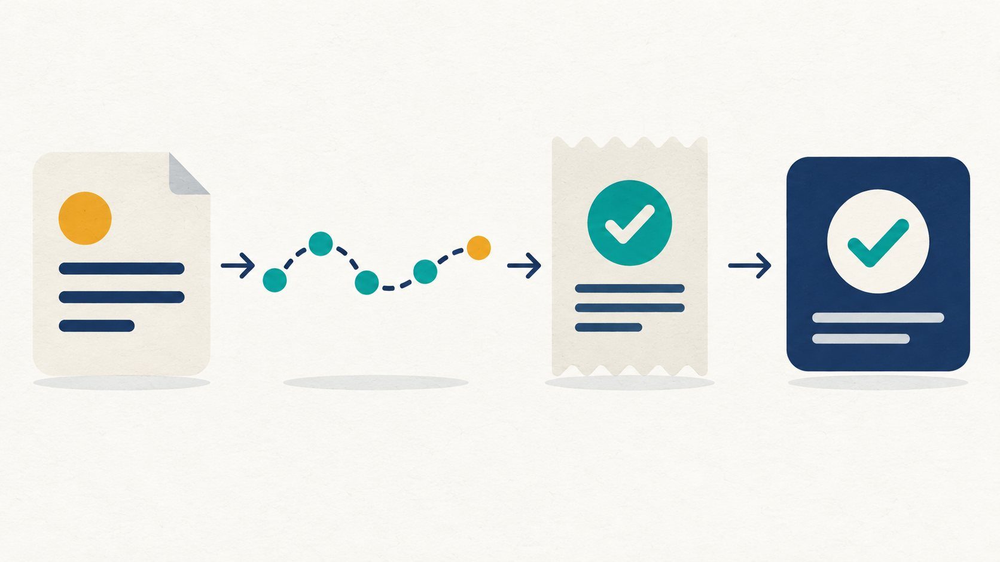

# Good Agent Evals Measure Work Done, Not Answers Given

*A practical guide to traces, outcomes, and evaluation-driven development—with Life Manager’s Writer pilot*

An agent can say, “I published the article,” and exit successfully. That still leaves important questions: Is the page live? Did a customer pay? Was the payment settled? What did the model and tools cost?

A useful agent evaluation answers each question from the right evidence. It connects the task, the agent’s actions, the outcome left in the world, and a rule for deciding whether that outcome counts as success.

Life Manager has specified this approach for evaluation-driven development, or EDD: turn real failures into repeatable cases, make one change, and check whether the change improves the result without breaking safety or economics.

## An eval is an agreement about what success means

Before running an agent, define the job and its success conditions. Then record the run and inspect the final state.

For a writing agent, “write an article” is a task. A draft that satisfies the brief is one outcome. A live page confirmed by the publisher is another. A customer payment with an official settlement record is an economic outcome. Those results belong in separate fields because each needs different evidence.

A clean task case says:

- **Starting state:** what the agent can see and use.
- **Goal:** what must be true when the task ends.
- **Allowed tools and limits:** permissions, budget, time, and retry cap.
- **Evidence:** the trace and authoritative records used by the grader.
- **Failure conditions:** what is a fail, what is unsafe, and what remains unknown.

This agreement makes an eval useful to the person fixing the system. It points to a specific failure and gives the developer a way to tell whether the repair worked.

## Logs, traces, observability, traceability, and evals answer different questions

- A **log** records an event, such as a quality gate returning FAIL.
- A **trace** shows the path of one run, such as research → draft → reader gate → publication check.
- **Observability** is the ability to investigate what happened using logs, metrics, and traces.
- **Traceability** connects a task to its run, release, evidence, receipt, and outcome so someone can reconstruct the result.
- An **eval** compares the observed result with the success conditions set before the run.

A health command is a useful entrance to this chain. Life Manager’s status, health, and doctor commands help identify owners, releases, and failures. They show system state; they do not prove that a customer’s work was completed or that money arrived.

The same distinction appears in distributed systems: OpenTelemetry defines common signals for logs, metrics, and traces. Those signals help explain a run, but an application still needs its own outcome grader.

## A small example: an unsupported claim should fail for a specific reason

Suppose a Writer draft says, “Customer purchases increased after the article was published.” The supplied evidence contains no purchase or settlement record.

A useful eval identifies the failure mode as an unsupported economic claim. The code grader can verify whether the cited receipt exists and matches the article and time period. A human or calibrated LLM judge may need to decide whether the article’s explanation accurately reflects the evidence.

The expected result is not simply “low quality.” It is: the claim has no supporting receipt, the article must not present it as fact, and revenue remains unknown. If a complete official sales readback covers the period and reports no sales, that is different from an unavailable or incomplete readback.

For an illustrative case, the result vector could be:

- Task completion: pass — a draft exists.
- Claim support: fail — the purchase claim has no evidence.
- Publication effect: unknown — no official publication readback was supplied.
- Settled net: unknown — no complete payment and cost record was supplied.

This is why a correct process result and a real-world business outcome cannot be collapsed into one score.

## Build evals from real failures, then use synthetic cases for boundaries

Begin by reading actual runs. Sample both successful and failed traces, note where the system broke, and group failures by observed cause. A taxonomy should use terms from the application: “unsupported purchase claim,” “draft hash changed after grading,” or “publication receipt belongs to another occurrence.” Generic labels such as “helpfulness” usually do not tell the repair owner what to change.

Then turn one observed failure into a case. Include a valid success example and a negative example. Synthetic cases are useful for rare safety and accounting boundaries, but label them as synthetic; they are not measurements of agent performance.

Separate cases used to tune the system from cases kept for final comparison. Public fixtures are useful regression tests, but calling a file held-out does not make it secret or independent. Freeze case, runner, grader, model, and release versions before comparing candidates. Repeat runs when model behavior is stochastic, and report the sample size and uncertainty.

## Use code for objective facts and judges for interpretation

Use deterministic graders wherever the answer can be checked directly:

- Does the output match the required schema?
- Is the receipt ID present and bound to the right task?
- Does the published URL resolve to the expected version?
- Is there a duplicate effect?
- Are revenue, refunds, fees, and costs complete for the same period and currency?

Use an LLM judge only for questions that require interpretation, such as whether a draft answers a reader’s question or whether a claim is supported by a cited passage. Test that judge against blind labels from a domain expert. Track false passes and false fails separately; a high overall agreement rate can hide one dangerous error class.

A judge is another component that can fail. If it misses a failure, record a grader error rather than blaming the agent. Keep the rubric versioned and do not let a candidate edit the grader or the held-out cases used to judge it.

## Measure the dimensions separately

A useful evaluation report can include several measures without forcing them into a single composite score:

- **Verified task completion:** completed tasks divided by assigned tasks. Keep failed, unknown, and invalid-environment cases visible in the denominator.
- **Effect integrity:** whether external actions have authoritative receipts and whether replay or duplicate effects are zero.
- **Economic outcome:** settled external revenue minus refunds, fees, and attributable actual costs for the same period.
- **Quality:** the task-specific reader, factual, or artifact criteria.
- **Time and cost:** wall-clock time and model, API, tool, and operating costs.
- **Human intervention:** who made a judgment or took an action, and how much time it required.

If a receipt or cost category is missing, net is unknown. Do not convert missing evidence into zero.

## Self-healing and self-improvement use the same loop for different purposes

**Self-healing asks whether the system recovered safely after a failure.** Measure the recovery result, recurrence, duplicate effects, recovery time, and human intervention. A restart or safe hold is not automatically task completion.

**Self-improvement asks whether a change makes a working system better.** Generate one candidate change, compare it with a frozen baseline under the same task, tools, budget, and grader, then promote only a candidate that passes quality and safety gates. Compare settled net only when revenue and cost coverage are complete.

In either case, an unknown external effect stays fenced until an official readback resolves it. An eval must never cause a second payment, publication, or application simply to get another trial.

## Existing benchmarks cover important parts of the problem

There is substantial prior work. Benchmarks such as GAIA test general assistant tasks; GDPval tests professional work products; AutomationBench and TheAgentCompany test work in simulated business tools; Vending-Bench 2 studies long-running business decisions in a simulation; and Project Vend documents a real-world vending experiment with human involvement.

These are useful foundations, and Life Manager should reuse their lessons. They measure different environments and claims. A simulated sale is not a settled customer payment. A good work product is not a verified business outcome. A real-world experiment with human help is not a zero-intervention result.

Life Manager’s hypothesis is narrower: connect a human-relevant task to a trace, authoritative external outcome, cost coverage, and intervention record. The project has not yet shown that this adds a reliable, generalizable benchmark result.

## Life Manager is starting with one Writer workflow

Life Manager’s main catalog contains 18 business and platform agents. We compared the catalog’s job counts and economic adapter status with existing evaluation and recovery code. The catalog describes code coverage, not live sales or production performance.

The first method pilot is **one Writer article, in one language and one publication channel, at the pre-publication quality stage**. Writer already has quality gates, hash-bound run artifacts, bounded recovery, and baseline/candidate experiment code. The slice can be repeated before publishing anything.

The strongest economic alternative is Agent Economy. Its catalog lists revenue, financial, and cost adapters as implemented, but the lane spans 19 jobs and its current plan places TaskMarket’s external-reward proof later. It is too broad for the first method pilot. PromptBase has one job but its financial and cost adapters are missing. Connector is small and has clear registration outcomes, but it is non-economic. Coconala’s adapters are more complete in the catalog, but its seven-job contract lifecycle includes more external effects and provider waiting.

Writer is the most prepared **evaluation-method slice**, not the simplest whole business and not a proven profit engine. Its financial and cost adapters remain partial. A quality PASS cannot be reported as revenue or net improvement.

The complete catalog lists every agent and adapter status:

1. Gig — Coconala: 7 jobs; funnel, financial, and cost adapters implemented.
2. Gig — Lancers: 7 jobs; all three adapters implemented.
3. Gig — CrowdWorks: 5 jobs; all three adapters implemented.
4. Gig — Mercor: 3 jobs; all three adapters partial.
5. PromptBase: 1 job; funnel partial, financial and cost adapters missing.
6. Writer: 7 jobs; funnel implemented, financial and cost adapters partial.
7. Affiliate: 6 jobs; funnel implemented, financial and cost adapters missing.
8. Investment: 4 jobs; funnel implemented, financial and cost adapters partial.
9. Agent Economy: 19 jobs; all three adapters implemented.
10. Job Hunter: 4 catalog jobs; all three adapters partial.
11. Fundraiser: 1 job; funnel implemented, financial and cost adapters missing.
12. Connector: 1 job; economic accounting is not applicable.
13. Self-Build / Product Improvement: 4 jobs; funnel partial, financial and cost adapters missing.
14. Mobile App Loops: 23 jobs; funnel implemented, financial and cost adapters missing.
15. eBook: 4 jobs; funnel partial, financial missing, cost partial.
16. Capafy: 11 jobs; funnel implemented, financial and cost adapters missing.
17. LINE Sticker: 3 jobs; funnel implemented, financial and cost adapters missing.
18. CFO: 3 jobs; portfolio aggregator, not an earning agent.

## Current evaluation status: contract checks exist; performance evidence does not

The LM-EAB evaluator currently contains five public synthetic fixtures: three tuning cases and two labeled held-out cases. Its offline runner checks economic-record and autonomy-scoring contracts. It does not execute an agent, earn money, measure natural-task performance, or provide a secret test set.

Within the EDD workstream, E01 begins by confirming that the merged missing-net fix is loaded in its main-derived release and then running the natural evaluation. The current unified SSOT still places capacity recovery and the remaining agent repairs ahead of EDD; that canonical cursor controls execution order. E02 connects recovery and economic evals to natural failures and CFO receipts. E03 adds natural task families. E04 freezes cases, graders, baselines, splits, and calibration. E05 checks a second harness. E06 publishes the task method, results, and limits. The roadmap also keeps H01–H04 for self-healing and I01–I04 for bounded self-improvement.

## The atomic roadmap

1. **E01 — Adopt and observe.** Confirm the missing-net fix is loaded; verify that missing or invalid net remains unknown in a natural evaluation.
2. **Review Writer traces.** Reuse the existing owner and lease. Select one pre-publication slice and read a representative mix of successful and failed natural runs.
3. **Classify one failure.** Write the failure taxonomy from observed traces, then choose one failure class for the first case.
4. **E02 — Join task and outcome.** Connect run, release, effect, official publisher receipt, and CFO fields. Keep completion, effect integrity, settled net, cost, latency, and human intervention separate.
5. **E03 — Add cases.** Turn the observed Writer failure into an eval case with a valid success example, a failure example, and provenance. Keep synthetic boundary cases labeled synthetic.
6. **E04 — Freeze the comparison.** Version and hash case, runner, grader, baseline, model, and toolchain. Keep tuning, development, held-out, and challenge splits separate. Calibrate subjective judges against expert labels.
7. **Run the baseline.** Repeat each case at least three times under the same model, tools, and budget. Report the sample size and variation.
8. **Add the regression.** Confirm the observed failure fails before the fix. Make the smallest source change, rerun the same case, then run the related acceptance checks and CI.
9. **H01–H04 — Prove self-healing.** Bind a natural failure to an owner-scoped recovery intent, resolve unknown external effects by official readback without replay, and verify the next natural outcome.
10. **I01–I04 — Prove bounded improvement.** Change one candidate variable, compare with the frozen baseline, canary only after offline gates pass, and retain or roll back from natural evidence.
11. **E05 — Reproduce elsewhere.** Run the same versioned cases in a second harness and document any differences.
12. **E06 — Publish limits and results.** Release the task authoring guide, grader, dataset split policy, measured results, uncertainty, and limitations. Record independent lab use only when it can be cited or reproduced.

## What would make labs use it?

A well-designed case is necessary, but adoption is an external outcome. Researchers need stable tasks, documented tool and budget conditions, graders that agree with expert labels, versioned data splits, cost-complete real outcomes where appropriate, and results that another team can reproduce. Public task definitions should be safe and representative; held-out challenges need separate governance.

The strongest success signal would be independent teams obtaining comparable results on the same versioned suite and using those results in model or agent evaluations. Publishing this article or a code repository alone does not establish adoption. “Leading benchmark” remains a goal until that evidence exists.

## Sources and implementation references

- Anthropic, [Demystifying evals for AI agents](https://www.anthropic.com/engineering/demystifying-evals-for-ai-agents).
- OpenAI, [Evaluation best practices](https://developers.openai.com/api/docs/guides/evaluation-best-practices).
- OpenTelemetry, [Observability primer](https://opentelemetry.io/docs/concepts/observability-primer/).
- [AutomationBench](https://github.com/zapier/AutomationBench), [GDPval](https://openai.com/index/gdpval/), [GAIA](https://arxiv.org/abs/2311.12983), [TheAgentCompany](https://github.com/TheAgentCompany/TheAgentCompany), [Vending-Bench 2](https://andonlabs.com/evals/vending-bench-2), [Project Vend](https://www.anthropic.com/research/project-vend-1), and [METR task horizon](https://metr.org/blog/2025-03-19-measuring-ai-ability-to-complete-long-tasks/).
- Evaluation tools: [Inspect AI](https://inspect.aisi.org.uk/), [Langfuse](https://langfuse.com/docs/evaluation/overview), [Braintrust](https://www.braintrust.dev/docs/evaluate), and [Phoenix](https://arize.com/docs/phoenix/evaluation/llm-evals).
- Life Manager source snapshot 5d158f51: [18-agent catalog](https://github.com/Daisuke134/life-manager/blob/5d158f51d432bafc10c6df8cf5d54247288a759b/apps/life-manager/config/product-loop-catalog.json), [LM-EAB guide](https://github.com/Daisuke134/life-manager/blob/5d158f51d432bafc10c6df8cf5d54247288a759b/docs/evals/lm-economic-autonomy.md), [Writer eval gate](https://github.com/Daisuke134/life-manager/blob/5d158f51d432bafc10c6df8cf5d54247288a759b/skills/writer-agent/scripts/eval-gate.sh), [bounded quality recovery](https://github.com/Daisuke134/life-manager/blob/5d158f51d432bafc10c6df8cf5d54247288a759b/skills/writer-agent/scripts/quality_self_heal.py), [candidate experiment](https://github.com/Daisuke134/life-manager/blob/5d158f51d432bafc10c6df8cf5d54247288a759b/skills/writer-agent/scripts/writer_learning_experiment.py), and [unified SSOT](https://github.com/Daisuke134/life-manager/blob/5d158f51d432bafc10c6df8cf5d54247288a759b/docs/superpowers/specs/2026-09-25-life-manager-unified-ssot.md).
