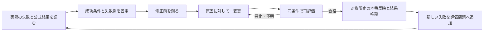

# 評価駆動開発と経済自律ベンチマークを理解する

## この文書の役割

Daisとの議論用の一次資料調査・説明。実装、production mutation、既存laneの順序変更は行わない。状態と実行順の正本は [統一SSOT](../superpowers/specs/2026-09-25-life-manager-unified-ssot.md)。設計は [EDD pilot spec](../superpowers/specs/2026-10-12-edd-recovery-pilot-design.md)、実装前の計画案は [pilot plan](../superpowers/plans/2026-10-12-edd-recovery-pilot.md)。

## まず結論

推奨は「全18業務を直してから評価」ではなく「実際の失敗を評価問題に変え、修正の前後を比較する」。公開ベンチマークへの投資は、その評価から他者にも再現できる問題が生まれてから増やす。評価だけでバグが直るわけではなく、診断・修正・反映を結ぶ測定方法になる。

長期の問いは「与えられた権限・予算・時間の中で、追加の人手なしにどれだけ検証可能な成果を完了できるか」。最初は経済業務を対象にする。収益は一つの測定軸であり、AGIの証明や人生全体の健全性と同一視しない。

「評価不足が五日間の遅れの主原因」は現時点では仮説。個々の失敗はコード、容量、認証、外部quota、会計根拠、release adoptionなどを診断して確かめる。評価を入れると修復時間・再発・改悪が減るかも測定対象にする。

## 基礎用語

| 用語 | 普通の言葉 | Life Managerでの例 |
|---|---|---|
| eval | 成功条件を決めて実行・採点する試験 | 送信後の応答欠落で二重送信せず状況を照合できるか |
| benchmark | 他者も同条件で比較できる共通試験 | 同じ問題群を異なるモデル・agentに渡す |
| task / case | 一問。初期状態、目的、制約、終わり方を定義 | 既に送信済みだがローカルでは未確認の注文 |
| trial | 一問を一度試すこと | 状態をリセットして同じ問題を別の試行として解く |
| trace | 何を入力され、どのtoolを使い、何が返ったかの記録 | 送信→timeout→公式履歴の取得 |
| outcome | 環境に実際に残った結果 | メッセージが一通だけ存在する |
| grader | 採点器 | 公式記録の一致、重複件数、費用の完全性を検査 |
| agent harness | モデルに道具・状態・実行機会を与える仕組み | Life Managerのtool、memory、loop |
| evaluation harness | 問題を準備し、agentを動かし、採点・記録する仕組み | task初期化→実行→結果収集→grader |
| baseline / candidate | 比較の基準 / 変更候補 | 現在release / 一箇所直したrelease |
| regression eval | できていたことが壊れない試験 | timeout修正で通常送信が壊れない |
| capability eval | 今までできなかったことへの試験 | 不明状態を照合して業務を再開する |
| held-out | 調整に使わない、別管理の試験 | 修正担当に解答を渡さない新しい障害例 |
| calibration | 採点が専門家の判断と合うかの点検 | 妥当な納品をAI採点器が落とさないか |
| contamination / overfitting | 答えの漏れ / 練習問題だけへの最適化 | 公開fixtureを暗記して未知の障害に失敗 |

コードのテストとevalは対立しない。決定的な関数のテストから、確率的なagentの完走評価まで連続している。普通のテストにも業務成果の検証は含められる。「テストは正しさ、evalは結果」という固定的区別はしない。

## EDDの一周

例: 送信toolがtimeoutした。実際には届いたかもしれない。成功条件は「再送しない」だけでなく「公式履歴で対象を特定し、送信済みなら重複を作らず処理を進める」。公式履歴も不明なら、安全維持は合格できるが、業務完了は未確認のまま。何もしないagentが満点になる設計を避ける。

評価器は診断・修正を行わない。自己修復は失敗を診断し回復処理を行う。自己改善は候補を作り、固定した評価で比較し、改善を確認した候補を採用する。prompt/tool/手順の改善は、モデルの重みを学習し直すこととは別。

## AI labによる採用を確認した資料

調査時点で公開されている公式ページを確認した。全labの非公開評価やすべての最新system cardを網羅したとは主張しない。版・harness・effortが違う得点を横に並べて順位を作らない。

| 公式出所 | 確認できた評価の例 | 意味 |
|---|---|---|
| [Anthropic Sonnet 5.5](https://www.anthropic.com/claude-sonnet-5-5) / [Opus 5.5](https://www.anthropic.com/claude-opus-5-5) | Terminal-Bench 4.0、GDPval-AA v2.1、OSWorld 2.1、AutomationBench、AA-Briefcase | terminal、職業成果、computer use、業務連携、長期知識業務 |
| [Google Gemini 4 Argon](https://deepmind.google/models/gemini/) / [発表](https://blog.google/innovation-and-ai/models-and-research/gemini-models/gemini-4-argon/) | Vals Index、AutomationBench、DeepSWE v1.1、FrontierSWE v2、Terminal-Bench 4.0、Agent’s Last Exam、OSWorld-2.0 | 経済領域・業務完走・長期coding・computer use |
| [OpenAI GDPval](https://openai.com/index/gdpval/) | OpenAI自身が作成・評価するGDPval | 職業上の成果物。実入金の試験ではない |
| [OpenAI GPT-5発表](https://openai.com/index/introducing-gpt-5/) | SWE-bench Verified、AIME、GPQA、MMMU、HealthBench | 採用履歴の根拠。最新GPT-6の評価一覧として扱わない |
| [OpenAI GPT-6最新発表](https://openai.com/index/gpt-6-for-everyone/) | 日常agentic task等の内部評価への言及 | 取得本文だけでは最新の外部benchmark一覧を確定できない |

GDPvalとGDPval-AAは同じ名称の版違いとして混同しない。前者はOpenAIの職業task、後者はArtificial Analysisによる評価で、発表にはElo等の別の採点体系がある。

## Life Managerに近い先行研究と再利用判断

| 先行例・一次資料 | 何を測るか | 再利用する知見 | 我々が追加検証する境界 |
|---|---|---|---|
| [AutomationBench](https://github.com/zapier/AutomationBench) / [論文](https://arxiv.org/abs/2604.18934) | 47の模擬SaaS toolを使う業務。publicは6領域600問、基礎200問は総合点対象外 | 初期state→tool→終状態assertion、禁止変更の検査、public/private分離 | 自然障害からの回復、実receiptと完全実費、介入分類。すでにno-user-interactionを扱うため、その概念の新規性は主張できない |
| [GDPval](https://openai.com/index/gdpval/) | 44職種の成果物。公開gold setは220問。専門家によるblind比較 | 現実の仕事、専門家の基準、納品物の品質 | 顧客獲得・入金・継続業務・回復は別に測る |
| [Vals Index](https://www.vals.ai/benchmarks/vals_index) | finance/coding/legal/taxの評価をGDP比で集約 | 能力・費用・速度を表示、領域別の検証 | GDP重みは経済効果のproxyで、個人の実利益ではない |
| [TheAgentCompany](https://github.com/TheAgentCompany/TheAgentCompany) | 模擬会社で複数サービスを使って仕事を完了 | 再現環境、task別grader、別agentでの実行 | simulationの仕事完了と実取引は区別。既存環境を即座に本hostへ入れない |
| [τ2-bench](https://github.com/sierra-research/tau2-bench) | user・agent・toolの協働と方針遵守 | 状態と対話を分離、繰返しの信頼性 | user simulatorがいるtaskを人の追加操作ゼロと同一視しない |
| [GAIA](https://arxiv.org/abs/2311.12983) | reasoning・web・multimodal・toolを使う一般assistantの質問 | 解くのは難しいが正解は検証しやすい問題 | 質問の回答と長期運営・実経済成果は別 |
| [METR task horizon](https://metr.org/blog/2025-03-19-measuring-ai-ability-to-complete-long-tasks/) | 人間が要するtask時間とagent成功確率の関係 | 問題の難しさ、50%等の成功率、長期taskの考え方 | horizonはagentの稼働時間や人生管理能力そのものではない |
| [Vending-Bench 2](https://andonlabs.com/evals/vending-bench-2) | 模擬一年の自販機事業、終残高、長期一貫性 | 記憶、計画、価格、経済状態の持続的変化 | 模擬利益と実入金を分け、simulationの攻略を実能力と取り違えない |
| [Project Vend](https://www.anthropic.com/research/project-vend-1) | 実店舗運営の実験 | 現実世界で起きる価格・在庫・交渉の失敗 | 補充などを人が実施。厳密な完全無人試験ではない |
| [ClawWork](https://github.com/HKUDS/ClawWork) | GDPval仕事、品質、token/API費用、経済的生存 | 成果物+費用の比較、軌跡の可視化 | paymentは品質と推定時間・BLS賃金から計算。実顧客settlementの証拠ではない |
| [Prosus Vending Bench](https://github.com/ProsusAI/vending-bench) | OSSのseed付き長期事業simulation、MCP/Harbor task | open simulator、reference operator、seedと費用の公開 | AndonのVending-Bench 2とは別実装。模擬貨幣とAPI実費を分離 |

AutomationBenchのREADME・Calendar assertion実装も確認した。event存在だけでなく正確な件数、重複時間帯、無変更等をstateから検査する。original code等はMITだが、第三者API schemaに第三者の権利まで付与するものではない（[LICENSE](https://github.com/zapier/AutomationBench/blob/main/LICENSE)）。実際の移植時はversion・license・対象taskを固定する。

## frameworkと自己改善の道具を混同しない

[Inspect AI](https://inspect.aisi.org.uk/)は問題・agent・tool・graderを接続する評価frameworkで、人生管理の試験問題そのものではない。[GEPA](https://github.com/gepa-ai/gepa) / [論文](https://arxiv.org/abs/2507.19457)はtraceのfeedbackから候補prompt等を改善するoptimizerで、何を成功とするかを代わりに決める道具ではない。

repoには既存NodeのLM-EAB scorer、recovery intent/apply/supervisor、`skills/earn/self-improve/evaluator.py` と `run_evolve.sh` のOpenEvolve経路がある。ソース存在は自然自己改善の成功証明ではない。今回のpilotは新framework・optimizerを追加しない。既存recovery testがすでにhold/nonretryable/no commands/owner拒否を検査するため、新wrapperによる再包装も追加しない。最初の足場は自然失敗一件と既存testのcoverage対応表である。Inspect/GEPAは将来の接続障害・探索需要が具体化したときの候補。

## 現行LM-EABの実態

読んだbaseは `dcc02a56ed1c80f824d917c02304a57376ec3de5`。`apps/life-manager/eval/economic-autonomy/cases.jsonl` は5件（tuning3、held_out2）。[現在の説明](../evals/lm-economic-autonomy.md)のとおり全部公開synthetic。

`run.js` は固定fixtureをhash照合し `scoreEconomicAutonomy` の期待結果と比較する。モデルを呼ばず、実業務を実行しない。runの日時も固定値。これは会計/evidence/autonomyの採点契約検査で、agentの能力比較ではない。`eligible=true` も収益成功を意味しない。

公開 `held_out` はラベルであり秘密の未見試験ではない。モデル順位には別管理の未使用task、agent実行adapter、複数trial、費用・不確かさが必要。

`runtime/loop/self-eval.mjs` の欠測net→0は最新mainでは修正済み。unknownCountとnet=nullを使いDEAD/WORKSを抑制する。古いsnapshotの不具合を新たな未修正taskとして提案しない。production adoptionは今回確認していない。

## 何を点数にするか

最初の主指標は「指定taskの自律完了率」。安全/権限違反は別の必須検査。settled net、費用、時間、人の介入、外部AI修理、重複操作を別に表示する。unknownを0に変えず、未確認件数と理由を見せる。unknownを除外して成功率を膨らませない。母数は事前指定のassigned tasks、verified completed / assigned を主表示し、failed/unknown/invalid-environmentの内訳も示す。

お金は `settled収入 − 返金 − fee − model/tool/API費用 − 運営費`。どれか欠ければ実利益はunknown。同じ元手・期間・tool・権限・harnessで比較する。資金注入・自己購入・既存顧客基盤をモデルの能力に帰属させない。

一回きり成功する能力と、毎回成功する信頼性は違う。独立試行の仮定下で一回の成功率80%なら10回すべて成功は約11%。これは説明用算数でLife Manager実測ではない。pass@kはk回で最低一回成功、pass^kは全k回成功。相関のある連続業務へ独立式をそのまま適用しない。

## no human in the loopの定義

評価開始前の初回設定・同意・credential準備と、開始後の判断・操作を分ける。既存 `one_shot_onboarding` と `agent_native` を混ぜない。予定したLife Managerの構成agentはsystemの一部だが、試験中に外からCodexが原因修正・再起動したら無人完了として数えない。採点器を較正する専門家はtaskを代行しないため、試験中の介入とは別。

「人生へのimpact」は単一の自然な単位を持たない。予定管理なら約束を守れたか、経済なら費用後成果、wellbeingなら同意済み縦断outcomeを定義する。これらを未定義の一つのAGI点へ足さない。

## 採用されるbenchmarkに必要なこと

差別化仮説は「追加の人手なしの業務完走に、回復・effect integrity・cost-complete outcomeを接続する」。新規性は外部反証前には未確定。

labにとって有用な理由は、新モデルの能力差を信頼できる条件で検出できること。実務的に重要なのは、妥当なtask、gradeの正確さ、比較条件の固定、費用と実行時間、未見task、異なるharnessでの再現、継続メンテナンス。

開発用の速い再現試験と、real-worldの遅い成果確認を併用する。模擬試験でモデル比較を行い、現実との対応は別の検証で調べる。実店舗/実決済だけで毎モデルを比較する方式は、市場・時期・顧客・資本の差が混ざりやすい。

採用までのmilestone: 内部で修復に役立つ一問→一般化したtask family→別harness baseline→固定版と未見task→独立2チーム以上の再現→外部利用の継続証拠。公開やGitHub starだけで「leading」と呼ばない。lab採用・収益化は保証しない。

## 判断と限界

推奨: 修復と一緒に最小EDDを始め、公開benchmarkは再利用+限定拡張で育てる。

best: 同じ失敗の再発と改悪を早く検出でき、他者も使うtask familyになる。base: 内部修復には効くが、外部採用は限定的。worst: 模擬環境だけに最適化され、実業務は改善しない。

棄却案の最強の論拠: 「容量・認証・releaseが壊れているなら評価より先に直すべき」。その通りの障害ではownerの修復を優先するが、同じ障害の再現試験を並行して残せる。全lane完了待ちは不要。

自分が間違うとしたら最有力の筋: 共通障害の大部分が外部資源の不足で、agent判断の比較評価より資源復旧の方が短期成果を改善する場合。pilotでは修復時間・再発・業務完了で確かめる。

## 取得の限界と訂正

DuckDuckGo HTML検索は結果anchorを取得できず、公式news/modelページとGitHub検索・rawを代替に使用。指定候補OpenAI Astra URLは空本文、Zapier blog URLは404だったが、OpenAI最新発表、Zapier公式GitHub・benchmark page・論文から目的に必要な内容を取得した。未取得を成功扱いしない。

提示されていたRSI-Anything（2610.13912）やMASSの具体的結論は今回確認していないため設計根拠にしない。「全事故が評価不足」「週30分で十分」「7日売上50%で自動rollback」「fixtureを自然traceで置換すれば完成」は採らない。評価の反復実行と判定再現性は区別する。確率的judgeでも較正・反復を伴えばevalとして使える。

方法論の一次資料: [Anthropic agent evals](https://www.anthropic.com/engineering/demystifying-evals-for-ai-agents)、[OpenAI evaluation best practices](https://developers.openai.com/api/docs/guides/evaluation-best-practices)、[Hamel product evals](https://hamel.dev/blog/posts/evals/)、[Hamel FAQ](https://hamel.dev/blog/posts/evals-faq/)。Hamelの推奨は著者自身が万能則でないと明示している。
