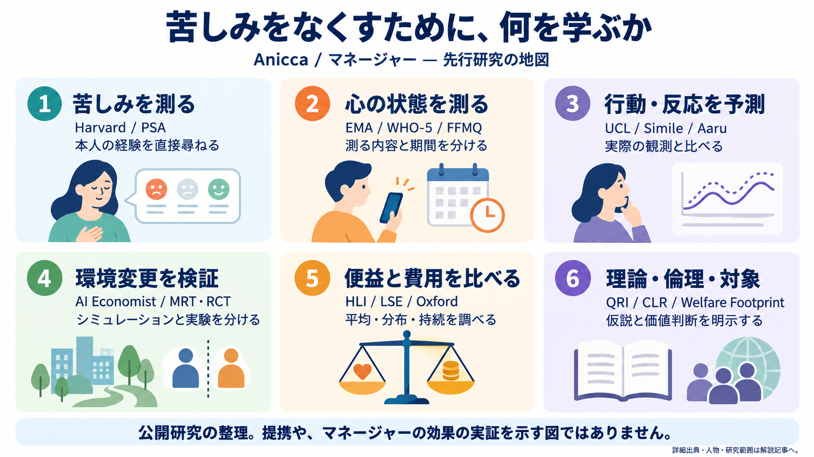

# 苦しみを測る研究とマネージャーの協働候補

調査基準日：2026年10月18日。Aniccaのミッションは **End suffering.**。以下は、その構想の一部である測定と介入を、公開研究から検討した調査資料である。製品の実装済み機能や効果を示す資料ではない。進捗の正本は既存の統合SSOTにある。

測定設計の最初の共同研究先には、Human Flourishing ProgramのTyler VanderWeeleとRichard Cowdenらを薦める。Personal Suffering Assessment（PSA）は、苦しみそのものを本人に尋ねる尺度であり、不安や幸福度だけでは拾えない領域を検討できる。ただし、自己報告を生物種横断の苦痛計にできるという意味ではない。WHO-5と短い日常記録を併用し、職場など共有環境を変えた際に、何が改善し、誰の苦しみが残ったかを調べる用途が初期候補になる。[公式の測定解説](https://hfh.fas.harvard.edu/measuring-flourishing)

図は研究系統を整理した概念図で、曲線やアイコンは実測データではない。提携、研究者間の直接の影響関係、マネージャーの実証済みの効果を示していない。各項目の根拠と対象範囲は以下に記す。

## 測れるものを分ける

苦しみには単一の確定した操作的定義、つまり「この観察手順なら苦しみの量が決まる」という合意済みの定義がない。このため、次の指標を別々に報告する。代理指標が改善したことと、ミッションの達成は同じではない。

| 分類 | 何を測るか | 読み違えやすい点 |
|---|---|---|
| 苦しみの自己報告 | PSAなどで、本人が経験する苦しみを尋ねる | 答え方、文化、期間の影響がある。他者や動物にそのまま適用できない |
| ウェルビーイングの自己報告 | WHO-5の肯定的な心の状態、生活満足度、PANASの感情 | 幸福の高さと、激しい苦しみがないことは別の問い |
| 臨床スクリーニング | PHQ-9の抑うつ症状、GAD-7の不安症状 | スクリーニングは診断の必要性を検討する入口。総点だけで診断しない |
| 経験サンプリング | EMA／ESMで日常のその時々の感情・状況を繰り返し尋ねる | EMAは生態学的瞬間評価、ESMは経験サンプリング法。回顧誤差を減らせても自己報告であり、回答負担と欠測がある |
| マインドフルネスの自己報告 | FFMQ、MAASで注意・気づきなどの傾向を尋ねる | 瞑想時間、脳活動、苦しみの減少そのものは測らない |
| 生理・神経指標 | EEG、fMRI、心拍変動、皮膚電気活動など | 覚醒、運動、呼吸などにも変動する。普遍的な苦しみの客観測定器は確認できない |
| 倫理・意思決定 | WELLBYによる集計、苦しみ重視の倫理 | 集計に使う尺度の仮定、重い苦しみと小さな改善を交換してよいかという価値判断が残る |
| 介入効果 | 比較試験で、環境や行動の変更後の差を調べる | 相関、前後差、ランダム化比較試験（RCT）の因果的な強さを区別する |

## 選定した22の研究系統・組織

番号は参照用であり、実力の順位ではない。歴史的な尺度の開発者と、現在接触できる組織を区別した。論文の公開と、データ・コードを自由に再利用できることも区別する。

### 1. Human Flourishing Program／Tyler J. VanderWeele・Richard G. Cowdenら

Harvardの学際的な研究プログラム。VanderWeeleの2019年論文 *Suffering and response: directions in empirical research* がPSAの概念と項目を示す。公式ページは、Sri Lankaの工場労働者1,200人超と国際線客室乗務員5,000人超のデータ、および内的一貫性を報告する。内的一貫性は、尺度の項目が互いに整合する程度であり、真の苦しみを完全に測れている証明ではない。Ho・CowdenらのIndonesia研究は、成人594人、2020年12月から2021年2月の3時点の観察研究で、苦しみ、心理的苦痛、複数のウェルビーイング領域の関連を調べた。介入効果の検証ではない。[尺度・2019年文献](https://hfh.fas.harvard.edu/measuring-flourishing)、[前向きコホート研究の書誌・抄録](https://pubmed.ncbi.nlm.nih.gov/35244330/)

マネージャーとの接点は、直接的な苦しみの自己報告を、症状や満足度と混同せずに設計すること。最初に相談したい内容は、日本語版の妥当性、反復測定への適性、変化を検出する力、重い苦しみを平均で消さない集計である。尺度本文・既存調査はあるが、本調査ではPSAの商用再利用許諾と日本語の検証済み版を確認していない。公式ページにあるFlourishing IndexのCC-BY-NC／商用ライセンスの記載をPSAの許諾へ流用しない。公開窓口は[公式Contact Us](https://hfh.fas.harvard.edu/)から辿る。

### 2. WHO／WHO-5

WHOが2024年10月2日に公表した文書は、過去2週間の肯定的な心の状態を5項目で尋ねるWHO-5を説明する。短い反復調査の候補になる。低い得点は追加評価を考える材料だが、苦しみの全領域や精神疾患の確定診断は表さない。公開文書と各言語版が再利用の出発点となり、使用する版と利用条件を固定する。マネージャーではPSAと併記し、日常の苦しみと肯定的な状態を別々に追う。[公式文書・入手先・WHO窓口](https://www.who.int/publications/m/item/WHO-UCN-MSD-MHE-2024.01)

### 3. Kurt Kroenke・Robert Spitzer・Janet Williams・Bernd Löwe／PHQ-9・GAD-7

PHQ-9はKroenkeらの2001年研究、GAD-7はSpitzerらの2006年研究が主要な開発・検証文献である。PHQ-9は抑うつ症状、GAD-7は不安症状を、主に過去2週間について本人に尋ねる。PHQ-9原著の対象はプライマリケア等の6,000人であり、全生物の苦しみを検証した研究ではない。[PHQ-9原著](https://pmc.ncbi.nlm.nih.gov/articles/PMC1495268/)、[GAD-7原著](https://jamanetwork.com/journals/jamainternalmedicine/fullarticle/410326)

臨床・研究連携時の共通指標として有用。自殺に関するPHQ-9の項目を含める場合は、回答後の対応を設計せずに収集だけを始めない。質問票が公開されていても、自作の短縮・訳文に原尺度の検証結果を引き継がせない。連絡候補は存命の共同研究者の所属機関を通じる。[RegenstriefのKroenke公式情報](https://www.regenstrief.org/person/kurt-kroenke/)を現在の窓口確認の起点とし、2001年論文中の住所・メールを現在の連絡先として扱わない。

### 4. Sheldon Cohenら／Perceived Stress Scale（PSS）

Cohen・Kamarck・Mermelsteinの1983年論文が出発点。PSSは、生活がどれほど予測不能・制御困難・負担過多に感じられるかを測る。一般的なPSS-10の回顧期間は過去1か月。環境の負荷を本人がどう受け止めたかを調べられるが、外的ストレス要因の客観量や疾病診断ではない。[CMU所蔵の原著](https://kilthub.cmu.edu/articles/journal_contribution/A_Global_Measure_of_Perceived_Stress/6613130)

共有環境への介入を検討するマネージャーと関係が深い。ただし、直近数分の変化を原版のPSS総点で測る設計は期間が合わない。CMUの現行ページは利用許諾の窓口としてMAPI Research TrustのePROVIDEを案内し、翻訳の権利は翻訳者に属すると明記する。[公式尺度・許諾窓口](https://www.cmu.edu/dietrich/psychology/stress-immunity-disease-lab/scales/index.html)

### 5. David Watson・Lee Anna Clark・Auke Tellegen／PANAS

1988年のPANAS原著は、肯定的感情と否定的感情を別の下位尺度で測る方法を示した。両者を一本の幸福・苦痛軸へ単純に反転しない。指定する回顧期間によって、現在の状態にも比較的持続する傾向にも使われるため、比較時には教示を揃える。[原著の書誌・抄録](https://pubmed.ncbi.nlm.nih.gov/3397865/)

マネージャーでは、介入後に肯定的感情が増えても否定的感情が残る場合を識別する候補。日常記録へ項目を抜き出すなら別尺度として扱う。項目・使用条件の確認と研究連携の入口は[NIHの公式測定情報](https://cancercontrol.cancer.gov/brp/research/group-evaluated-measures/adopt/positive-negative-affect-schedule)。本調査では開発者個人の現在の連絡経路と実装用コードを確認していない。

### 6. Daniel Kahneman・Alan Krueger・Norbert Schwarz・Arthur Stoneら／日常経験の測定

Kahnemanらの2004年のDay Reconstruction Method（DRM、前日の活動をエピソードごとに再構成する方法）は、時間の使い方と、その場面の感情を結びつける。生活全体の評価と、経験している時の感情を区別する研究系統である。DRMは回顧的な方法なので、リアルタイムのEMAと同一ではない。[原著](https://pubmed.ncbi.nlm.nih.gov/15576620/)、[Princetonの著者論文集](https://kahneman.scholar.princeton.edu/publications)

マネージャーには「どの環境で、どの時間帯に苦しみが増えるか」という測定単位を与える。Kahnemanは2024年、Kruegerは2019年に亡くなっているため、歴史的な研究者として扱い、出演依頼の候補にはしない。[PrincetonのKahneman追悼](https://behavioralpolicy.princeton.edu/news/DanielKahneman)、[Krueger追悼](https://irs.princeton.edu/news/2019/alan-krueger-long-time-princeton-economist-and-industrial-relations-section-affiliate)。接触候補は現役の共同研究者・後継チームで、[Princeton Survey Research Center](https://psrc.princeton.edu/publications/survey-method-characterizing-daily-life-experience-day-reconstruction-method)など所属機関の窓口を使う。原研究の質問票と公開資料は参照できるが、特定集団の経験を別集団へそのまま移さない。

### 7. ESMira／Karl Landsteiner University系の心理学的方法論チーム

ESMiraはESM／EMAの反復調査を行うためのオープンソースのサーバー・携帯アプリ。2023年の方法論論文と著者リポジトリが公開されている。苦しみを自動推定するモデルではなく、研究者が決めた質問を適切な時点で集める道具である。[論文](https://doi.org/10.3758/s13428-023-02194-2)、[著者コード・Issue窓口](https://github.com/KL-Psychological-Methodology/ESMira)

マネージャーでは、測定基盤を新規開発する前に再利用を比較したい候補。負担、通知の見落とし、苦しい時ほど答えない欠測を記録する。確認時点のリポジトリ表示はAGPL-3.0。自社コードへ組み込む場合と、独立した調査基盤として使う場合の条件を区別し、採用時点のライセンス、導入条件、保持する情報を確認する。公開データの候補には[openESM](https://openesmdata.org/)もあるが、各データセットの同意・ライセンスは個別に異なる。

### 8. Ruth Baer／FFMQ、Kirk Warren Brown・Richard Ryan／MAAS

FFMQは観察、描写、意識した行動、内的経験への非判断、非反応性など、マインドフルネスの複数の側面を自己報告で測る。MAASは日常の注意と気づきの傾向を中心に測る。主要な開発文献はFFMQが2006年、MAASが2003年。瞑想経験者と未経験者で項目の意味や因子構造が異なり得ることは、Baerらの2008年検証を含めて検討すべき点になる。[FFMQ開発](https://pubmed.ncbi.nlm.nih.gov/16443717/)、[2008年検証](https://pubmed.ncbi.nlm.nih.gov/18310597/)、[MAAS開発](https://pubmed.ncbi.nlm.nih.gov/12703651/)

マネージャーでの用途は、介入が作用する過程の補助指標である。FFMQが上がっただけで苦しみが減ったとは結論しない。公開論文に項目情報はあるが、今回は日本語版の許諾と実装用コードを確認していない。連携窓口は、[BaerのOxford公式プロフィール](https://www.psych.ox.ac.uk/team/ruth-baer)が公開するruth.baer@psych.ox.ac.ukなど、現行所属の公式ページで確認する。

### 9. LSE Centre for Economic Performance／Richard Layardら

Layardが2001年に始めたWellbeing Programmeの系統は、生活満足度、精神的健康、所得、雇用、教育などを政策評価へつなぐ。治療へのアクセス拡大にも関与した。個人への訓練から、集団が共有する条件や制度へ介入範囲を広げるAniccaの方針と接点が大きい。[研究プログラム](https://cep.lse.ac.uk/_new/our-work/wellbeing/)、[LSEによる政策への影響の説明](https://www.lse.ac.uk/Research/research-impact-case-studies/2021/understanding-and-improving-subjective-wellbeing)

公開論文・ワーキングペーパーを起点に、研究ごとの識別方法、データ入手条件を調べる。幸福度と所得の相関だけでは政策を変更した効果を示せない。協働・ポッドキャストでは「何を変えれば精神的苦痛が減るか」を相談したい。公式公開経路は[LayardのCEPページ](https://cep.lse.ac.uk/_new/people/person.asp?id=970)。

### 10. Oxford Wellbeing Research Centre／Jan-Emmanuel De Neveら

学校、職場、公共政策でウェルビーイングを研究し、World Happiness Reportの出版拠点となる組織。国際比較は主としてGallup World Pollの生活評価を使い、個人の日常の苦しみを直接連続測定するものではない。[組織の公式説明・連絡先](https://wellbeing.hmc.ox.ac.uk/about/)

マネージャーでは、職場環境や政策の比較に使う指標と、結果の分布を確認する協働先になる。報告書の集計表が公開されていても、Gallupの個票を自由にダウンロードできるとは限らない。[データの提供範囲](https://www.worldhappiness.report/data-sharing/)を確認する。公式公開連絡先はwellbeing@hmc.ox.ac.uk。Global Happiness Councilという名称だけから、現在の研究主体や最新のデータ提供元を推定せず、現行のOxford・報告書ページを起点にする。

### 11. Happier Lives Institute（HLI）／Michael Plantら

介入による主観的ウェルビーイングの改善を費用対効果で比較する組織。WELLBYは通常、0〜10の生活満足度が1人について1点、1年間改善する量を表す。HLIが原理を単独で発明したという説明は適切でなく、同団体も既存研究を方法論の基盤に挙げている。[公式方法論](https://www.happierlivesinstitute.org/research/charity-evaluation-methodology/)

公開評価・計算の資料を使い、尺度換算、効果持続、脱落、他の家族への波及、費用の仮定を点検できる。1点の意味が人・国で等しいか、平均の改善で少数の深刻な苦しみを隠さないかは残る。マネージャーでは資源配分の比較軸の一つに使い、苦しみをWELLBYだけに還元しない。対談テーマは「寄付の比較から環境介入の選択へ何を移せるか」。[公式FAQ・公開窓口](https://www.happierlivesinstitute.org/faqs/)はhello@happierlivesinstitute.orgを案内する。

### 12. Center for Healthy Minds／Richard J. Davidson・Matthew Hirshbergら

University of Wisconsin–Madisonの感情・瞑想・ウェルビーイング研究。Healthy Minds Programのアプリ試験には、2020年の3群RCTや、教育機関職員662人を対象にした4週間の待機群比較試験がある。注意、関係性、自己理解などの訓練を、心理的苦痛などのアウトカムで評価する。[2020年試験](https://mental.jmir.org/2020/11/e23825/)、[職員662人の試験](https://pmc.ncbi.nlm.nih.gov/articles/PMC9642982/)

待機群との比較では、期待や参加時間の効果を十分に分離できない。神経科学の権威があることと、アプリの効果が全員に生じることも別である。研究大学のCenterと、応用を進めるHumin（Healthy Minds Innovations）は区別する。[Davidsonの現行紹介](https://centerhealthyminds.org/people/richard-j-davidson)

マネージャーでは、低負担の介入の比較と、利益が得られない人の特定を学べる。公開試験資料はあるが、アプリ本体のソースコードが自由利用できることは確認していない。公式窓口は[CenterのAbout](https://centerhealthyminds.org/about)のinfo@centerhealthyminds.org。

### 13. Brown Mindfulness Center／Judson Brewerら

Brewerは習慣、依存、不安、強化学習とマインドフルネスの接点を研究する。2021年のUnwinding Anxiety試験は65人をランダム化し、通常治療へのアプリ追加と通常治療を比較した。GAD-7、不安を反復する思考、非反応性などを測った。2か月時点の改善は、非反応性や心配の変化との関連も分析されている。[試験全文](https://www.jmir.org/2021/12/e26987)

規模が小さく、対象の多くが女性で、積極的な別アプリとの比較ではない。著者の一部がアプリ所有会社Sharecareの有償アドバイザーだったことも開示されている。媒介分析は作用の過程を検討する手掛かりで、神経機構の確定ではない。マネージャーには、反復する行動と環境の引き金を区別する設計が参考になる。公開論文・補足資料はあるが、商用アプリのコード公開は確認していない。[現行役職・公開連絡先](https://mindfulness.sph.brown.edu/people/judson-brewer)はjudson_brewer@brown.edu。

### 14. Oxford／Willem Kuyken・MYRIADチーム

MYRIADは、学校で一律に行うマインドフルネス訓練を通常教育と比較した大規模クラスターRCT。2022年の主要論文と追加分析は、早期思春期の生徒に、検証した形の訓練を一律導入する根拠を与えなかった。クラスターRCTは、生徒個人でなく学校などの集団をランダムに割り付ける方法である。[主要論文の機関記録](https://www.psy.ox.ac.uk/publication/1267925)、[誰に何が働いたかの追加分析](https://www.psy.ox.ac.uk/publication/1267924)

この結果を、全世代の全マインドフルネス介入が無効だという意味へ広げない。マネージャーに有用なのは、良さそうな介入でも、対象・提供方法・比較条件を変えると効果が変わるという実証である。論文と関連資料は公開されているが、個票への無条件アクセスは確認していない。協働・対談の窓口は[Oxford公式研究部門](https://www.psych.ox.ac.uk/research/mindfulness)。

### 15. Brown Clinical and Affective Neuroscience Laboratory／Willoughby Britton・Jared Lindahlら

瞑想による困難や有害事象を研究するチーム。2021年論文 *Defining and Measuring Meditation-Related Adverse Effects in Mindfulness-Based Programs* は、経験の種類、本人にとっての望ましさ、持続期間、機能への影響を区別して調べた。苦しい体験と、生活機能を損なう害を一括りにしない。[原著](https://doi.org/10.1177/2167702621996340)

マネージャーでは、平均の改善だけでなく悪化も観測する評価設計の相談先となる。害の割合は質問方法と対象者で変わるため、研究の数値をアプリ全利用者の発生率へ一般化しない。尺度MRAES-MBPの研究・翻訳・検証用の申請経路と、講演等の公開窓口は[LabのContact](https://sites.brown.edu/britton/contact/)。ポッドキャストでは「苦しみを減らす介入が苦しみを増やした場合をどう捉えるか」を聞きたい。

### 16. Tomas Rosら／CRED-nf共同研究者

2020年のCRED-nfは、ニューロフィードバック研究の実験設計と報告に関する合意チェックリスト。ニューロフィードバックとは、本人の脳活動の指標をその場で返し、調整を学ぶ訓練である。標的信号を変えた効果、期待、訓練全般の効果、反復検査、自然経過を分ける必要がある。[合意文書・著者所属と対応窓口](https://academic.oup.com/brain/article/143/6/1674/5807912)

チェックリストは介入の有効性を示すRCTではない。脳信号を調整できたことと、苦しみが減ったことは別の評価になる。Aniccaの出発点だった個人向けニューロフィードバックを評価し直す際、また環境介入に生理指標を追加する際の方法論が参考になる。公開チェックリストを再利用できるが、具体的なプロトコルの安全性・効果は個別に調べる。

### 17. Institute for Advanced Consciousness Studies（IACS）／Nicco Reggente・Félix Schoellerら

IACSは意識、変性意識、没入技術、ニューロフィードバック、ニューロモデュレーションなどを研究する非営利研究所。この資料でいうIACSはこの正式名称を指す。[組織の公式説明](https://advancedconsciousness.org/about/)

Simonian・Reggenteらの2025年3月12日論文は、126人を4群に分け、反射チャンバーとVRで呼吸法・雨の刺激を比較した。状態不安、認知課題、呼吸・心臓・皮膚の生理反応などを測り、原データのOSF公開先を記載する。すべての群で改善しているため、前後差だけで装置固有の効果を判断できない。臨床的な長期効果や、全種類の苦しみを減らす効果の証明ではない。機器企業Lumenaとの研究契約も開示されている。[原著・データ提供記載](https://advancedconsciousness.org/wp-content/uploads/2025/03/journal.pmen_.0000269.pdf)

マネージャーには、経験の自己報告と生理指標を同時に扱う研究の相談先。まず公開データの変数・欠測・測定時間を確認する用途が現実的で、超音波刺激などの介入実施を提案する段階ではない。公式窓口はinfo@advancedconsciousness.org、原著の責任著者はnicco@advancedconsciousness.org。[研究一覧](https://advancedconsciousness.org/research/)

### 18. Qualia Research Institute（QRI）／Andrés Gómez-Emilssonら

主観的経験と情動価を数学的に記述する研究を目指す非営利組織。情動価（valence）は経験が快いか不快かという性質を指す。Symmetry Theory of ValenceはMichael Edward Johnsonが提案した理論の系統であり、QRIは対称性と情動価の関係を研究仮説として提示している。[公式の研究方針](https://qri.org/research-approach.html)、[理論の説明](https://qri.org/blog/symmetry-theory-of-valence-2020)

ミッションとの距離は近いが、理論への共感と、独立検証済みの普遍的な苦痛計は区別する。本調査は、種や脳の構造を超えて苦しみを測れる完成済み指標や、大規模RCTによる治療効果を確認していない。マネージャーでは定義・反証可能性の議論と探索研究の候補になる。具体的な公開ツールは個別のライセンスと再現性を確認する。[公式サイトの連絡経路](https://qri.org/)を使い、公開対談では「どの観察で理論を棄却できるか」を聞きたい。

### 19. Center on Long-Term Risk（CLR）／苦しみ重視の倫理・s-risk研究

苦しみ重視の倫理（suffering-focused ethics）は、苦しみの防止にとくに大きな重みを置く倫理的立場の総称。CLRの現在の公式説明は、AIの有害な傾向と協調の失敗に焦点を置く。s-riskは、極めて大規模で深刻な苦しみを生むリスクを指す。[現在の組織説明](https://longtermrisk.org/about/)、[研究案内](https://longtermrisk.org/research/)

これは症状尺度や介入効果の測定ではなく、何を優先すべきかを考える規範的研究と戦略研究である。マネージャーには、平均的な幸福の最大化と深刻な苦しみの防止が衝突する場合の判断を検討する接点がある。公開論考は読めるが、倫理的結論をデータから自動的に導けるわけではない。連絡・対談候補の入口はinfo@longtermrisk.org。以前のFoundational Research Instituteのページは歴史資料として扱い、現行の研究範囲を古いMissionページだけで決めない。

### 20. Sentience Institute／Jacy Reese Anthis・Janet Pauketat・Ali Ladakら

デジタルの心や道徳的配慮の範囲の拡大を研究する学際的シンクタンク。2025年4月25日掲載のAIMS関連研究は、人々が感覚を持つAIやデジタルの心をどう認識するかを調べる。測っているのは主として人間の認識や態度であり、AI自身の意識や苦しみの存在を直接検出した研究ではない。[公式研究一覧](https://www.sentienceinstitute.org/research)、[研究課題](https://www.sentienceinstitute.org/research-agenda)

マネージャーの長期構想では、対象にする存在を人間だけへ固定しないための協働候補。公開報告・調査データへの入口はあるが、各研究の利用条件は個別確認になる。ポッドキャストなら「苦しむ可能性が不確かな存在へ、どこまで配慮するか」が適する。公式連絡先はinfo@sentienceinstitute.org。[公式サイト](https://www.sentienceinstitute.org/)

### 21. Welfare Footprint Institute／Cynthia Schuck-Paim・Wladimir Alonsoら

Welfare Footprint Frameworkは、動物が異なる強度の不快・快の状態で過ごす時間を、文献・生理・行動などの証拠から推定する枠組み。Cumulative Painは、強度別に積み上げた痛みの時間を意味する。自己報告できない存在を扱うため、推定の仮定と不確実性が中心になる。[公式枠組み・方法文書](https://welfarefootprint.org/framework)、[適用上の説明](https://welfarefootprint.org/get-support)

マネージャーでは、飼育環境など集団に共通する条件を変更したときの苦しみを考える先行例。人間のPSAやWELLBYの点数へ直接換算できるという証拠はない。強度区分の時間を別々に示し、全種共通の一つのスコアに合算する前に仮定を公開する。公開評価・方法資料の再利用条件を確認し、独立評価と感度分析も行いたい。協働・対談の公開窓口はcontact@welfarefootprint.org。[公式Contact](https://welfarefootprint.org/contact)

### 22. Wen Fan・Juliet B. Schor・Orla Kelly・Guolin Gu／労働時間と環境介入

2025年7月21日公開、Nature Human Behaviour掲載の研究は、6か国141組織の従業員2,896人について、賃金を維持した週4日勤務の試行前後を分析した。燃え尽き、仕事への満足、精神・身体の健康の改善を報告し、12の比較企業では同様の傾向が見られなかった。[原著の書誌・抄録](https://pubmed.ncbi.nlm.nih.gov/40691306/)、[原著DOI](https://doi.org/10.1038/s41562-025-02259-6)

これは個人の心への訓練から、複数の人が共有する働く条件へ介入する例である。ただし企業参加の選択や非ランダム化の限界があり、全職種で同じ効果になるとは結論できない。マネージャーでは、環境変更の候補を予測した後、現場の比較研究で確かめる設計の参考になる。今回読んだ範囲は書誌・抄録で、原データ、分析コード、費用、企業ごとの実装詳細は未確認。接触時は原著のCorrespondenceと所属機関ページを再確認する。

## 介入の証拠をどう読むか

マインドフルネスは一つの介入ではない。Goyalらの2014年の系統的レビューは、積極的比較群を含む試験で不安・抑うつ・痛みなどの小さな改善を報告する一方、対象とアウトカムによって証拠の確実性が異なるとした。これは分野の基礎的な比較資料であり、2026年の最新レビューと呼ばない。[AHRQのレビュー本文](https://www.ncbi.nlm.nih.gov/books/NBK180104/)

2025年9月29日のJITAI／EMA中の介入に関する系統的レビューは、2018年から2025年5月までの研究を対象に、小さな改善と、アドヒアランス・欠測に関するバイアスの限界を報告する。アドヒアランスは、計画した介入にどれほど沿って実施できたかを表す。通知を個別化すれば自動的に有効になるという証拠ではない。[レビューの書誌・抄録](https://pubmed.ncbi.nlm.nih.gov/41027677/)

個別のアプリ試験、学校のMYRIAD、瞑想の有害事象研究を並べて読むと、誰に、どの提供方法で、どの比較群より、いつまで利益があるかを問える。特定試験での有効性は、その介入をAIが選んだ場合の有効性を保証しない。マネージャーの推薦自体の評価も別に必要になる。

## 測定から予測・介入へつなぐ研究地図

マネージャーが目指す流れは、測定 → 予測 → 介入候補の比較 → 現実の因果評価 → 倫理を踏まえた更新、と整理できる。最後の評価が次の測定へ戻る。倫理は最後だけの審査ではなく、最初に対象・指標・許容しない害を定める段階から関わる。この流れ全体の有効性をAniccaが実証したという意味ではない。

| 段階 | 参考になる系統 | マネージャーへ持ち帰れること | 次へ進むために残る検証 |
|---|---|---|---|
| 測定 | PSA、WHO-5、EMA、Welfare Footprint | 苦しみ、心の状態、状況、推定の不確実性を分けて記録する | 対象言語・集団・生物種で何を測れているか |
| 人の反応の予測 | Simile、Park・Bernstein・Liangら、Aaru | 実在の人の調査や行動との対応を保ち、予測を後から比べる | 未観測の環境変更への予測が現実に合うか |
| 社会的な相互作用 | Concordia／Vezhnevets・Leiboら、MiroFish | 行為者と環境、シナリオ、相互作用の履歴を分ける | 仮想の発言・行動が現実の分布にどれほど合うか |
| 介入候補の探索 | AI Economist／Stephan Zheng・Alexander Trottら | 行為者が制度へ適応することを含めて、変更案を比較する | シミュレーション内の報酬や制度が実際の苦しみと対応するか |
| 現実での因果評価 | MYRIAD、アプリRCT、Fan・Schorらの職場研究 | 比較群、割付、脱落、悪化、効果の持続を評価する | 現実の改善が提案した変更によるものか |
| 価値判断と資源配分 | HLI、CLR、Sentience Institute、Welfare Footprint | 費用、深刻な苦しみ、不確かな感覚能力、利益と害の分布を検討する | 異なる存在・強度・期間をどの前提で比較するか |

予測・シミュレーションの各組織については、既存の[研究の系譜と仕組みの解説](articles/2026-10-18-manager-lineage-and-mechanisms-ja.md)に一次資料と公開コードの確認がある。この節はその既存調査を接続したものであり、本調査で各社のモデルを新たに検証した記録ではない。Simileの研究論文と商用モデル、Aaruの公開説明と非公開の実装を区別する。AaruをLLMエージェントだけの方式とみなすことも、これらの研究者・企業がAniccaと同じミッションや協働関係を持つと述べることもしない。

## 学習用データと、その先の共有環境への介入案

最初の学習用データ候補は、Jaremba・O’Reilly・O’Driscollらが2026年に報告した、スマートフォンによる支援の研究に対応する公開EMAデータである。JITAI（Just-in-Time Adaptive Intervention）は、その時点の状態や状況に合わせて支援を届ける設計をいう。この研究の二次解析は、有意な近接介入効果を確認していない。まず次の自己報告ストレスと、介入への記録上の応答を別々に予測する課題へ使い、苦しみの軽減を実証したデータとは扱わない。[2026年の研究](https://doi.org/10.1038/s41598-026-39518-z)、[第9章のデータ候補と確認範囲](2026-10-18-chapter9-dataset-decision.md)、[最初の予測課題の説明](articles/2026-10-18-chapter9-01-what-to-predict-ja.md)

その先の用途候補として、成人の職場で勤務時間・会議・休息など共有条件の変更を比較する研究支援がある。これは本資料の提案であり、導入済みの機能でも、受け入れ先が確保された共同研究でもない。週4日勤務研究は環境変更の実例、Harvardは苦しみの測定、LSE・Oxford・HLIは介入選択と資源配分の方法に根拠を提供する。ただし、この組合せ全体が検証済みという意味ではない。

| 項目 | 初期案 | 確認したいこと |
|---|---|---|
| 入力 | 本人が同意して答えるPSA、WHO-5、短いEMA、勤務・会議・休息の条件 | 日本語版の測定特性、商用許諾、質問の回顧期間、回答負担 |
| 予測対象 | 共有条件を変えたときの、苦しみとウェルビーイングの分布の変化 | 平均以外に悪化者と強い苦しみが残る人を捉えられるか |
| 比較 | 現状維持、会議の変更、休息・勤務時間の変更など、実施可能な案 | 労務・組織上の条件、他の従業員への負荷移転 |
| 検証 | 介入前の予測と、実際に条件を変えた後の測定を比較 | 同時期の比較群、可能なら集団単位の割付、欠測・脱落・持続性 |
| 出力 | 予測の範囲、仮定、未確認点、観測された変化 | シミュレーション上の改善を実地の効果と誤認しないこと |

臨床尺度は、必要な共同研究と対応体制があるときに追加を検討する。生理指標は自己報告を置き換える根拠がないため、最初の必須入力にはしない。動物の環境改善は別の測定系で並行して考え、Welfare Footprintから学ぶ。これによって、人間を最初の研究対象にすることと、ミッションの対象を人間へ限定することを分けられる。

## 協働・ポッドキャストの優先候補

| 優先 | 候補 | 最初に話す主題 | 具体的に持参する材料 |
|---|---|---|---|
| 1 | Harvard／VanderWeele・Cowdenら | 苦しみの直接自己報告と、環境変更による変化の測定 | PSA・WHO-5・EMAの役割を分けた1枚の測定案 |
| 2 | LSE／Layardら、Oxford／De Neveら | 集団が共有する条件を、どの指標で選ぶか | 職場介入候補と、平均・分布・費用の比較案 |
| 3 | HLI／Plantら | 効果の持続・尺度換算・費用対効果の不確実性 | 仮定を変えたときに推薦順位が変わる表 |
| 4 | Britton・Lindahlら | 改善と悪化を同時に観測する方法 | 有害事象・機能障害・欠測を分けた評価案 |
| 5 | Welfare Footprint Institute | 人間以外の苦しみと環境条件の比較 | 強度別時間を人間尺度と無理に合算しない設計案 |
| 6 | Davidson・Brewer・IACS | 訓練・体験・生理測定をどこまで再利用できるか | 公開試験の対象、比較条件、持続性の整理 |
| 7 | QRI・CLR・Sentience Institute | 情動価、倫理、将来の対象範囲 | 検証済みの部分と仮説・価値判断を分けた質問 |

連絡経路は上記の公開公式窓口だけを記録した。メール送信、フォーム送信、出演交渉、アカウント作成、有料API利用は行っていない。

## 調査の範囲と残る確認

この調査は、検索結果の一次資料抜粋、公開抄録、公式組織ページ、取得できた原著本文に基づく。本文取得が制限された資料について、全文を精読したとは扱わない。取得範囲とURLは [出典記録](evidence/2026-10-18/suffering-map-sources.json) に記録した。すべての2026年文献を網羅した系統的レビューではなく、基準日までの代表的な方法と接触候補を選んだ調査である。

実際の採用前には、対象言語・年齢・文化での尺度の妥当性、商用利用条件、個票データの利用条件を資料単位で確認する。研究者の現在の役職と公開連絡先も、送信を行う時点で再確認する。研究上の妥当性があること、製品へ実装できること、現場で苦しみを減らせることの三段階は別々に扱う。
