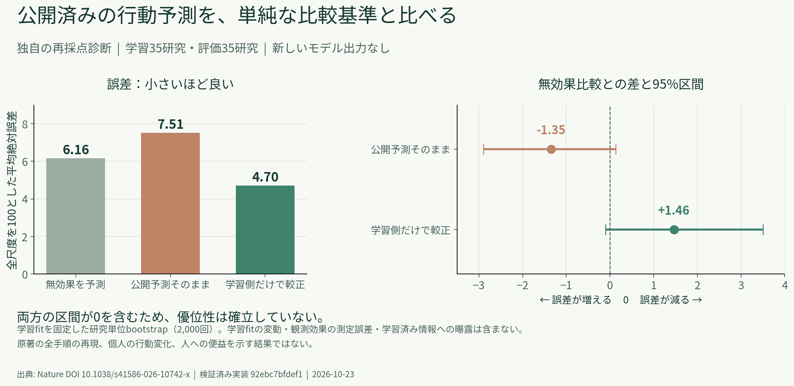

# 公開済み行動効果の固定study-holdout診断

日付：2026-10-23。これはNature論文の公開集約値を使った後ろ向きの再採点診断であり、原著の全手順を再現した研究ではない。Source Dataは公開ページの公式ファイルを読み取り、全4ファイルのSHA-256を解析前に照合した。個票、条件名、raw study rowsはリポジトリへ含めていない。実装とfocused testsはPR #8575でmainに統合済み（merge commit [`b7c9d150`](https://github.com/Daisuke134/life-manager/commit/b7c9d150684d0278ec7011e2a9981cef2e3f952f)）。

図：効果はnative signed scale `[-1,1]`、平均絶対誤差はそのfull scaleで表示する。誤差差と区間は元のfull-scale MAE差を100倍した「full-scale換算ポイント」で、確率差や相対改善率ではない。右側の差は「無効果baselineの誤差 − 比較手法の誤差」なので正なら誤差低下を表す。どちらのpaired区間も0を含む。



同じ図の[PDF](evidence/released-effects-diagnostic-20261023/diagnostic.pdf)と、[集計値・図のprovenance](evidence/released-effects-diagnostic-20261023/provenance.json)を参照できる。

## 対象と固定protocol

対象はNature DOI [10.1038/s41586-026-10742-x](https://doi.org/10.1038/s41586-026-10742-x) の2026-07-08 version of recordに付属する公開集約効果である。検証済みsnapshotは70研究、3,356 directed rows、1,678 unordered condition pairs、129 study×outcome blocksから成る。3,356行は独立な標本数ではない。study単位でSHA-256層別splitを一度だけ作り、published/unpublished group内で35研究をtrain、35研究をtestに割り当てた。split seedは`20261022`、digestは`1f114592643d6ed78624964b7cd5f2f73e340752df3c099dee3e1a1eeed62f14`。同じstudyの全outcomeとcontrastは同じ側に保持した。

各unordered pairの向き付き効果は条件差の符号規約を固定して復元した。比較の尺度はsigned full-scale effect `[-1,1]`。raw公開予測、無効果予測`0`、trainのみで学習した切片なしweighted least-squares係数`β`による予測を比べた。βはpair→outcome→studyの等重み構造でfitし、test側はfitに使っていない。方向一致は各pair内の一致率、次にeligible outcome、study、test studyの順に平均した。全段階のeligible coverageとprediction/observed tie数を別々に出し、欠測を0に置換しない。

Pearson値は各unordered pairの効果と予測の両方を反対向きにも置く対称化表現に対してSciPyのPearson statisticだけを計算した。この対称化は条件名を置き換えても値を不変にするための記述上の定義である。値は反対称なcontrast間の記述的associationに限り、p値、行単位区間、独立Nの解釈は出していない。条件の再ラベルと方向反転に対する不変性を合成testで確認した。

不確実性は固定したtrain fitの下で、test studyを単位に2,000回再標本化するpaired percentile 95%区間（seed `20261022`）である。これにはtrain-fitの変動や個々の効果測定誤差を含まない。Selection objectiveは指定されず、regretは未推定である。

## 結果

| 手法 | test-study macro MAE（native full scale） | test-study macro RMSE（native full scale） | 無効効果予測との差（MAE差×100、full-scale換算ポイント） |
|---|---:|---:|---:|
| 無効果予測 | 0.06164431 | 0.10474382 | — |
| 公開予測そのまま | 0.07513314 | 0.11241519 | −1.3489（95% paired CI −2.9001, 0.1348） |
| train側だけで較正 | 0.04701231 | 0.06831260 | +1.4632（95% paired CI −0.0993, 3.5053） |

較正係数は`β = 0.5497078236`。trainの符号付き平均予測は`−4.22×10⁻¹⁹`であり、対称なcontrastによる構造上のゼロである。したがってtrain-mean baselineは別の勝者ではなく、無効果baselineと同じaliasとして扱った。両方のpaired test-study区間が0を含むため、この診断から優越性を結論できない。

rawと較正後の方向一致率はともに`0.5834541`。どちらもtest 35研究中35研究が方向指標に寄与し、823 test pairsのうち821 pair、66 outcome blockがeligibleだった。方向一致のeligible pairは821、観測ゼロは1、予測tieは1。無効果予測は全823 pairでprediction tieとなるので、方向一致率は推定不能であり、0%として扱っていない。対称化した記述的Pearson `r=0.82620`はrawと較正後で同一、無効果予測はconstant inputのため未定義である。

## 解釈と限界

この結果は既存の公開効果集約に対する再採点だけで、新しいモデル推論は行っていない。study holdoutは、対象論文や研究結果がモデルのpretrainingで未見だったことを示さない。公開予測そのままのMAEは無効果baselineより大きく、train-only較正の点推定は小さいが、paired区間はどちらも0を含む。係数fit、study数、集約重み、区間が許す範囲のため、優越性を主張しない。

これは原著のrandom-reference、attenuation correction、LOSO pilot、megastudy top-20% selectionの再現ではない。関連IDを持つ別studyをさらにクラスタ統合しておらず、provided study IDを唯一のbootstrap単位とした条件付き区間である。人の行動変化、介入の便益・害、費用、福祉、個人への効果は測っていない。目的関数未指定のselection regretも未評価である。従って、本結果を行動予測全般や介入方針の優位性、E16または原Phaseの完了として解釈しない。

## 再現手順とprovenance

解析コードは[固定診断CLI](../../../products/manager/scripts/evaluate_external_behavior_benchmark.py)、入力のhash-first検証は[公開snapshot inspector](../../../products/manager/scripts/inspect_external_behavior_benchmark.py)、任意の研究依存は[`requirements-external-behavior-eval.txt`](../../../products/manager/requirements-external-behavior-eval.txt)。元データはローカルのprivate snapshotに置き、コマンド出力のaggregate JSONもprivate scratchへ保存する。次のコマンドが今回使った固定設定を示す（ここでは再実行していない）。

```bash
/workspace/scratch/rothko-benchmark-venv-20261022/bin/python \
  products/manager/scripts/evaluate_external_behavior_benchmark.py \
  /workspace/scratch/as-reuse-http-20261022 \
  > /workspace/scratch/manager-external-behavior-eval-20261023-aggregate.json
```

今回の集計receiptのSHA-256は`5427bfdc2fae204a197d4bb9b054cf9cd57780eb7c42f28111bd9b84a0eb35a5`。入力manifestで照合した4ファイルのhashと、リポジトリに含めた図のhash・byte数は[provenance JSON](evidence/released-effects-diagnostic-20261023/provenance.json)に記録した。実行時のPython環境は既存のNumPy 2.2.6 / SciPy 1.15.3 venvで、通常のManager runtimeへ新たな必須依存は加えていない。

## 公開済み章への編集候補（未適用）

公開済みの[人工社会・公開行動研究章](articles/2026-10-22-artificial-societies-open-behavior-research-ja.md)に、再編集時に挿入する候補：

> 公開予測を研究単位で分けて後ろ向きに再採点すると、35研究で学習した単純な線形較正は、残る35研究で平均絶対誤差0.047となり、無効果予測の0.062より点推定では小さかった。一方、研究単位のpaired 95%区間は誤差差が0となる場合を含む。これは公開済み集約効果の診断で、新しいモデル推論や人の便益測定ではなく、論文・研究結果が学習時に未見だったことも示さない。

章ファイルや外部公開先はこの作業では変更していない。
