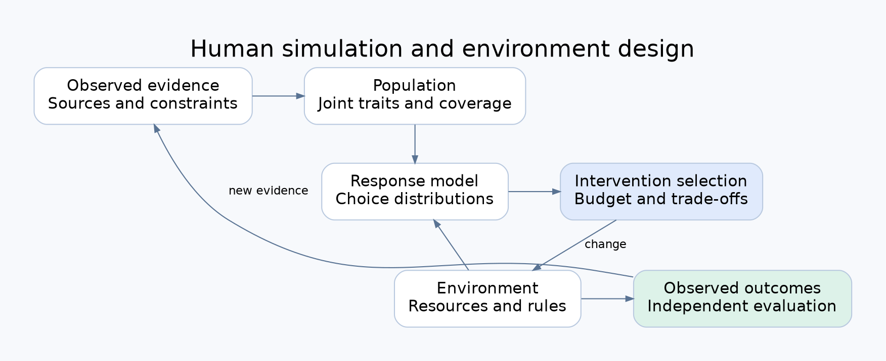
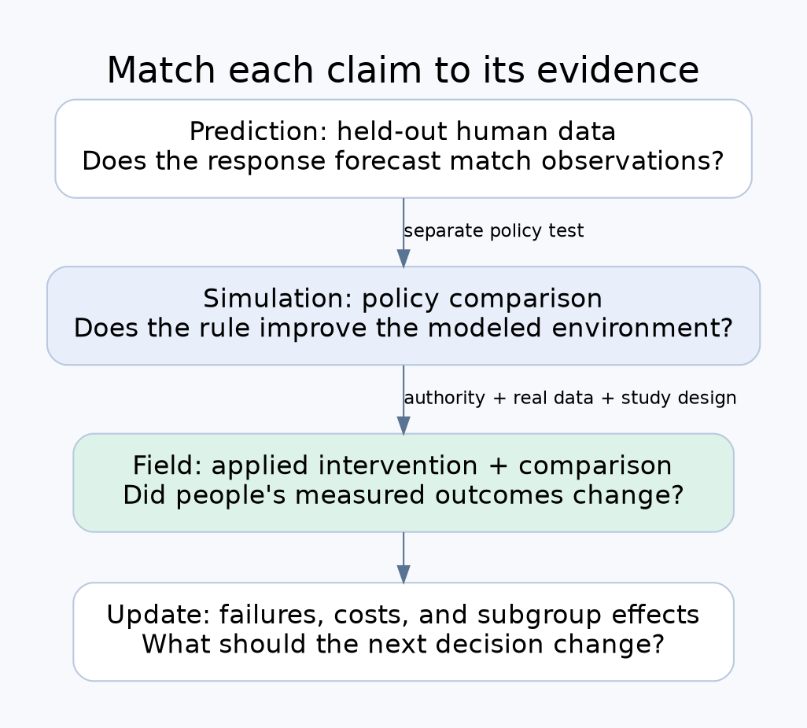

# 人間の反応を予測するAIから、環境を設計するAIへ

銀行が新しい決済体験を作る。薬局が待ち時間や相談の仕組みを変える。その前に、人々がどう反応するかを試せるだろうか。人間シミュレーションの企業が売っているのは、この判断を助ける技術だ。

Aaru、Simile、Primitive Labsは、会話の自然さより現実の反応を重視する。ただし、人を予測するモデルと、環境を変えて生活を改善するシステムには、異なる検証が必要になる。この記事では、人口生成、行動予測、環境設計を分けて読む。

## 人口を作る問題と、反応を予測する問題

人口モデルは、どんな人がどれくらい存在するかを表す。年齢や所得の平均だけでなく、家族、雇用、時間制約、アクセスがどう重なっているかが重要だ。各属性の分布が合っていても、組み合わせが間違っていれば、変更への反応はずれる。

例えば、平日の昼に使えるサービスを増やしても、その時間に働いている人のアクセスは改善しない。所得だけで利用者を分類すると、この制約を見落とす。人口生成では属性の結合分布を扱い、行動モデルでは、その制約の下でどの選択肢を選ぶかを予測する。

さらに、利用者が増えて混雑すれば、他の人の選択が変わる。制度や市場を扱うには、個人の回答を集計するだけでなく、相互作用と時間を表現する必要がある。

*構成を理解するための概念図。各社の非公開実装を表したものではない。*

## AaruとSimileの出発点

Aaruは公開・ライセンス・顧客データを統合し、人口の構造から合成人物を生成する流れを説明する。公開研究では、人口生成と個人の行動軌跡の中核は言語モデルではないと明記している。一方、Population Simulation求人には、言語モデルと計算社会科学・心理測定・調査方法を組み合わせる構成の研究が書かれている。[1][2]

これは矛盾と断定できない。中核と周辺の層、対象システム、研究方向が違う可能性がある。求人は仕事内容の証拠であり、そこで挙げられた技術すべてが現行製品で使われている証拠ではない。

Simileは、インタビューや調査に加え、取引や利用行動などで人間の反応モデルを学習する。本人が何を言うかと、実際に何をするかの両方を扱う方向だ。現在の求人は「地球上の80億人をシミュレーションする」を使命として掲げる。個人だけを対象にした会社ではない。[3][4]

両社を「人口対個人」「公開データ対個人データ」で完全に二分すると、実際の重なりを失う。Aaruでは人口構造の説明が、Simileでは人間への接地と予測誤差の研究がよく見える、と読む方が正確だ。

## 実際に何へ使われているか

AaruのEY事例では、3,600人、30超の市場を対象とした資産家調査を、結果を見ずに再現したと報告する。53の対応する質問で、中央値のSpearman相関は0.90、平均差は7.1パーセントポイントだった。これは研究再現の事例で、投資家が豊かになったという実証ではない。[5]

Breakwaterとの事例は、4万人の模擬投資家による71の判断を扱う。製品・価格・市場参入・戦略広報もAaruの用途に含まれる。シナリオ説明には競合や政策担当者の反応もあるが、例示シナリオと、実在顧客の成果報告は分ける必要がある。[6][7]

SimileとItaúは、ブラジルの自動定期決済Pix Automáticoについて、理解、信頼、操作の主導権、利用意向を調べた。5週間の研究を4営業日に短縮したという報告は、研究工程の成果である。[8]

CVS事例は、薬剤師へのアクセス、待ち時間、説明の明瞭さ、補充意向、給付設計を扱う。シミュレーションで候補を絞り、その後の試行や実験へつなげる流れだ。この記事から、服薬や健康の改善幅を確定することはできない。[9]

PrimitiveのInstinctは、利用者が製品のどこで迷い、離脱し、購入するかを予測する。公式説明は、承認された提案を試験済みの改善へ変える機能も掲げる。既存企業をすべて「予測だけ」と扱うと差別化を誤る。[10]

Synthetic Usersは合成人物へのインタビューと概念テスト、Seldonは製品の流れや摩擦の事前検証を売る。製品説明は用途を知る資料として使えるが、サイト上の一致率を、共通条件での企業間比較には使えない。[11][12]

## AI Economistが加える、ルールへの適応

SalesforceのAI Economistには、経済活動をする人々と、税などの共通ルールを決める設計者がいる。ルールが変わると働き方や取引が変わり、設計者はその結果を受けて学ぶ。二層の強化学習は、この適応を扱う。[13]

設計者の目的は、人々の目的と同じではない。生産性と平等の組み合わせなど、社会として何を改善するかを人間が指定する。モデルが唯一正しい価値観を発見するわけではない。また、シミュレーション内の税制改善は、現実の政府での効果とは区別される。

Managerが学ぶべきなのは、制度を変えた直後だけでなく、人々が新しい条件へ適応した後を評価することだ。

## 世界モデルとの接続

World Labsは空間と動きを、JEPA系の研究は判断に必要な表現と将来状態の予測を扱う。これらをロボットだけの技術と限定する必要はない。しかし、人間の制度、情報、選択を扱うには、社会に固有のデータと評価がいる。[14][15]

観測から未来を予測できても、環境を変更すれば結果が改善するとは限らない。変更を選んだ人の特徴、他者への波及、外部の変化が結果を左右するからだ。

*同じシステムでも、実測した段階までが主張できる範囲になる。*

## 実証を選ぶ条件

環境変更の実証は、先行研究と、実際に変更できる運営条件から選ぶ。CVSの事例では薬剤師へのアクセスや待ち時間を扱っている。また、予約方式を変えるadvanced accessについて、2011年の系統的レビューの抄録は24研究をまとめ、待ち時間の改善を報告している。ただし各研究に偏りの懸念があり、満足度の結果は混在し、臨床成果のデータは限られていた。[16]

この根拠は、予約や供給の条件を変える価値を調べる出発点になる。一方、その効果はAIの追加効果を示したものではない。Managerを使う場合には、通常の運営方式と比較して、予測と変更の選択が結果を改善するかを別に測る。

初期対象には、変更権限、実在する利用者、変更前の記録、比較できる条件、成果が出る期間が必要だ。所得機会や医療アクセスを、これらが分からないまま最優先には決めない。運営者から資料を得て、先行研究で扱われた条件と対応するかを確認する。

受益者がアプリを使わなくても、供給や利用条件を変えることはできる。公開する成果は、環境のどの条件を変え、誰のアクセス・負担・所得がどう変化したかを、他人が検査できる記録で示したものになる。

## 出典

- [1] [Aaruの公開方法](https://aaru.com/publications/population-simulation-at-the-replication-floor-research)
- [2] [Aaru Population Simulation求人](https://aaru.com/careers/f718d12f-67e9-4fe9-91cc-9e3b69ff00fe)
- [3] [Simile What-If Machine](https://www.simile.com/blog/what-if-machine)
- [4] [Simile Evaluations求人](https://jobs.ashbyhq.com/simile/33d75074-c23b-4a1f-bfdb-129bcc5be662)
- [5] [Aaru・EY事例](https://aaru.com/case-studies/ey-wealth-research)
- [6] [Aaru・Breakwater事例](https://aaru.com/case-studies/breakwater-conviction-advantage)
- [7] [Aaru Scenario Planning](https://aaru.com/use-cases/scenario-planning)
- [8] [Simile・Itaú事例](https://www.simile.com/blog/itau-at-esomar)
- [9] [Simile・CVS事例](https://www.simile.com/blog/simile-cvs-health)
- [10] [Primitive Instinct](https://primitivelabs.ai/instinct)
- [11] [Synthetic Users](https://www.syntheticusers.com/)
- [12] [Seldon](https://seldon.com/)
- [13] [AI Economist論文](https://arxiv.org/abs/2108.02755)
- [14] [World Labsの世界モデル分類](https://www.worldlabs.ai/blog/taxonomy-of-world-models)
- [15] [V-JEPA 2論文](https://arxiv.org/abs/2506.09985)

- [16] [Advanced access scheduling outcomes, systematic review](https://doi.org/10.1001/archinternmed.2011.168)
