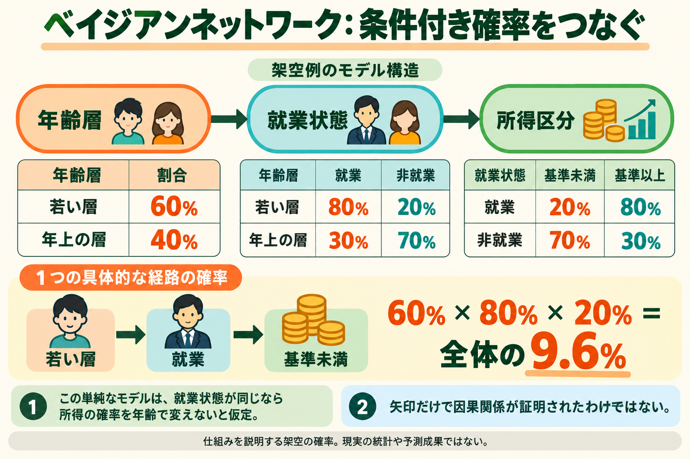
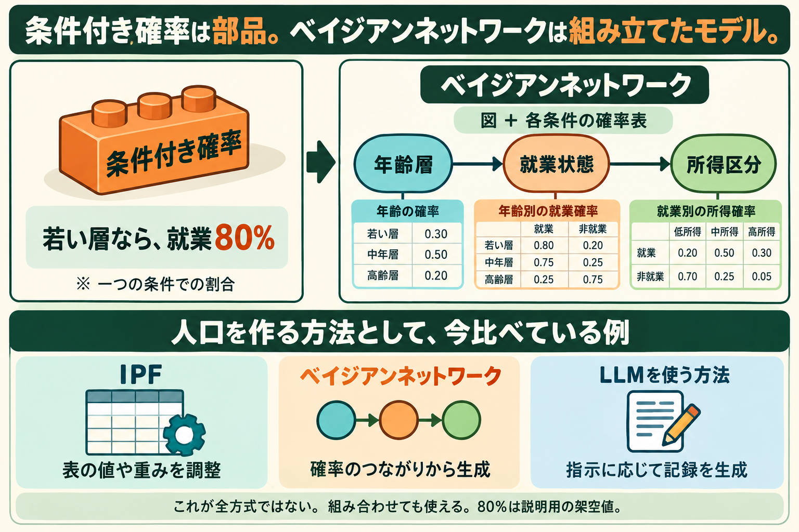

# ベイジアンネットワーク：条件付き確率をつないで人口を作る

ベイジアンネットワーク（Bayesian network）は、複数の属性の結合分布を、矢印のある図と条件付き確率の表で表現するモデルである。前回は「男子なら自転車通学30%」という一つの条件を扱った。今回は条件付き確率をつなぎ、複数の属性を持つ仮想の人を作る。



## 図と確率表の二つが必要

教材として「年齢層→就業状態→所得区分」という単純な構造を置く。各丸や箱がノード（node）、矢印が辺（edge）。矢印の始点は終点の親（parent）と呼ぶ。生成するときは親の値を先に決め、その値に対応する確率表から子の値を抽選する。

今回の確率はすべて架空である。若い層60%、年上の層40%。若い層なら就業80%、年上の層なら就業30%。就業なら所得基準未満20%、非就業なら70%とする。それぞれ残りの確率は反対の区分へ割り当てる。

一人を作るには、まず60%の抽選で年齢層を決める。若い層に決まれば就業確率80%を使う。就業に決まれば所得基準未満確率20%を使う。ここでは1人を作るたびに各段階で別の乱数を使う。

## 一つの組み合わせの確率を求める

若い層・就業・基準未満という組み合わせの確率は、0.60×0.80×0.20=0.096、全体の9.6%。100人を独立生成した場合、その種類の期待人数は9.6人になる。一回の抽選で9.6人になるという意味ではない。

```text
P(年齢, 就業, 所得)
 = P(年齢) × P(就業｜年齢) × P(所得｜就業)
```

この式は今回の図に対応する。一般の三変数では最後がP(所得｜年齢,就業)となり、年齢を省くにはモデルの仮定が必要である。この教材は「就業状態が同じなら、所得区分の確率を年齢で変えない」と仮定している。現実には年齢も関係するかもしれない。その場合は年齢→所得の辺を追加し、年齢と就業の両方に対応する確率表を用意する。

つまり、単に矢印を描くだけでなく、どの関係を省略したかもモデルの内容になる。ベイジアンネットワークは有向非巡回グラフ（DAG）を使い、矢印をたどって元のノードへ戻る循環を含めない。

## 確率と構造はどこから得るか

今回は理解のため手で決めた。実際には二つの学習を区別する。構造学習（structure learning）は、どの属性を結ぶかを決める。パラメータ学習（parameter learning）は、決まった構造の確率表をデータから推定する。

例えば標本の若い層100人中80人が就業していれば、単純な頻度推定は80/100=80%。ただし標本重み、少数群、未観測の親の組み合わせ、別地域への移動を考慮する必要がある。親を増やすと必要な条件別データも増えるので、辺を多くすればよいわけではない。

SunとErathの2015年の研究は、シンガポールのHITS2012調査を参照人口として扱い、一部標本から人口を生成する方法を比較した。bnlearnのtabu searchで構造を探索し、構造と確率を学習して生成する。IPFとの比較では入力情報も異なるため、単一の成績を全条件での優位性へ一般化しない。調査データを既知の参照人口とする評価であり、シンガポール全員の個票を得た研究ではない。[1]

## 公開コードではどう生成するか

pgmpyのBayesianModelSampling.forward_sampleを読んだ。コードは親が先になる順番でノードを処理し、get_cpdsで確率表を取り、既に生成した親の値で該当する条件を選んで抽選する。親がなければそのノードの無条件の確率を使う。[2]

今回、pgmpy自体の実行はしていない。同じ三段階の考え方をPython標準ライブラリの短い教材で実行し、8種類の組み合わせの確率の合計が1、指定経路が9.6%であることを検算した。さらに架空の人物を10,000件抽選した。現実データからの学習や、論文の成績再現ではない。

## 矢印と介入は別に確認する

今回の矢印は、確率の依存関係を表す。データ上の関係だけで「仕事を与えれば、この確率で所得が変わる」という介入効果は証明できない。就業している人の所得分布と、ある人を就業させた場合の所得変化は別の問いである。

マネージャーでは人口生成の比較候補として学ぶ。生成した人口が地域の集計に合うか、未使用の組み合わせが合うかを別に評価する。最初の六セル・公開集計表・既存IPFという実装範囲は維持し、この学習だけで新依存へ置換しない。AaruやSimileがこの具体的なネットワークを使用するという証拠はなく、両社の内部方式とは区別する。

[1] Sun / Erath, A Bayesian network approach for population synthesis https://lijunsun.github.io/files/papers/2015-TRC-BN-Population.pdf 。今回3.1–3.3と実験設定を確認。

[2] pgmpy公開コード https://pgmpy.org/_modules/pgmpy/sampling/Sampling.html 。取得したdevソースのハッシュと読解範囲は対応する証拠JSONに保存。


## 条件付き確率とネットワークは同じものか

条件付き確率は「若い層なら就業80%」のような、条件の下での確率である。ベイジアンネットワークは、変数の図と、その図に対応する確率表を組にして結合分布を表すモデル。条件付き確率が部品、ネットワークがその組み合わせという関係であり、二つの名前が同じものを指すわけではない。

人口生成についてIPF・ベイジアンネットワーク・LLMを比較しているのは、この講座で選んだ代表例である。分野全体をこの三方式だけに分類する意味でも、市場での主要三方式という意味でもない。IPFは調整アルゴリズム、ベイジアンネットワークは確率モデル、LLMはモデルの一群で、分類の階層も異なる。VAEなどの生成モデルや組み合わせ最適化もあり、複数を組み合わせられる。

IPFとipfnも区別する。IPFは手法名、ipfnはその手法を利用できるPythonライブラリ名である。



補足図の確率表もすべて架空値であり、前の二年齢区分の教材とは別の説明例である。部品と全体の関係を示すための図として読む。
