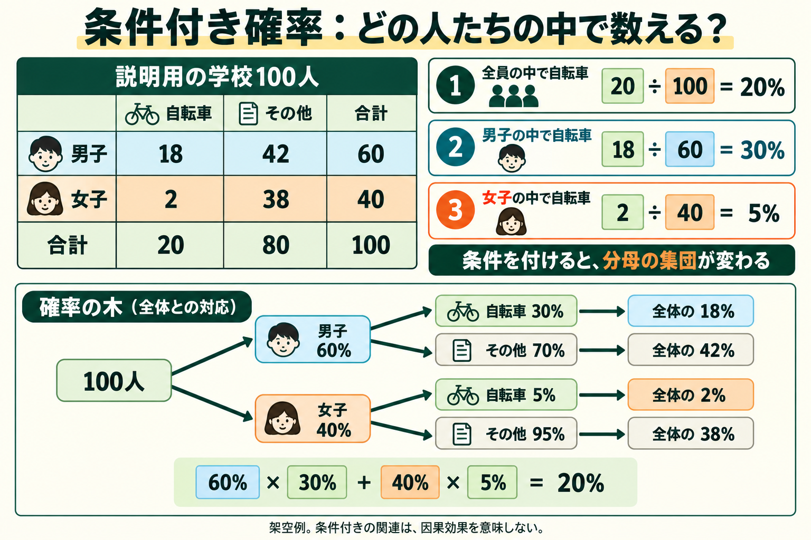

# 条件付き確率：どの人たちの中で数えるか

条件付き確率（conditional probability）は、ある条件に当てはまる対象に絞ったときの確率である。「全員の中で自転車通学は何％か」と「男子の中で自転車通学は何％か」では、分母となる集団が違う。



説明用に、学校100人の資料を考える。男子60人のうち自転車18人、その他42人。女子40人のうち自転車2人、その他38人とする。現実の調査結果ではない。

全校では20/100=20%が自転車。男子に絞ると18/60=30%、女子に絞ると2/40=5%となる。条件を付けたから人の通学手段が変化したのではなく、数える対象を絞ったため割合が変わった。この関連だけでは因果効果を示さない。

記号ではP(自転車｜男子)=0.30。「｜」の右側が条件、左側が知りたい事柄である。一般式はP(A｜B)=P(AかつB)/P(B)で、P(B)>0が必要。分母が0のとき、通常のこの式で条件付き確率は求められず、0%と決めることもできない。

## 仮想の人を作るときに使う

この架空の表から仮想の学校を生成するとする。まず男子60人、女子40人という属性を用意し、各人に通学手段を割り当てる。男子なら自転車確率30%、女子なら5%で抽選する。0以上1未満の一様乱数uを取り、u<確率なら自転車とする。同じu=0.20でも、男子の閾値0.30なら自転車、女子の閾値0.05ならその他となる。実際の独立抽選では各人に新しく乱数を取る。

```python
probability = 0.30 if group == "male" else 0.05
bike = rng.random() < probability
```

これは一つの属性を条件付きで抽選する学習例であり、研究論文の人口合成アルゴリズム全体の再実装ではない。Harlandらの方法では既存の属性に条件付けた確率を使って次の属性を割り当て、集計との調整も行う。全員に一律20%を使うと、今回の男女と通学手段の関連は再現できない。

自転車通学の期待人数は60×0.30+40×0.05=20人。ただし、抽選で必ず20人になるわけではない。今回のPython標準乱数・seed42による100人の例では男子24人、女子2人、合計26人になった。20人は期待値、26人は一回の生成結果である。乱数のseedを固定すると同じ実装で結果を再現しやすいが、現実への正確さを保証しない。人数を厳密に合わせるには、別の割当・調整が必要になる。

## 結合分布と周辺分布につながる

全体から男子を選ぶ確率0.60と、男子なら自転車である確率0.30を掛けると、男子かつ自転車の確率0.18になる。P(男子かつ自転車)=P(男子)P(自転車｜男子)である。女子かつ自転車は0.40×0.05=0.02。二つを足すと全体の自転車割合0.20となる。

逆向きのP(男子｜自転車)は18/20=90%。P(自転車｜男子)=30%とは別の量であり、条件と対象を逆にしてはいけない。

## 分からない確率は、集計だけでは決まらない

上の表は、条件付き確率を理解するために全セルを与えた教材である。現実に男子60・女子40、自転車20・その他80しか分からなければ、男子内の自転車確率30%は計算できない。標本、別資料、またはモデルで組み合わせを推定する必要がある。

その確率が別地域の標本から得られた場合、対象地域にも通用するかを検証する。属性を増やすほど条件別の標本が少なくなることもある。全体の合計を合わせただけで条件別確率が正確とは判断しない。

## マネージャーへの接続

人口側では年齢などに条件付けて他の属性を生成する方法の基礎になる。反応側では人物属性と環境条件に応じた行動確率を表す基礎になる。両方に同じ確率の考え方が使えるが、学ぶデータと正解は異なる。最初の公開集計表六セル・IPFという実装範囲は維持する。

次は、条件付き確率を複数つないだBayesian networkと、属性の組み合わせの確率をどう推定するかを扱う。グラフの矢印を因果関係と同一視しない。

出典：Brown University, Seeing Theory https://seeing-theory.brown.edu/compound-probability/index.html ／ Harland et al. 2012, Conditional Probabilities節 https://www.jasss.org/15/1/1.html 。教材の人数、抽選コード、26人という出力は今回の架空例であり、出典の研究結果ではない。
