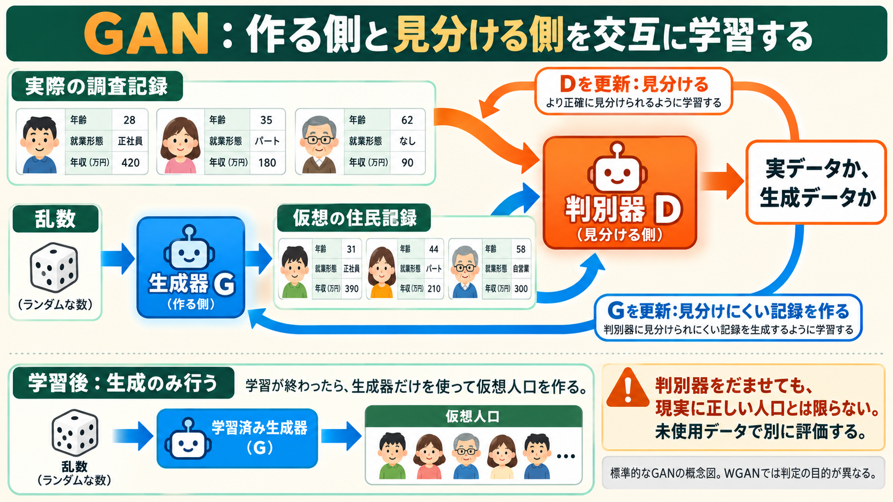

# GANで人口を作る：生成器と判別器の役割

図は説明用。住民カードの数値は架空で、実測結果ではありません。

VAEの基本の次に学ぶ単元。GANはGenerative Adversarial Network、敵対的生成ネットワークの略である。Goodfellowほかの2014年論文が出発点。[1]

## 何を学習するか

住民属性を持つ調査記録がある。生成器Gは乱数を受け取り仮想の記録を作る。判別器Dには、本物の調査記録と生成された記録を渡し、どちらから来たかを見分けるよう学習させる。次にGを、Dから見分けにくい記録を作るよう更新する。これを交互に行う。

たとえるなら、練習問題を作る人と、その問題が過去の問題集に似ているか見分ける人が、一緒に上達するような仕組み。ただしDは現実の全人口を知る審判ではない。

VAEの基本形が符号化・復号と再構成・KLを使うのに対し、GANの基本形ではGとDの競合を学習の信号として使う。GANとVAEを組み合わせる変種もあるので、全実装の絶対的な区分ではない。

## 人口の例

元データで「若い・就業」「若い・非就業」「年上・就業」「年上・非就業」の比率が40%、20%、10%、30%だとする。架空の例である。

Gが若い就業の人ばかりを作れば、Dには元データとの違いを見つける手がかりになる。しかし、Dをだませたという学習上の結果だけでは、少数集団の再現や現実への一致は保証されない。特定の種類ばかり作るmode collapse（モード崩壊）などに注意し、未使用資料で別に評価する。

学習後、人口を生成するときは「乱数→学習済みG→属性」。基本形では生成のたびにDを使って採点し直す必要はない。

## コードでの対応

読解した `vdarsel/PopulationSynthesis` の `models/GAN/WGAN/model_WGAN_alone.py` は `Generator_Tabular`、`Discriminator_Tabular` と勾配ペナルティを持つ。`train_WGAN_alone.py` はD用とG用のoptimizerを分け、順に更新する。D更新で `fake_data.detach()` とし、そのときにGまで同時更新しない処理を確認した。[2]

これはWGAN系の実装で、標準GANと目的関数が異なる。「実データの確率を出す」という初歩説明を、そのまま全WGANへ適用しない。取得版ではD末尾にSigmoidもあるため、教科書のWGAN-GPと完全に同じ実装だと断定せず、再現時に相違を点検する。コードの公開と利用許諾も区別する。

## 今回の実行範囲と次

生成器・判別器のコードを静的読解。今回ニューラルネットワークのGAN学習は行っていない。数式の教材では、標準GANでDの出力が小さい生成例ほどGの損失が大きくなることと、複製型の生成でも分布が偏り得ることを検算する。実人口の性能測定や著者の実験再現とは別である。

次はGANの学習信号・モード崩壊の疑問を解消し、拡散モデルの「ノイズから少しずつ戻す」学習と比較する。その後にLLM人口生成へ進む。学習済みへの更新は本人の理解合図で行う。

1. https://arxiv.org/html/1406.2661v1 （方法3節）
2. https://github.com/vdarsel/PopulationSynthesis （固定版は証拠JSON）
