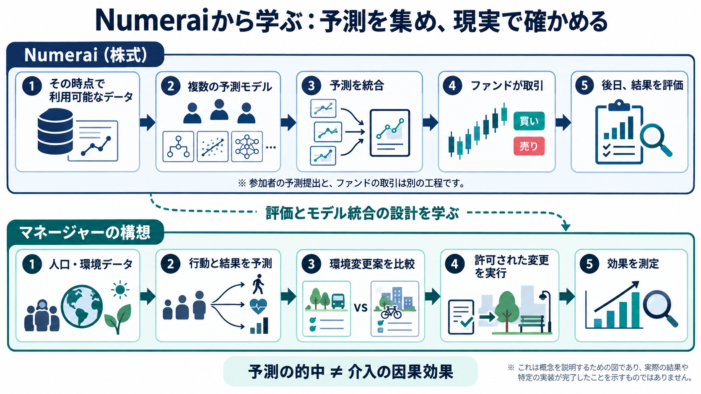

# NumeraiのUnityを理解する：予測を集め、現実の結果で評価する

確認日：2026年10月17日。2026年10月16日付の公式記事「Unifying Numerai and Signals」、公式データ・API説明、公開コードをもとに整理する。

## 何をしている会社なのか

Numeraiは株式予測のデータサイエンス大会とヘッジファンドを運営している。参加者が予測を作り、ファンドは集約された予測を取引へ利用する。参加者の予測値と、ファンドのポジションや注文は別の出力である。[1][2]

株式と時点を一行とするデータでは、特徴量が入力、将来の成績を表すターゲットが予測対象になる。株価の絶対値を正確に当てることと同じ課題ではない。モデルの予測が当たったかを後日測る。NMRを賭ける仕組みには報酬と損失の両方があり、保証された収益ではない。ステーキングなしでも予測と採点から始められる。[2]

## Unityで何が変わるか

従来のNumeraiは株式の識別を隠した特徴量を提供し、Signalsは参加者が独自データを持ち込む形だった。Unityは実際の株式IDと1,040特徴量を提供し、独自の特徴量を結合できるようにする。特徴量自体の匿名化・加工が全て解除されるわけではない。二大会は当面並行し、公式発表では2027年1月1日に一つの大会とMeta Modelへ統合する予定。[1][3]

記事には、公表資料からLLMで特徴量を作る例もある。ただし記事自身が、追加特徴量が予測に役立つかはこれから検証が必要だと述べている。データ収集を自動化できたことと、未知期間の予測が改善したことを分けて読む。[1]

## Meta Modelとは

複数の予測を統合したモデルである。単独の精度だけでなく、既存の予測群へ何を加えるかにも意味がある。例えば同じ誤りをするモデルを増やしても、情報があまり増えない場合がある。

現在の公式スコア説明には、リスク要因などの影響を調整してから相関を見るNCORRと、調整後の統合モデルへの追加貢献を見るNMMCがある。普通の正解率、実際のファンド利益とは異なる。移行中なので採点設定は日付・ラウンドごとに固定する。[4]

## 自分たちで動かせる範囲

公式の `numerai/example-scripts` を取得し、`numerai/v6_example_model.ipynb` を静的読解した。流れは、メタデータと学習データの取得、成熟したターゲットへの絞り込み、LightGBM学習、時間を隔てた検証、NCORR等の計算である。株式・日付の結合検査や、将来60営業日を参照するターゲットに対して検証期間を離す処理もある。この期間隔は当該コードの設定であり、あらゆる時系列課題への固定ルールではない。[5]

今回、隔離venvにNumerAPI 3.1.1をインストールし、認証不要の公開データ一覧と `v6.0/features.json` を取得した。全特徴量1,040、小セット101、中セット351を実際に確認できた。大きな学習データは取得せず、モデル学習・大会投稿・口座接続・NMR購入やステーキングは未実施。公開APIを使う検証と、本人のAPIキーを必要とするMCP認証は別である。[6]

再実行手順は証拠ディレクトリの `numerai-public-probe.py` と `numerai-requirements.txt`。環境のvenv自体をGitへ保存せず、再作成可能な依存と取得結果を保存する。公式大会への参加側は実装できるが、ファンド全体の内部システムをインストールできるという意味ではない。

## 出典

1. https://blog.numer.ai/unifying-numerai-and-signals/
2. https://docs.numer.ai/
3. https://forum.numer.ai/t/the-unity-data-release/8367
4. https://docs.numer.ai/numerai-signals/scoring/definitions
5. https://github.com/numerai/example-scripts/blob/master/numerai/v6_example_model.ipynb
6. https://docs.numer.ai/numerai-tournament/api

本稿は公開資料の解説であり、取引成績の報告ではない。
