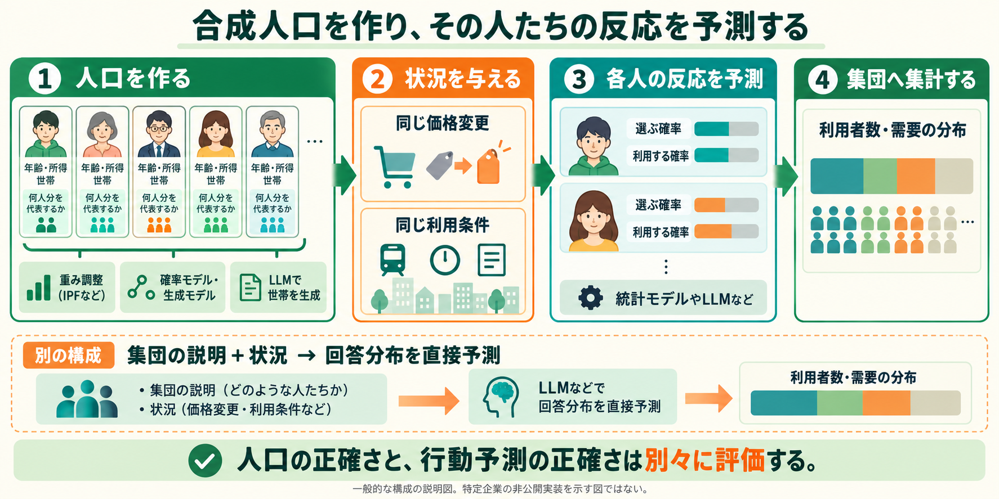

# 合成人口から行動予測へ：統計モデル、LLM、Aaru、Simileの違い

「仮想の人々を作り、その人たちがどう反応するかを予測する」という理解は、個人単位の社会シミュレーションの基本構成に当たる。まず対象集団の属性構成を表現し、次に状況を与えて反応を予測し、最後に集団へ集計する。ただし、集団の説明と状況から回答分布を直接予測する方式もあり、全方式が一人ずつの人物を明示的に生成するわけではない。



## 人口合成と行動予測を分ける

人口合成（population synthesis）が扱うのは「どんな属性の人や世帯が、何人・何世帯いるか」。例えば年齢、所得、世帯構成の組み合わせを推定する。行動予測（behavior prediction）が扱うのは「その人が、この状況で何を選ぶか」。人口の属性を正確に再現しても、新しい価格や利用条件への反応が正確になるとは限らない。

映画に例えれば、人口合成は配役と人数を決める工程、行動モデルは場面ごとの振る舞いを決める工程に近い。ただし目標は面白い物語ではなく、現実の属性や行動への一致である。

## 人口を作る方法はIPFだけではない

第一は、標本の重みを変える方法。既存の記録を何人分として数えるかを調整する。IPFは集計表への反復調整に使われ、世帯と個人の条件を扱うIPUなどの拡張もある。記録にない組み合わせは、重みの変更だけでは追加できない。

第二は、条件付き確率を使って属性を割り当てる方法。例えば年齢を決めた後に、その年齢での就業状態の分布に従って状態を選ぶ。ベイジアンネットワーク（Bayesian network）では属性の依存関係をグラフと条件付き分布で表し、そこから人物を生成する。ただしグラフの矢印が、そのまま因果関係の証明になるわけではない。SunとErathの研究は人口合成への適用を示している。[1]

第三は、組み合わせ最適化（combinatorial optimisation）。標本から選ぶ記録やその組み合わせを変え、集計との誤差が小さくなる人口案を探索する。焼きなまし法（simulated annealing）は探索方法の一つで、序盤は悪化する変更も一定確率で受け入れて、局所的な解にとどまりにくくする。Harlandらは重み調整、条件付き確率、焼きなまし法を比較し、制約集計だけでなく交差表や制約に使わない変数も評価した。[2]

第四は、学習した生成モデル。VAE（Variational Autoencoder、変分オートエンコーダ）などが属性の組み合わせを学習し、新しい記録を生成する。Borysovらは人口合成へVAEを適用した。言語モデルではないニューラルネットワークも人口を生成できる。未観測の組み合わせを提案できても、それが現実に存在する保証はなく、構造的ゼロ、希少群、分布のずれを別に検査する。[3]

第五は、LLMで人物や世帯の記録を生成する方法。Jonesらの2026年の研究は、集計資料、属性の形式、生成済み人口の集計をプロンプトへ入れ、世帯を順次生成する。追加学習を前提とせず、目標とのずれを後続の指示へ返す方式である。[4]

これらは完全に排他的な分類ではない。生成モデルで候補を作り、重み調整で地域の構成へ合わせるなど、組み合わせて使える。また、標本を使うか集計表だけか、出力が個人か世帯かは、アルゴリズムとは別の分類軸である。

## LLMで人口を作る公開コード

今回、著者のLLM-Population-Generatorを取得した。PopulationGenerator.generate_householdsは、プロンプトを用意して生成を呼び、結果を蓄積し、次のバッチへ向けて統計を反映したプロンプトを更新する。コード上の主な接続は次である。

```text
population_generator/engine/generator.py
  generate_households
    → batch_processor.run_batch
    → households.extend
    → batch_processor.update_prompt_with_statistics
```

世帯の形式や整合性を確認する仕組みはdata/validation.pyなどに分離されている。今回、この上流の検証部品だけをオフラインで読み込み、架空の年齢30を受理し、年齢-1を拒否する確認を行った。世帯生成、モデル推論、論文成果の再現は行っていない。

対応するSynthetic-Population-Experimentsには、年齢×性別×世帯人数×世帯構成を比較するvalidate_full_cross_tab.pyと、IPUとLLMの結果を比較する09_compare_methods.pyがある。ファイルが存在することと、比較が完全に公平であることは別であり、利用する前に入力・分割・定義の一致を確認する。

LLMへ目標を教えて集計が近づいたことだけでは、教えていない組み合わせの正確さは分からない。論文の図10は2026年8月に訂正されており、紹介時は訂正版を参照する。[5] また公開コードの世帯ルールには領域固有の仮定も含まれるため、地域や目的を問わずそのまま採用する仕様とはしない。

## LLMで反応を予測する二つの方法

一つは、人物の情報を回答時に読ませる方法。モデルのパラメータをその人物向けに学習し直すことは必須ではない。人物に関する記録から質問に関係する情報を取り出し、質問と一緒にLLMへ渡す。

StanfordHCI/genagentsのGenerativeAgentは人物情報とmemory_streamを持つ。categorical_respはinteraction.pyへ処理を渡し、_main_agent_descが関連記憶を検索して人物説明へ追加する。その説明と質問・選択肢をLLMへ渡し、返答を構造化して取り出す。記憶検索は関連性、新しさ、重要度を組み合わせる。これは記憶を外部に保持して参照する構成で、記憶を加えるたびにLLM自体を学習し直す構成とは異なる。[6]

もう一つは、人間の実験結果からモデル自体を追加学習する方法。Socratesでは「人物属性・実験条件・質問」を入力し、観測された回答を予測対象にする。SFT（Supervised Fine-Tuning、教師あり追加学習）は、その入力に対して実際の回答へ高い確率を付けるようパラメータを調整する。DPO（Direct Preference Optimization、直接選好最適化）は、同じ入力に対する回答の対を用いて、目的に合う方を相対的に選びやすくする。同研究には人物属性・条件などの違いを使った対の作り方がある。ここでの選好は研究上の学習目標であり、倫理的に望ましい回答という意味に限られない。[7]

Socrates論文の方法節と評価節を確認した。210研究のうち170研究を学習、40研究を未使用の評価へ分け、個人回答と集団の反応分布を分けて測っている。GitHub側は主にデータ・モデル・分割への案内で、追加学習にはLLaMA-Factoryを直接使うと記載する。独自の完備した学習スクリプトが同リポジトリ内にあるとは報告しない。データ、基盤モデル、派生モデルの利用条件も別々に確認する。[7][8]

## Aaruについて公開資料から分かること

Aaruは対象集団に合うエージェント人口を作り、各エージェントの反応を出力する構成を説明している。人口生成と個人の行動軌跡を予測する中核モデルは、いずれも言語モデルではないと明記する。IPF、VAE、特定のネットワークを使うという断定は、公開資料からはできない。

同社の2026年9月の公開評価は主に質問ごとの回答割合を扱い、個人内の論理的一貫性や高次の関係は別の課題としている。集団の回答割合をよく再現したという報告を、各人の行動や未知の介入効果まで証明したと読むことはできない。これは企業自身の報告であり、今回私たちが独立再現した結果ではない。[9]

## Simileについて公開資料から分かること

研究の一例は、実在の人のインタビューや調査を基にLLMエージェントを作り、別の質問への反応を評価するもの。公開genagentsは近縁の研究実装だが、Simileの現在の商用製品コードそのものではない。[6]

現在の公式技術記事では、購買記録、インタビュー、調査を使って行動予測モデルを学習すると説明する。対象集団、状況、可能な行動を文章で入力し、行動の分布を出力する例が示される。Qwen3.5-27Bを使った追加学習・不確実性予測の実験も説明するが、これだけで製品全体の内部構成が公開されたとは言えない。人口集計を実現する全手順は未確認である。[10]

Aaruは人口だけ、Simileは個人だけ、と二分するのは不正確である。両社とも個人と集団の予測に関係するが、公開されているモデルの説明、データ、評価単位が異なる。

## 出典と読解範囲

[1] Sun / Erath, A Bayesian network approach for population synthesis https://lijunsun.github.io/files/papers/2015-TRC-BN-Population.pdf

[2] Harland et al., Creating Realistic Synthetic Populations at Varying Spatial Scales https://www.jasss.org/15/1/1.html

[3] Borysov et al., Scalable Population Synthesis with Deep Generative Modeling https://arxiv.org/abs/1808.06910

[4] Jones et al., A large language model framework for sample-free population synthesis https://journals.plos.org/plosone/article?id=10.1371/journal.pone.0341704

[5] 同論文の訂正 https://journals.plos.org/plosone/article?id=10.1371/journal.pone.0356492

[6] StanfordHCI/genagents https://github.com/StanfordHCI/genagents ／ 対応する人物再現研究 https://arxiv.org/abs/2411.10109

[7] Kolluri et al., Finetuning LLMs for Human Behavior Prediction in Social Science Experiments https://aclanthology.org/2025.emnlp-main.1530/ （PDFの方法節・評価節を読解）

[8] Socrates公開案内 https://github.com/akaashkolluri/socrates

[9] Aaru公開研究 https://aaru.com/publications/population-simulation-at-the-replication-floor-research

[10] Simile, Building confidence in Simile https://www.simile.com/blog/confidence

取得した著者コード： https://github.com/MJones235/LLM-Population-Generator ／ https://github.com/MJones235/Synthetic-Population-Experiments 。固定コミットと読解ファイルのハッシュは対応する調査証拠に保存した。4リポジトリすべての全ファイルを読了したという意味ではない。
