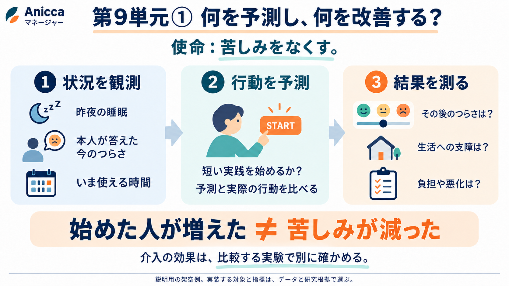

# マネージャー第9単元① 何を予測し、何を改善するのか

Aniccaの使命はEnd suffering。マネージャーは、その使命に向けて作る製品である。テクノロジーは手段であり、使命の条件ではない。最初の予測モデルを選ぶときも、モデルの新しさより、どの問題に役立ち、その役立ち方をどう確かめるかを先に決める。



図は説明用の架空例であり、マネージャーの実測結果ではない。描かれた睡眠や時間の項目が、今回の候補データにすべて収録されているという意味でもない。

## 人口を作ることと、行動を予測すること

これまでの人口合成では、「どのような属性の人が、誰と暮らしているか」を用意した。次は「その人が、その状況でどう行動するか」を扱う。ただし、仮想住民の記録を作っただけでは、実際の行動を予測できるようにはならない。実際に観測された行動を使う学習と評価が必要になる。

例えば、短い実践の案内を出したとき、記録上の応答があるかを予測することを考える。それは「実践によって苦しみが減るか」とは違う質問である。案内を開く、取り組む、完了する、役に立つ、という出来事もそれぞれ異なる。データの列がどれを記録しているかを確かめる必要がある。

## まず四つを分ける

| 種類 | この教材での例 | 確かめるもの |
|---|---|---|
| 状況 | 直前の自己報告、時間帯、その場の条件 | 予測時点で本当に分かっていたか |
| 行動 | 提示した支援への記録上の応答 | 予測と観測が合うか |
| 経験・状態 | 次の質問に対するつらさの自己報告 | 状態の予測と観測が合うか |
| 介入効果 | 支援ありと比較条件での、その後の結果の差 | 支援によって結果が変わったか |

つらさの自己報告は状態の観測であって、行動そのものではない。また、回答が記録されなかったことを「つらさゼロ」とは扱わない。記録上の応答がないことも、支援を拒否した、実践しなかったと直ちに断定できない場合がある。

## 一人の一回を、時系列で考える

以下の値と質問文は、仕組みを説明するための架空例であり、検証済みの尺度や実データではない。

```text
14:00 その時点の自己報告：「いまのつらさは7/10」
14:01 短い実践の案内を提示
14:10 アプリに応答の記録あり
16:00 次の自己報告：「いまのつらさは5/10」
```

14時の時点で、14時10分に応答があるかを予測できる。次の16時の自己報告を予測する課題も作れる。ただし、16時の回答を14時の予測の入力へ入れると、未来の情報を使ってしまう。これがデータリーケージの一例である。

この一例だけでは、「案内のおかげで7から5に改善した」と結論できない。時間の経過や別の出来事で変わった可能性がある。支援の効果を調べるには、適切な比較やランダム化などが必要になる。

## 先行研究は何をしているか

Jaremba、O’Reilly、O’Driscollらの2026年の研究は、マインドフルネスとメンタライゼーションの短い介入を扱う試験の二次解析である。介入への応答に関わる条件と、次の測定時点のdistressの予測を扱い、有意な近接介入効果は確認しなかったと報告している。[1]

これは「予測モデルを作れた」と「その介入で直ちに改善した」を区別する実例になる。公開されたコードとデータ候補は、最初の実装対象として調査している。行動の記録方法、欠測、予測時点、評価分割を確認してから採用する。論文の報告値を、そのまま未知の人や期間での性能とは扱わない。

EMA（Ecological Momentary Assessment）は、日常生活のその時々に短い質問をして状態を測る方法である。JITAI（Just-in-Time Adaptive Intervention）は、その時点の状況などに合わせて支援を届ける設計である。状態がつらいときと、支援を受けられるときが一致するとは限らないため、必要性と受け入れやすさの両方を調べる意味がある。[1][2]

介入の効果を繰り返し調べる方法にはMicro-Randomized Trial（MRT）がある。HeartStepsは、活動の提案を出すかなどを繰り返しランダム化し、その後の行動を比較する代表例だ。[3] 歩数は方法を学ぶ教材にはなるが、歩数の増加を苦しみの減少そのものとは扱わない。

より新しい2026年8月のTranらの研究は、救急対応などの従事者に、介入なし・短いメッセージ・アプリによる実践の条件を日ごとに割り付けた。抄録は、瞬間的ストレスへの直接効果を確認しなかった一方、ストレス要因への反応には条件による違いを報告する。[5] 「新しいマインドフルネス研究だから有効」とまとめず、比較条件と測った結果を読む必要がある。最初の教材は発表日の新しさだけでなく、観測の意味とコード・データを確かめられるかでも選ぶ。

## 苦しみを、何で測るのか

使命はEnd sufferingだが、最初の研究で苦しみの全体を一つの数字で表せるとは仮定しない。本人のつらさ、生活への支障、抑うつや不安の症状、マインドフルネス、生活満足度は、関連があっても別の概念である。仏教でいう苦と、心理学のdistressの尺度が測る範囲も、同一だと仮定しない。使命を測りやすい指標だけへ置き換えず、今回何を測れたかを明示する。Harvard Human Flourishing ProgramのPersonal Suffering Assessmentのように、苦しみを直接問う測定もある。[4]

採用する尺度は、対象者、言語、参照期間、信頼性、利用条件を調べて選ぶ。月全体を尋ねる質問票を、そのまま1分の介入の直後に繰り返して同じ尺度として扱うことはできない。脳波やHRVも、苦しみを直接読み取る万能な測定器ではない。

## マクロなマネージャーへどうつながるか

短い実践を扱う教材を使っても、マネージャーの構想を個人への通知だけへ限定しない。将来は、休息を取りやすい共有スケジュールや、利用しやすい支援制度など、環境側の条件を変えることも考えられる。

ただし、一つの臨床研究の反応を、そのままRhode Islandの全住民へ割り当てる根拠はない。対象の違いと観測できない属性を調べ、移送可能性を検証する必要がある。最初は、元の研究の対象と条件の範囲で予測を再現し、人口への接続は別段階に置く。

## この回で説明できるようにすること

マネージャーは、実際の状況から行動や状態を予測する。その予測を未知の観測で採点する。一方、何を変えれば苦しみが減るかは、比較する実験などで別に確かめる。支援への応答の増加だけを、使命の達成と呼ばない。

## 出典

1. Jaremba et al., [Optimizing just-in-time adaptive interventions for interpersonal distress: mechanisms, prediction, and the challenge of engagement](https://doi.org/10.1038/s41598-026-39518-z), Scientific Reports, 2026-02-11。対応するデータ候補：[OSF chfy2](https://osf.io/chfy2/)。データ・著者コードの読解範囲は[データ比較](../2026-10-18-chapter9-dataset-decision.md)へ。
2. [2025年のJITAI/EMIに関する系統的レビュー](https://doi.org/10.1136/bmjment-2025-301641)。研究一覧と効果の評価に使う資料。全実装の有効性を保証するものではない。
3. Klasnja et al., [Efficacy of Contextually Tailored Suggestions for Physical Activity](https://doi.org/10.1093/abm/kay067), 2018オンライン公開／2019掲載。
4. [Harvard Human Flourishing Programの測定紹介](https://hfh.fas.harvard.edu/measuring-flourishing)。PSAを含む。
5. Tran et al., [Effects of a Smartphone-Based Mindfulness Intervention on Momentary Stress Among First Responders](https://pubmed.ncbi.nlm.nih.gov/42576136/), Prevention Science, 2026-08-10。今回の確認範囲は書誌・抄録であり、個票や解析コードを再現したものではない。

本文と図は学習用原稿。今回、臨床介入、本人の状態の推定、行動モデルの学習・評価は実行していない。第9単元の進捗と作業順は統合SSOTを参照する。
