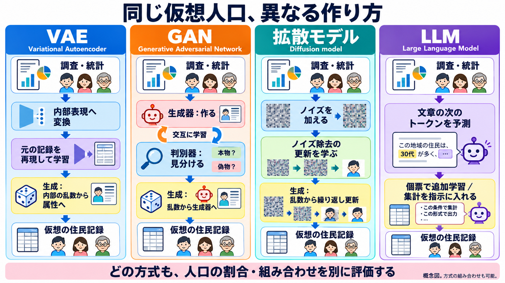
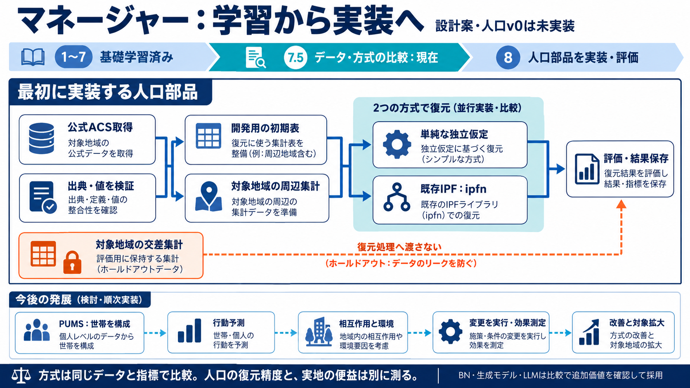

# 人口生成方式の比較とマネージャーでの選定

2026年10月18日。学習単元7.5の比較教材。進捗は統合SSOTにのみ記録する。最初の6セル復元は単純な独立仮定と既存IPFを比較する。世帯・個人段階では、元の世帯の再標本化と集計調整を軸に、BNを比較候補にする。高次元化などに応じて拡散モデルやLLM等を追加評価する。以下は先行研究に基づく設計判断で、私たちが全方式を実測比較した順位ではない。

## 主要方式の強みと弱み

|方式|主な入力と働き|強み|弱み・条件|マネージャーでの扱い|
|---|---|---|---|---|
|単純な独立仮定|各属性の割合を独立と仮定して掛け合わせる|安価で再実行しやすく、追加方式の価値を測れる|属性同士の関連を表せない|人口v0の必須比較対象|
|IPF・再重み付け|初期表や標本の重みを既知集計へ調整|少数の集計条件に合わせる目的が明確。計算と検査を追える|初期の関係に依存し、ゼロを掛け算で増やせない。未知の組合せは保証しない|集計表v0に既存ipfnを利用|
|世帯単位の再標本化・IPU/list balancing等|個人が世帯に属する標本と、世帯・個人の集計|元の世帯関係を保持し、複数レベルの人数を扱える|見本の欠落・重みの偏り。整数化後の誤差。IPUとPopulationSimの方式は同じではない|PUMS世帯段階の基準設計。PopulationSim等の再利用範囲を評価|
|BN（ベイジアンネットワーク）|個票から属性の依存構造と確率を学ぶ|依存関係を追いやすく、学習後の生成が比較的軽い|構造・条件付き独立の仮定、希少条件のデータ不足。世帯関係や地域集計は自動では保証しない|個票生成の有力な比較候補|
|MCMC・条件付き抽出|条件付き分布などから状態を繰り返し更新して抽出|条件や分布に基づいた抽出を構成できる|混ざり方・収束・自己相関の確認が必要。BN等と組み合わせられるため排他的な分類ではない|必要な条件付き生成で検討|
|組合せ最適化・焼きなまし・整数最適化|候補世帯と地域の制約から組合せを探索|整数・世帯・地域の条件を明示できる|探索時間、局所解、候補の不足、制約の両立不能。ソフトによって近似解になる|割当て・整数化を扱う既存実装の候補|
|VAE|個票を潜在分布へ圧縮し復元するよう学ぶ|比較的学習を扱いやすく、学習後の生成が速い|希少な組合せの不足、制約違反、潜在表現の解釈|追加価値を測る候補|
|GAN|生成器と判別器を競わせる|複雑な分布を学び、学習後に速く生成できる|学習調整、モード崩壊、少数層の欠落|最初の既定にせず比較で選ぶ|
|拡散モデル|乱したデータからの復元等を学び、段階的に生成|複雑な混合属性に有力な比較結果がある|反復生成の費用、カテゴリー処理、制約の追加検査|深層モデルを比較するときの有力候補|
|LLM追加学習型|個票を文章化して次トークン予測で適応|属性の意味と調査の傾向を併用できる|学習費用、記憶、分布誤差、不正出力、順序や生成設定への依存|個票があり、既存方式を超える価値を測れる場合に比較|
|LLM指示・統計フィードバック型|公開集計と形式を指示し、生成後のずれを次の入力へ戻す|個票なしでも試せ、条件を文章で指定できる|未知の組合せをLLMが補う。割合一致や現実性は保証されず、指示・費用に依存|個票が得られない用途の比較候補。PUMSが得られる初期実装で必須にはしない|

IPF・整数化・世帯抽出・BN・LLMは異なる役割を持ち、組合せられる。「全部を導入すると最良になる」という設計にはしない。TRSや整数最適化は、小数の重みを個体数へ変える工程であり、人口属性の学習モデルと同じ順位表へ無条件に入れない。

## 比較研究が支持する範囲

Darselほか2026の12属性・フランス資料の条件では、BNが精度・費用等のよい折り合いを示し、深層生成モデルでは拡散が有力だった。全領域・全次元への結論ではなく、IPFとLLMの直接比較でもない。Lim・Yunほかでは追加学習LLMが参照資料にある組合せの指標で優れても、VAE/WGANの分布誤差が小さい。JonesほかではLLMとIPUの優劣が属性で変わり、全体平均・速度・費用はIPUが有利だった。

したがって「最良」は、同じ入力と未使用評価資料、単位、生成数、世帯制約、少数集団、乱数反復、時間と費用をそろえて選ぶ。集計制約への一致、高次の未使用組合せ、定義上の矛盾、訓練記録の複製・プライバシーを別々に確認する。全基準を一つの点数へ隠さない。

原論文と読解範囲は[方式選定レビュー](2026-10-17-population-method-selection-ja.md)、[データ選定](2026-10-18-manager-dataset-selection-ja.md)、[世帯・整数化](2026-10-18-household-integerization-ja.md)を参照。実装計画は既存atomic-patchesに維持する。

## 深層生成とLLMの内部処理

同じ仮想の住民記録を作る場合でも、学習の目的と生成手順が異なる。

|方式|学習する仕組み|新しい記録を作るとき|
|---|---|---|
|VAE（Variational Autoencoder、変分オートエンコーダ）|属性を潜在表現へ変換し、元の記録を再構成する。潜在分布も整える|事前分布から抽選し、学習済み復号器で属性を出す|
|GAN（Generative Adversarial Network、敵対的生成ネットワーク）|生成器と判別器を交互に更新する|乱数を学習済み生成器へ渡す|
|拡散モデル（Diffusion model）|ノイズを加えたデータから、ノイズや元データなどを予測する更新を学ぶ|新しい乱数から、学習済みモデルで繰り返し更新する|
|LLM（Large Language Model、大規模言語モデル）|それまでの文章から次のトークンを予測する。人口記録で追加学習する構成もある|属性を文章や構造化形式で順に出す。集計を指示に含める方式もある|

例えば「30代・就業・3人世帯」という記録を出しても、内部の作り方は違う。LLMには、モデルのパラメータを追加学習で更新する方式と、追加学習せず公開集計を指示へ入れる方式がある。後者の指示フィードバックは、モデルのパラメータ更新と区別する。

これらは互いに排他的な分類ではない。VAEの潜在空間で拡散するモデルや、BNで決めた属性順序をLLMの追加学習へ使う研究もある。BNは属性の依存構造と条件付き確率分布を明示するモデルで、人口生成の別の比較候補である。

どの方式でも、人口の割合、未知の属性関係、希少集団、制約違反、複製、費用を共通条件で評価する。人口生成の成功は、行動予測や実地介入の成功とは別である。今回の比較は仕組みの整理で、自前モデルの性能順位を測った結果ではない。

詳細と確認済みの出典：

- [VAE講座](2026-10-17-vae-population-synthesis-ja.md)
- [GAN講座](2026-10-17-gan-population-introduction-ja.md)
- [拡散モデル講座](2026-10-17-diffusion-population-ja.md)
- [LLM講座](2026-10-18-llm-population-ja.md)

## 実装への接続

図の初期表は開発用6地域から作る。「周辺集計」は対象地域の年齢別・貧困状態別の合計を意味し、近隣地域の統計ではない。対象地域の交差集計は採点だけへ渡す。図は設計であり、人口v0を実装済みとしない。詳細は既存atomic-patches、進捗は統合SSOTを参照。
