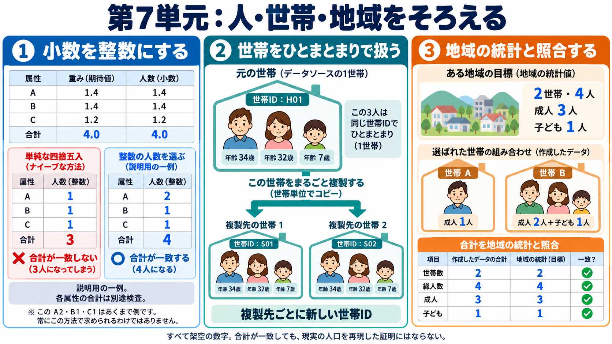

# 第7単元：整数化と個人・世帯・地域の整合

進捗は統合SSOTに記録する。ここで用いる小さな数字は架空で、実人口生成の結果ではない。

## 目的

人口合成では、属性の組み合わせだけでなく、何人・何世帯を、どの地域へ置くかを整える。世帯人数3と書かれた個人が3人いても、同じ世帯とは限らない。household_idで所属を明示し、世帯の構成を保つ。

## 整数化

重み1.4、1.4、1.2の合計は4だが、個別四捨五入は1+1+1=3になる。2、1、1なら総数4を保てるが、これは説明用の一例で各属性の一致まで保証しない。TRSは整数部分を複製し、残りの必要数を端数に応じた確率で抽出する。世帯を扱うとき、世帯数と人数は別の制約になる。

## 世帯と地域

候補Aは成人1人、Bは成人2人と子ども1人、Cは成人2人。対象地域が2世帯・4人・成人3人・子ども1人なら、AとBを一つずつ選ぶと一致する。標準Pythonで候補数の全列挙を実行し、この組み合わせを確認した。これは探索の教材で、実用ソルバーの導入や現実の検証ではない。元世帯を複製する場合は、複製先ごとに新しい世帯IDを付け、各複製に元世帯の構成員を結合する。

## 既存実装

PopulationSim commit 21881f0094680afbe11e2839124dfca10e61a2d2を取得し、populationsim/steps/expand_households.pyとwrite_synthetic_population.pyを読解。前者は整数重みによるnp.repeat、後者はsynthetic_hh_id付与とseed属性の結合を行う。PopulationSimの調整は単純IPFと同一ではなく、list balancing等を用いる。ソフト本体は未実行、マネージャーへ未統合。

COMPASS（2026-10-07）は世帯・個人の複数レベル制約を扱う組合せ最適化。人工人口Meropisから集計と標本を用意して再構成を検証する。最終的に合計が一致しても、未観測の組み合わせや実人口の正しさは保証されない。

## マネージャーへの適用

将来の実装では世帯・個人・地域ID、観測/推定の区別、整数化前後の誤差を記録する。最初の人口v0の集計表を扱う範囲では、世帯や地理部品を不要に追加しない。相互作用・共有資源を扱う用途に応じて導入する。

## 出典

- https://activitysim.github.io/populationsim/application_configuration.html
- https://github.com/ActivitySim/populationsim/tree/21881f0094680afbe11e2839124dfca10e61a2d2
- https://arxiv.org/abs/1303.5228
- https://robinlovelace.net/spatial-microsim-book/smsim-in-R.html
- https://journals.sagepub.com/doi/10.1177/23998083261484652
