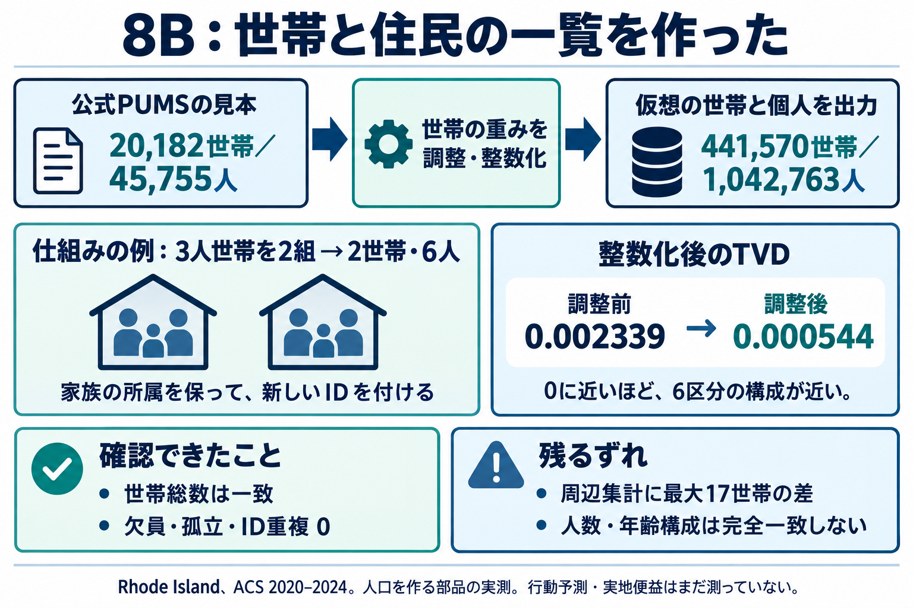
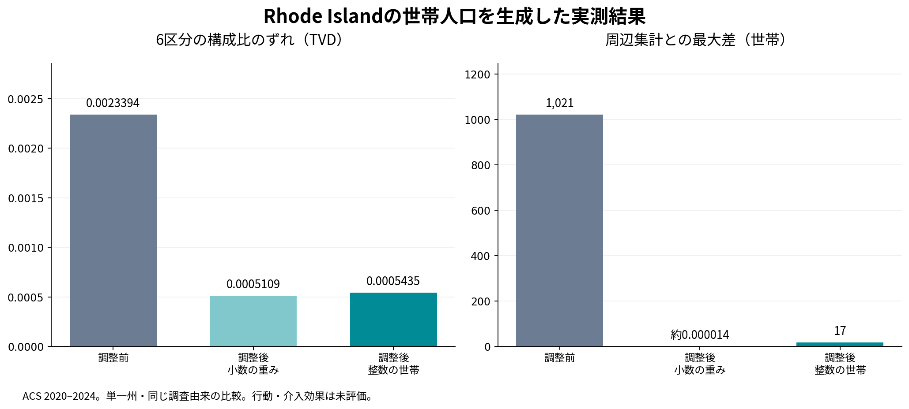

# 世帯を壊さず、44万世帯と104万人の仮想人口を作った

Rhode Islandの公開データから、441,570世帯・1,042,763人の仮想人口を生成した。一人ずつの記録に新しいIDを付け、同じ家に属する人を結びつけた。出力を読み直した検査では、欠員・孤立した個人・ID重複・元属性の不一致は0だった。

この説明図は生成画像で、実測値と仕組みの架空例を分けている。下のグラフは保存した実測結果から描いた。

## 人口の表から、一人ずつの一覧へ

前の8Aでは、年齢×貧困状態の6区分に何人いるかという表を作った。今回の8Bでは、どの人とどの人が同じ世帯かを持つ一覧へ進んだ。世帯を作る際は、構成員全員をまとめて選ぶ。

例えば、説明用の見本に「大人2人と子ども1人の3人世帯」があるとする。これを2世帯分使う場合、3人のセットを2組作る。世帯は2つ、人数は6人になる。各組に別の世帯IDを付け、その組の個人にも新IDを付ける。3人から2人だけを抜き出す処理ではない。この小さな例は架空で、実際の生成では下記の公開見本を使った。

## 元にしたのはPUMSの住宅と個人の記録

使った資料は、米国Censusの2020–2024 ACS 5-year PUMS。住宅のファイルと個人のファイルが分かれており、共通のSERIALNOで所属を結べる。Rhode Islandの通常居住世帯20,182件に、45,755人の個人記録が所属していた。全対象世帯で、住宅側の人数と個人側の人数が一致した。

PUMSには空き家や、寮・施設などの集団居住の記録も含まれる。今回は通常の居住世帯だけを対象にし、空き家1,503件、集団居住のplaceholderと対応する個人4,070件を分けた。仮想人口を実在する住民名簿や実住所と扱うこともしていない。

少数の見本から地域の人口を作るには、一つの見本を何世帯分使うか決める必要がある。PUMSのWGTPは世帯用の重みで、今回の出発点にした。PWGTPは個人用の重みなので、世帯の複製回数と同じものとして使い回さない。

## 合わせたのは世帯種別と世帯人数の合計

公式のB11016という集計表から、家族世帯/非家族世帯の世帯数と、1人/2人/3人以上の世帯数を取り出した。非家族世帯には一人暮らしだけでなく、血縁などのない同居人の世帯も含まれる。家族世帯の1人は定義上あり得ない0として残した。

調整前の方法は、元の世帯重みを目標総数へ比例させる。調整後の方法は、IPFを使って既知の世帯種別別合計と人数構成別合計へ合わせる。調整するのは各世帯を何回使うかで、選んだ世帯の構成員は変えない。

採点では、入力に渡していない「家族世帯のうち何世帯が2人か」など、世帯種別×人数構成の6区分を比較した。復元処理は、この採点用の交差集計を開かない。ただしPUMSと公式集計は同じACS調査に由来するため、完全に独立した調査による実証とは呼べない。

## 小数の重みを、実際に作る世帯数へ変える

調整した重みが12.4なら、そのまま12.4世帯を一覧に置くことはできない。整数部分の12世帯を採ったうえで、残りの必要世帯数を端数に応じて抽選した。TRSと呼ばれる既存の整数化手法である。

この方法で、世帯総数を441,570へ一致させた。ただし、世帯の種類や人数の内訳まで厳密に一致するとは限らない。3人世帯を一つ増やすと、世帯が1つ、人が3人増えるため、世帯数と人数は別の制約になる。

## 整数化の前後を分けて測った結果

|段階|6区分TVD|周辺集計の最大差|
|---|---:|---:|
|調整前|0.00233938|1,021世帯|
|調整後・小数の重み|0.00051085|約0.000014世帯|
|調整後・整数の世帯|0.00054352|17世帯|

TVDは、6区分それぞれの構成比の差を絶対値にして足し、半分にした値。0が一致する。今回の整数人口では、調整前から約76.8%小さくなった。一つの州の、この世帯区分での比較なので、他地域や全属性でも同じ改善率になるとはしない。8Aの年齢×貧困のTVDとは区分も対象も違う。

整数化で、周辺集計に最大17世帯の差が戻った。例えば2人世帯は目標151,592世帯に対して151,575世帯になり、17世帯少なかった。この17は調整に使った合計のずれで、採点用の交差セルすべてが17以内という意味ではない。乱数seedを事前に決めた10通りで試すと、整数化後のTVDは0.00045519〜0.00058201だった。この幅は抽選による変動であり、元のACS推計の信頼区間ではない。良いseedを選んで代表値にしていない。

## 世帯が合っても、個人の分布は完全一致しない

調整後に生成した人数は1,042,763人だった。一方、元の対象個人をPWGTPで集計した参考値は1,057,168人。年齢3区分の割合にも最大約0.70パーセントポイントの差が残った。個人の人数や年齢を今回の調整制約に含めていないため、この差を別に記録した。

世帯を丸ごと使えば、見本の家族関係は保てる。しかし、地域のあらゆる属性が正しくなる保証はない。個人・世帯の両方の制約を扱う調整や整数最適化は、次の比較候補になる。元調査の推計誤差を伝播する処理も、今回はまだ実装していない。

## ソースと説明素材を再利用できる形にする

取得、所属検証、重み調整、整数化、CSV出力、再読検査、採点を実行コマンドに分けた。同じ入力とseedで出力を再生成できる。既存のPopulationSimの世帯展開とID付与の形、TRSの原手法を参考にし、IPFには既存OSSのipfnを使った。PopulationSimやAaru、Simileの製品全体を再現した実装ではない。

[実装と実行手順](../../../../apps/manager/docs/households-v0.md)、[公開用の集計記録](../evidence/2026-10-18/household-v0-summary.json)、[6枚のスライド・カルーセル素材](../content/2026-10-18-household-v0/README.md)を保存した。ソースはリポジトリのMIT Licenseに従う。データ本体と全仮想人口のCSVはGit外に置き、公式配布先から再生成できる。

Aniccaの使命はEnd suffering.であり、マネージャーはその実現に向けて作る製品である。今回の実装は、そのための人口部品である。次の行動予測では、仮想の個人・世帯に状況を与え、何を選びそうかを別の行動観測で評価する。今回、苦しみの軽減効果は測っていない。記事と画像は保存済み素材で、ブログやTikTokへの投稿はまだ行っていない。

## 出典

- [Census公式住宅ZIP](https://www2.census.gov/programs-surveys/acs/data/pums/2024/5-Year/csv_hri.zip)と[個人ZIP](https://www2.census.gov/programs-surveys/acs/data/pums/2024/5-Year/csv_pri.zip)。各ZIPに公式ReadMe同梱。
- [PUMSのデータ辞書](https://www2.census.gov/programs-surveys/acs/tech_docs/pums/data_dict/PUMS_Data_Dictionary_2024.pdf)
- [B11016の定義](https://api.census.gov/data/2024/acs/acs5/groups/B11016.json)と[公式集計ファイル](https://www2.census.gov/programs-surveys/acs/summary_file/2024/table-based-SF/data/5YRData/acsdt5y2024-b11016.dat)
- [PopulationSimの固定コード](https://github.com/ActivitySim/populationsim/tree/21881f0094680afbe11e2839124dfca10e61a2d2)
- [Lovelace/Ballasの整数化手法](https://arxiv.org/abs/1303.5228)
