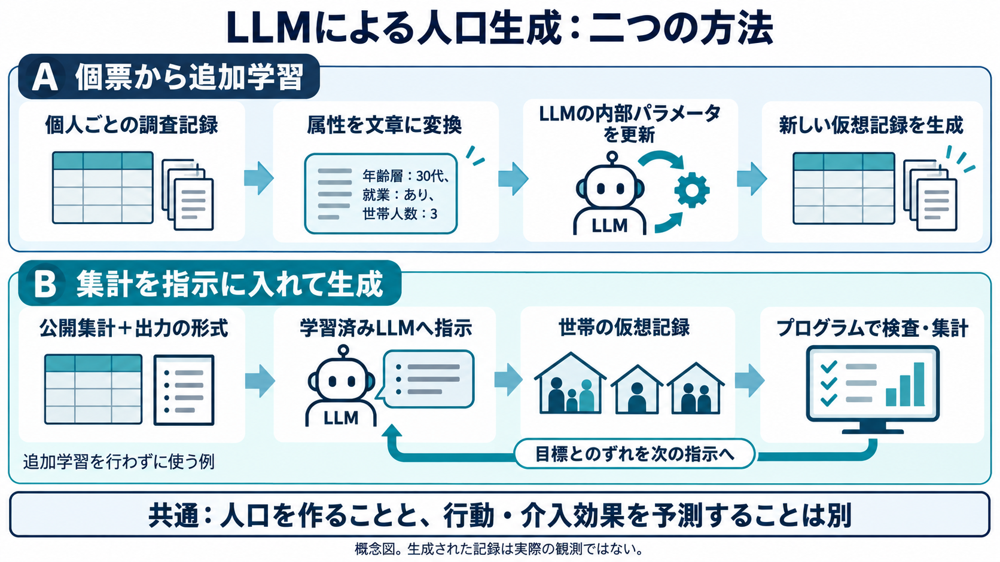
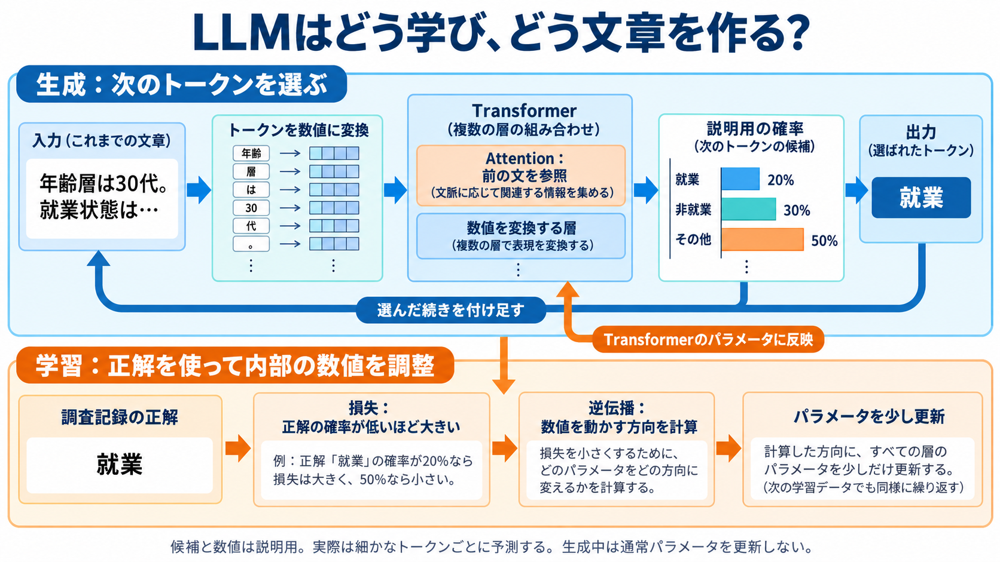

# LLMで人口を作る：追加学習と指示による生成を分ける

調査日：2026年10月18日。LLMはLarge Language Model、大規模言語モデル。今回は仮想の個人・世帯の属性記録を作る方法を扱う。人の行動予測や、介入の効果測定は別の工程である。

## 1. 文章を生成するモデルが、なぜ人口を作れるのか

人口表の一行は文章にもできる。「年齢層は30代、仕事は事務職、世帯人数は3人」といった記録である。LLMは文字列をトークンという小さな単位へ分け、それまでの並びから次のトークンの確率を計算する。続きの選択を繰り返すことで一人分の記録を出せる。

ただし、文章が自然であることと、集団全体の人数や属性の組み合わせが現実に近いことは違う。言葉として典型的な人ばかり作ると、少数集団を過小に表す場合がある。

## 2. 方法A：個票で追加学習する

すでに学習された言語モデルに、対象の調査記録を文章化して追加学習させる。fine-tuningは、このモデルの内部パラメータをデータに合わせて更新すること。プロンプトへ一時的に資料を入れる処理とは区別する。

SFTはSupervised Fine-Tuning、教師あり追加学習の略である。今回の人口生成コードでは、文章化した記録を正解の系列として、続くトークンへ高い確率を置くよう更新する処理を確認した。チャットで指示へ従う学習と同じ名称でも、入力と評価対象は異なる。人口重みとも別の数値を更新している。

Yunほかの研究では、BNで得た属性の依存構造に沿う順序で記録を文章化する。BNが人口の全てを生成する方式とは異なり、LLMの学習に使う属性の並べ方へBNを利用する。順序は一つに固定するだけでなく、構造に矛盾しない並びを選ぶ実装になっている。[1][2]

例として、先に世帯人数を出し、次に他の属性を出す設計なら、次の項目の生成時には前の項目が文脈になる。ただし、その順序だけで因果関係や世帯整合性が保証されるわけではない。

## 3. 読んだコードと動かした部分

`HyunsooYun/llm-pop-synth` の `utils/text_encoder.py` は、数値コードを意味のある語句へ変換し、属性を指定順に結合する。`LLM-BN/train.ipynb` ではBNに沿った順序を使い、`BN_generator.py` ではDistilGPT-2を読み込む。モデルへ `labels=input_ids` を渡して損失を計算し、逆伝播とoptimizer更新を行う。

今回は上流 `TextEncoder.encode_row` を、架空の3属性で実行した。出力は `Age group is 30-39, Work type is Manager/Office, Number of household members is 3.`。これはデータの文章化であり、LLMの学習・推論はしていない。コードはMIT、データとモデルの利用条件は別に確認する。[2]

## 4. 方法B：集計を指示に入れて生成する

個票がない場合、公開統計と必要な出力形式を指示へ入れる方式がある。Jones・Dawson・Millsの2026年研究は、集計から世帯を生成し、現在の集計と目標の差を次の指示へ返す。モデル自体の追加学習を必須としない。[3]

架空の目標を「100人、若い層60人・年上40人」とする。途中まで50人を作り、その内訳が若い20人・年上30人なら、残りの人数を厳密に合わせるには若い40人・年上10人が必要である。この差はプログラムで計算できる。LLMへ文章で条件を伝えたことだけでは、その人数を正確に出す保証はない。

実際の公開コードでは `engine/generator.py` の `generate_households` がバッチ生成を進め、`update_prompt_with_statistics` を呼んで次の指示を更新する。`generation/prompts.py` は統計情報をテンプレートへ挿入する。実行用の出力形式と、必要なら追加の整合性検査を設定できる。[4]

この往復では、作成中の人口と指示が更新される。モデル内部のパラメータまで更新しているとは限らない。人口の統計的なずれを小さくするループは、現実へ介入して生活が改善したかを学ぶループとも異なる。

## 5. 二つの方式の使い分け

|観点|個票による追加学習|集計による指示生成|
|---|---|---|
|主な入力|個人ごとの調査記録|公開集計・形式・文脈|
|モデルの内部数値|追加学習で変更|ここでの例では変更しない|
|集計への一致|生成後の検査が必要|指示へ差を戻しても検査が必要|
|主な課題|標本の偏り、学習費用、記憶|未知の交差分布、指示依存、生成費用|

「sample-free」は対象地域の個票を必要としないという意味で、モデルの事前学習や公開集計まで不要という意味ではない。未知の関係は事前学習の傾向に依存し得る。

## 6. 何を評価するか

まず形式と定義上の整合をプログラムで検査する。次に、与えた集計への一致を測る。さらに、生成や調整へ使わなかった交差集計で属性の関係を評価する。指示の言い換え、乱数、モデル版による変動、費用、少数集団、記録の複製も確認する。

Yunほかの公開稿では、LLM系が実現可能性の代理指標で有利でも、VAE/WGANの方が分布への一致がよい項目がある。有限の参照資料にない組み合わせを、論理的に不可能と自動判定しない。JonesほかのIPU比較でも、項目、費用、利用できる資料で優劣が変わる。新しい方式を使ったというだけでは成果にならない。

## 7. 今回の実行範囲

論文・コードの読解と、上流の文章化関数の実行を行った。実データを使った追加学習、モデルのダウンロード、LLM推論、API呼び出し、生成した実人口の性能測定は未実施。数値例は架空の説明用である。

次の主線は、個人と世帯を整合させる方法と、実資料での方式比較。追加学習の損失や生成時の確率調整に疑問があれば、その部分を先に深める。

## 出典

1. Yunほか、論文公開稿：https://arxiv.org/pdf/2505.04196 ; 2026年雑誌版：https://doi.org/10.1016/j.trc.2026.105581
2. 著者コード：https://github.com/HyunsooYun/llm-pop-synth
3. Jones・Dawson・Mills、2026：https://journals.plos.org/plosone/article?id=10.1371/journal.pone.0341704 ; 図10の訂正確認済み：https://journals.plos.org/plosone/article?id=10.1371/journal.pone.0356492
4. 著者コード：https://github.com/MJones235/LLM-Population-Generator （今回の固定コミットは証拠JSONを参照。論文掲載時のreleaseと現行チェックアウトを同一視しない）

