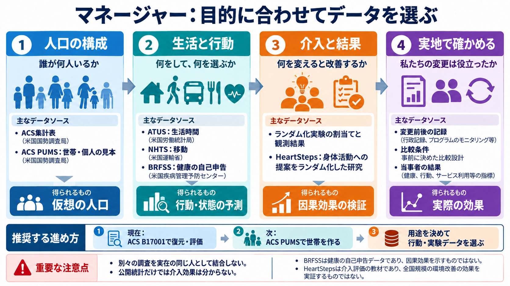

# マネージャーのデータ選び：人口、行動、介入をつなぐ

2026年10月18日調査。第7.5単元の教材（データと方式選定。第8単元は実装）。企業の説明、論文の報告、私たちの採用方針を分ける。以下は主要な事例を調べた比較であり、全企業・全論文を網羅した一覧ではない。進捗は統合SSOTにのみ記録する。

## 推奨する組み合わせ

最初の人口部品は、既存計画どおりACS 2024 5-yearのB17001集計表で検証する。次の世帯・個人を扱う部品には、同じ2020–2024年系列のACS PUMSを第一候補にする。生活時間、健康、移動、実験結果は、最初の介入用途を決めてから選ぶ。

人口構成が分かる資料と、行動を観測した資料と、介入の因果効果を調べられる資料は異なる。国勢調査の属性だけから、環境を変えたときの便益は測れない。私たちの使命は苦しみの終焉であり、全生命・宇宙への長期構想を保つ。ここで選ぶ人間人口のデータは、その構想の最初の技術部品に限定する。

## データを四つの役割に分ける

|役割|観測するもの|候補|この資料だけでは分からないこと|
|---|---|---|---|
|人口の構成|年齢、所得、世帯構成、地域別人数|ACS集計、ACS PUMS、INSEE国勢調査|未知の状況での選択や介入効果|
|生活と行動・状態|生活時間、移動、健康の自己申告、回答、購買|ATUS、NHTS、BRFSS、調査・実験データ|観測された関連が介入の効果かどうか|
|介入と結果|割当て、割当て確率、実施可能性、実施後の結果|ランダム化試験、HeartStepsなど|別の人口・別の環境への効果の移転|
|自分たちの実地評価|実行した変更、比較条件、結果、費用、悪影響|自分たちが運営する環境の記録と当事者からの観測|観測していない便益や全生命への効果|

## 先行者が使っているデータ

|研究・企業|公開資料に書かれたデータ|目的と再利用できる学び|確認範囲と制限|
|---|---|---|---|
|RTI / rti_synth_pop|2015–2019 ACS、PUMS、TIGER、LandScan USA|人口属性、世帯、空間配置を組み合わせた米国合成人口|論文概要と公式READMEを確認。コード、配布人口、位置データの利用条件は個別に扱う。現行データを2019年の配布物と同一視しない|
|ActivitySim / PopulationSim|世帯・個人の標本と、複数地理階層の集計制約。米国利用ではACS/PUMSが候補|世帯の関係を保ち、世帯単位と個人単位の条件に合わせる|公式文書と取得コードを読解。フレームワーク自体は特定年度のACS専用ではない|
|Jones・Dawson・Mills 2026|Newcastleの2021 UK Census集計。IPU比較にはNorth Eastの10% safeguarded microdata|個票が得られない場合、集計をLLMの指示へ入れ、生成結果を集計して戻す|論文の方法・結果・限界と著者コードを読解。英国個票を無条件でダウンロード可能とはしない|
|Lim・Yunほか 2026|韓国HTSの2010・2016・2021年を統合した1,006,391件。学習標本はその5%|交通分野の属性組合せを学習し、LLM・BN・生成モデルを比較|公開稿と著者コードを読解。統合調査を実在の全人口とみなさない。交通調査の属性は一般的な苦しみの測定ではない|
|Darselほか 2026|INSEEフランス国勢調査、Île-de-France。公開前処理データは23変数、論文の比較は12属性|BN・VAE・GAN・拡散を、同じデータと評価条件で比較|最終版の方法・データ・結果を読解。重み付き調査の代表値を全住民の完全な個票とみなさない。前処理データとコードのライセンスは別々に確認|
|Hoehnほか COMPASS 2026-10-07|人工人口Meropisから作った小地域集計と1%世帯標本|元人口が分かる教材で、世帯・個人・地域の整合と生成の不確実性を検証|論文の方法と実験を読解。Meropisでの結果を実世界の便益と混同しない|
|Aaru|公式説明では国勢・人口統計、公開資料、許諾された購買・来訪などの行動記録、顧客の第一者データ。公開評価は質問・選択肢・対象集団の説明と、保持された回答分布|人口構成、行動、結果を用途ごとにそろえ、未使用の観測結果で評価する|公式Simulationページと2026-09-24の研究記事を確認。非公開データ、全ベンダー、全内部実装は不明。企業自身の主張として扱う|
|Simile|公式説明では店舗・配達アプリの取引、AIによる音声インタビュー、調査回答、実際の結果|行動記録と本人の説明を併用し、予測分布と観測分布を比較する|公式confidence/what-if記事を確認。現行製品の全学習データは公開されていない|
|Parkほかの個人シミュレーション研究|米国1,052人の2時間インタビュー、GSS項目、Big Five等の自己報告|人口属性だけの人物設定と、本人から得た情報を用いる方法を比べる|2026-06-28改訂v3の要旨を確認。旧題はGenerative Agent Simulations of 1,000 People。全インタビューを自由取得できるとはしない。Simile製品全体の実装説明ではない|

企業が同種のデータを使うことは、私たちがその企業のデータを利用できることを意味しない。また、公開された購買予測の精度は、環境変更による因果効果の保証ではない。

## なぜ最初はACSなのか

ACSは米国国勢調査局のAmerican Community Surveyである。集計表は地域ごとの合計を表し、PUMSはプライバシー保護の加工を受けた人・住宅の標本記録を表す。役割が異なる二種類を同じ調査系列から得られるため、世帯生成まで段階的に学べる。公式の変数辞書、重み、精度の資料、ファイル配布があり、外部の有料データ契約を最初の条件にしなくてよい。

ただし、米国を最終市場と決めたから選ぶわけではない。第8単元の再実行しやすい教材として選ぶ。地域や対象人口を日本へ移す場合には、e-Statの公開集計と個票利用条件を改めて設計する。日本の公開集計があることと、対応する匿名個票を審査なしに使えることは別である。

ACS 5-yearは5年間の調査から得た推計で、今日の住民台帳ではない。1-yearと5-yearの混在、年度・地理境界・対象母集団の違いを避ける。最新のモデルへ変更しても、評価データの版は固定し、比較できる状態にする。

### 最初の集計表：B17001

既存v0は2020–2024 ACS B17001「過去12か月の貧困状態×性別×年齢」を、年齢3群×貧困2群の6セルへまとめる。対象は貧困状態が判定される人口であり、全人口そのものではない。貧困は苦しみの代理指標として自動採用せず、人口再構成の検証項目として使う。

50州とDCを開発6・検証4・最終評価41地域へ分ける既存計画を維持する。対象地域では周辺集計だけを復元処理へ渡し、交差集計は採点側へ分離する。初期表は開発地域から作り、単純な独立仮定とIPFを比較する。

この分離で防ぐのは答えの混入である。同じACSから計算した周辺集計と評価用交差集計は、独立に採取したデータではない。「隠した組合せをどれだけ復元したか」と報告し、将来予測や実地改善の実証とは呼ばない。

### 次の個票：ACS PUMS

次段階では2020–2024 ACS 5-year PUMSの住宅ファイルと個人ファイルを使う。最初の小規模読解用にはRhode Islandを推奨する。州を選ぶ理由は処理量を抑え、入出力を追いやすくすること。効果実験の対象地域を選んだことにはしない。

2026-10-18に、公式配布ディレクトリで `csv_hri.zip` と `csv_pri.zip` の存在を確認した。ZIP本体の取得や人口生成はまだ行っていない。

|ファイル|最初に使う項目|役割|
|---|---|---|
|住宅・世帯|SERIALNO、ST、PUMA、NP、WGTP|世帯の識別、地域、人数、世帯重み|
|個人|SERIALNO、SPORDER、AGEP、RELSHIPP、PWGTP|世帯所属、世帯内個人識別、年齢、続柄、個人重み|

追加で所得・就業・貧困状態を扱う場合は、HINCP・ESR・POVPIPなどを辞書に従って追加する。生コードを人名・現住所・実在個人の識別子と解釈しない。住宅ファイルには空き家、個人ファイルには集団居住施設等の対象もあるため、通常世帯を扱う範囲と除外理由を定義する。NPと結合後の人数、キー重複、続柄、欠測、割当て・加工フラグを検査する。

個票を何行読んだかと、重みを使った人口推計を分ける。世帯を選ぶ重みと個人を集計する重みも混同しない。学習・評価の分割は世帯ID単位にし、同じ世帯の人が両側へ分かれないようにする。

PUMSの公開地理は粗く、個票に正確な町内住所はない。小地域に置く場合には、地理の対応表と別の集計制約が必要になる。PUMSの加重推計とACS詳細表が完全一致するとは限らず、公式資料も推計差を説明している。ACS集計とPUMSは元調査が重なるため、完全に独立した検証とは呼ばない。

## 生活や介入へ進むときの候補

|用途|候補|使える観測|採用前に確認すること|
|---|---|---|---|
|時間の負担・家事・休息・ケア|BLS ATUS|活動日誌、活動時間、回答者属性、世帯構成|回答者を中心とした日誌で、世帯全員の同時行動ではない。幸福度モジュールは別年度・別資料として確認。時間短縮を苦しみ軽減と同一視しない|
|移動・交通の負担|FHWA NHTS|世帯、個人、旅行・移動記録、交通手段|全国標本の代表範囲と版、調査重み、地域粒度。交通サービスを変更した効果が直接入っているとは限らない|
|健康・主観的状態|CDC BRFSS|成人の健康状態や健康行動の自己申告。MENTHLTHなど|対象は成人・電話調査。子どもや全生命を代表しない。因果介入データではない|
|質問や実験条件への反応|SocSci210等|研究・条件・質問・回答の対応|元研究ごとの利用条件、研究単位での評価分割、重複と学習データ混入。人口構成の基準にはしない|
|介入評価の方法を学ぶ|HeartSteps V1|身体活動への提案をランダム化した試験の記録|公開リポジトリのCC BY 4.0と引用。利用可能性、割当て、結果、欠測を理解する。身体活動の個人向け介入から大規模環境変更へ効果を一般化しない|

マネージャーの最初の環境変更用途は未確定である。使命との接点を重視するなら、生活時間やケア負担を扱うATUSは次の読解候補になる。ただし、介入の操作対象と比較設計が決まる前に、最初の実地用途として採用しない。

異なる調査に同じ年齢・所得の行があっても、実在する同じ人ではない。PUMSとATUSやBRFSSを年齢だけで結合し、実測された一人の履歴として扱うことはできない。統計的な対応付けを行うなら、仮定、対象の共通性、対応しない属性、結合後の検証を明示する。

## 実装への対応

既存の人口v0にある `apps/manager/src/manager/population/acs.py`、`prepare.py`、`fit.py`、`apps/manager/src/manager/benchmarks/population.py` と `config/population-v0.json` の計画は維持する。今回、製品コードは作成しない。PUMS、生活時間、健康のデータを初期6セルの入力へ混ぜない。

世帯段階を実装するときの候補は `population/pums.py`（読込・型検証）、`population/households.py`（所属・人数・複製ID）、`population/integerize.py`（既存整数化手法との接続）、`tests/test_pums.py` と `tests/test_households.py`。これは設計候補で、現在の実装済みファイルではない。スキーマと受入条件を確定した段階で既存atomic-patchesへ具体化する。

各入力の記録には、提供者、URL、年度・期間、対象母集団、地理粒度、変数辞書、単位、重み、欠測規則、精度情報、利用条件、取得日、ハッシュ値、入力/評価の役割、元調査の重なりを含める。外部資料をGitHubへ再配布できるかと、手元で研究利用できるかを分ける。

## 資料と読解範囲

- [ACSのPUMS概要](https://www.census.gov/programs-surveys/acs/microdata.html)、[2024年の辞書・精度・利用資料](https://www.census.gov/programs-surveys/acs/microdata/documentation/2024.html)、[公式5年配布先](https://www2.census.gov/programs-surveys/acs/data/pums/2024/5-Year/)。メタデータと配布一覧を確認。
- [B17001項目定義](https://api.census.gov/data/2024/acs/acs5/groups/B17001.json)。実際にJSON取得し、対象母集団と項目例を確認。
- [RTIの論文](https://pmc.ncbi.nlm.nih.gov/articles/PMC11762717/)、[公式コード](https://github.com/RTIInternational/rti_synth_pop)。論文概要とREADMEを確認。コード全体は今回実行していない。
- [PopulationSim公式資料](https://activitysim.github.io/populationsim/application_configuration.html)。前単元で世帯展開・出力コードを読解済み。
- [Jonesほか](https://journals.plos.org/plosone/article?id=10.1371/journal.pone.0341704)、[Lim・Yunほか](https://doi.org/10.1016/j.trc.2026.105581)。前単元で方法・結果と著者コードを読解済み。
- [Darselほか最終版](https://hal.science/hal-05758634/document)、[前処理データ](https://doi.org/10.17632/p2gcy7x7sd.3)。最終版のデータ節と比較を確認。前処理データ本体は今回取得していない。
- [COMPASS](https://journals.sagepub.com/doi/10.1177/23998083261484652)。人工人口の実験と方法を確認。
- [Aaruの公式説明](https://aaru.com/simulation)、[公開評価](https://aaru.com/publications/population-simulation-at-the-replication-floor-research)。データ種別と評価条件を確認。
- [Simileのconfidence記事](https://www.simile.com/blog/confidence)、[what-if記事](https://www.simile.com/blog/what-if-machine)。データ種別と結果の検証方法を確認。
- [Parkほか改訂v3](https://arxiv.org/abs/2411.10109v3)。今回の追加確認は改訂要旨まで。旧版の数字をそのまま最新版の成果として扱わない。
- [ATUS](https://www.bls.gov/tus/data/datafiles-2024.htm)、[NHTS公式公開ガイド](https://nhts.ornl.gov/media/2022/doc/DE_public.pdf)、[BRFSS](https://www.cdc.gov/brfss/annual_data/annual_2024.html)。配布資料と用途を確認。本文データの解析は未実施。
- [SocSci210の固定版](https://huggingface.co/datasets/socratesft/SocSci210/tree/048481111a4425ed83dc0eacf15f8431f252b21a)、[HeartSteps V1](https://github.com/klasnja/HeartStepsV1)。前者はカード、後者はREADMEとCC BY 4.0を確認。試験解析は未実施。
- [日本の匿名データ利用](https://www.e-stat.go.jp/microdata/anonymity)。集計と個票の利用手続の違いを確認。

取得確認の記録：`../evidence/2026-10-18/dataset-source-check.json`。HTTPエラーも残し、Webでの読解とスクリプト取得を混同しない。
