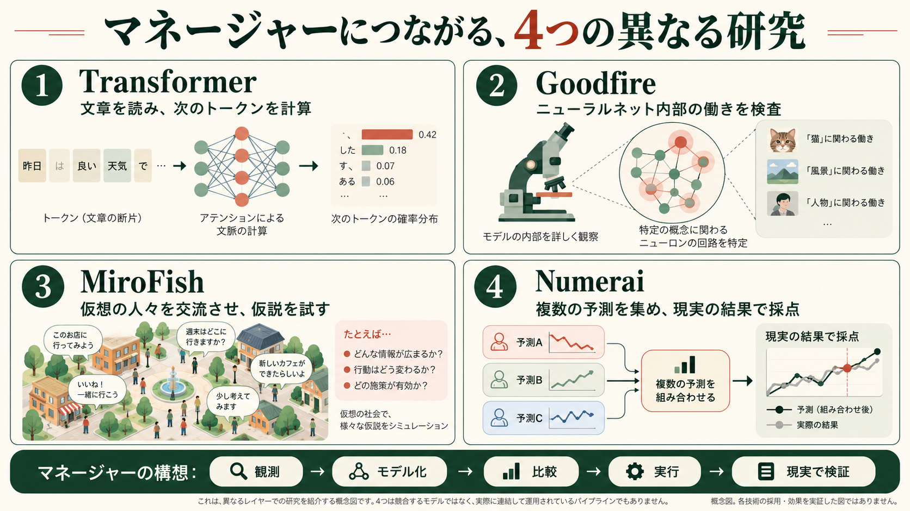

# 世界を理解し、変えるAIはどこから来たのか。MiroFish、Goodfire、Numeraiとマネージャー



図はAI生成の概念図。人物、確率、グラフは例示で、実際のモデル出力、収益、介入効果を表すものではない。

確認日：2026年10月18日。公式サイト、原論文、公開コードをもとにした解説。企業の説明、研究者の仮説、説明用の架空例、私たちの実測を区別する。

世界をモデル化し、変更案を試し、現実に働きかけ、その結果で学ぶ。こうしたAIを考えると、社会シミュレーション、言語モデル、モデル内部の解釈、予測の集約が一度に登場する。しかし、それぞれが解く問題は異なる。

| 対象 | 主に扱うもの | 出力 | それだけでは分からないこと |
| --- | --- | --- | --- |
| Transformer型言語モデル | 入力のトークン列 | 次のトークンの確率や生成した文章 | 文章が事実に合うか、介入が有効か |
| MiroFish | 入力文書、人物・組織の関係、仮想社会 | エージェントの行動履歴と報告 | 現実の将来をどれだけ当てるか |
| Goodfireの指定記事 | ニューラルネットのニューロン・回路 | 内部機構に関する説明と実験 | 社会を正しく予測できるか |
| Numerai | 株式の特徴量と参加者の予測 | 採点された予測と統合モデル | 人口の反応や生活改善の効果 |

これらは四つの人口生成法ではない。計算方式、実験環境、内部の検査、予測の評価という異なる層に位置する。

## MiroFishは、資料から仮想社会をつくる

「Mirofish」は、公開リポジトリ `666ghj/MiroFish` を指すものとして確認した。名前の似た第三者のサービスを、開発元の公式サービスと取り違えない。開発者の実名は今回の資料だけで補わず、公開アカウントを記す。[1]

今回確認した公開コードでは、入力文書を分割してZep Cloudへ送り、人物・組織・関係を表すグラフを用意する。`graph_builder.py` に、分割、グラフ作成、関係の型の設定、データ投入の処理がある。次に `OasisProfileGenerator` が、グラフの要素と周辺情報から人物設定や組織の代表アカウントを用意し、Twitter型のCSVやReddit型のJSONへ変換する。[2][3]

コードにある `_generate_profile_with_llm` は、名前、要素の種類、要約、属性、文脈を指示へ入れ、接続先のLLMからJSONを受け取る。LLMをこの処理で追加学習する方式ではない。生成失敗時にはルールによる代替処理もある。したがって、人物設定の中身をすべて実測データと見なすこともできない。[3]

OASISを使う仮想SNS上で交流を進め、ReportAgentが検索や仮想エージェントへの質問を通して結果を整理する。報告に引用された発言が、仮想エージェントの発言である場合、それは現実の住民へのインタビュー結果とは異なる。[4][5]

例えば、説明用に「自治体がバスの減便を発表した資料」を入力したとする。学生、通勤者、自治体、報道機関という役柄を作り、仮想の投稿や反応を観察できる。そこから「夜間の移動に不安が集中するかもしれない」という調査仮説を得ることはできる。しかし「現実の住民の32%が反対する」という数値を信頼するには、実際の住民と比較した別の検証が必要になる。このバスの例は本稿の架空例であり、MiroFishを実行した結果ではない。

マネージャーに参考になるのは、資料からシナリオ、行動履歴、報告へつながる操作の流れである。一方、私たちが作った人口合成部品は、地域統計に人口構成を合わせる役割を持つ。MiroFishの登場人物を増やすことだけで、地域を代表する人口になるとは限らない。

確認した版は `7657031ac01184afe2cb220f5ee3545573b5e843`。構成上はLLM接続とZep Cloudが必要で、設定検査は独自の `ZEP_API_URL` を受け付けない。コードはAGPL-3.0であり、自社のMITコードへ無条件に取り込める部品として扱わない。今回は主要処理を静的に読んだ。サービスの起動、課金APIへの接続、未来予測の実験は行っていない。[6]

## Transformerの内部では、何が起きているのか

ここでは、現在よく使われる自己回帰型のdecoder-only言語モデルを例にする。2017年の原論文はencoderとdecoderを持つ翻訳モデルであり、すべての現代LLMと同じ構成ではない。[7]

説明用の入力を、次の一人分の記録とする。

```text
年齢層は30代。就業状態は
```

この続きとして「就業」「非就業」などを生成するまでには、次の計算がある。以下の分割、数値、確率はすべて架空で、実モデルから取り出した結果ではない。

### 1. 文字列をトークンIDへ変える

トークナイザーは文字列をトークンの列へ変換する。説明上は `[年齢層][は][30][代][。][就業][状態][は]` と分けたと考える。実際の切れ目はトークナイザーによって異なる。

次に、各IDに対応するembeddingという数値ベクトルを取り出す。例えばあるトークンが `[0.2, -0.4, 0.7, ...]` のような列になる。embeddingの表は学習するパラメータである。位置情報もモデルの方式に応じて計算へ入る。

### 2. Attentionで、前にある情報を組み合わせる

最後の位置が続きを計算するとき、前の「30代」などを参照する。各位置のベクトルに学習済みの行列を掛け、Query、Key、Valueを作る。

```text
Q = X W_Q
K = X W_K
V = X W_V
Attention(Q,K,V) = softmax(QKᵀ / √d + mask) V
```

QueryとKeyの内積から参照の点数を作り、softmaxで重みへ変換する。その重みでValueを足し合わせる。因果マスクは、生成する位置が未来の正解トークンを参照するのを防ぐ。

小さな例では、三つの過去位置の点数が `[0, 2, 1]` なら、重みは約 `[0.090, 0.665, 0.245]` になる。Valueが一つの数値ずつ `[0, 2, 1]` だった場合、重み付きの和は約1.575になる。実モデルのValueはベクトルなので、各成分で同じような足し合わせを行う。

「30代に注意した」とは、人間の注意状態を測ったという意味ではない。ベクトル同士の計算で情報を混ぜた、という技術上の呼び方である。また、Attentionの重みだけから最終判断の原因を言い切ることはできない。

### 3. MLPで、各位置の情報を変換する

MLPは、線形変換と非線形関数を組み合わせた部分である。簡単な一つのユニットなら、入力 `[1, 2]` に対して次の計算をする。

```text
1 × 0.4 + 2 × (−0.1) + 0.2 = 0.4
```

`0.4`、`−0.1`、`0.2` が重みやバイアスというパラメータで、その計算結果がactivationである。ニューロンは計算上のユニットを指し、パラメータそのものではない。生物学的な神経細胞と同一視もしない。

現代のモデルではSwiGLUなどのゲート付きMLPも使われる。簡略式は `SiLU(xW_gate) ⊙ (xW_up)` を出力側の行列で変換する形である。モデルごとに構成は違う。AttentionとMLPによる変化を元の表現へ足すresidual connection、正規化を含むブロックを繰り返す。[8]

### 4. 候補の点数を確率に変える

最後の表現を語彙全体の点数、logitへ変換する。説明用に候補を三つだけにすると、次のようになる。

| 候補 | logit | softmax後 |
| --- | ---: | ---: |
| 就業 | 2 | 約66.52% |
| 非就業 | 1 | 約24.47% |
| 学生 | 0 | 約9.00% |

この確率から次のトークンを選び、入力の末尾に追加して続きを計算する。実際のモデルは大きな語彙を持ち、「就業」が一つのトークンとは限らない。「学生」と就業状態を同じ分類に置くのもこの算数例だけの簡略化であり、人口スキーマの推奨ではない。

### 5. 学習時だけ、損失からパラメータを更新する

調査記録の次の正解が「就業」なら、損失を `−log(0.6652) ≈ 0.4076` と計算できる。これは正解に割り当てた確率が小さいほど大きくなるcross-entropyの一例である。

backpropagationは、損失を少し変えるには各パラメータをどちらへ動かせばよいかという勾配を、計算をさかのぼって求める。単純なgradient descentなら、更新は次の式になる。

```text
新しいパラメータ = 古いパラメータ − 学習率 × 勾配
```

最後のlogitを作る三つのバイアスだけをパラメータとする小さなモデルで、学習率0.1の更新を一回行うと、上の点数は約 `[2.0335, 0.9755, −0.0090]` になる。「就業」の確率は約67.71%に上がり、損失は下がる。実際のTransformerでは、この変化を出力側からAttentionやMLPなどの大量の行列へ伝える。AdamWなどのoptimizerでは、過去の勾配の情報も使って更新量を決める。

異なる調査記録には「非就業」もある。そのときはその正解に沿った更新が入る。目指すのは全員を就業者にすることではなく、条件に応じた記録の分布を学ぶことである。通常の生成時には、この学習の更新はしない。直前の文章やactivationは変わるが、固定したモデルのパラメータはそのままである。

この算数例をPython標準ライブラリで実行し、勾配を数値微分と照合した。[計算コード](../evidence/2026-10-18/context-research/transformer_math_demo.py)と[出力](../evidence/2026-10-18/context-research/transformer_math_demo.json)を保存している。これはTransformerの学習実験でも、人口予測の成績でもない。

## Goodfireの記事は、この内部機構を調べている

指定された *Neural Networks Are Already Clean* は、Nick Cammarataによる2026年10月15日公開の研究エッセイで、言語ニューロンの調査にはCurt Tiggesも貢献している。記事自身はworking hypothesisと位置づけている。[9]

中心となる主張は、無関係な概念が一つのニューロンへ混在して見える場合でも、既存の可視化方法やモデル構造の問題を直し、周辺の回路まで調べると、関連した一般化として理解できる例が多いというものだ。単一のactivationの大きさを眺めるだけでなく、周辺の接続、出力への影響、入力を変えた実験から説明を確かめる。

例えばSwiGLUでは、ゲート側とValue側の両方が負なら積は正になる。正の出力が大きい例だけを集めると、働きを読み違える場合がある。内部の計算構造を調べる必要がある、という具体例である。

一方、このエッセイから「すべてのLLMを解明した」「superpositionはあらゆる設定で存在しない」「安全性を保証した」とは言えない。superpositionを示すtoy modelの研究と、既存モデルのニューロンを直接追う2026年の研究は、それぞれの条件を確認して読む必要がある。[10][11]

マネージャーでの用途として考えられるのは、使うモデルがどんな情報に反応しているかを調べ、誤った判断の原因を検査することだ。ただし内部の重みやactivationを読むにはモデルと計算環境へのアクセスが必要で、通常の文章生成APIだけで同じ調査ができるとは限らない。内部の一部が分かっても、住民の行動や介入効果は別の実データで評価する。

## Numeraiは、予測を集めて採点する仕組みを教えてくれる

Richard Craibが率いるNumeraiは、参加者から株式予測を集め、評価し、統合する。人口や仮想住民を作る会社とは、入力も評価対象も異なる。[12]

2026年10月16日のUnity発表では、実際の株式IDと1,040の特徴量を使い、自分で集めた特徴量を結合できるようにした。特徴量の加工や匿名化がすべて解除されたわけではない。大会とMeta Modelの統合完了は2027年1月1日の予定であり、確認日の10月18日に完了したと書くのは誤りになる。[13]

マネージャーに応用できる考え方は、予測を事前に保存し、後から得られた結果で採点すること、複数のモデルを同じ条件で比べること、予測の組み合わせが追加の情報をもたらすかを見ることである。この応用は私たちの設計上の解釈で、Numeraiが社会介入を実証したという意味ではない。

金融では価格、リスク、費用などを測る。苦しみの軽減を目指す場合には、対象者の自己報告、生活上の負担、アクセスの改善、不利益の分布など、目的に合う評価を改めて設計する必要がある。株価の予測スコアをそのまま使うことはできない。既存の[Unity詳説](2026-10-17-numerai-unity-ja.md)には公開APIと例示コードの読解範囲も記録している。

## 同じ方向に取り組んできた人たち

ここでの「近い」は課題や方法の近さであり、全員が同じ使命を掲げているという意味ではない。また、マネージャーがこれらから直接影響を受けて生まれたという歴史的主張でもない。

| 時期 | 人・取り組み | 接点と、引用時に残す違い |
| --- | --- | --- |
| 1948年 | Norbert Wiener、サイバネティクス | 観測とフィードバックによる制御。現在のLLMや人口モデルを作ったわけではない。[14] |
| 1950年代以降 | Jay Forrester、system dynamics | 社会・組織・資源の変化をモデル化。個人を一人ずつLLMにする方式とは異なる。[15] |
| 1971–73年 | Stafford Beer、Fernando Floresら、Cybersyn | 経済の情報収集、統計処理、シミュレーション、意思決定支援を接続した試み。自律型AGIが国家を運営した事例ではない。[16] |
| 1996年 | Joshua Epstein、Robert Axtell、Sugarscape | 単純な個体の相互作用から社会現象を調べるagent-based modeling。[17] |
| 2020–22年頃 | Stephan Zheng、Alexander Trottら、AI Economist | 行動する経済エージェントと政策を選ぶplannerを二層の強化学習で学習する。社会制度の変更案を探す点で特に近い。結果は設定された経済環境の条件に依存する。[18] |
| 2023年以降 | Joon Sung Park、Michael Bernstein、Percy Liangら | Generative Agentsから実在の人の自己報告を使う研究、Simileへ。記憶・計画と、人へのgroundingが参考になる。論文の公開コードと現在の商用モデルは同一とは限らない。[19][20][21] |
| 2023年以降 | Alexander Sasha Vezhnevets、Joel Z. Leiboら、Concordia | 行為者と、環境の変化を処理するGame Masterを分ける。社会的な実験環境を組む参考になる。[22] |
| 2025年以降 | AgentSocietyの研究チーム | LLMエージェント、都市環境、相互作用を接続。規模と、現実の介入効果の正しさは別の評価になる。[23] |
| 現在 | Aaru、Simile | 実データに基づく人口・行動シミュレーションを企業の意思決定へ提供する近い取り組み。広告上の精度や自社検証を、独立した再現実験と同一視しない。[21][24] |

Aaruの創業者は公式紹介にCam Fink、John Kessler、Ned Kohと記載されている。公式研究説明は人口生成モデルと行動軌道の中核モデルを言語モデルではないと明記している。LLMシミュレーション企業として一括りにするのは不正確だ。[24][25]

Simileの公式紹介は、実在の人から集めた調査や行動データ、継続した検証を重視している。Joon Sung Park、Michael Bernstein、Percy Liangの論文を紹介するときは、論文で検証した対象と商用サービスの説明を分ける。[19][20][21]

「誰がマネージャーをそのまま作っているか」という問いに対しては、今回の確認範囲では、すべての生命の苦しみの軽減を目的に、観測・モデル化・変更・現実での効果測定をすべて実証した同一製品は確認できていない。これは存在しないという証明ではない。人口の反応はAaruやSimile、政策探索はAI Economist、実験環境はConcordiaやAgentSocietyというように、近い部分を対応させる方が正確である。

## SFは、目指す姿と難しさを先に描いていた

Isaac Asimovの『Foundation』は、Hari Seldonのpsychohistoryによって大集団の将来を考える物語である。集団の動きをモデル化し、長期的な破局を減らすという接点がある。しかし作中の予測能力は架空の設定であり、社会科学の成果として引用しない。[26]

Iain M. Banksの〈Culture〉では、高度なAIであるMindsが船や居住環境を運営する。著者自身の1994年の説明は、豊かさ、選択の自由、環境の運営に触れている。「AIが暮らしの条件を整える」という将来像に近い。ただし、私たちの構想との対応づけは解釈であり、同一の倫理体系や実装を主張するものではない。[27]

対照的に、E. M. Forsterの『The Machine Stops』は、生活を機械に依存した社会を描く。便利さを増やすだけで十分か、故障時に何が残るのかという論点を考える参考になる。これは作品と照らした読解であり、AI一般についての実験結果ではない。[28]

これらを一つの進歩史としてつなぐと誤解を招く。SFは可能な社会を描き、サイバネティクスは制御を研究し、社会シミュレーションは仮説を調べる。それぞれから、何を実現したいかと、何を確かめるべきかを学べる。

## 私たちがマネージャーへ持ち帰るもの

マネージャーは、すべての生命の苦しみを減らすという使命を持つ。その実現には、人口を作るだけでなく、行動、環境、変更の影響、実行後の結果をつなぐ必要がある。

今回の先行例からは、MiroFishのシナリオと履歴、Goodfireの説明を実験で確かめる姿勢、Numeraiの予測を後から採点する仕組み、AI Economistの行為者と政策の同時適応が参考になる。どの技術も、導入するだけで使命を達成できるものではない。

私たちは公開統計とPUMSから世帯を生成する部品まで実装・測定した。行動予測と現実への介入効果は、今後の検証対象である。先行研究を紹介するときも、自分たちの成果を説明するときも、この境界を残す。

## 出典

1. [MiroFish公開リポジトリ](https://github.com/666ghj/MiroFish)
2. [固定版graph_builder.py](https://github.com/666ghj/MiroFish/blob/7657031ac01184afe2cb220f5ee3545573b5e843/backend/app/services/graph_builder.py)
3. [固定版oasis_profile_generator.py](https://github.com/666ghj/MiroFish/blob/7657031ac01184afe2cb220f5ee3545573b5e843/backend/app/services/oasis_profile_generator.py)
4. [固定版report_agent.py](https://github.com/666ghj/MiroFish/blob/7657031ac01184afe2cb220f5ee3545573b5e843/backend/app/services/report_agent.py)
5. [OASIS原論文](https://arxiv.org/abs/2411.11581)
6. [MiroFish設定](https://github.com/666ghj/MiroFish/blob/7657031ac01184afe2cb220f5ee3545573b5e843/backend/app/config.py)、[依存](https://github.com/666ghj/MiroFish/blob/7657031ac01184afe2cb220f5ee3545573b5e843/backend/pyproject.toml)、[ライセンス](https://github.com/666ghj/MiroFish/blob/7657031ac01184afe2cb220f5ee3545573b5e843/LICENSE)
7. [Attention Is All You Need](https://arxiv.org/abs/1706.03762)
8. [nanoGPTの学習用実装](https://github.com/karpathy/nanoGPT/blob/3adf61e154c3fe3fca428ad6bc3818b27a3b8291/model.py)。Attention、MLP、residual、cross-entropyを読むための参考。SwiGLUの実装例という意味ではない。
9. [Goodfireの指定エッセイ](https://already-clean.goodfire.com/)、[公式研究一覧と公開日](https://www.goodfire.com/research)
10. [Toy Models of Superposition](https://arxiv.org/abs/2209.10652)
11. [Language Model Circuits Are Sparse in the Neuron Basis](https://arxiv.org/abs/2601.22594)
12. [Numerai公式](https://numer.ai/)、[公式文書](https://docs.numer.ai/)
13. [Unifying Numerai and Signals](https://blog.numer.ai/unifying-numerai-and-signals/)
14. [Wiener『Cybernetics』MIT Press](https://mitpress.mit.edu/9780262537841/cybernetics-or-control-and-communication-in-the-animal-and-the-machine/)
15. [MITのForrester紹介](https://news.mit.edu/2016/professor-emeritus-jay-forrester-digital-computing-system-dynamics-pioneer-dies-1119)
16. [Eden MedinaによるCybersynの歴史](https://thereader.mitpress.mit.edu/project-cybersyn-chiles-radical-experiment-in-cybernetic-socialism/)
17. [Epstein・Axtell『Growing Artificial Societies』](https://www.brookings.edu/books/growing-artificial-societies/)
18. [AI Economist原論文](https://arxiv.org/abs/2108.02755)、[公開コード](https://github.com/salesforce/ai-economist)。コードの確認時点ではpublic archive。
19. [Generative Agents](https://arxiv.org/abs/2304.03442)
20. [自己報告にgroundingした個人シミュレーション研究](https://arxiv.org/abs/2411.10109)
21. [Simile公式](https://www.simile.com/)
22. [Concordia原論文の公式紹介](https://deepmind.google/research/publications/64717/)
23. [AgentSociety原論文](https://arxiv.org/abs/2502.08691)
24. [Aaru研究説明](https://aaru.com/publications/population-simulation-at-the-replication-floor-research)
25. [Aaruの創業者紹介](https://aaru.com/about)
26. [Asimov『Foundation』出版社紹介](https://www.penguinrandomhouse.com/books/5655/foundation-by-isaac-asimov/)
27. [Banks自身によるA Few Notes on the Cultureの再掲](https://theculture.adactio.com/)。著者の文章の再掲であり、公式製品サイトではない。
28. [Forster『The Machine Stops』の解説・書誌](https://sf-encyclopedia.com/entry/forster_e_m)
