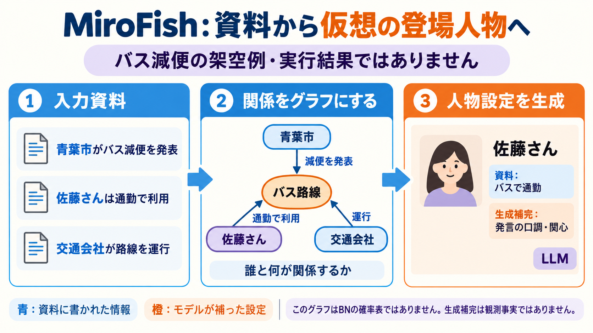
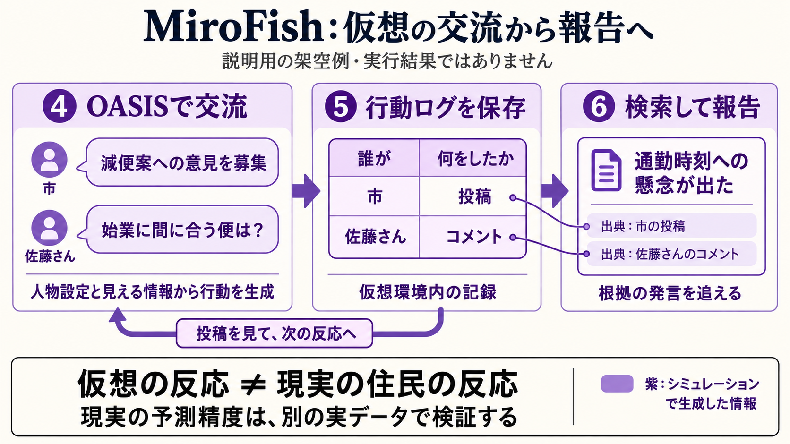

# MiroFishは、資料からどう仮想の社会を作るのか

MiroFishは、資料を読み、登場する人や組織の関係を整理し、仮想のアカウントに投稿や交流をさせ、その経過を報告するオープンソースのシステムです。「資料の要約」から一歩進んで、条件を与えた登場人物どうしの反応を試す仕組みを持っています。

ただし、仮想のアカウントが反対したことと、現実の住民が反対することは別です。ここでは公開コードの処理を説明し、実在の地域での予測精度を実証したものとして扱いません。確認したコードは2026年10月18日時点で取得したコミット `7657031ac01184afe2cb220f5ee3545573b5e843` です。今回、アプリの起動、LLM APIの呼び出し、シミュレーションの実行はしていません。

## まず、バス減便を調べる場面で考える

「青葉市がバスを減らしたら、関係者はどんな困りごとを話すだろうか」を調べるとします。入力資料は、次の三文です。

> 青葉市は、朝のバス路線を減便する案を発表した。
> 佐藤さんは、その路線を通勤に利用している。
> 青葉交通は、その路線を運行している。

この市名、会社名、人物、減便案は、すべて説明用に作った架空の例です。以降のJSON、投稿、ログ、報告も、実際のMiroFishの出力を転載したものではありません。入力と出力の対応を理解するための例です。



図では、青い資料欄、橙の生成補完欄、紫の仮想行動欄を分けています。図中の人物の服やノードなどの装飾色は、この分類を表していません。この例では入力自体が架空です。実資料を使う場合も、資料に書かれていることと、真実として検証できたことは区別します。

## 資料の文を、関係の一覧にする

最初に、人や組織、路線などをノードとして取り出します。ノードは、関係の図に置く一つの対象です。対象どうしの関係をエッジ、つまり線として記録します。

| 対象 | 関係 | 相手 |
|---|---|---|
| 青葉市 | 減便案を発表した対象 | バス路線 |
| 佐藤さん | 通勤で利用 | バス路線 |
| 青葉交通 | 運行 | バス路線 |

この表と図は、関係を理解するための概念例です。公開コードがこの三文から必ずこのノード構成を出す、という実行結果ではありません。実装のontology生成プロンプトは、人や組織など、社会の中で発言できる主体を中心に設計する指示になっています。図に描いた路線自体が、発言する仮想アカウントになることを意味しません。

この関係が分かれば、「佐藤さんの設定を作るとき、どの情報を参照するか」が分かります。佐藤さんはバス路線とつながっていて、その路線には減便案と運行会社の情報があります。

その前段の `OntologyGenerator.generate()` は、資料の文章、シミュレーションの目的、追加説明を受け取り、`_build_user_message()` で指示文を作ります。`ONTOLOGY_SYSTEM_PROMPT` と組み合わせて、`chat_json()` でLLMに対象の種類と関係の種類をJSONとして提案させ、検証・整形します。[7]

例えば「対象の種類をPersonとOrganization、関係をUSESやOPERATESとして扱う」といった設計を先に用意し、その定義に沿って文章から対象と関係を抽出する流れです。ここに示した名称は説明用の例で、実際の生成結果ではありません。

公開コードの `GraphBuilderService` は、入力文を分割し、グラフを作り、ontologyを設定したうえで、分割した文章をZepのAPIへ送ります。ontologyは「どんな種類の対象と関係を扱うか」という定義です。MiroFish側は送信と処理の完了待ち、取得したノード数やエッジ数の管理を担当します。Zep Cloud内部の抽出処理のすべては、今回読んだMiroFishのPythonファイルにはありません。確認できたのは、ontologyを設定して文章を送り、グラフを取得するAPIの境界までです。対象や関係の抽出にはモデルによる解釈が入るため、元の文章を機械的に正しく写したと決めつけず、抽出結果も確認する必要があります。[1]

このグラフは、前に学んだベイジアンネットワーク（BN）とは役割が違います。BNでは「年齢が分かったときの就業確率」のような確率分布を表します。ここでは「誰がどの路線を使うか」という対象間の関係を表します。「佐藤さん→バス路線」という線から、利用確率や減便の因果効果が自動的に計算できるわけではありません。

## 関係を読み、仮想アカウントの設定を作る

次に、佐藤さんのノードの説明と、その周辺の情報を集めて、LLMへ渡します。LLMは、シミュレーションで使うプロフィールをJSONという構造化した形式で返します。JSONは、項目名と値を対にして保存する形式です。

実装には `user_id`、`name`、`bio`、`persona` などの項目があります。年齢、職業、関心のある話題などは任意項目です。説明用に一部だけ示すと、次のようになります。[2]

```json
{
  "user_id": 1,
  "user_name": "sato_example",
  "name": "佐藤さん",
  "bio": "路線バスで通勤している。",
  "persona": "通勤に支障が出ないかを気にして、具体的な時刻を尋ねる。",
  "interested_topics": ["通勤", "バスの運行"]
}
```

`bio` の「バスで通勤」は入力資料に対応します。一方で、「具体的な時刻を尋ねる口調」までは資料にありません。この例ではLLMが補った設定です。実在の佐藤さんの性格を観測した結果ではありません。

こうした設定が必要なのは、次の場面でモデルに「この人として、何を投稿するか」を計算させるためです。資料の三文だけでは、口調や関心、反応の仕方まで決まりません。補うことでシミュレーションを動かせますが、補った内容が反応を偏らせる可能性も生まれます。

組織の場合もプロフィールを生成できます。交通会社のアカウントなら、運行を説明する立場の設定を与えます。個人と組織では、生成に使うプロンプトを分けています。

確認した実装はJSON出力を指定してLLMを呼び出し、最大3回試します。失敗が続く場合は、ルールで作るプロフィールへ切り替える処理もあります。したがって、画面に人物設定が出たことだけで「LLMが十分な根拠から設定を作れた」と判断せず、どの経路で作られたかも見る必要があります。[2]

## OASISの仮想SNSへアカウントを置く

人物設定を作ったら、OASISへ渡す形式に変換します。OASISは、投稿、コメントなどの行動を扱うソーシャルメディアのシミュレーション環境です。実在のSNSへ、この例の投稿を公開する説明ではありません。

ここでは、プロフィールが行動の前提になります。例えば、佐藤さんの設定と減便案の情報、仮想環境で見える投稿などをもとに、モデルが次の行動を生成する流れを考えられます。以下は、その違いを示すための架空の経過です。

| 段階 | 仮想アカウント | 説明用の行動例 |
|---|---|---|
| 1 | 市のアカウント | 「朝の運行を減らす案について、ご意見を募集します」と投稿 |
| 2 | 佐藤さん | 「始業に間に合う便は残りますか」とコメント |
| 3 | 交通会社 | 「通勤時間帯の便について検討しています」と返信 |

市の発表という入力から始めても、佐藤さんの質問や交通会社の返信は、仮想環境でモデルが生成するものです。現実の住民がそう発言した記録にはなりません。また、どの投稿を見られるか、誰がいつ活動するか、どの行動を選べるかという環境の設定も、結果を左右します。

### 実際のコードで一回の行動はどう進むか

Twitter型の実行スクリプトでは、次の順で環境を作ります。[8]

```python
# 公開コードから処理の対応を抜き出した説明用の形
agent_graph = await generate_twitter_agent_graph(
    profile_path=profile_path,
    model=model,
    available_actions=available_actions,
)
env = oasis.make(
    agent_graph=agent_graph,
    platform=oasis.DefaultPlatformType.TWITTER,
    database_path=db_path,
    semaphore=30,
)
await env.reset()
actions = {agent: LLMAction() for agent in active_agents}
await env.step(actions)
```

まずプロフィールのファイルを読み、各アカウントへモデルと選択可能な行動を渡します。環境にはデータベースの保存先を指定します。`reset()` で初期化した後、設定された時間帯や活動度などから、そのラウンドで動くアカウントを選び、`LLMAction()` を渡して `env.step()` で一回分進めます。設定した初期投稿は、通常の自発的な行動とは別に、`ManualAction` で投入できます。

ここでLLMが扱う情報の役割は「自分の人物設定、環境から見える情報、選べる行動」です。出力は、自由な解説文だけでなく、環境で実行する行動の選択と引数になります。Twitter型スクリプトが渡す選択肢は、投稿、いいね、再投稿、フォロー、何もしない、引用投稿です。先ほどのコメントの例はSNS交流全体の概念例で、Twitter型スクリプトにコメントという選択肢があると示すものではありません。

例えば、仮に `CREATE_POST` と「始業に間に合う便は残りますか」という本文が選ばれれば、環境がその投稿を保存し、以後の状態へ反映します。その後、別のアカウントが参照できる状態に応じて次の行動が計算されます。投稿本文はこの解説の架空例です。

個別のモデル入力をどう組み立て、どの形式でモデルに行動を選ばせるかという内部処理は、ここではOASIS/CAMELへ委譲されています。MiroFishの実行スクリプトを読んだだけで、そのライブラリ内部のプロンプト全文まで確認したとは扱いません。

MiroFishの `SimulationRunner` は、Twitter型、Reddit型、または並列用のPythonスクリプトを子プロセスとして起動します。設定ファイルを渡し、必要に応じて最大ラウンド数を指定します。つまりMiroFishは、プロフィールや設定の準備からシミュレーションの起動、進捗の取得までをつなぐ役割を持っています。[3]



## 行動を保存し、報告の根拠として検索する

実行中の行動は、ログとして保存されます。確認したrunnerは `twitter/actions.jsonl` や `reddit/actions.jsonl` を読み、行動数や最近の行動、終了イベントなどを追跡します。JSONLは、一行ごとにJSONの記録を置く形式です。[3]

次はログの意味を説明するための簡略例です。実装の完全なスキーマでも、実行結果でもありません。

```json
{"step": 1, "actor": "city_example", "action": "post", "text": "減便案への意見を募集します"}
{"step": 2, "actor": "sato_example", "action": "comment", "text": "始業に間に合う便は残りますか"}
```

ログがあると、「通勤への懸念が出た」という説明を、仮想環境のどの発言に基づいて書いたか追えます。ここで追えるのは、シミュレーション内の証拠です。現実世界の証拠として扱うには、別途、実際の調査や行動記録との比較が要ります。

行動ログからグラフ側へ活動を反映する処理もあります。runnerで `enable_graph_memory_update` を有効にした場合、読み取った行動をグラフ更新担当へ渡します。報告側の検索は主にZepのグラフを対象とするため、「すべての報告がJSONLを直接全文検索する」という構成としては説明できません。仮想環境のデータベース、行動ログ、検索用グラフ、報告作成ログを区別して追います。[3][4]

報告用の `ReportAgent` には、`quick_search`、`panorama_search`、`insight_forge`、`interview_agents` などのツールが定義されています。検索や仮想エージェントへの質問を使って情報を集め、報告を作る構成です。

報告生成には、情報を取り直すループがあります。モデルが検索ツール名と引数を返すと、プログラムが `_parse_tool_calls()` で読み取り、`_execute_tool()` で実行します。検索結果を追加の入力としてモデルへ返し、必要な検索と本文作成を続けます。これはモデルの重みを更新する操作ではなく、モデルに見せる情報を増やす操作です。

報告作成の途中のツール呼び出しやモデル応答も、専用の `agent_log.jsonl` に記録します。これは、SNS上の行動ログとは別のログです。[4]

架空の例から書ける報告は、「この設定で生成したやり取りには、始業時刻に間に合うかを気にする発言があった」という範囲です。「住民の何％が減便に反対する」「減便すれば必ず失業が増える」といった結論は、この例だけからは得られません。

## LLMを新しく学習しているのか

ここで読んだ処理は、既存のLLMをAPI経由で呼び出す処理です。人物設定の生成や報告などを、プロンプトやツールでつなぎます。資料を渡すたびに、MiroFishがTransformerの重みを一から学習したり、個々人の脳を再現したりする仕組みとしては確認していません。

設定ファイルの既定モデル名は `gpt-4o-mini` ですが、環境変数で変更できます。したがって「MiroFishのすべての実行は同じモデル」とは限りません。LLMの種類、人物設定、活動条件、仮想SNSの仕組みが違えば、同じ資料でも違う経過が出ることがあります。[5]

## マネージャーには、どの部分が参考になるか

マネージャーで作った合成人口は、「どんな人が何人いて、誰と暮らすか」を用意する部品です。MiroFishで参考になるのは、その次に「状況を与え、仮想の人物が反応し、他者の発言でまた反応する」という時間のある過程を扱う部分です。

ただし、記事に登場する人や組織から作ったアカウント群が、地域の人口全体を代表するとは限りません。バス利用者の発言だけを資料にした場合、バスを使っていない住民や、発言しない住民が不足することも考えられます。代表性のある人口を用意する処理と、発言や行動を生成する処理は別々に評価します。

最初の用途には、仮説を広げる実験が考えられます。例えば「運賃の話しか考えていなかったが、時刻や乗り継ぎについても実際の住民に質問しよう」と、次の調査項目を作る使い方です。施策の利用人数や効果を決める段階では、実測データとの比較、複数の設定での再実行、単純な予測手法との比較を加える必要があります。

## 自分たちで動かす場合の範囲

公開コードはAGPL-3.0です。Pythonの対象バージョンは3.11以上3.13未満で、確認した依存には `camel-oasis==0.2.5`、`camel-ai==0.2.78`、`zep-cloud==3.25.0` が含まれます。コードは公開されていますが、この構成でのグラフ作成にはZep Cloud、人物設定などにはLLM APIの設定が必要です。利用料金や送信する資料の扱いも、利用先に依存します。[5][6]

今回確認したのはコード上の処理と依存関係です。導入や実行、精度評価はまだ行っていません。次に試すなら、まず公開可能な架空資料で入力・人物設定・行動ログ・報告を保存し、設定を変えてどこが変わるかを調べる実験にできます。

## 出典と確認した範囲

すべて下記の固定コミットを参照しています。コードの説明と、独自の架空例を区別して記載しました。

1. [グラフ構築 `graph_builder.py`](https://github.com/666ghj/MiroFish/blob/7657031ac01184afe2cb220f5ee3545573b5e843/backend/app/services/graph_builder.py)
2. [人物設定 `oasis_profile_generator.py`](https://github.com/666ghj/MiroFish/blob/7657031ac01184afe2cb220f5ee3545573b5e843/backend/app/services/oasis_profile_generator.py)
3. [実行と行動ログの取得 `simulation_runner.py`](https://github.com/666ghj/MiroFish/blob/7657031ac01184afe2cb220f5ee3545573b5e843/backend/app/services/simulation_runner.py)
4. [報告生成 `report_agent.py`](https://github.com/666ghj/MiroFish/blob/7657031ac01184afe2cb220f5ee3545573b5e843/backend/app/services/report_agent.py)
5. [設定 `config.py`](https://github.com/666ghj/MiroFish/blob/7657031ac01184afe2cb220f5ee3545573b5e843/backend/app/config.py)、[依存関係 `pyproject.toml`](https://github.com/666ghj/MiroFish/blob/7657031ac01184afe2cb220f5ee3545573b5e843/backend/pyproject.toml)
6. [ライセンス](https://github.com/666ghj/MiroFish/blob/7657031ac01184afe2cb220f5ee3545573b5e843/LICENSE)、[公式README](https://github.com/666ghj/MiroFish/blob/7657031ac01184afe2cb220f5ee3545573b5e843/README.md)
7. [ontologyの提案と検証 `ontology_generator.py`](https://github.com/666ghj/MiroFish/blob/7657031ac01184afe2cb220f5ee3545573b5e843/backend/app/services/ontology_generator.py)
8. [Twitter型の環境と行動ループ `run_twitter_simulation.py`](https://github.com/666ghj/MiroFish/blob/7657031ac01184afe2cb220f5ee3545573b5e843/backend/scripts/run_twitter_simulation.py)

図は、この説明用に生成したイラストです。実際のMiroFishの画面や実行ログのスクリーンショットではありません。
