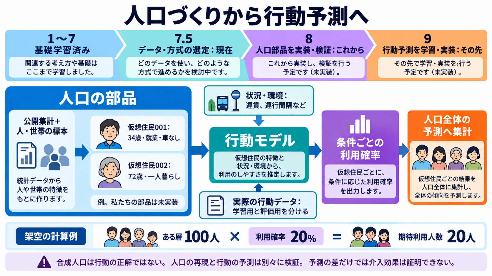

# 人口づくりから行動予測へ

2026年10月18日。ここまでの学習と次の実装・行動予測の接続を示す。数値と住民カードは説明用の架空例。実装と実測の進捗は統合SSOTにのみ記録する。

現在は学習7.5のデータと方式選定。1〜7の基礎学習の後、第8単元で人口部品を実装・検証する。第9単元で、その出力と状況を入力にする行動予測を学習・実装する。人口v0と行動部品はいずれも未実装である。

人口の部品は、どんな属性の人が何人いるかを表す。世帯段階では、誰と暮らしている設定かも保持する。例えば「34歳・就業・車なし」という仮想住民の属性を、運賃や運行間隔などの状況と合わせて行動モデルへ渡す。行動モデルは、その条件でバスを使う確率などを予測する。

人口の属性を作っても、行動の正解は得られない。行動モデルには実際の人の行動・回答のデータと、学習に使わない評価資料が必要になる。人口構成の再現と、条件付き行動の予測を別々に評価する。

説明用に、ある層が100人、各人の利用確率が20%なら、期待利用人数は100×0.2=20人。これは実際に20人が利用したという観測ではない。確率が人によって異なる場合は各人の確率を足し、重み付き人口なら重みと確率の積を足す。相互作用や定員などが重要なら、さらに環境と共有資源のモデルを加える。

条件を変えたときの予測差は、実地で測った介入効果とは区別する。最終的には変更を実行できる環境に接続し、事前に決めた比較設計と実観測で便益を検証する。バスは説明例で、最初の実地用途として選定したものではない。

関連資料：[データ選定](2026-10-18-manager-dataset-selection-ja.md)、[方式比較](2026-10-18-generative-methods-comparison-ja.md)、[人口と反応の分離](2026-10-17-population-methods-and-behavior-ja.md)。
