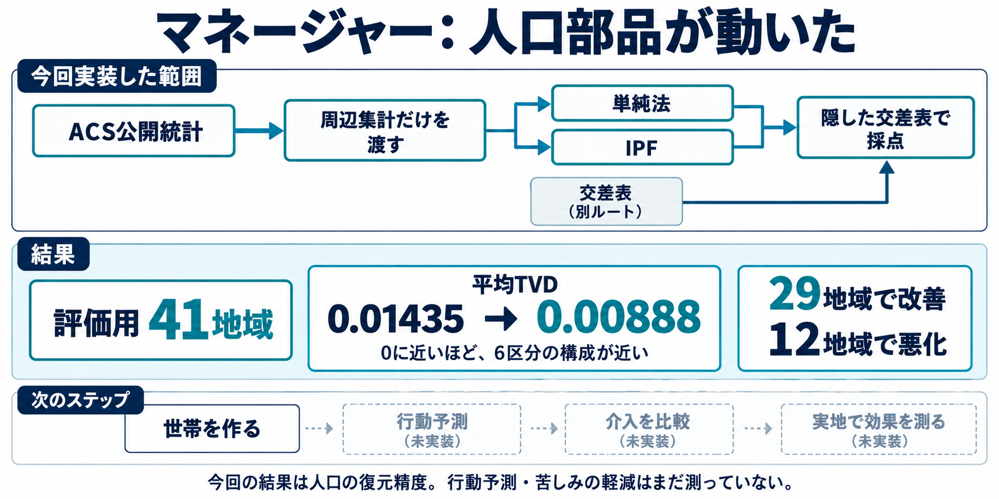
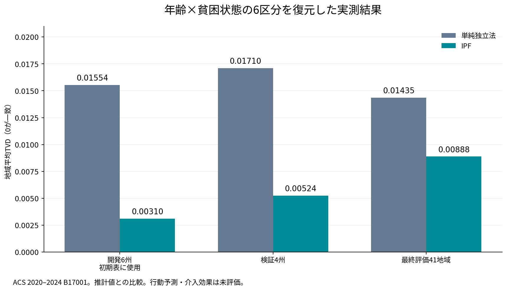

# 公開統計から人口を復元して、IPFと単純法を比べた

年齢別の人数と貧困状態別の人数だけを渡し、「どの年齢群に貧困基準未満の人が何人いるか」を復元した。米国の50州とDCを使った実装を2026年10月18日に動かし、最終評価41地域の平均TVDは単純法0.01435、IPF0.00888だった。平均では改善したものの、12地域ではIPFの方が悪かった。

この図は実装範囲を説明する生成画像で、結果カードの数字は実測に基づく。下のグラフは保存した集計結果からmatplotlibで描いた。

## 何を渡して、何を当てたのか

例えば、ある地域で「子どもが何人、成人が何人、高齢者が何人」と「貧困基準未満が何人、以上が何人」が分かっているとする。その合計だけでは、「子どものうち何人が基準未満か」は一つに決まらない。そこで年齢3区分×貧困状態2区分の6セルを復元し、元資料にある交差集計と比較する。

実際に使った資料はACS 2024 5-year Detailed Table B17001で、2020–2024の調査に基づく推計である。対象は貧困状態を判定できる人口。所得額や心の苦しみを直接測った資料ではない。

復元には二つの方法を使った。単純独立法は、地域の年齢構成と貧困割合を掛け合わせる。IPFは開発用6州の詳しい組み合わせを初期表にし、対象地域の年齢別人数と貧困状態別人数に合うまで調整する。初期表が持つ関連を別地域へ移すことが役立つかを、この比較で調べた。

対象地域の交差集計は復元コマンドへ渡さず、別の採点コマンドだけで開いた。開発6州、検証4州、最終評価41地域の分割は実行前に固定している。ただし、周辺集計と交差集計は同じACS資料から作っており、別調査による実証ではない。

## 結果の読み方

TVD（全変動距離）は、6区分それぞれの構成比のずれを合計し、半分にした値である。0が一致し、1が最大。TVDが0.01なら、地域全体の約1%分を区分間で移すと配分が一致する差に相当する。「個人の行動を99%当てた」という意味ではない。

|分割|単純独立法|IPF|
|---|---:|---:|
|開発6州の地域平均TVD|0.015544|0.003100|
|検証4州の地域平均TVD|0.017104|0.005243|
|最終評価41地域の地域平均TVD|0.014348|0.008881|
|最終評価41地域の人口加重平均TVD|0.015560|0.007666|
|最終評価41地域の最大TVD|0.033504|0.015971|

地域平均は地域を同じ重さで数え、人口加重平均は人口の多い地域を大きく数える。最終評価の地域平均は約38.1%低下したが、41地域すべてで改善したわけではない。IPFが良かったのは29地域、悪かったのは12地域だった。

例えばUtahでは単純法0.002432に対しIPF0.012673だった。開発州の関連を移すより、その州では単純な独立の仮定の方が近かったことになる。こうした失敗を含めて保存し、今回の評価を見て初期表や設定を変更していない。

## 実装で確かめたこと

取得、入力検証、分割、復元、採点を別々の処理にした。IPF自体は既存OSSの `ipfn==1.4.4` を利用し、計算後に周辺集計との残差を独立に検査する。欠測値を0で埋めたり、未収束を成功扱いにしたりしない。

全51地域を両方式で復元し、同じ保存済み入力から再実行した予測ファイルはbytesまで一致した。追加の有料モデル呼び出しは0だった。コードとテスト、実行コマンドは[人口部品のREADME](../../../../apps/manager/README.md)にある。[公開用の集計記録](../evidence/2026-10-18/population-v0-summary.json)には出典、入力・設定・コードのハッシュと各分割の結果を残した。

ACSの値にも推計誤差があり、今回はその不確実性を結果へ伝播していない。また、州の分割は無作為抽出ではないため、全国への一般化を示す信頼区間も出していない。今回分かったのは、この条件で公開交差集計へどれほど近づいたかである。

## 次に作るもの

次は世帯と個人を結びつける人口部品を作る。個人の年齢だけでなく、「誰と同じ世帯に暮らしているか」を残し、世帯を丸ごと選んで地域の統計へ近づける。その後に、状況と属性から選択や行動を予測するモデルを接続する。

マネージャーの使命は、技術によって苦しみを減らすことにある。人口の構成を復元する今回の実装は、そのための最初の部品である。行動予測、介入案の比較、実行、実地の便益は、今後それぞれ測る必要がある。

## 出典と再実行

- [Census公式Summary File](https://www2.census.gov/programs-surveys/acs/summary_file/2024/table-based-SF/data/5YRData/acsdt5y2024-b17001.dat)
- [B17001の属性定義](https://api.census.gov/data/2024/acs/acs5/groups/B17001.json)
- [ipfnの固定参照](https://github.com/Dirguis/ipfn/tree/fa57b905291e4125c6e4f7ddacc8770218ad024e)
- [実装と実行コマンド](../../../../apps/manager/README.md)
- [評価の定義と制限](../../../../apps/manager/docs/population-v0.md)

州抽出のSHA256は `316b602beb75129605d91ca7a9c440a37df7bc9c02271d86d3eb39cf25559a9d`。公式配布ファイル全体のhashではない。記事と図は保存済み原稿であり、ブログやSNSへの公開はまだ行っていない。
