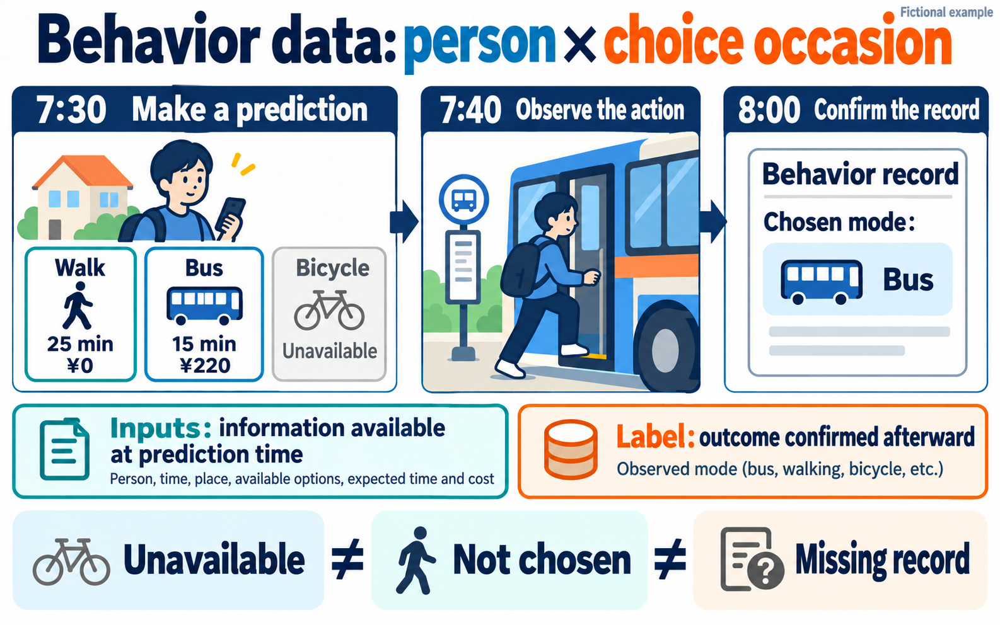

# 9.2 How to build behavioral data

One record should tell us who faced a choice, when it happened, which options were available, and what they did.

“How many people in this town do not own a car?” and “Will this person take the bus tomorrow morning?” are different questions. Population and household data help answer the first. The second requires information about available options, conditions known when making the prediction, and observed choices.

Reconstructing a population does not produce those people's choice histories. Before adding behaviors to a population table, we need to define what counts as one observation. This chapter builds that input data before introducing the model's equations.

## The same person can contribute several observations

Every person, time, price, and action below is fictional. These are teaching examples, not participant records or results from a trained model.

At 7:30 one morning, fictional person P01 plans to commute. Walking would take 25 minutes. The bus would take 15 minutes and cost ¥220. Their bicycle is being repaired and cannot be used. The prediction target is the mode used for a commute started between 7:30 and 8:00. If we can confirm that they did not start commuting by 8:00, that is also a possible outcome. The categories are walking only, bus use, and bicycle use; walking to a bus stop still counts as bus use. Trips combining multiple vehicles are outside this fictional example. Real datasets likewise need explicit classification rules and a defined scope.

The unit of observation is a **person × choice occasion**. P01 is not the observation by themselves; P01's opportunity on this particular morning is. Asking the same question tomorrow creates another observation for the same person. In this example, an occasion is created only when a commute is planned and that plan is known at 7:30.

| Person | Occasion | Prediction time | Observation deadline | Target |
|---|---|---|---|---|
| P01 | Monday morning | Monday 7:30 | Monday 8:00 | Mode for commute started, or no start |
| P01 | Tuesday morning | Tuesday 7:30 | Tuesday 8:00 | Mode for commute started, or no start |
| P02 | Monday morning | Monday 7:30 | Monday 8:00 | Mode for commute started, or no start |

Three rows do not mean three people. P01 appears twice. We must preserve person identifiers when we later split data for evaluation.

## The outcome is unknown when we make the prediction

First, save only information available at 7:30 on Monday. Inputs supplied to a model are called features. Here, candidates include the weather, estimated travel times, fares, and whether each option can be used, all as known by the prediction time.

| Person and occasion | Input cutoff | Weather | Estimated walking time | Estimated bus time | Bus fare | Bicycle available? |
|---|---|---|---:|---:|---:|---|
| P01, Monday morning | 7:30 | Clear | 25 min | 15 min | ¥220 | No: under repair |

We do not yet know what P01 will actually do. Writing “bus” because it seems likely would replace an observation with our own guess. Keep inputs and outcomes separate.

| Person and occasion | Outcome status | Observed action | Action time | Confirmation time |
|---|---|---|---|---|
| P01, Monday morning | Not yet observed | Pending | Pending | Pending |

Suppose P01 boards the bus at 7:40 and the record can be confirmed at 8:00. We can now attach the label “bus” to the input record. A label is the observed outcome used as the target during training or evaluation.

| Person and occasion | Outcome status | Observed action: label | Action time | Confirmation time |
|---|---|---|---|---|
| P01, Monday morning | Confirmed | Bus | 7:40 | 8:00 |

The illustration shows the three transport modes. The additional outcome “no commute started by 8:00,” defined in the tables, is omitted from the drawing. All times and prices are fictional.

The action time is 7:40 even though confirmation occurs at 8:00. A system might receive that record at 8:10. The event time, recording time, and time at which the prediction system could access it can differ. Reconstructing what was known before a prediction requires checking the last of these as well.

## Record the available options separately from the chosen option

To learn from a choice, a model needs more than the fact that P01 took the bus. It also needs to know which options they could use. The available alternatives for an occasion form its choice set.

Chapter 2 of Kenneth Train's *Discrete Choice Methods with Simulation* starts with the definition of alternatives. In a single-choice problem, they should not overlap and should cover the possible outcomes being modeled. If choosing none is possible, the definition needs to accommodate it. [Train, second edition, Chapter 2, §2.2](https://eml.berkeley.edu/books/choice2nd/Ch02_p9-33.pdf)

We can represent the fictional occasion with one row per alternative. This is a long-format table. The earlier table, which puts different modes in separate columns, is wide format. Both can represent the same occasion.

| Person | Occasion | Alternative | Available at 7:30 | Estimated time | Cost | Choice confirmed afterward |
|---|---|---|---:|---:|---:|---|
| P01 | Monday morning | Walk | 1 | 25 min | ¥0 | 0 |
| P01 | Monday morning | Bus | 1 | 15 min | ¥220 | 1 |
| P01 | Monday morning | Bicycle | 0 | Not applicable | Not applicable | Not applicable |
| P01 | Monday morning | No start by 8:00 | 1 | Not applicable | Not applicable | 0 |

These four rows represent one choice occasion, not four choices. Among available alternatives, the observed outcome receives a 1. Before observation, the entire final column is pending.

Writing zero minutes for the unavailable bicycle would imply instantaneous travel. Keep an availability flag and its reason; do not replace every “not applicable” time or cost with zero.

Availability also needs a definition. A running bus may still be inaccessible to someone who cannot reach its stop or use the vehicle. Service operation, physical access, required facilities, and eligibility are different constraints. Record which ones were checked rather than assuming unknown conditions are identical for everyone.

## Unavailable, not chosen, and missing are different states

P01 could walk on Monday but did not. They could not use the bicycle at all. Treating the bicycle as a rejected option would confuse a constraint with a preference.

Now suppose Tuesday's record fails to upload. The absence of a bus record does not establish that P01 did not take the bus.

| State | Meaning in this example | Treatment of the label |
|---|---|---|
| Unavailable | Bicycle under repair | Exclude from the available choice set |
| Not chosen | Walking was available; bus use was confirmed | Walk = 0; bus = 1 |
| No start | No commute by 8:00 was confirmed | An observed “no start” outcome |
| Missing | Observation failed; action unknown | Keep the label unknown |
| Pending | The observation window has not ended | Wait before assigning a label |

“No start” requires evidence that observation was adequate. Converting missing records to that outcome turns a measurement failure into a behavior. Read the data dictionary to distinguish nonresponse, inapplicability, uncertainty, and an explicit negative answer.

The [2022 NHTS public codebook](https://nhts.ornl.gov/assets/2022/doc/codebook.pdf), for example, uses distinct codes for valid skips, “don't know,” and information not ascertained, depending on the variable. Replacing all negative codes with zero loses those distinctions.

## How was the action established?

“I intend to take the bus tomorrow,” “I took the bus this morning,” and a boarding record are different observations. The first records an intention. The latter two attempt to measure past behavior, but have different sources of error.

| Collection method | What is directly recorded | What it does not establish by itself |
|---|---|---|
| Ask about future plans | An answer expressing an intention | That the action occurred |
| Ask for a choice in a hypothetical scenario | A response under the presented conditions | That the person acted that way in reality |
| Ask about yesterday's behavior | A retrospective report | That recall and reporting are error-free |
| Use a boarding-related record | The event defined by that system's specification | Complete coverage of every person and transport mode |

Hypothetical choice experiments are a common form of stated-preference (SP) data. Information about real choices is distinguished as revealed-preference (RP) data. “Revealed” does not mean error-free or that preferences are directly observable. We must also identify whether the real-world behavior was self-reported or captured by a device.

Swissmetro, used in EPFL's Biogeme examples, illustrates the distinction. Its public description documents hypothetical choices, respondent identifiers, travel times, costs, availability, and choices. A model using these records predicts responses to the presented scenarios. It does not predict observed rides on a real Swissmetro service. [Original Swissmetro data description](https://transp-or.epfl.ch/pythonbiogeme/examples/swissmetro/swissmetro.pdf)

## What the public code actually separates

Biogeme's [official preprocessing module](https://biogeme.epfl.ch/sphinx/_modules/biogeme/data/swissmetro.html) defines a choice variable, `CHOICE`, separately from availability variables such as `TRAIN_AV`, `SM_AV`, and `CAR_AV`. Variables such as `TRAIN_TT` describe travel time; `TRAIN_CO` describes cost. The code constructs derived availability variables and removes observations with `CHOICE` equal to zero. That is this example's exclusion rule, not a general instruction to treat every zero in every dataset as missing.

The [official multinomial logit example](https://biogeme.epfl.ch/sphinx/auto_examples/swissmetro/plot_b01a_logit.html) passes three separate components into the model: alternative-specific expressions in `v`, availability conditions in `av`, and the observed `CHOICE`. Before studying the equations, notice the structure: an unavailable option should not become selectable simply because the model scores it favorably.

| Role | Fictional example |
|---|---|
| Inputs for comparing alternatives | Walking takes 25 minutes; bus takes 15 minutes and costs ¥220 |
| Availability | Walking and bus available; bicycle unavailable |
| Observed training target | Confirmed bus use |

Similar column names do not guarantee that two datasets answer the same question. A designed hypothetical experiment supplies alternatives and attributes. A real travel diary may record the chosen mode without recording service conditions and estimated travel times for every unchosen option. Adding those requires other sources or explicit assumptions.

## Travel and activity diaries do not automatically contain choice sets

The U.S. National Household Travel Survey asks about real travel. Its 2022 public codebook includes `HOUSEID` for households, `PERSONID` for people, `TDCASEID` for trip records, and `TRPTRANS` for travel mode. Because `PERSONID` is a within-household identifier, combine it with `HOUSEID` to identify a person. This version also includes `TRIPID`; column names from older releases should not be assumed to carry over. [2022 NHTS public codebook, Trip File](https://nhts.ornl.gov/assets/2022/doc/codebook.pdf)

A trip record first describes a person's observed trip. Collecting only trips cannot create occasions for people who planned to commute but did not start by 8:00. Matching the fictional prediction task requires a roster of eligible people and occasions defined before departure. If training only on observed trips, state that conditioning explicitly.

The American Time Use Survey (ATUS) provides another example of multiple records within a day. Its official instructions identify respondents with `TUCASEID` and activities with `TUACTIVITY_N`. We can connect activity types and durations to respondent information. But a list of activities reported in a diary is not a list of every activity the person could have chosen. Repeated observations within one diary day also do not establish follow-up of the same person on subsequent days. [ATUS file instructions](https://www.bls.gov/tus/other-documentation/howto.htm), [survey FAQ](https://www.bls.gov/tus/questions-and-answers.htm)

## Keep future outcomes out of earlier inputs

Consider adding the following columns to P01's Monday record.

| Proposed input | Available for a 7:30 prediction? | Why? |
|---|---|---|
| Bus travel-time estimate obtained at 7:25 | Potentially | Available before prediction |
| Boarding payment at 7:40 | No | Occurs after the target action begins |
| Actual journey duration | No | Unknown until arrival |
| Bus-use rate from Monday through Friday | No | Includes Monday's future |
| Confirmed bus-use rate through last week | Potentially | Can be restricted to prior history |

Using information unavailable at prediction time is data leakage. A column that reflects the completed choice can make a historical prediction look easy without supporting real forecasts. The [scikit-learn guidance](https://scikit-learn.org/stable/common_pitfalls.html#data-leakage) also describes leakage through preprocessing and the use of evaluation data during model construction.

Deleting the label column is insufficient. Imputing values with a full-period mean or scaling with statistics calculated from the evaluation period lets future information into training. Split data first. Learn imputation, scaling, and feature-selection rules from the training portion, then apply those rules to evaluation data.

## A hundred rows from one person are not a hundred people

If we randomly mix P01's Monday-to-Friday records across training and evaluation, a model can learn P01's habits. That does not test whether it generalizes to people it has never seen.

For new-person use, split by person. For future predictions about known people, train on earlier history and evaluate later periods. These answer different questions. Predicting the future for new people requires considering both people and time. [scikit-learn on grouped and time-series evaluation](https://scikit-learn.org/stable/modules/cross_validation.html#cross-validation-iterators-for-grouped-data)

In long-format tables, do not place the walking and bus rows of the same occasion on opposite sides of a split either. They belong to one comparison. Preserving person, occasion, and prediction-time identifiers makes these distinctions possible.

## Preserve the scope of people and occasions observed

The fictional dataset covers people whose commuting plans are known at 7:30. It does not automatically represent people on leave, people who depart at other times, or people whose plans could not be established. Keeping only occasions with a recorded outcome can further favor actions that are easier to measure.

For example, a payment system may capture some bus use while missing walking or cash fares. Calling every absent record “not bus” would turn the recording system's coverage into a person's behavior. Document eligibility, collection coverage, missing outcomes, and the conditions required to confirm a label.

Even a well-constructed behavioral table does not reveal every reason behind a choice. More walking on clear days does not by itself establish what would happen if weather changed for the same person. This chapter organizes observed conditions and actions so that their meaning can be checked; it does not identify causal effects.

## Read the finished record back as a sentence

The first P01 record should translate back into this sentence:

> For P01's Monday morning, with a commute planned, use information available by 7:30 to predict the mode used for a commute started by 8:00. Walking and bus are available; the bicycle is not. Later observation confirms that P01 boarded the bus at 7:40.

If part of that sentence has no counterpart in the table, a field may be missing or the question may still be ambiguous. Matching the person, occasion, choice set, input availability time, observation window, and basis for the label makes the prediction task precise.

## Sources and reading scope

- Kenneth Train, *Discrete Choice Methods with Simulation*, second edition, 2009: [Chapter 2](https://eml.berkeley.edu/books/choice2nd/Ch02_p9-33.pdf), especially §2.2 on choice sets. The [author's access page](https://eml.berkeley.edu/books/choice2.html) specifies personal research and study use. This article uses original fictional examples and does not reproduce the book's figures or prose.
- Michel Bierlaire / EPFL: [Swissmetro description](https://transp-or.epfl.ch/pythonbiogeme/examples/swissmetro/swissmetro.pdf), its experimental design and variable definitions; [preprocessing code](https://biogeme.epfl.ch/sphinx/_modules/biogeme/data/swissmetro.html), `read_data` and variable definitions; and the [model example](https://biogeme.epfl.ch/sphinx/auto_examples/swissmetro/plot_b01a_logit.html), which passes alternatives, availability, and outcomes separately. No participant rows are reproduced and no estimation was run.
- Federal Highway Administration / Oak Ridge National Laboratory: [2022 NHTS public codebook](https://nhts.ornl.gov/assets/2022/doc/codebook.pdf). The retrieved PDF identifies itself as Version 2.0.1, December 2024. We checked identifiers, modes, and missing-value codes; we do not assume this PDF is identical to the site's latest distribution.
- U.S. Bureau of Labor Statistics: [ATUS file instructions](https://www.bls.gov/tus/other-documentation/howto.htm) and [FAQ](https://www.bls.gov/tus/questions-and-answers.htm), for person/activity identifiers and the diary period.
- scikit-learn developers: [Common pitfalls](https://scikit-learn.org/stable/common_pitfalls.html#data-leakage) and [Cross-validation](https://scikit-learn.org/stable/modules/cross_validation.html#cross-validation-iterators-for-grouped-data), for leakage, preprocessing, and evaluation by person and time.

Sources checked October 19, 2026. This is an explanation of data construction. The fictional example provides no measured model performance or intervention effects.
