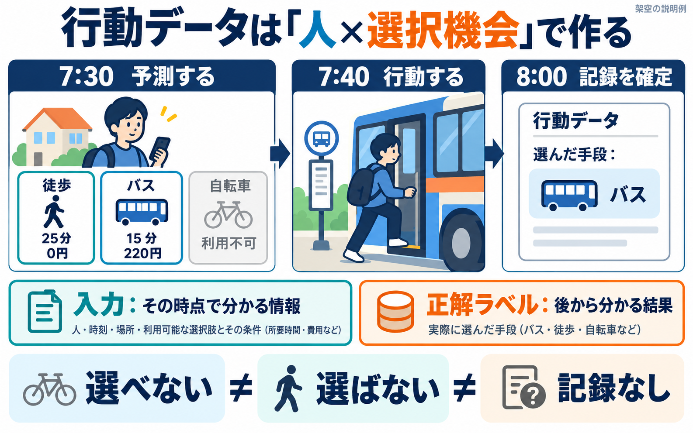

# 9.2 行動データの作り方

誰が、いつ、何を選べて、何をしたかを1行にする

「この町には、車を持っていない人が何人いるか」と「その人は、明日の朝にバスを選ぶか」は、違う問いです。前者を調べる資料は、人口や世帯の構成です。後者を調べるには、実際に選べた手段、予測する時点の条件、そして選んだ結果の記録をそろえます。

人口の構成を再現しても、その人たちの選択履歴が得られるわけではありません。行動予測へ進むには、人口を表す表に架空の行動を書き足す前に、何を1件の選択と数えるかを決めます。この節では、モデルの計算式に入る前に、その入力データを作ります。

## 同じ人でも、毎朝の選択は別の観測になる

以下の人、時刻、費用、行動は、すべて説明のための架空例です。実際の調査参加者や、学習したモデルの結果ではありません。

架空の人「P01」は、ある朝7時30分に通勤を予定しています。徒歩なら25分、バスなら15分で、バスの運賃は220円です。自転車は修理中で使えません。予測したいのは、「7時30分から8時までに開始する通勤の手段」です。8時までに通勤を始めなかったことも、確認できれば一つの結果として記録します。分類は「徒歩のみ」「バス利用」「自転車利用」とし、バス停まで歩く場合もバス利用に数えます。複数の乗り物を組み合わせる通勤は、この架空例には含めません。現実のデータでも、こうした分類規則と対象範囲を先に決めます。

この定義では、観測単位は「人×選択機会」です。P01そのものが1件なのではなく、P01のこの朝の機会が1件です。翌朝にも同じ問いを立てれば、同じ人について別の観測が増えます。ここでの選択機会は、予測を行う7時30分に、通勤予定が確認されていることを条件に作っています。

| 人ID | 機会ID | 予測時刻 | 観測する期限 | 予測するもの |
|---|---|---|---|---|
| P01 | 月曜朝 | 月曜7:30 | 月曜8:00 | 開始した通勤手段、または開始なし |
| P01 | 火曜朝 | 火曜7:30 | 火曜8:00 | 開始した通勤手段、または開始なし |
| P02 | 月曜朝 | 月曜7:30 | 月曜8:00 | 開始した通勤手段、または開始なし |

同じ人の観測が2行あるので、3行は3人を意味しません。後でデータを分割するときにも、この人IDが必要になります。

## 予測時点には、結果の欄を埋められない

まず、月曜7時30分の時点で分かる情報だけを保存します。モデルに渡す入力情報を「特徴量」と呼びます。ここでは予測時刻までに確認された天候、各手段の所要時間の見積もり、運賃、利用できるかどうかが候補です。

| 人ID・機会ID | 入力を確定する時刻 | 天候 | 徒歩の見積時間 | バスの見積時間 | バス運賃 | 自転車の利用可能性 |
|---|---|---|---:|---:|---:|---|
| P01・月曜朝 | 7:30 | 晴れ | 25分 | 15分 | 220円 | 利用不可（修理中） |

この時点で、実際に乗った手段はまだ分かりません。「おそらくバスだろう」という推測を正解として書くと、モデルは観測された行動を学べません。予測前の入力と、後から確かめる結果は、別々に保存します。

| 人ID・機会ID | 結果の状態 | 実際の行動 | 行動時刻 | 結果を確認した時刻 |
|---|---|---|---|---|
| P01・月曜朝 | 観測前 | 未確定 | 未確定 | 未確定 |

7時40分にP01がバスに乗り、8時に記録を確定できたとします。そこで初めて、正解ラベルを「バス」として入力行に対応させられます。「ラベル」は、学習や評価で正解として扱う観測結果のことです。

| 人ID・機会ID | 結果の状態 | 実際の行動（ラベル） | 行動時刻 | 結果を確認した時刻 |
|---|---|---|---|---|
| P01・月曜朝 | 確認済み | バス | 7:40 | 8:00 |

図は架空例を使った説明図です。徒歩・バス・自転車を図示し、表で定義した「8時までに開始なし」は省略しています。図の時間や金額は実測値ではありません。

記録を確かめた時刻が8時でも、バスに乗った時刻は7時40分です。さらに、8時の記録をシステムが8時10分に受信する場合もあります。「行動が起きた時刻」「記録された時刻」「予測する側が利用できた時刻」は一致するとは限りません。過去の情報だけを使うには、最後の時刻まで確認します。

## 選べたものを、選んだものと別に記録する

モデルが選択を学ぶには、P01がバスを選んだことに加え、何を選べたかを知る必要があります。その機会に選べた選択肢の集まりを「選択集合」と呼びます。

Kenneth Train の『Discrete Choice Methods with Simulation』第2版・第2章は、離散的な選択のモデルを、選択肢の定義から説明しています。一つを選ぶ問題では、選択肢どうしが重ならず、対象とする結果を取りこぼさないように定義します。何も選ばないことがあり得るなら、それも扱える形にします。[Train, Chapter 2, §2.2](https://eml.berkeley.edu/books/choice2nd/Ch02_p9-33.pdf)

架空例では、同じ機会を、選択肢ごとに行を分けて書くこともできます。これを縦長形式と呼びます。さきほどのように各手段を別の列に置く横長形式と、表している機会は同じです。

| 人ID | 機会ID | 選択肢 | 7:30時点で利用可能 | 見積時間 | 費用 | 後から確認した選択 |
|---|---|---|---:|---:|---:|---|
| P01 | 月曜朝 | 徒歩 | 1 | 25分 | 0円 | 0 |
| P01 | 月曜朝 | バス | 1 | 15分 | 220円 | 1 |
| P01 | 月曜朝 | 自転車 | 0 | 対象外 | 対象外 | 対象外 |
| P01 | 月曜朝 | 8時までに開始なし | 1 | 対象外 | 対象外 | 0 |

4行ありますが、4回選んだわけではありません。一つの機会を4つの候補に展開した表です。利用可能な選択肢のうち、観測された結果に一致するものだけに1が付きます。選択前には、この最後の列はすべて未確定です。

自転車の見積時間を0分と書くと、「一瞬で移動できる」と読まれてしまいます。使えない選択肢には、利用不可のフラグと、その理由を持たせます。時間や費用の「対象外」を数値の0へ一括変換しないようにします。

利用可能性も、何を条件に判断したかを残します。バスが走っていても、停留所までたどり着けない人にとって使えるとは限りません。運行、本人の身体条件、必要な設備、利用資格など、どの制約を確認したかによって、同じ「利用可能」の意味が変わります。確認できない条件を、全員同じと決めて埋めてはいけません。

## 「選べない」「選ばない」「記録がない」を分ける

月曜のP01について、徒歩は選べたものの選びませんでした。自転車はそもそも選べませんでした。この二つは、本人の好みを解釈するときに違いを生みます。自転車が使えなかった記録を「自転車を嫌っていた」という結果に数えると、制約を好みと取り違えます。

翌日のP01の通勤について、記録の送信に失敗したとします。バスを使ったログが届いていないだけでは、バスを選ばなかったとは言えません。

| 状態 | この例での意味 | ラベルの扱い |
|---|---|---|
| 利用不可 | 自転車が修理中 | その機会に選べる候補から外す |
| 非選択 | 徒歩も使えたが、確認された結果はバス | 徒歩は0、バスは1 |
| 開始なし | 8時まで通勤を始めなかったことを確認 | 「開始なし」という観測結果 |
| 欠測 | 観測が途切れ、何をしたか不明 | ラベルは未知のまま残す |
| 観測前 | まだ8時までの観測が終わっていない | 未確定として待つ |

「開始なし」は、観測できていることが条件です。記録のない行を全部「開始なし」に変えると、欠測が行動に変わってしまいます。データの辞書が、未回答・対象外・分からない・明示的な「いいえ」をどう区別しているかを読みます。

実際に、[2022 NHTS の公開辞書](https://nhts.ornl.gov/assets/2022/doc/codebook.pdf)には、質問による正当なスキップ、分からない、情報を得られなかった場合など、異なるコードが記載されています。どのコードが使われるかは変数ごとに確認する必要があります。負の数をまとめて0へ置き換える処理では、こうした意味の違いを失います。

## 何をしたかは、どう確認したのか

「明日はバスに乗るつもりです」という回答と、「今朝はバスに乗りました」という回答と、乗車記録は、同じ観測ではありません。前者は予定についての発言です。後の二つは過去の行動を記録しようとしていますが、思い違い、未記録、検出誤りなどの性質が違います。

| 記録の取り方 | 直接記録されるもの | そのままは言えないこと |
|---|---|---|
| 将来の予定を尋ねる | 「バスに乗るつもり」と答えたこと | 実際にバスに乗った |
| 仮想条件で選んでもらう | 提示された条件下での回答 | 現実の同じ条件で実行した |
| 昨日の行動を尋ねる | バスに乗ったという回想報告 | 記憶や回答の誤りがない |
| 乗車に結び付く記録を使う | 仕様が定める乗車・決済等のイベント | 全利用者・全交通手段を観測できる |

仮想の条件を示して選んでもらう調査は、表明選好（stated preference、SP）の代表的な方法です。現実の選択に基づく情報は、顕示選好（revealed preference、RP）と区別します。RPという名前も、誤差がないことや、好みを直接読み取れることを保証しません。行動の自己報告か、機器の記録かという測定方法も併せて確認します。

この違いがよく見えるのが、EPFL の Biogeme で使われる Swissmetro のデータです。公開説明には、仮想の移動手段を含む選択課題、回答者ID、所要時間、費用、利用可能性、選択の結果が記載されています。したがって、モデルが予測するものを「提示した仮想条件への回答」と説明する必要があり、「現実の Swissmetro 乗車を予測した」とは言えません。[Swissmetro の原データ説明](https://transp-or.epfl.ch/pythonbiogeme/examples/swissmetro/swissmetro.pdf)

## 公開コードでは、入力・利用可能性・選択がどう分かれているか

Biogeme の[公式の前処理コード](https://biogeme.epfl.ch/sphinx/_modules/biogeme/data/swissmetro.html)には、`CHOICE` という選択の列と、`TRAIN_AV`・`SM_AV`・`CAR_AV` という利用可能性の列が別々に出てきます。`TRAIN_TT` などは所要時間、`TRAIN_CO` などは費用の列です。前処理では利用可能性の派生変数も作り、`CHOICE` が0の観測を除く処理が読めます。これは、このコードにおける除外条件であり、あらゆるデータの0を欠測と見なす規則ではありません。

[公式の多項ロジットの例](https://biogeme.epfl.ch/sphinx/auto_examples/swissmetro/plot_b01a_logit.html)では、選択肢ごとの式をまとめる `v`、利用可能性をまとめる `av`、観測された選択 `CHOICE` を分けてモデルへ渡します。ここで確認したいのは、式の細部よりも、モデルの好みだけで利用できない選択肢を選ばせない構造です。

架空例へ対応させると、次の3つになります。

| モデルへ渡す役割 | 架空例での内容 |
|---|---|
| 選択肢を比較する入力 | 徒歩25分、バス15分・220円等 |
| 選択肢の利用可能性 | 徒歩とバスは可、自転車は不可 |
| 学習時に照合する結果 | 実際にバスを選んだという確認済みのラベル |

同じような列名があることと、同じ問いに答えられることは別です。Swissmetro は選択集合と回答が設計された調査です。一方、現実の移動日記では、選んだ手段は分かっても、選ばなかった全手段の運行状況や見積時間までは記録されていない場合があります。足りない情報は、別の資料との結合や仮定が必要になります。

## 移動日記や活動日記は、そのまま「選択集合つきデータ」ではない

米国の National Household Travel Survey（NHTS）は、現実の移動を尋ねる調査です。2022年版の公開辞書には、世帯を結ぶ `HOUSEID`、人を表す `PERSONID`、移動レコードの識別子 `TDCASEID`、移動手段 `TRPTRANS` などが記載されています。`PERSONID` は世帯内の番号なので、人を識別するには `HOUSEID` と組み合わせます。この版では `TRIPID` という列もあり、過去の版の列名をそのまま流用できるとは限りません。[2022 NHTS 公開辞書、Trip File](https://nhts.ornl.gov/assets/2022/doc/codebook.pdf)

この構造から作れるのは、まず「その人の、その移動」の観測です。しかし、移動した人の記録だけを集めても、「通勤予定だったが、8時までに開始しなかった人」の機会は作れません。架空例と同じ問題にするには、移動の発生前に定義した対象者と機会の一覧が必要です。移動レコードだけから学ぶなら、どこまで条件を絞った予測なのかを明記します。

American Time Use Survey（ATUS）の活動ファイルも、1日の中に複数の行を持つ実例です。公式の説明では、回答者を `TUCASEID`、活動を `TUACTIVITY_N` で識別します。活動の種類や長さを人の情報へ結べますが、日記で報告された活動の列が、そのまま当時選べた全行動の一覧になるわけではありません。また、1日の中の繰り返しは、同じ人を翌日以降も追ったことを意味しません。[ATUS のファイル利用手順](https://www.bls.gov/tus/other-documentation/howto.htm)、[調査方法の FAQ](https://www.bls.gov/tus/questions-and-answers.htm)

## 未来の結果を、過去の入力に混ぜない

月曜のP01について、次の値をモデルの入力に追加できるか考えます。

| 追加したい列 | 7:30の予測で使えるか | 理由 |
|---|---|---|
| 7:25に取得したバスの見積時間 | 使える候補 | 予測前に取得済み |
| 7:40の乗車決済 | 使えない | 予測対象の行動の後で発生 |
| 当日、実際に移動した所要時間 | 使えない | 到着まで分からない |
| 月曜から金曜までのバス利用率 | 使えない | 月曜の未来に当たる記録を含む |
| 先週までの確認済みバス利用率 | 使える候補 | 今回の予測時点までの履歴に限れる |

予測時点で利用できない情報が学習や評価へ入ることを、データリークと呼びます。実際の選択を反映する列が入れば、過去の表では簡単に当たっても、未来に出す予測では再現できません。[scikit-learn の公式解説](https://scikit-learn.org/stable/common_pitfalls.html#data-leakage)も、予測時点にない情報と、前処理を通じた評価データの混入を扱っています。

リークはラベルの列を消すだけでは防げません。全期間の平均を使って欠損を補ったり、評価期間を含む平均・標準偏差で値を変換したりすると、未来の分布が学習へ入ります。データを分けた後、平均の計算、補完、特徴選択などを訓練部分だけで決め、評価部分にはその決め方を適用します。

## 同じ人の100行は、100人の1行と違う

P01の月曜から金曜を無作為に混ぜて、一部を訓練、一部を評価へ入れたとします。モデルはP01特有の習慣を学べるので、「初めて会う人にも当たるか」という評価にはなりません。

未知の人へ使う予定なら、人IDを単位に分けます。既知の人の将来へ使う予定なら、予測時刻より前の履歴で学習し、後の期間で評価します。この二つの問いは、分割を一つ変えるだけで同じになるわけではありません。未知の人の将来へ使う場合には、人と時刻の両方を考える必要があります。[scikit-learn の grouped data と time series の説明](https://scikit-learn.org/stable/modules/cross_validation.html#cross-validation-iterators-for-grouped-data)

縦長形式の表では、同じ機会の徒歩行とバス行を別々の側へ分けることも避けます。比較する候補が別れてしまうと、一つの選択問題が壊れます。最低限、人ID、機会ID、予測時刻を保っておく理由がここにあります。

## 観測された人と機会の範囲を残す

架空例の対象は「7時30分に通勤予定が確認された人」です。休日の人、別の時刻に出勤する人、予定を確認できなかった人は、このデータだけでは代表できません。さらに、結果を記録できた機会だけ残すと、記録を残しやすい行動へ偏る可能性があります。

たとえば、乗車決済だけを使うとバス利用を捉えられても、徒歩や現金での乗車を取りこぼすかもしれません。この場合、ログのない機会をすべて「バス以外」とすると、記録方法の制約を本人の選択へ変換してしまいます。収集した対象、収集できなかった結果、ラベルを確定した条件を、学習用の表と一緒に記録します。

行動を正しく並べても、選んだ理由のすべてが分かるわけではありません。晴れた日に徒歩が多くても、天候を変えれば同じ人が歩くという因果効果まで示したことにはなりません。ここで作るのは、どの条件でどの行動が記録されたかを、検証できる形にしたデータです。

## 作り終えた表を、もう一度ことばで読む

最初のP01の行は、次の一文へ戻せます。

> 通勤予定が確認されたP01の月曜朝について、7時30分までに分かる情報を入力とし、8時までに開始した通勤手段を予測する。徒歩とバスは利用可能で、自転車は使えない。結果を確認したところ、7時40分にバスに乗っていた。

この一文のどこかが表に対応しなければ、列が足りないか、問いがまだ定まっていません。人、選択機会、選択集合、入力の利用可能時刻、観測期限、ラベルの根拠を対応させると、初めて「このデータで何の予測を学ぶのか」が明確になります。

## 参照資料と読んだ範囲

- Kenneth Train, *Discrete Choice Methods with Simulation*, 2nd edition, 2009。[第2章](https://eml.berkeley.edu/books/choice2nd/Ch02_p9-33.pdf)の選択集合の条件、特に§2.2を参照。著者の[公開案内](https://eml.berkeley.edu/books/choice2.html)は個人の研究・学習用の提供である。本文の図・表は独自の架空例で、書籍の図表や本文を転載していない。
- Michel Bierlaire / EPFL, [Swissmetro の説明PDF](https://transp-or.epfl.ch/pythonbiogeme/examples/swissmetro/swissmetro.pdf)。選択課題の設計と変数説明を確認。[前処理コード](https://biogeme.epfl.ch/sphinx/_modules/biogeme/data/swissmetro.html)の `read_data` と変数定義、[モデル例](https://biogeme.epfl.ch/sphinx/auto_examples/swissmetro/plot_b01a_logit.html)の選択肢・利用可能性・選択結果の受け渡しを読んだ。データの個人行を転載せず、推定も実行していない。
- Federal Highway Administration / Oak Ridge National Laboratory, [2022 NHTS 公開辞書](https://nhts.ornl.gov/assets/2022/doc/codebook.pdf)。取得できたPDFは Version 2.0.1（December 2024）。人・移動の識別子、移動手段、欠測等のコードを確認。サイトの現在の配布版と同一だと推測せず、この辞書の版を特定して説明した。
- U.S. Bureau of Labor Statistics, [ATUS の利用手順](https://www.bls.gov/tus/other-documentation/howto.htm)と[FAQ](https://www.bls.gov/tus/questions-and-answers.htm)。人と活動の識別、日記の対象期間を確認。
- scikit-learn developers, [Common pitfalls](https://scikit-learn.org/stable/common_pitfalls.html#data-leakage)と[Cross-validation](https://scikit-learn.org/stable/modules/cross_validation.html#cross-validation-iterators-for-grouped-data)。データリーク、前処理、人単位・時間順の評価を参照。

資料の確認日は2026年10月19日。本文はデータ作成の解説であり、架空例からモデルの精度や介入の効果を実測したものではありません。
