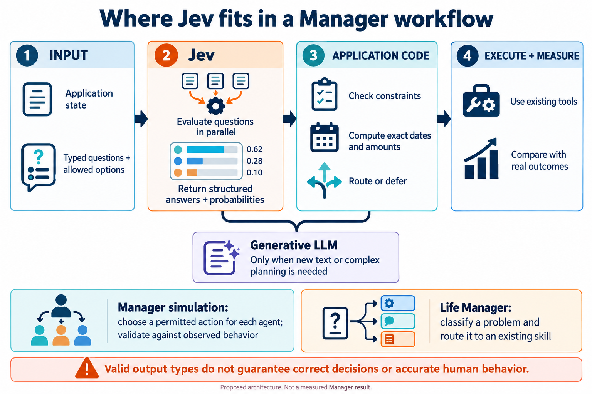

# Jev and fast structured decisions for Manager

Jev is a candidate for the repeated, bounded judgments inside an automated system: classify a problem, choose an existing handler, or decide whether a generative model is needed. Its structured interface could also select actions inside a simulation. Accurate human behavior prediction still requires observed behavior and evaluation on the intended population.

TypeSafe introduced Jev on September 15, 2026 as its first System One model. The useful distinction is the output contract. A generative language model produces text; Jev evaluates a supplied state against typed questions and returns constrained answers and probabilities. TypeSafe describes a new architecture, a parallel sampler and Reinforcement Learning for Calibrated Decisions, or RLCD. Its launch FAQ explicitly rejects the description of Jev as a small LLM. The public materials do not disclose enough architectural or training detail to reconstruct the model. [Launch article](https://typesafe.ai/blog/introducing-system-one-models-and-jev)



This is a proposed architecture, not a measured result from Manager. The probability values pictured are illustrative, not recorded API outputs.

## From state to a decision that code can use

A request contains a state and named questions. The state can hold text, records or application context. Each question supplies instructions and defines an answer space. Jev evaluates the questions against the shared state and returns answers for the application to inspect.

The stable text interface has three main primitives:

| Primitive | What the application defines | What the model returns |
|---|---|---|
| Choice | An unordered set of permitted options | A selected option and its probability distribution |
| Score | Ordered, described levels | A score and a distribution over levels |
| Noul | A yes-or-no proposition | The probability of yes |

The standard Choice interface supports up to 255 options, and Score supports up to ten levels. A Score is a judgment against a rubric, not an exact numeric extractor. Amounts, timestamps and identifiers should be computed or selected from valid candidates rather than reconstructed from a score. [API reference](https://docs.typesafe.ai/api.md), [known failure modes](https://docs.typesafe.ai/model-jaggedness/jev-1.13.md)

Here is a proposed request for a fictional Life Manager problem. It uses the documented HTTP request shape and a versioned model ID; it is not a recorded API call.

```json
{
  "model": "jev-1.13.0",
  "state": {
    "message": "I think I was charged twice for the same order.",
    "available_handlers": [
      "billing_review",
      "technical_support",
      "account_support",
      "insufficient_information"
    ]
  },
  "questions": {
    "handler": {
      "type": "choice",
      "instructions": "Which available handler best matches the reported problem? Do not assume the duplicate charge has been verified.",
      "criteria": {
        "billing_review": "A reported payment or charge problem.",
        "technical_support": "A product or service malfunction.",
        "account_support": "An account access or profile problem.",
        "insufficient_information": "The supplied record does not support a handler choice."
      }
    }
  }
}
```

Suppose the selected option is billing_review. That means the report should reach an existing billing workflow. It does not establish that a duplicate charge occurred, authorize a refund, or determine the correct amount. The workflow must retrieve the relevant records and apply its existing rules.

This division is useful for a proactive manager. Text may need semantic interpretation, while checking two transaction identifiers, comparing dates and computing amounts can remain ordinary code. TypeSafe's own failure-mode documentation recommends keeping arithmetic and time comparisons in code.

## What is public about the mechanism

TypeSafe describes Jev as returning the outputs in parallel rather than generating an answer token by token. Shared state is ingested once while the questions are evaluated against it. This can remove repeated context transmission and sequential output generation from workflows with many independent judgments. [Models](https://docs.typesafe.ai/models.md), [System One](https://docs.typesafe.ai/concepts/system-one.md)

RLCD is described as optimizing decisions and their probabilities. For a calibrated group of predictions, outcomes assigned a probability near 0.8 should occur roughly 80% of the time. That statement concerns groups of predictions on a distribution; it does not make one answer certain or establish calibration after moving to a new task. [AI primer](https://docs.typesafe.ai/introduction/machine-learning-primer.md)

There are two different kinds of change to keep separate:

- TypeSafe trains the model's parameters.
- A customer changes state, instructions, criteria and surrounding code.

The model documentation says Jev is not fine-tuned or LoRA-adapted for individual customers: accounts share the same weights. A Manager integration would initially be a new request and workflow configuration, not additional training of Jev.

The available documentation explains the interface and training objective. It does not provide the model's parameter count, layer layout, complete RLCD loss or training recipe. An exact Transformer-level explanation of Jev would go beyond those public materials.

## Probability and confidence are different fields

TypeSafe computes Choice and Score confidence from the returned probability distribution. It is a summary statistic, not an independent inspection of whether the answer is factually correct. Noul returns a yes probability without a separate confidence field.

For a Choice with n options, the documented formula is:

```text
confidence = (largest_probability - 1/n) / (1 - 1/n)
```

For an illustrative three-option distribution of 0.7, 0.2 and 0.1, confidence is 0.55. Neither number is an independently measured accuracy for a new Manager task. The model's probabilities, the derived confidence and accuracy against observed labels must be kept separate. [Confidence documentation](https://docs.typesafe.ai/confidence.md)

This also clarifies the launch article's broad hallucination claim. A schema-valid answer can still be the wrong permitted answer. Restricting the output to billing_review or technical_support prevents a third, undeclared handler from appearing; it does not guarantee that the correct handler was selected.

## How fast and inexpensive is it

The launch article reports end-to-end response times of 70–500 milliseconds. It says its published evaluations generally ran from laptops on the US West Coast, near the service. Its headline 193.6-fold speed improvement and 444.6-fold cost reduction come from its workflow evaluations; the article describes them as toward the high end of expected real-world gains.

Those comparisons also depend on what the other models were asked to return. TypeSafe used an adapter that makes LLMs return compatible structured decisions and probabilities. They are not universal multipliers against every classifier, local model, prompt or workload.

The model page lists a price of $0.042 per million input tokens, with output tokens unmetered. At that price:

| Illustrative workload | Input-token cost |
|---|---:|
| One request totaling 1,000 input tokens | $0.000042 |
| One million such requests | $42 |
| One million such requests repeated for 100 simulation steps | $4,200 |

These are arithmetic examples, not invoices or a Manager benchmark. Count all billed input, including questions. Repeated state, retry behavior, concurrency limits and the number of simulation steps affect the actual budget. A low price per call does not remove the need to budget a large simulation.

The hosted service also has organization-level request and token rate limits. Per-call latency alone does not tell us how long a million-agent simulation would take.

## What the evaluations establish

TypeSafe's public WorkflowEvals repository covers invoice processing, customer-service routing, agent-trace observability and security incidents. It compares workflow outputs against reference models and records agreement, cost and elapsed time. Its aggregate gives each workflow equal weight. Agreement with a reference model is a different target from agreement with independently observed human behavior. [WorkflowEvals code](https://github.com/typesafe-ai/WorkflowEvals)

Independent evaluation is available too. Deußer, Sparrenberg and Sifa evaluate pinned Jev 1.13.0 on 37 public datasets in their September 29 preprint, releasing a harness and responses. They report strong results on several classification and multiple-choice tasks, while finding weaknesses in rubric scoring, some language and domain settings, and binary decisions made with a fixed 0.5 threshold. Thresholds chosen on separate training or validation examples improved some task results. [Paper](https://arxiv.org/html/2609.37647v1), [code](https://github.com/AppliedMachineLearning-Lab/jev-benchmarking)

A separate October 13 preprint compares Jev, LLM judges and safety classifiers under controlled attacks. Its phishing task and rule-based moderation tasks produce different trade-offs. This supports evaluating the intended decision and threshold rather than treating one aggregate speed or accuracy number as product-wide evidence. [Paper](https://arxiv.org/html/2610.17820v1)

Both are preprints. Neither measures the accuracy of a Manager human-behavior simulation or whether a Manager intervention reduces suffering.

## An actual Jev and social simulation integration

A public community project, badgerbees/jev-oasis, forks CAMEL-AI OASIS and introduces a two-stage action path:

1. Build a state from an agent's persona and visible environment.
2. Ask Jev to choose from the available action tools.
3. Execute a non-generative action through the simulation's existing functions.
4. Call a generative LLM when the chosen action requires text, such as creating a post or comment.

The implementation also falls back to an LLM when Jev is unavailable or a request fails.

The README reports 12 generative LLM calls instead of 36 in a test with 36 agents over one round. The environment code still issues a Jev request for each agent, concurrently through one shared client. That is not one Jev request for the entire population, nor a 67% reduction in all requests. The reported count does not measure behavioral fidelity or total cost. [Project](https://github.com/badgerbees/jev-oasis), [environment code](https://github.com/badgerbees/jev-oasis/blob/3a115c6e8d28ae06ff83000475994b5d2e9b30b8/oasis/environment/env.py)

The code is useful as an architectural example, but its target selection needs care. It asks for a post identifier using Score and converts the result to an integer, with a fallback identifier. TypeSafe's own documentation warns against using Score to reconstruct exact numbers. For a Manager experiment, a better interface would offer the actual visible candidate identifiers as Choice options and check that the selected target remains available. [Agent code](https://github.com/badgerbees/jev-oasis/blob/3a115c6e8d28ae06ff83000475994b5d2e9b30b8/oasis/social_agent/agent.py)

This is a community integration. It is not evidence that CAMEL-AI's official OASIS, official MiroFish, Aaru or Simile uses Jev. The reviewed official descriptions and configuration examples do not establish such adoption. Aaru and Simile describe their own human-behavior modeling approaches; those descriptions cannot be turned into Jev adoption claims. [Aaru](https://aaru.com/publications/population-simulation-at-the-replication-floor-summary), [Simile](https://www.simile.com/blog/series-b), [MiroFish configuration](https://github.com/666ghj/MiroFish/blob/main/.env.example), [OASIS documentation](https://github.com/camel-ai/oasis/blob/main/docs/key_modules/social_agent.mdx)

## Where Manager and Life Manager could use it

| Component | Candidate role for Jev | What still needs another component |
|---|---|---|
| Population construction | Classify text into defined attributes, with evaluation | Population counts, household constraints and weighting |
| Behavior prediction | Produce candidate features or bounded predictions to compare with baselines | Observed behavior labels, calibration and validation on the target population |
| Agent simulation | Select among permitted actions; route text-generating actions to an LLM | Environment state, interactions, constraints and behavioral-fidelity testing |
| Proactive Life Manager | Classify a reported problem, route to an existing skill, assess relevant evidence | Exact calculations, tool execution, planning and outcome measurement |

A typed probability over walk, bus and bicycle does not become a real person's choice probability merely because a synthetic profile was supplied. The population from chapter 8 supplies attributes and household membership. It supplies no observed commuting history. The relationship between inputs and recorded behavior must still be learned or validated using appropriate data.

A second integration pattern uses Jev to extract semantic features from text and trains a separate supervised predictor against observed outcomes. TypeSafe's feature-discovery cookbook demonstrates this pattern with a downstream CatBoost regressor. That is a candidate method to test, not a result for Manager. [Feature-discovery cookbook](https://docs.typesafe.ai/cookbooks/autoresearch_feature_discovery.md)

For Life Manager, the first useful comparison would be a small, labeled routing problem with a bounded answer set. Compare rules, an existing model and Jev on the same held-out cases. Measure correctness, probability calibration, deferral rate, latency and cost. Keep exact calculations and allowed actions in code.

## Version and deployment boundaries

The retrieved model page lists stable jev-latest as Jev 1.13.0 and preview as 1.14.0. The October 14 announcement introduces experimental image, Box and long-context capabilities behind danger-zone flags. Those features should not be silently mixed into a baseline evaluation of the stable text decision interface. Pin a versioned model ID and record the response version. [Models](https://docs.typesafe.ai/models.md), [October 14 announcement](https://typesafe.ai/blog/jev-1-14)

Jev itself is a hosted API, not an open-weight model to install inside a local Life Manager. TypeSafe's enterprise FAQ says VPC and on-premises deployment are not currently available. Its documentation says customer requests and responses are not used for model training. A local-only application would need a different local decision implementation, or explicitly treat Jev as an optional remote component. [Enterprise](https://typesafe.ai/enterprise), [data handling](https://docs.typesafe.ai/models.md#data-handling)

English is the primary training language identified by TypeSafe. Japanese workloads need their own evaluation. A good result on an English routing dataset does not establish the same performance on Japanese records.

Manager's mission is End suffering. A fast decision component could help it identify and solve problems efficiently. Success still has to be measured in the resulting changes to people's circumstances, beyond valid types, fast calls or agreement with another model.
