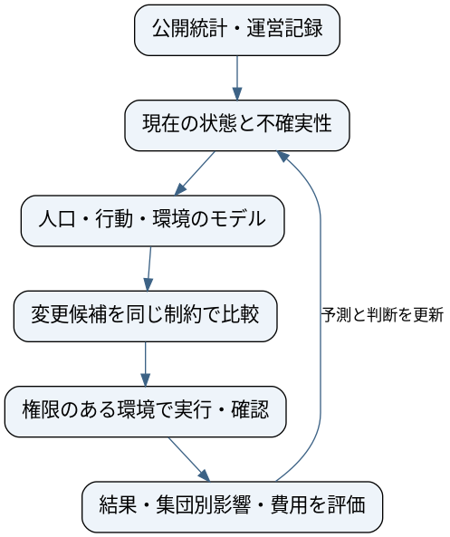

# 社会をシミュレーションし、環境を変えるAIを理解する

2026年10月12日。Managerを理解するための学習資料。歴史は原文、著者・財団・出版社・研究機関の公開資料から主要な論点と書誌を確認した。取り上げる本をすべて読了したという記録ではない。Managerの構成は提案であり、実装・実地効果は未検証。作業順と状態は[統合SSOT](../../../superpowers/specs/2026-09-25-life-manager-unified-ssot.md#manager-history-basics-20261012)。公開会社解説とは別の、自社構想を理解するための資料。

## 1. この分野は何を問うのか

ある制度や供給の仕組みを変えたら、誰がどんな選択をし、その結果どんな生活になるか。さらに、その予測を使って変更を選び、実際の結果から次の判断を改善できるか。この二つがManagerの技術上の問いになる。

関連する既存分野は、計算社会科学、社会シミュレーション、agent-based modeling（ABM）、制度・メカニズム設計、制御、因果推論だ。human behavior simulationは人の反応の予測、synthetic user simulationは主に製品などの利用者をモデル化する言葉として使える。world engineeringは構想の説明語であり、この一連の研究の標準名称として確立しているとは扱わない。environmental engineeringは一般には水・汚染等の環境工学を指すため、社会の制度設計と同一の専門分野とは言えない。

Managerの使命は、すべての生命の苦しみを終わらせること。現在の研究対象は人間の集団と共有環境の部分モデル。宇宙全体は使命の範囲であり、現在の観測・制御能力ではない。

## 2. 一つの系譜ではなく、五つの流れ

次の歴史は、各人物が直接次の人物へ影響したと証明する系譜ではない。現在の問いに関係する別々の流れを、年代と役割で整理したものだ。

|時期|構想・研究|問いの変化|
|---|---|---|
|1516|Thomas More『Utopia』|所有、労働、教育などの制度から社会を考える|
|1890|William Morris『News from Nowhere』|労働、生産、生活環境を変えた社会を文学で考える|
|1922|John Dewey『Human Nature and Conduct』|習慣を、人間と自然・社会環境の相互作用として考える|
|1932|Aldous Huxley『Brave New World』|幸福や安定の設計と、自由・尊厳の関係を問う|
|1945|F. A. Hayek「The Use of Knowledge in Society」|分散した知識を、一つの判断主体が把握できるか|
|1948|B. F. Skinner『Walden Two』|学習と行動の条件を設計した共同体を描く|
|1948–1956|Norbert Wiener、W. Ross Ashby|観測、フィードバック、制御、対応できる複雑さを形式化|
|1951|Isaac Asimov『Foundation』単行本|集団の歴史の予測と介入をSFとして描く|
|1961|Jay Forrester『Industrial Dynamics』|在庫、流量、遅れ、フィードバックを計算模型で扱う|
|1971|Thomas Schellingの分離モデル|個人の局所的な選択から、社会全体の偏りが生まれることを示す|
|1973|Ursula K. Le Guin「The Ones Who Walk Away from Omelas」|多数の幸福と、一部の苦しみの関係を問う|
|1990–1996|Elinor Ostrom、Epstein/AxtellのSugarscape|制度の実証と、個人の相互作用から社会を作る計算模型|
|1998–2000|Clark/Chalmers、Judea Pearl|環境に支えられる認知と、観測・介入・反実仮想の区別|
|2020–2023|AI Economist、Generative Agents|適応する住民と制度の学習、言語モデルによる行動生成|
|現在|Aaru、Simile等の行動予測と自己改善研究|現実の分布との照合、誤差予測、継続する更新を製品/研究に接続|

第一は理想社会とその批判を描く思想・文学。第二は人の行動を環境との関係で理解する研究。第三は制御とシステムの動力学。第四は相互作用から集団を作るシミュレーション。第五は、どの結果を良いとし、誰が決め、どう実証するかという制度・倫理・測定の問題である。

## 3. 哲学と小説から受け取る問い

Deweyは、心の善さだけを変えれば制度も変わるという立場と、人が環境で完全に決まり制度変更まで何もできないという立場の両方を批判する。人の性質と環境の相互作用を理解し、選択が意味を持つ環境を作る方向へ進む。Managerの物語も「環境が全て」ではなく、変更できる条件を理解して改善することに置く。

Skinnerからは、意志や説教だけでなく、行動を生む条件を調べる発想を学べる。ただし、共同体の行動設計を、人の自由と権利を問わず正当化するわけにはいかない。『Walden Two』は実験論文ではなく小説だ。

『Foundation』は、大きな人口の歴史を予測し介入する想像力の資料になる。psychohistoryは作品内の架空の科学で、現在の人口シミュレーションの実証済み理論ではない。作品の魅力と技術上の性能を分けて語る。

『Brave New World』は、管理された満足と自由の関係を問う。『Omelas』は、多数の幸福の陰で一部の苦しみが維持される社会を問う。Managerへの含意は本資料の解釈であり、著者がAIの評価を論じたという主張ではない。平均値の上昇だけで成功を宣言せず、誰に負担が残るかを確認する設計につながる。

Hayekは、経済上の知識が場所と時点ごとに分散する問題を示す。Ostromは、共有資源を単純な国家対市場の二択で捉えず、複数の制度や参加者による統治を検討する。Managerが一つの名前を持つことと、すべての権限を中央へ集めることは別である。

仏教の苦の滅は使命の出発点にできる。ただし、制度変更だけで仏教上の苦の滅に至ると原典が教えているわけではない。健康や生活負担を測る尺度は、使命へ進むための部分的な証拠である。

## 4. 統計とシミュレーションの基礎

モデルは、現実のうち判断に必要な部分を表現するものだ。地図に一人ひとりの人生がなくても移動を考えられるように、集団モデルにも実名は必要ない。ただし何を省いたかによって、使える判断が変わる。

人口モデルは、誰がどれくらい存在し、どんな条件を持つかを表す。仮に100人の社会で、高齢者40人、低所得者30人という集計しかないとする。両方に該当する人数は0から30まであり得る。独立だと仮定すると12人になるが、それは観測事実ではない。個別の割合を周辺分布、組み合わせの割合を結合分布という。

IPF/rakingは、人口の重みを既知の集計に合わせる手法の候補。元の人口構造にない関係や未知の相関を自動的に発見する仕組みではない。複数の可能な結合構造で施策を比較し、結果の順位が変わるかを確認する。

行動モデルは、条件を与えた場合の選択の分布を表す。全員に一つの回答を出す必要はない。仮に利用する確率が60%なら、100人全員が利用するという予測ではない。個人の確率、集団の予測割合、有限標本の実観測割合は異なる。

ABMでは、個体ごとの状態やルールを持ち、相互作用を繰り返す。Schellingでは局所的な近隣選好から大きな分離が生じる。これを逆に読んで、観測された分離から個人の動機を一意に決めることはできない。Sugarscapeでは資源のある環境で人工の個体が行動し、人口や格差などを作る。現象を作れることと、実社会の原因を確定することは別だ。

シミュレーションは、モデルから時間を進めて結果を計算する。反実仮想は「別の変更を選んだ場合に何が起きたか」という問い。計算できる反実仮想も、モデルの仮定が誤れば結果を誤る。モデルを実観測へ照合する必要がある。

## 5. 現在のAIは何を足したか

古典的なABMの多くは、開発者が書いた行動ルールを使う。LLMを使うモデルは、文章で与えた状況から、発言や選択などを生成できる。柔軟な表現ができても、それだけで実在する集団の分布に近いとは言えない。

Generative Agentsは記憶、reflection、planningを組み合わせて架空25エージェントの行動を作った。これは社会のもっともらしさを研究する一歩であり、実人口全体の予測精度の証明ではない。

Aaruの公開研究では、人口生成と個人の行動軌跡の中核を非言語モデルと明記する。人口構造と反応予測を大規模な質問の実観測へ照合している。Simileは調査、実験、インタビュー、行動記録などに基づく行動予測とconfidenceを研究・製品化する。両者を「人口対個人」で完全に二分しない。

AI Economistは、住民の行動と制度を設定するplannerが適応し合う二段階の強化学習を使う。何を良い経済とするかは明示した目的関数で決まり、万能の福祉をAIが自動的に発見する仕組みではない。

MASSやRSI-Anythingは、手順・モデルを改善し更新を保持する研究だ。人口の行動モデルそのものとは別の部品であり、Managerの研究・予測・選択の進め方に応用を検討できる。

## 6. Managerの基本構成

以下はManagerの設計案。各社の非公開構成を再現したものではない。

|部品|何を受け取り、何を返すか|確かめること|
|---|---|---|
|証拠の保存|公開集計/許諾運営記録→出典付き観測|時点、対象集団、単位、欠測、利用条件|
|状態推定|観測→現在の状態と不確実性|観測・推定・未知を分ける|
|人口|集計制約→集団と重み/合成人口|未知の結合構造、被覆、集団別の誤差|
|行動|集団/選択肢/環境→選択の確率|単純な統計モデル以上に予測できるか|
|環境の変化|制度/行動/容量→次の状態|予算・在庫・容量・待ち行列の整合性|
|変更の選択|現状と候補→適用する変更/見送り|同予算、遅延、適応、集団別の結果|
|実行|権限付き変更→適用記録と確認|重複・誤適用・復旧、適用後の状態|
|評価と更新|予測と結果→誤差/効果/採用する更新|独立heldout、費用、失敗、次世代への保持|

技術上は、観測できない状態を推定しながら行動を選ぶ問題として扱える。POMDPはそのような意思決定問題の形式の一つだが、初期に巨大なPOMDP solverを作る必要はない。未観測を明示した状態と、複数の仮定での比較から始められる。

たとえば、共有供給ネットワークを説明用の模型にするなら、人口の需要、受け取りに行ける時間や距離、拠点の容量、在庫、運搬費を表す。Managerは供給の配置や運営条件の候補を比較する。選択が変われば混雑や他の集団の利用可能性も変わる。これは学習用の例であり、最初の実地対象や改善実績として確定したものではない。

状態をs、環境への変更をa、次の状態をs'とすれば、環境モデルはP(s'|s,a)を近似する。選択の方策は、得られた証拠に基づいてaを決める。ただし観測データから学んだ条件付き予測と、実際にaへ介入したときの因果効果は同じとは限らない。

初期の選択は、変更候補を列挙し、同じ状態から複数の乱数条件で比較する方式を提案する。変更なし、固定ルール、単純な最適化を比較対象にする。モデルに都合のよい一つの未来だけで選ばず、反応や需要が変わる条件でも順位が保たれるかを測る。強化学習は、この比較で必要性が分かった段階で追加できる。

予測精度が高くても、どの変更を望ましいとするかは別の問題。目的には時間負担、健康、費用、利用可能性などを使い、重い不利益や資源制約を併記する。福祉を一つの数値へ完全に置き換えたとは主張しない。

## 7. 最初の実装で必要な契約

各部品が扱う情報を先に固定すると、モデルを交換して比較できる。次は提案する最小schemaであり実装済みAPIではない。

|情報|主要な内容|
|---|---|
|Observation|source/version、観測時点、地域、対象集団、metric、value、unit、uncertainty|
|Population|集団ID、重み、属性、アクセス制約、未知の関係の仮定|
|Intervention|変更対象、parameter changes、権限、予算、期間、復旧方法|
|Prediction|変更候補、予測する結果、集団別分布、不確実性、モデル版|
|Outcome|実観測、比較条件、時点、集団、費用、欠測、適用確認|
|RunManifest|データ/モデル/コード版、split、seed、全費用、失敗、評価protocol|

Python、NumPy/SciPy、Parquet/JSONL、必要に応じSQLite/PostgreSQL、CLI runnerで始める案。数値的な資源制約はコードで守る。LLMは資料整理、変更候補、必要な応答モデル等へ限定して使い、学習モデルの追加価値をbaselineと比較する。cloud/localは実行場所であり、別の製品設計にしない。

## 8. 人に何を証明するか

最初は、第三者が判断できる実験結果を示す。

|段階|示す結果|言える範囲|
|---|---|---|
|人口の評価|未使用の交差表/地域/期間への一致、被覆、感度|この対象人口を、この条件で表現できた|
|予測の評価|未知の実観測に対する誤差、校正、baseline比較|この結果を予測できた|
|施策の評価|未知の模型条件で同予算の方法を比較|この模型内で変更を選べた|
|実行の評価|適用後のreadback、失敗、費用、復旧|変更を正しく実行できた|
|実地の評価|比較条件に対する実結果、集団別改善/悪化|この環境でこの結果を改善した|

カテゴリ分布の差ならTVD、数値ならMAE等、確率の質ならproper scoring ruleと校正を使う。校正とは、例えば60%と予測した事例群で、その結果が概ね60%起きるかという性質。信頼区間は有限データによる不確実性の一部を表すが、誤った人口構造や因果仮定を自動的に含むわけではない。

改善前後の単純差だけでは、季節、対象者の変化、外部要因と分離できない。無作為化、cluster比較、段階導入、条件を満たす準実験などを、権限・干渉・データに合わせて選ぶ。公開集計だけで因果効果が識別できない場合、その限界を結果に残す。

提出する証拠は再現command、versioned code/data、protocol、baseline、結果表、集団別の失敗、費用、判断を変えた理由。現状ではこの新Managerの実験結果はまだない。

## 9. 理解と実装を進める順序

必要な基礎は確率、分布、標本、誤差、校正、holdout、因果、動的な状態とフィードバック。これらを一つずつ、手計算できる小さな例で理解し、集団モデルと数値環境へ実装する。最初から全世界の全情報を表す必要はない。

研究を読む→再現する→必要な部品を作る→比較する→失敗から変える→実地で確かめる、という循環で専門性を作る。発信はその循環から分かったことを伝える。資金調達、企業価値、podcast招待を、専門性が成立した証拠として先取りしない。

## 10. 話すための短い説明

「人を変えるには、本人への助言だけでなく、選択肢を形づくる環境も考える必要があります。この発想にはDeweyやSkinner、フィードバック制御、人工社会の研究など複数の歴史があります。現在はAIで人口や反応をモデル化できるようになっていますが、予測できることと改善できることは別です。私たちはManagerで、環境の変更を選び、実行し、実際の結果から学ぶ閉ループを作ろうとしています。使命は、すべての生命の苦しみを終わらせること。その使命へ進む一歩ずつを、比較できる証拠として示します。」

## 出典

1. [More, Utopia原文](https://www.gutenberg.org/files/2130/2130-h/2130-h.htm)
2. [Morris, News from Nowhere原文](https://www.gutenberg.org/cache/epub/3261/pg3261-images.html)
3. [Dewey, Human Nature and Conduct原文](https://www.gutenberg.org/cache/epub/41386/pg41386.txt)
4. [Skinner財団の書誌](https://www.bfskinner.org/publications/books)
5. [Huxley, Brave New World出版社](https://www.penguin.co.uk/books/357838/brave-new-world-by-huxley-aldous/9781784879686)
6. [Hayek, The Use of Knowledge in Society原文](https://www.econlib.org/library/Essays/hykKnw.html)
7. [Wiener, Cybernetics出版社](https://mitpress.mit.edu/9780262537841/cybernetics-or-control-and-communication-in-the-animal-and-the-machine/)
8. [Ashby原著/Archive](https://ashby.info/Ashby-Introduction-to-Cybernetics.pdf)
9. [Asimov, Foundation出版社](https://www.penguinrandomhouse.com/books/5655/foundation-by-isaac-asimov/paperback/)
10. [Forrester, MITでの書誌と研究史](https://news.mit.edu/2016/professor-emeritus-jay-forrester-digital-computing-system-dynamics-pioneer-dies-1119)
11. [Schelling, Dynamic models of segregation](https://doi.org/10.1080/0022250X.1971.9989794)
12. [Le Guin公式Omelasページ](https://www.ursulakleguin.com/the-ones-who-walk-away-from-omelas)
13. [Ostrom本人インタビュー](https://www.nobelprize.org/prizes/economic-sciences/2009/ostrom/164465-ostrom-williamson-interview-transcript/)
14. [Epstein/Axtell, Growing Artificial Societies出版社](https://www.bloomsbury.com/us/growing-artificial-societies-9780262550253/)
15. [Clark/Chalmers, The Extended Mind著者公開論文](https://www.consc.net/papers/extended.html)
16. [Pearl, Causality出版社](https://www.cambridge.org/core/books/causality/B0046844FAE10CBF274D4ACBDAEB5F5B)
17. [AI Economist論文](https://arxiv.org/abs/2108.02755)
18. [Generative Agents論文](https://arxiv.org/abs/2304.03442)
19. [Aaru公開方法](https://aaru.com/publications/population-simulation-at-the-replication-floor-research)
20. [Simileのconfidence研究](https://www.simile.com/blog/confidence)
21. [SN56.11](https://suttacentral.net/sn56.11/en/sujato)
22. [MASS](https://arxiv.org/abs/2610.12176)、[RSI-Anything](https://arxiv.org/abs/2610.13912)。前の[静的コード調査](../2026-10-12-rsi-anything-mass-code-review.md)。
