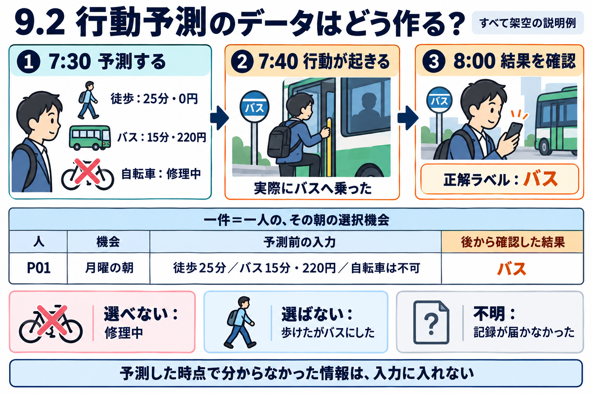

# 9.2 行動予測に使えるデータとは何か

2026-10-19。公開保留・学習用。以下の人物・金額・時刻は説明用の架空例。実測結果ではない。

目的は「どんな条件のとき、実際に何をしたか」の対応を記録すること。8Bは誰が何人いて誰と暮らすかを作った。行動予測には別に実際の選択や行動の記録が必要で、合成人口だけでは正解は得られない。

## 一回の朝の例

P01さんの月曜日7:30に、8:00までに始める通勤方法を予測する。入力は7:30までに分かる条件。徒歩25分・0円、バス15分・220円、自転車は修理中で利用不可。7:40に実際にバスを利用したことを記録から確認し、正解をバスとする。バス利用には停留所までの徒歩を含めるなど、分類の定義も先に決める。8:00までに通勤開始なしを確認できた場合は別の正解区分。記録が取れなかった場合は不明として扱う。

|人|機会|予測時刻|徒歩|バス|自転車|後から確認した正解|
|---|---|---|---|---|---|---|
|P01|月曜朝|7:30|25分・0円・可能|15分・220円・可能|修理中・不可|7:40バス利用|

一行は一人×一回の選択機会。同じ人の5日分は5観測だが5人ではない。選択肢ごとに複数行へ展開する表形式でも、同じ機会のIDを保つ。

- 徒歩は選べたが選ばなかった。
- 自転車は選べなかった。自転車が嫌いだと決めつけない。
- 行動ログが欠けたことと「通勤しなかった」は違う。
- 7:40の支払い履歴を7:30の予測入力に入れると未来の情報が漏れる。観測時刻とシステムが利用可能になった時刻の違いにも注意する。
- 利用不可の自転車の所要時間を0分と埋めると、最速の選択肢に見える場合がある。

## 先行資料から学んだこと

Swissmetro/Biogemeは仮想条件への回答を使う選択モデルの教材。CHOICEと利用可能性TRAIN_AV/SM_AV/CAR_AVを分ける。これは実乗車の履歴とは違う。NHTSは自己申告の移動記録、ATUSは一日の生活時間の記録で、後者だけで同じ人の翌日の行動を追えるわけではない。何を観測した資料かを区別して選ぶ。

出典：
- https://eml.berkeley.edu/books/choice2nd/Ch02_p9-33.pdf
- https://biogeme.epfl.ch/sphinx/_modules/biogeme/data/swissmetro.html
- https://biogeme.epfl.ch/sphinx/auto_examples/swissmetro/plot_b01a_logit.html
- https://nhts.ornl.gov/assets/2022/doc/codebook.pdf
- https://www.bls.gov/tus/other-documentation/howto.htm

## 第9単元の順序

|単元|学ぶこと|小さく作るもの|
|---|---|---|
|9.1|行動予測とは何か|入力・行動・予測の定義|
|9.2|行動データの構造|人×機会の表、利用可能性と時刻|
|9.3|条件付き確率と比較基準|全体と条件別の割合|
|9.4|教師あり学習・選択モデル|ロジスティック回帰等の小実装|
|9.5|未来・別人への評価|学習・検証・テストの分割|
|9.6|予測の採点|正答率、Brier、log loss、較正|
|9.7|方式の比較|選択モデル・木・ニューラル・LLMを同条件で比較|
|9.8|履歴と時間|次の行動・回数・待ち時間のモデル|
|9.9|個人から集団へ|期待人数と乱数による実現値、制約|
|9.10|研究・データ・コードの比較|再現する題材を選ぶ|
|9.11|公開データで総合実装|取得→整形→比較基準→学習→評価→誤差分析|
|9.12|マネージャーへの応用|対象行動・地域・属性を選び人口部品と接続|

基礎→公開データで再現→マネージャー応用。各段階で学ぶ→作る→測る→説明する→改善する。苦しみやマインドフルネスの測定は後の別章。現在は9.2再説明であり、行動予測の精度向上を実測した段階ではない。
