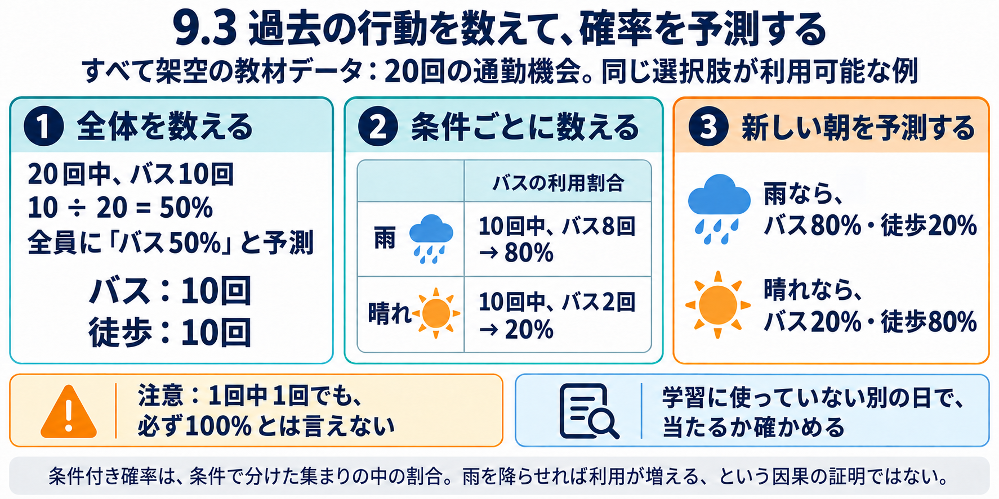

# 9.3 条件付き確率と比較基準

日本語の学習解説。公開保留。全数値は架空教材。

9.2で作った「人×選択機会」の表を数え、行動の確率を予測する。ここでは通勤方法がバスか徒歩の二択で、どちらも利用できる記録に限定する。

|天気|バス|徒歩|合計|バス割合|
|---|---:|---:|---:|---:|
|雨|8|2|10|80%|
|晴れ|2|8|10|20%|
|全体|10|10|20|50%|

全体の予測は10÷20=50%。新しい朝の天気を問わず50%を出す。この単純な方法が比較基準になる。条件別の予測は雨の記録だけを分母にして8÷10=80%、晴れなら2÷10=20%。P(バス|雨)の縦線は「雨という条件のもとで」。一般式はP(B|R)=P(BかつR)/P(R)、P(R)>0。今回の割合は未知の確率の推定値で、未来に必ずその比率になる約束ではない。

80%という出力と「必ずバス」という出力は違う。確率から一番大きい行動を選ぶことと、乱数で行動を作ることも違う。確率.8の10機会なら期待利用回数は8だが、実現値を8に固定するわけではない。

条件を年齢・曜日・地域まで細かくすると、該当が1件になることがある。1回中1回という観測だけで真の確率100%とは言えない。教材の加算平滑化は、二択それぞれに仮のカウント1を足して(バス回数+1)/(総数+2)とする。1回中1回なら2/3。実際の観測を増やしたわけではなく、極端な推定を抑える仮定を加えた。常に最善ではなく、偏った行動では50%へ寄せる仮定が不適切なこともある。

比較基準は全体割合、最頻行動、条件別割合、直前の行動など。直前の行動は履歴がある人だけに適用でき、初見の人への代替を決める。学習用の表に合うだけでは足りず、別の未来の記録で評価する。教材Pythonでは別に構成した8機会で全体基準50%正答、条件別75%正答。構成例の結果であり現実の予測改善ではない。

雨の日とバス利用の関連は、運賃を下げた効果の証拠にはならない。予測と介入効果を分ける。マネージャーでは人口構成の部品に加え、観測された行動を学ぶデータが必要。既知の人なら合成人口なしでも予測できる。

原典・教材・公式コードの一覧は英語原稿articles/2026-10-19-chapter9-03-frequency-baselines-en.mdへ保存。Shmueli2010 DOI10.1214/10-STS330、Train2009第2章、D2L確率、Jurafsky/Martin2026草稿第3章、scikit-learn DummyClassifier、Hyndman/Athanasopoulos教材を参照。論文、教科書、公式コードを混同しない。言語モデルの平滑化を人の行動へ応用する説明は教材上の統計的対応であり、交通予測の実証結果ではない。
