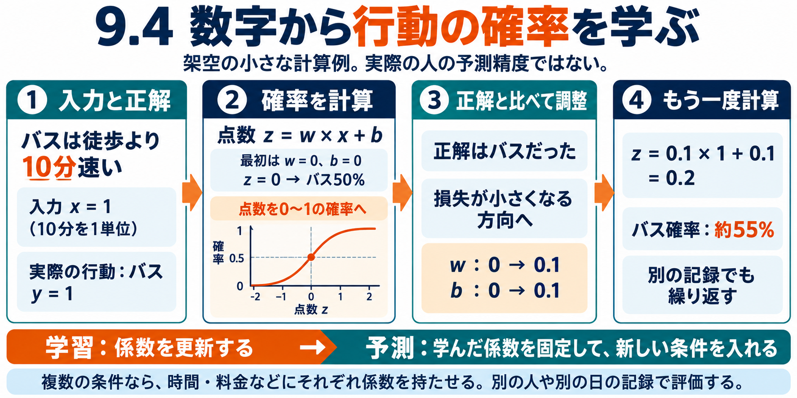

# 9.4 行動の確率を学習する仕組みとJevの役割

学習用。公開保留。数値計算は架空教材。

9.3は条件ごとに数えて割合を出した。9.4は入力の数字から確率を計算する関数を作り、その係数を実際の行動に合わせて学ぶ。例はロジスティック回帰。徒歩25分・バス15分なら、速さの差を10分単位にしてx=1。点数z=w×x+bを作り、シグモイドp=1/(1+exp(-z))でバス確率へ変える。wは入力の影響を調整する係数、bは基準をずらす係数。最初w=b=0ならp=.5。

実際はバスy=1だった場合、損失は-log(.5)=.693。勾配は(p-y)xとp-yで、どちらも-.5。学習率.2ならwとbをそれぞれ.1へ更新する。再計算するとz=.2、p=.549834、損失.598139。この一件では正解側の確率が上がった。別の記録で歩いたなら、入力によって逆方向の更新も起きる。多数の記録の損失を小さくする係数を探す。実際の最適化では記録をまとめて計算することも多く、使用するソルバーも異なる。予測時は係数を固定し、新しい入力へ同じ計算を行う。

20件の架空記録（x=1はバス8・徒歩2、x=-1はバス2・徒歩8）を別に用意した全件学習でも動作確認。w約1.386294、b約0、p(1)=.8、p(-1)=.2、p(.5)約.666667。これは学習表への適合だけであり、未知の人への精度や介入効果を実証していない。

## 人と実装

Daniel McFaddenは個人の選択を扱う条件付きロジットを発展させた。原典は買い物の交通手段や行き先の選択などを含む。Kenneth Trainは選択モデルの導出・推定・仮定を教科書で整理している。Michel Bierlaire／EPFLのBiogeme公式例は鉄道・Swissmetro・車の三択で、時間と料金の係数を最尤推定する。選択肢の利用可能性も別に持つ。公式出力の6,768観測・係数は著者例の結果であり、私たちの再実行結果ではない。仮想条件への回答データであることにも注意する。scikit-learnは一般的な分類としてのロジスティック回帰を提供している。

マネージャーは観測行動データ→特徴→学習→別の記録で評価→対象集団へ予測→判断・実行→実地成果評価を接続する。8Bの生成エンジンは再利用できるが、ロードアイランドの住民一覧がそのまま全用途の正解行動データになるわけではない。

## Jev

TypeSafeのJevは状態と型付き質問を受け、分類・候補選択・順序付き評価などを返すモデル。通常の利用では利用者が個別に重みを追加学習するのではなく、状態・指示・候補を設定する。公式は独自アーキテクチャ、並列出力、RLCDを説明しているが層構造や損失の完全仕様は公開資料から再構築できない。小さなLLMと断定しない。

例：二重請求かもしれないという文章を、請求確認・技術対応・アカウント対応・情報不足のいずれかへ分類する。請求確認を選んだことは二重請求の確定や返金の許可ではない。金額・日時はコードで確認し、必要な文章は生成LLMへ渡す。

コミュニティのbadgerbees/jev-oasisではJevがSNS行動を選び、投稿など文章が必要な場合だけLLMへ回す。36エージェント1巡でLLM呼出36→12という著者報告。Jev呼出は別に存在するため総呼出・費用・行動再現性の改善とは読み替えない。公式MiroFish、OASIS、Aaru、SimileのJev採用の証拠ではない。

価格は入力100万トークン$.042。入力1000トークンの呼出100万回で$42、100ステップなら$4200という算術例。70–500msは会社公表条件下の値で、私たちの実測ではない。安定版1.13、プレビュー1.14を2026-10-19に再確認。クラウドAPIでありローカル配布モデルではない。JevAPI推論は実行していない。

マネージャーには問題分類・担当機能への振分け・許可された行動候補の選択が候補。人の行動確率として使うなら観測行動に対する評価が別途必要。9.4で学習する行動モデルとJevの役割を混同しない。

英語原稿と出典一覧：../../articles/2026-10-19-chapter9-04-learning-choice-models-en.md。詳細なJev調査：../../articles/2026-10-19-typesafe-jev-system-one-en.md。
