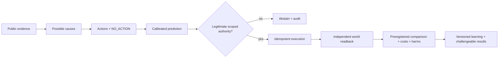

# Why Prediction Is Not Intervention: Building an AI That Can Prove It Helped

*What Simile, Aaru, Andon Labs, Tinker, cash-transfer researchers, and prediction markets teach us about the missing link between predicting people and improving their lives.*

**Research field note · October 21, 2026 · Anicca / Manager**

Imagine a town with an expensive electricity problem. It has public weather reports, utility consumption statistics, open-source forecasting tools, and a new AI that can describe exactly why the bills are likely to rise next week.

The town does not need another convincing explanation of its bill. It needs a change that actually lowers the bill without making somebody else's situation worse.

That distinction sounds simple. In artificial intelligence today, it separates at least three fields that are often spoken about as if they were the same.

**Prediction** asks, “What will happen?” **Intervention** asks, “What should we change?” **Causal evaluation** asks, “Did that change improve anything, compared with what would otherwise have happened?”

Manager, a separate research product being developed under Anicca, is an attempt to connect those fields. Its mission—*End suffering*—is a direction, not an empirical finding or a claim that any one system has discovered an adequate way to define every person's wellbeing. Its technical challenge is to build an observable bridge from evidence and uncertainty to a legitimate action and, finally, an independently verified outcome.

There is no need to invent every wheel. Some of the best components are already being built in different laboratories. The difficulty is knowing which components answer which questions.

## 1. Two remarkable simulations—and two different ways of being wrong

Start with [Simile's explanation of its What-If Machine](https://www.simile.com/blog/what-if-machine). Simile distinguishes what people *do*—actual purchases, clicks, delivery orders, movements—from what people say about *why* they do it. A price increase might correlate with losing customers. It does not by itself reveal whether price, habit disruption, word of mouth, or a competing product caused the switch.

The company is trying to combine observed behavioral traces, surveys, interviews, and experimental data. It then evaluates whether the resulting simulation agrees with events that actually happened. In its [2026 confidence-model research](https://www.simile.com/blog/confidence), Simile makes an especially useful move: rather than reporting just the forecast, it tries to predict its own future error.

For a question about whether delivery customers tip, Simile illustrates a model prediction of 93.4% versus an observed 87.3%. The gap is not a headline “accuracy of 93.4%.” In this two-option example, the total-variation distance is about 0.0615. The point of the confidence model is to learn which questions may produce an even larger gap before the observed truth arrives. On roughly 8,600 held-out questions, different methods—simple distributions, text embeddings, neural hidden-state probes, and continued training of a Qwen3.5 model—show different strengths. Simile's reported ~0.736 AUROC method is a technical measurement, not evidence that changing a policy would help someone.

[Aaru's September 2026 research](https://aaru.com/publications/population-simulation-at-the-replication-floor-research) attacks a closely related problem. It builds simulated populations intended to reproduce real survey-response distributions. Across 2,993 questions from 186 studies, Aaru reports a mean unadjusted TVD of 7.62 points, and 5.98 after its sampling adjustment. Its sample-adjusted mean absolute error is 2.78 percentage points.

These are serious published *claims with described evaluation methods*. They are not an independently audited performance comparison against Simile on a shared dataset. Aaru also reports separate comparisons to observed purchases, plus an error predictor. But a brand-pair ranking, a pooled answer-share correlation, and a marginal survey-distribution TVD are not individual life-course accuracy. Nor do they establish that the simulation can predict a causal welfare effect of a policy change.

We should learn from both groups. We should not borrow confidence from one benchmark and carry it untested into another.

## 2. The prediction-market category error

[Polymarket](https://help.polymarket.com/en/articles/13364272-what-is-a-prediction-market) uses tradeable contracts on resolvable events. Its prices, with documented orderbook-display conventions, aggregate financially exposed participants' beliefs about *whether an event will occur*. A market asking whether a particular election will be won is not answering how residents of a particular neighborhood will behave if a transit fare changes.

Simile and Aaru address responses conditioned on described people and circumstances. A causal policy evaluator asks about the difference between worlds in which the action does or does not occur. These are three distinct quantities:

```text
Event forecast:        P(event resolves YES)
Behavioral forecast:   P(action | population, circumstances)
Causal intervention:   E[outcome if do(A)] - E[outcome if do(NO_ACTION)]
```

A forecast market may outperform some commentators on a particular event, but it cannot substitute for a study of who bears the cost of an intervention. And a behavioral simulator may predict a shopping choice exceptionally well without being able to tell you which welfare intervention is ethically worth executing.

Manager should compare these models as complementary baselines. It does not need to create a new trading market to make the comparison—and it does not need to place a trade.

## 3. Let the other experiments expose our blind spots

[Andon Labs' Vending-Bench 2](https://andonlabs.com/evals/vending-bench-2) tests whether a model can run a fictional business for a simulated year. Inventory, negotiated prices, limited cash and unhappy customers can compound into failure. This is a clever measure of long-horizon coherence. But the model's virtual account balance is not a real person's earnings.

[Anthropic and Andon's Project Vend](https://www.anthropic.com/research/project-vend-2) is different. AI really managed operations for an office shop. It made memorable mistakes, and later became better at ordering, pricing and commercial work. Physical labor and other real-world constraints mattered. Even then, the many architecture and model changes over time mean the case is not a clean randomized estimate of a single model upgrade's causal contribution, much less a measure of reduced suffering.

Perhaps the most useful warning comes from outside the agent world. In the [Behavior Change for Good megastudy](https://www.nature.com/articles/s41586-021-04128-4), researchers compared 54 digital exercise interventions among 61,293 gym members with consistent outcome measurement and time frames. During the intervention, 45% of tested programs significantly increased gym visits. Only 8% showed measurable persistent effects after the program ended. Judges' forecasts did not reliably identify the winners.

Read that again. Many people designed plausible, evidence-informed ways to help. Even experts could not reliably predict what would work best. The true discriminating information came from comparing real interventions under common conditions.

This is why our preferred scientific workflow is not “predict and declare victory.” It is “predict, abstain when uncertain, test carefully, measure, and update.”

## 4. From public signals to interventions with their own proof

Consider an air-quality intervention.

A public outdoor PM2.5 sensor can help describe current conditions. It does not measure an individual classroom's indoor exposure, and it does not give an AI permission to control the building's ventilation. A useful intervention study would need a legitimate facility operator, an independent indoor monitor, a safely randomized or comparable treatment schedule, and a clear account of electricity, noise, maintenance and occupant discomfort.

Or consider an aid intervention. An AI can read [Open Collective's public ledger documentation](https://developers.opencollective.com/) and find historical transactions. That demonstrates access to source data, not that the agent raised new donations. A successful payment may still be someone else's money moved from one deserving cause to another. And an increased donation balance does not measure the financial or psychological wellbeing of an actual recipient.

A credible record needs distinct stages.



An intervention's receipt, a sensor's observation, and a causal study's estimated benefit answer separate questions. Collapsing them into a single success indicator makes the system appear more impressive, but less trustworthy.

## 5. The universal basic income test: token, money or welfare?

The ambition to distribute the benefits of advanced automation is not new. But the mechanisms vary enormously.

[GiveDirectly's Kenyan cash research](https://www.givedirectly.org/2023-ubi-results) actually paid people and compared alternative designs including long-duration monthly grants, short-duration grants, lump sums and control villages. Recipients' lives were studied. A [related large Kenyan randomized-transfer study](https://www.nber.org/papers/w26600) also investigated effects on nonrecipients, firms and local prices. That is the scale of measurement required if we want to claim an intervention improved economic wellbeing rather than merely generated activity.

The [GoodDollar](https://www.gooddollar.org/) protocol, on the other hand, describes daily digital-token distribution. Such a system offers different advantages: public ledger traces, automation, regular grants and open programmable interfaces. Yet token emissions and wallet claims are not the same thing as buying food, paying rent or retaining income after transaction costs. Value, liquidity, access, security, local acceptance and privacy all matter.

The experience of [Circles UBI](https://www.frontiersin.org/journals/blockchain/articles/10.3389/fbloc.2024.1362939/full) reinforces the lesson. Issuing a community currency does not automatically construct a healthy local marketplace, a stable source of production or effective social governance. Another [qualitative study](https://arxiv.org/html/2504.02714v1) describes experiences of participants in the Berlin pilot, but its small purposive sample is not a randomized estimate of universal poverty reduction.

A third category is corporate wealth sharing. [Anthropic's October 2026 Public Benefit Fund announcement](https://www.anthropic.com/news/public-benefit-fund) describes a conditional equity commitment and possible future direct distributions. It is not a launched crypto-based basic-income program, and a pledge is not an independently confirmed payout.

A genuinely proactive income Manager would start by asking where value can be created, which access barriers can be removed, and whether doing so improves recipients' resources net of all harms. It would not assume a new token is necessary.

## 6. What about reinforcement learning—and Tinker?

[Thinking Machines Lab's Tinker](https://thinkingmachines.ai/tinker/) is a strong candidate for the *post-training* layer. It offers managed, distributed LoRA training for supported open-weight models, with supervised and reinforcement-learning recipes in its [official quickstart](https://tinker-docs.thinkingmachines.ai/tinker/quickstart/) and [cookbook](https://github.com/thinking-machines-lab/tinker-cookbook). It reduces the engineering effort of standing up GPU infrastructure. Open-source alternatives like [TRL](https://github.com/huggingface/trl) should be tested on exactly the same tasks before paying for a large hosted training run.

What would we train?

First, a question-conditioned response predictor on genuinely meaningful and use-permitted human data. Second, a separate error-prediction model, following Simile's confidence work, judged on held-out questions. Third, if a real randomized comparison is available, a model of treatment-effect uncertainty, with ordinary statistical methods as serious baselines.

Only after that should we train operational behavior using RL. A model may learn to preserve a budget, reject forged authority, avoid duplicate sends, or admit uncertainty. Those have verifiable rewards. We cannot responsibly reward it for “saving lives” when no independent downstream welfare measurement exists.

Training infrastructure is already out there. Our competitive edge must come from measuring the right things, maintaining a correct boundary between simulation and reality, and refusing to manufacture optimistic labels.

## 7. Where Manager actually stands

As of this research snapshot, the independent Manager kernel's K001–K014 offline software acceptance conditions have been tested. The same restricted kernel operates fictional finance and environment adapters, including durable effect reservations, scoped mock authority, safe NO_ACTION and audit traces.

Phase 06's first three tasks cover candidate/authority mapping, a frozen *study-design proposal* and a read-only third-party public financial data source. F004 and F007 remain blocked on actual funding/property permissions. The other Phase 06 field-effect tasks remain unfinished.

**No verified Manager-caused welfare improvement exists in the evidence described here.** Nothing in a successful test suite changes that scientific status.

What we do have is a reusable engineering scaffold and a set of external research communities showing how to improve each scientific layer. This is a legitimate starting point for a public research project, not the end of the work.

## 8. What we cannot claim

We cannot yet say that Manager has reproduced the original HeartSteps randomized analytic sample, validated a human behavior foundation model across novel interventions, issued a legal third-party grant, performed a real beneficial financial or environmental intervention, or independently shown a causal net improvement in people's lives.

We also cannot equate a vendor's cross-population survey accuracy with our own result, an external transaction with income generated by Manager, or a simulated model's decision with real authorization.

The point of publishing these failures and unknowns is to make the next experiments more credible.

## Methods

This article is an original synthesis of source-owned research and official documentation accessed in October 2026. Where numbers come from companies, they are described as vendor- or self-reported. Experimental results are credited to their research authors. We did not obtain non-public respondent profiles or raw customer data, recreate proprietary model weights, run new training, execute finance/physical transactions, or field a new human RCT for this article.

The accompanying [Manager first-source evidence register](https://github.com/Daisuke134/life-manager/tree/research/manager-product-r006-20261020/products/manager/docs/research/crossfield-20261021) separates the demonstrated claim, limitations, reuse decision and rights check for every cited system. Open code, open weights, public data, and a public paper are not interchangeable permissions.

## References

1. [Simile — Building the What-If Machine](https://www.simile.com/blog/what-if-machine)
2. [Simile — Building confidence](https://www.simile.com/blog/confidence)
3. [Aaru — Population simulation at the replication floor, methods](https://aaru.com/publications/population-simulation-at-the-replication-floor-research)
4. [Polymarket — How displayed market prices are calculated](https://help.polymarket.com/en/articles/13364488-how-are-prices-calculated)
5. [Andon Labs — Vending-Bench 2](https://andonlabs.com/evals/vending-bench-2)
6. [Anthropic — Project Vend, second phase](https://www.anthropic.com/research/project-vend-2)
7. [Behavior Change for Good — Megastudies improve applied behavioral science, Nature](https://www.nature.com/articles/s41586-021-04128-4)
8. [GiveDirectly — UBI first findings](https://www.givedirectly.org/2023-ubi-results)
9. [Egger et al. — General equilibrium effects of cash transfers](https://www.nber.org/papers/w26600)
10. [GoodDollar — Protocol and token distribution](https://www.gooddollar.org/)
11. [Circles — Academic pilot and implementation limitations](https://www.frontiersin.org/journals/blockchain/articles/10.3389/fbloc.2024.1362939/full)
12. [Anthropic — Public Benefit Fund announcement](https://www.anthropic.com/news/public-benefit-fund)
13. [Thinking Machines — Tinker quickstart](https://tinker-docs.thinkingmachines.ai/tinker/quickstart/)
14. [Hugging Face — TRL open-source training](https://github.com/huggingface/trl)
15. [Open Bandit Pipeline — Logged-policy evaluation](https://github.com/st-tech/zr-obp)
16. [Salesforce/AI Economist — Two-level policy RL](https://pmc.ncbi.nlm.nih.gov/articles/PMC9067926/)

*Manager's proposed future proof is not a slogan. It is the difference between a world that changed and the closest defensible version of that world where we chose NO_ACTION—reported with uncertainty, dignity, costs, harms and the right to challenge the result.*
