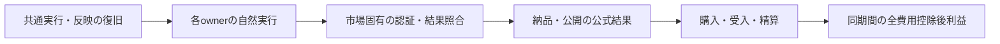

# Gig・Capafyの共通障害と個別課題

**今回の範囲:** 状況説明とspec/README更新。修復、owner起動、認証、provider操作、release/apply、fence解除・再送を行わない。

**正本:** `../specs/2026-09-25-life-manager-unified-ssot.md`。実行順は既存のRemaining atomic Gig TODO、CB、Capafy CD/DDを参照する。この資料は別のTODO/status正本を作らない。

**一次情報:** source `9b3c77491d72dab1007393fa69ff453d905ed4ca`。安全なlaunchd読取を使ったstatus captureは`2026-10-14T00:39:32.123821Z`完了。Capafy限定調査は00:46:18Z終了。数値/35 owner行は`docs/evidence/gig-capafy-status-20261014.json`。保存済provider readbackの日時は実行観測と分ける。今回は新しいprovider GETを行っていない。

## 結論と共通基盤の更新

**共通障害だけを直しても、全市場の無人収益化は完成しない。** 共通実行の待ち、過去effectの照合不足、account/inventory読取、未登録owner、納品の未達、商品枠、配信・転換・利益計測をそれぞれ扱う。

前回の旧bundle拒否を現在の唯一の故障として扱わない。currentは完全release `20261014T080308-28614ef5`、SHA `28614ef51d8f5be0aa82c0967d4d8562ba7f14dc`、cut_at=10/13 23:04:52Z。既存修正`03df6ebe10`はその祖先で、`runtime/host/disk_admission.py`は調査mainと一致する。release-reconciler自身も同SHAをloadedする。

一方、reconciler stderrはfleet applyの`partial / budget exceeded`を記録し、各ownerは複数SHAに分かれる。current変更は全owner採用の証明ではない。直近reconcilerイベントは`entrypoint_exit_75`、古いログには実`ENOSPC`もある。容量計算、物理書込、owner反映、自然実行の受入を分け、ALLを重ねて作ることを現在の次手にしない。

共通admissionでは`resource_capacity_busy / resource_fifo_wait / resource_control_busy`を観測した。sourceのagent同時実行上限既定は2だが、これを現場の全overrideを読んだ値とは扱わない。RO queueの別窓はagent41/deterministic46。枠待ちを送信失敗や売上0へ置換せず、上限だけを上げてmaximizationと呼ばない。通常Gig producerはnumeric free-space floorを使わないmain修正があり、release構築容量の条件と混同しない。

## Gigの工程・市場別状況

`Submit`は正式納品として定義する。Applyは応募、Negotiateは契約前の返信/見積、Paidは受注後の制作・品質確認・正式納品・受入観測をまとめたlane。単なるメッセージ送信やprocess PASSを正式納品/入金へ置換しない。

| 市場 | Storefront | Apply | Negotiate | 制作・Submit | 現在の残原因 |
|---|---|---|---|---|---|
| Coconala | 実装・managed ownerあり。旧掲載effectでheld | 旧応募effectでheld | Reply ownerあり。旧送信effectでheld | Paid ownerあり。00:31:55Zの公式受注中一覧はcomplete、0件。直近outer wakeは枠待ち | 掲載のstdout/runtime binding、応募intent対応、message receipt、実行枠。現行SKUの需要/利益は別課題 |
| Lancers | 実装・managed ownerあり。旧effectでheld | capacity待ち＋過去unknown177 | capacity待ち＋過去unknown217 | Paidの保存結果はprovider_inventory/RuntimeErrorでfailed。work-syncもfailed | account/inventoryを現在読めない。古いfunded状態を現在へコピーしない。正式納品の自然receiptは未確認 |
| CrowdWorks | 専用Storefront ownerなし。native storefrontの適格性は未確認 | capacity待ち、旧unknown76。内側最新保存値account_ensure_failed | ReplyはFIFO待ち、旧unknown289 | Paidは5件観測/5件pending、全件reconcile_unknown、effect/readback0。outerはcapacity待ち | account readinessの失敗、過去提出/返信/納品の照合、実行枠。5件を納品済み/精算済みとは扱わない |
| Mercor | Storefront型ownerなし | 旧application effectでheld | 旧reply effectでheld | Paid ownerは観測・handoff。sourceのmutateはmercor_human_submission_requiredを返す | 旧effectに加えて無人Submit未実装。10/04のcontracts=[]は現在の契約0の証拠ではない |
| Freelancer | readiness/transport/paid adapterのsourceあり | managed production ownerなし | managed production ownerなし | managed production ownerなし | 旧3labelsはretired/disabled。account-bound inventory・action許可・funded契約・owner受入が未証明 |
| Upwork | adapterのsourceあり | managed production ownerなし | adapterのsourceあり、managed ownerなし | adapterのsourceあり、managed ownerなし | 旧2labelsはretired/disabled。現在のaction許可・account/contract・自然readbackが未証明 |

`unknown177/217/76/289`は各ownerの未解決occurrence履歴で、別々の顧客数・有償注文数・実送信数ではない。CrowdWorksの5 pendingとunknown60 Paid occurrencesも同じ数字ではない。

### 直近のbusiness owner行

| owner | installed SHA | 最新イベント | 意味 |
|---|---|---|---|
| hf-gig-storefront-direct | 5b90b21e | blocked/resource_effect_unknown | 旧18d8d288748508e8-23902がheld |
| hf-gig-apply-direct | 5b90b21e | blocked/resource_effect_unknown | 旧18dadcd76d9c61b0-37711がheld |
| hf-gig-reply-detector | 28614ef5 | blocked/resource_effect_unknown | 新版でも旧18dde86cdb81d360-30574は未照合 |
| hf-gig-paid-direct | 2275018c | blocked/resource_capacity_busy | 新しい0注文readbackは正常観測。今後の制作/納品実績とは別 |
| lancers-revenue-storefront | 5b90b21e | blocked/resource_effect_unknown | 旧18d67d28fc8af5c0-77700がheld |
| lancers-revenue-application | 5b90b21e | blocked/resource_capacity_busy | 旧unknown177も残る |
| lancers-revenue-negotiate | 5b90b21e | blocked/resource_capacity_busy | 旧unknown217も残る |
| lancers-revenue-paid | 5b90b21e | blocked/resource_capacity_busy | 内側provider_inventoryの失敗は別に残る |
| lancers-revenue-work-sync | a299acc0 | fail/entrypoint_exit_1 | 保存stdoutはaccount_unavailable/source_complete=false。最新runへのstdout bindingは未確認 |
| crowdworks-revenue-application | 5b90b21e | blocked/resource_capacity_busy | 00:22:43Z保存値account_ensure_failed |
| crowdworks-revenue-reply | 5b90b21e | blocked/resource_fifo_wait | 旧unknown289も残る |
| crowdworks-revenue-paid | a299acc0 | blocked/resource_capacity_busy | 00:31:44Z保存値5 pending/reconcile_unknown |
| mercor-revenue-application | a299acc0 | blocked/resource_effect_unknown | 旧18d6f9cb5bdaef98-33812がheld |
| mercor-revenue-reply | a299acc0 | blocked/resource_effect_unknown | 旧18d668a6643dc360-61324がheld |
| mercor-revenue-paid | 5b90b21e | blocked/resource_effect_unknown | 旧18db69e6a498b168-26587がheld |

### 何を直せばよいかを確定する次の境界

- **Coconala:** CB06の既存adapterを使い、Applyのoccurrence→複数request intent、Storefrontのstdout/runtime identity→official listing、Replyのintent/body hash→official message IDを結ぶ。保存済adapterはそれぞれ未closureで、Storefrontはstdout_runtime_binding_invalid、Replyはofficial_provider_receipt_unavailable。既存の正しいproofをparserが誤拒否する再現があればそのparserだけのRED/diffを作る。receipt不足を比較緩和で修復しない。
- **Lancers:** `work_sync.run_tick`→`application_tick._production_account_ready`のaccount境界を、実際のowner/session/WAF/responseで狭める。保存済solver pendingをlive UIの証拠にはしない。`paid_adapter._inventory`→`paid_kernel`でerror codeがどこまで保持されるかを同runに結ぶ。mainにはpaid_error_codeを付ける既存実装があるため再実装を先にしない。`paid_adapter.mutate`にはaccept/formal_deliveryを含む経路が存在するが、`decide`のformal_delivery_surface_unverified待ちと公式納品receiptを別々に受け入れる。除外済みrows25–27/Answersには触れない。
- **CrowdWorks:** `application-owner`→account/profile ensureの同run失敗結果と、Paidの5 work itemのprevious intent/readbackを先に照合する。profile-receipt=completeだけでは最新account ensureの成功にならない。既存form/納品adapterに必要なfunded terms、品質、提出済みreceiptを保つ。
- **Mercor:** `paid_adapter.mutate/decide`はsource上でhuman submission待ち。共通runtime修復でこの契約は変わらない。現在の契約とAI work authorization、本人に属するinterview/identity要件、許可されたagent作業を公式に区別した後でのみ、同adapterの最小変更を設計する。本人になりすまして手続きを実行する案は作らない。
- **Freelancer/Upwork:** `freelancer_readiness.py`/`upwork_readiness.py`と既存provider adapterを再利用し、source-complete account inventoryと適格なaction、fulfillmentのfunded handoffを確認する。すべての応募にfunded契約を要求することと、Paidの開始条件を混同しない。READMEへの追加はlaunchd登録/再有効化ではない。現時点で自動bid/納品を開始するdiffは作らない。

### 登録・READMEの要件

現行のcatalogはCoconala/Lancers/CrowdWorks/Mercorの4能力、runtime registryはその小さいowner群を持つ。Freelancer/Upworkのコードを見つけても19番目/20番目の稼働agentへ自動昇格しない。Coconalaの`hf-gig-apply-reconcile`はmanaged control jobだがcatalogの7 job_idsには含まれず、製品対応と共通supportの分類を確認する対象になる。

今回READMEはCrowdWorksのPaid/ReplyとCapafyのdistributorを表示し、未登録の市場もcoverage表へ明示する。既存`product-onboarding.test.js`はcatalog18件と、全nameがREADME.md/README.ja.mdにあることを検査する。これを再利用し、自動生成とjob/phase/descriptionの完全対応を**未実装の要求**としてspecへ残す。runtime registrationはowner/policy/readbackのsource受入→main→release経路を通す。

自動一覧の将来差分は次の一案に固定する。実装を開始する時は最新mainで既存同等機能の有無を再確認する。

1. `apps/life-manager/scripts/loop-contract-gate.js`へ純粋関数`renderCatalogReadme(catalog)`を追加する。既存validated catalogのname/description/job_idsと実row数から、main agentsの見出し・表だけを決定的に生成する。数18を固定せず、現在のreceiptや収益を生成値に含めない。
2. 同じCLIへ`--readme PATH`（指定範囲の一致確認だけ）と`--write-readme`（その範囲だけ更新）を追加する。後者は前者がある時だけ受け付ける。`README.md`に一対の`PRODUCT-LOOP-CATALOG:BEGIN/END` commentを置き、marker不足/重複は書き換える前に固定errorで拒否する。初回生成には現在の代表owner subsetをcatalogのjob_ids全件へ揃える差分を含める。
3. `apps/life-manager/scripts/loop-contract-gate.test.js`へ、新catalog rowが表へ現れるRED、未登録/退役jobが既存validationで拒否されるケース、marker外本文不変のケースを最小限追加する。新能力追加時は`product-onboarding.test.js`の18固定assertも同じ差分で更新し、既存name検査を保持する。CIの既存contract checkへreadme一致確認を接続する。二つのフラグはまだ利用できない。

将来のphase自動表示に構造化情報が足りない場合は別atomにし、validated contractへ最小fieldを足す。別の手維持一覧・新scheduler・実行時のREADME書込を作らない。catalogの自動表示と、account/許可/readbackを満たしてruntime ownerを登録することは分ける。

## Capafyの制作・配信・収益

| lane | 状況 | 共通障害以外に残るもの |
|---|---|---|
| 工場capafy-loop-daily | 00:39:54Z/28614ef5でpass。内側CAP_FULL、platform write0 | 審査中3＋未公開draft1＋rejected1で5枠。公開receiptなし。枠を増やす/凍結sellerを変更する案に置換しない |
| 記事/X capafy-distribute-daily | 00:34:10Z/a299acc0でpass | ledgerの公開記録はあるがrun/occurrence/release bindingがない。XはURLを除いた検索CTAなのでdirect CT追跡不成立 |
| IG account manager | 28614ef5でも旧effectでblocked | lifecycle replacement_requested、account row不正/session未成立。保存値は10/03でlive sessionの証拠ではない |
| browser IG marketing | disabled、旧effectあり | 最後の自然terminalは10/07 02:06:05Z。02:29:28Zのinstall/planを終端と数えない |
| Postiz IG | disabled。最後の自然terminalは10/07 03:08:05Z/entrypoint_exit_1 | 必須credential/integrationのsource契約は存在するが、当該失敗stderrなし。credential欠落と断定しない |
| outcome monitor | a299acc0、旧message effectでblocked | 旧message receipt/outbox照合。incident/outboxを売上collectorと混同しない |
| goal hourly/healthcheck | 28614ef5で自然pass | 計測が動いても到達・購入・利益を保証しない。morningは枠待ち |
| daily close | 10/13 16:59:58Zのpassはarchiveにある | statusのevent nullを未実行と断定しない |

工場とcollectorはslot定義が違う。analytics70行はonline49/offline12/draft5/under_review3/rejected1。draft5のうち4件に公開版がある。collectorはoccupied8+retry1、factoryは公開版ありをlistedへ再分類して未公開5slots。どちらもfree0なのでCAP_FULLは妥当だが、表示する占有数を同じ定義へ揃える課題が残る。factoryの5は保存入力とsource規則からの再計算で、当該runのinventory stdoutは未保存。

### 金額・転換の定義

以下は00:07:24Zのcollector保存値。新たなprovider取得ではない。

| 指標 | 値 | 範囲・限界 |
|---|---:|---|
| 累計gross / orders | $102.75 / 70 | positive daily bucketのorders合計。unit sales101/trial69/non-trial32とは別 |
| creator earnings | $76.18 | 銀行着金・全費用控除後利益ではない |
| 7d views / paid / gross | 620 / 0 / $0 | UTC観測日基準10/08〜10/14、両端含む |
| 30d views / paid / gross | 4080 / 16 / $41.84 | 09/15〜10/14。trial5別、all orders21 |
| 最後のpositive日次bucket | 09/29、$1.99、1order | bucketの開始/終了時刻null。個別last paid order日時/receiptは未知 |
| payout balance / paid out | $59 / $0 | balanceは入金ではない。銀行receipt未確認 |
| net30という保存値 | $33.47 | gross×固定0.80。実手数料receiptではない |
| OpenRouter actual | $21.16 | 09/13 00:00〜10/13 00:00、売上窓と不一致 |
| profit30_actualという保存値 | $12.31 | 上の計算値−一費目。全費用complete/settled netではない |
| true MRR / cost-complete net | unknown | active/canceled subscriptions・返金/実手数料/全費用/銀行照合が不足 |

30dのpaidはsearch8/$17.92、hot5/$9.95、Google1/$9.99、direct2/$3.98。登録CTは8views/paid0。09/29の売上が止まった原因をseller編集だけに確定することも、閲覧不足だけに確定することもできない。

正しい配信ledgerは`~/.local/state/life-manager/writer/capafy-distribute/capafy-distribute/ledger.json`。一段上は09/29の1件だけで古い。mtime00:33:59.155575Z、SHA256=41da891abe96bca8e9ba931dec61929af86f51d7c878e3e59caccf175b02307bの120rowから、capafy_skill=promptbase-hook-labの3rowを除く。slot IDの日付で30d09/15〜10/14は117 slots/記事published記録104/X PUBLISHED記録98/blocked13、7d10/08〜10/14は81/80/77/1。これはledgerの記録であり、全件の公式公開・今回の購入への寄与は未証明。

Hook Labは定期Agent別traffic取得の60件枠から漏れる。DD03保存readbackは10/13 21:09:53Z、09/14〜10/13のHook Lab=434views/7paid/$5.93、hooklab_ig CT=2views/0paid/$0。collectorの全seller窓と混ぜず、最優先sellerを取得対象へ必ず含めるREDを設計する。

### 既存CD/DDへ追加する修復対象

- **工場:** `inventory_status.normalize_agents`の既存判定を再利用する。同じ保存inputの公開版ありdraft、未公開draft、審査中、却下の最小fixtureでcollector slot表示との一致を検証する。新規draftのresume/審査/却下理由は正確なAgent/versionへ結ぶ。FROZEN sellerの更新・再審査・削除を修復案にしない。
- **DD02のtrace:** 既存`capafy-distribute-daily.sh`→配信ledger→capafy event adapterへ同じrun/occurrence/releaseとarticle/X IDを結ぶ。main済み差分とloaded a299acc0を比較し、旧公開を再送せず自然slotで受け入れる。ledger件数をeffect closureに代用しない。
- **DD03/DD04のfunnel:** `capafy_hourly_reconcile.py`のAgent別60件切捨てより先にFROZEN優先sellerを選ぶ。売上bucketと取得日、direct/search/CT、未提供impressionsを区別する。Xは検索CTAの効果として評価し、直接URLが残ると仮定したclick率を出さない。未取得impressionsを0へ変換しない。
- **IG:** 旧account/provision/message/publication proofを正確に照合した後で既存lifecycle/sessionを復旧する。disabled理由とPostiz失敗を秘密非出力の同run diagnosticで確定する。creative approval不足は現在の原因ではない。fenceを消して投稿・アカウント作成をやり直す案にしない。
- **経済性:** 固定0.80と異なる窓のprofit30_actualは参考計算へ明示する。既存CFO financial/cost recordにactual fee/refund/payoutと同期間の全実費を結ぶ。active subscriptionがない間はMRR unknownを保持する。CFO最新packetは10/13 23:57:22Z、4 Gig/CapafyのtrailingとMRRは全てunknown。

## 修復開始時の単一推奨

共通反映/実行枠とexact proofの診断を先に行い、確認済みの有償義務を優先する。CapafyはCD1/DD02–DD04の計測と既存sellerへの無料配信を重点にし、未公開5枠とIGを個別cursorで扱う。全市場の応募数・掲載数を同時に増やすことを利益最大化へ置換しない。既存Gig item2→3→4–10、SelfBuild item11とCapafy CD1のowner/cursorを奪わない。

最良は共通待ちと旧effectの照合が複数ownerを再開し、納品・seller購入につながる。基準は技術復旧後もaccount/納品/転換の個別修復が必要。最悪は市場に許可された無人作業が成立しない、または需要・費用で正利益にならない。全市場を同時拡大する案の強みは機会分散だが、現在は未照合と費用を増やすため採らない。この推奨が誤る最有力の筋は、別市場の確認済み案件の限界利益がCapafyより高いこと。

US$10M月商/MRR以上という既存目標を保持し、「世界で最も利益を出す」はcost-complete・settled netと再現性で評価する。売上目標を達成済み、10M純利益、世界順位の実証へ読み替えない。期待値だけでなく利益/実行費用/失敗率/再送ゼロの実traceで自己改善を評価する。
