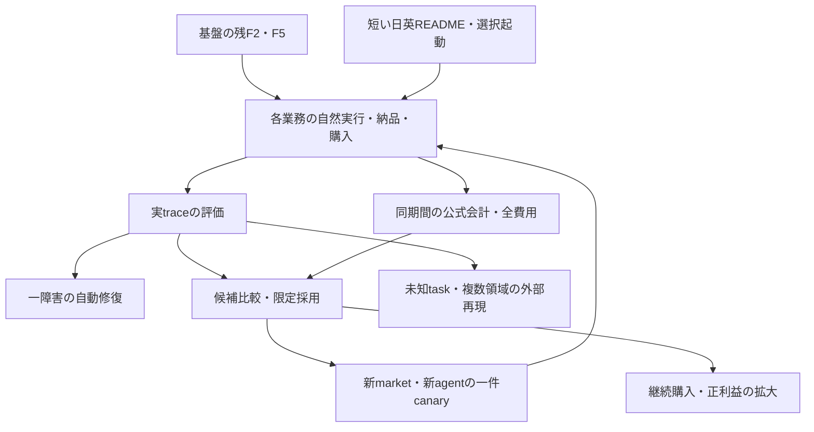

# README・新端末起動・meta-loopの完走計画

**今回の範囲:** 状況監査、README日英の短縮案、起動修復と全体順序のspec更新。実装、実installer、依存install、認証、wallet、provider、release/applyを実行しない。

**正本:** `../specs/2026-09-25-life-manager-unified-ssot.md`。実行順/status/cursorは同specのF/M/H/E/I/N/O/G、Gig、Capafy、DDに置く。この資料は手順・設計・snapshotの参照である。

**共有基盤の現在方針:** → spec「外部の実運用方式へ揃える」。全F完了や連続N回の自然実行を全事業の再開条件にしない。選択laneの資源/owner/effect条件を満たす仕事から進める。

**source:** `c900bf0aa3b0d5f00ceff32d01f9d108df4c7dea`。source監査と隔離contract検証は`docs/evidence/readme-onboarding-meta-audit-20261014.json`。稼働中の別ownerの仕事を奪わない。暦の完了予定や新端末の実動作を推測で埋めない。

## READMEは何を残すか

GitHub mainの英語版580行、日本語版306行は構成が一致しない。英語版のMoney Printer/WebMCPのtool一覧、Challenge-period changes、judge guide、長いConnector図、startupと経済runtimeの混在が最初の利用者の起動判断を難しくする。

**単一推奨:** READMEは製品説明、Start、agent/startup coverage、起動前plan、data/account、開発参照、North Star、MITの短い対へ揃える。目安は各100–120行以下。行数だけを減らすために起動条件を削らない。未完成のハッカソンtool/historyは主READMEから外し、既存`docs/webmcp-judge-guide.md`等の参照資料とGit履歴へ残す。tool、API、Money Printerのsourceを削除する依頼とは扱わない。

レビュー可能な全文案は `../patches/2026-10-14-readme-onboarding/README.en.proposed.md` と `README.ja.proposed.md`（前稿各75行、whole-life哲学修正後各79行）。今回はREADME本体をこの案へ置換しない。sourceに存在するCoconala beta bootstrapを例とし、全18を起動するコマンドが既にあるとは書かない。両案は全18nameと同じ順序/command/状態を持ち、North Starの2行とstartup context metadataを保つ。

情報を全部READMEへ残す案の強みは一ページで検索できることだが、初回導入の判断と内部設計を混ぜるため採らない。数行の宣伝だけにする案は短いが、現実の対応範囲を隠すため採らない。最良は短い両READMEから新端末の実起動まで閉じる、基準は短縮後も未完成installerを明示して段階修復、最悪は文面だけ簡潔になりcommandが失敗し続ける。推奨が誤る最有力の筋は、新端末の利用者が詳細ガイドへの移動でsetup条件を見落とすことで、setup待ちの理由はCLIにも残す。

## コマンドの実際の現在地

| 経路 | 確認した範囲 | 新端末で未達のもの |
|---|---|---|
| `install.sh`引数 | plan/coconala/job-hunter/connector/fundraiserのみdispatch。引数なしはAgent Economy | 全18の共通起動ではない。capafy/lancers等9種はmutating分岐前にexit2 |
| Coconala/Job Hunter bootstrap | missing deps、clone、専用setupへ進むsourceあり | 今回は実installerも独立fresh Macも動かしていない。契約検証を完全E2Eにしない |
| Connector/Fundraiser | 既存deps/gog/CDPがあるMac向けactivation | 依存準備と利用者自身のbrowser identity/sessionを新端末へ作る経路 |
| `scripts/bootstrap.sh` | Homebrew/Git/Python/venv→既存onboarding server | integration graphはCoconala manifest1本。18 catalogをgraphへ接続する経路 |
| `start-local.sh` | compute-proxy launcherへ委譲 | 全18のproduct onboardingとは別の経済runtime入口 |
| Investment/CFO/Mobile | 手動runner、有限workspace/assets bootstrap | provider setup、永続owner、後続stageまでの一コマンド受入 |
| Local catalog guided8 | 実行commandを宣言する8能力 | guidedはclean-host依存/auth/起動の検証済みという意味ではない |
| Cloud guided | 現catalogではAgent Economy `/start`のみ | ほかの能力のtenant-scoped host adapterとprovider setup |

readonly unknown-product probeはcapafy/lancers/freelancer/crowdworks/promptbase/writer/affiliate/self-build/line-stickerの9引数でexit2/stdout空。12 OSS fixture testsと8 pure onboarding testsはPASS。初回pure testのENOENTは監査snapshotにserver.jsが無いことによるもので、必要1fileを追加した同検証でPASS。実sourceの欠陥とは数えない。

実installer・dependency取得・認証・wallet生成・launchd activation・provider成果は検証していない。install-isolation suiteはこれらを実行するため今回の境界では実行しない。private stateやMacの成功を新利用者のclean-host証明へ移さない。

## 一コマンド化の具体的な変更順

既存bootstrap、planner、integration manifest、installerを再利用する。第二のinstaller framework、全agent一斉起動、sourceの私的複製を作らない。

### O01の文書差分

1. README.md/README.ja.mdの同じsectionと順序へ上の短縮案を適用する。両言語のstate/command/agent数を同じcatalogから検査する。既存`product-onboarding.test.js`の全name検査、startup contextとNorth Starの既存契約を使う。
2. 共通catalogからREADME tableを生成/検査する差分は前のGig auditの`renderCatalogReadme`案を使う。代表owner名を手維持して漏らさない。ハッカソン文章は主READMEの必須説明にしない。

### O01/O02の共有入口

3. `scripts/bootstrap.sh`に**将来追加する**`--loop <catalog-id>`を、ネットワーク/依存install前に厳密parseする。未指定の既存GUI入口は保ち、selected loopだけを準備する。first targetは宣言済みmacos-arm64、新OSはadapter受入までunsupportedを明記。今のscriptはこのflagを処理しないので、現時点の利用者へ完成commandとして載せない。
4. `install.sh`の既存legacy aliasをcanonical catalog IDへ結び、同じ選択をplanner/installerへ渡す。`planProductOnboarding`はpure/read-onlyのまま使う。起動先はvalidated catalogと登録済みadapterから決定し、任意shell文字列をprofileから実行しない。未完成packageはsetup_requiredで必要stageを示し、exit0だけで起動済みにしない。
5. `scripts/integration-onboarding.py::load_manifests/graph`と`life-manager-onboarding-server.py::_graph/_connect`をcatalog/manifest対応へ揃える。integration manifestはprovider固有ceremony/preflight/activationだけを持ち、product一覧の第二正本にしない。未選択loopはmetadataだけを表示し、preflight/readiness/activationは選択したloopだけへ限定する。全18が画面にあることと、各ownerが起動/仕事/収益まで受入済みであることを分ける。
6. onboarding serverのraw `/bin/launchctl print gui/...`を既存`launchctl-safe`経路へ統一する。UID/Directory Services/Aqua/manager前提が失敗した時はGUI-domain probeを発行せず、非macOSを`loaded=len(owners)`でreadyへ置換しない。これは同じportability修復の範囲で、shared production daemonを再起動しない。

**入口の最終形（未実装の設計、現在は実行しない）:**

```bash
/bin/bash -c "$(curl -fsSL https://raw.githubusercontent.com/Daisuke134/life-manager/main/scripts/bootstrap.sh)" -- --loop capafy
```

この形式を広告するのはflag/選択/依存/identity/activationがsourceと新利用者環境で受入された後。既存scriptへ引数を足しても現在はCapafyを起動しない。選択は全18の同じcatalog IDに対応する目標であり、全18のアカウントやpaid workを自動で用意できるという意味ではない。

### O02の能力別packageと実受入

7. Connector/Fundraiserのdepsと固定identityを利用者自身のhost/profile/sessionへ解決する。`skills/connector/install.sh`、`skills/fundraiser-agent/runtime/install.sh`の前提とbootstrapを同じ契約へ揃え、Daisのinteractive:daisを新利用者のidentityに要求しない。既存sessionを再利用し、privately bound accountを他userへコピーしない。
8. catalog/installerの設定差を一件ずつ揃える。Job Hunterは`configure_connectors`がTelegram任意なのにcatalogが必須とする。現実のreport transport条件を確定してrequirementsとCLIを同じ差分で修正する。要件を欠落させてfake readyにしない。
9. Capafy、Gig各市場、Writer等は既存business entrypoint/registry/immutable applyを使ったselected packageを一能力ずつ受け入れる。Investmentのpaper/live、Mobileのassets/build/sign/publish等のstageを一回のworkspace生成へ縮小しない。public installerを増やす前に、同じCLIが現在の未完stageを正しく出す。
10. 既存`product-onboarding.test.js`、`test/install-connector-dispatch.test.mjs`とprovider setup testsへ、unknown ID、selected-only、fresh prerequisite不足、user identity、resume/idempotency、GUI unavailableを最小fixtureで検証する。必要な既存isolation checksは実装範囲で実行し、実credentialやproviderを使う検証と区別する。
11. **Done:** 独立した新利用者のsupported deviceから、repo/deps/session/private runtimeを借りず、掲載された同じ一commandで選択→公式setup→対象owner起動→exact loaded release/次自然仕事→公式readback→停止/再開を確認する。初回本人手続きはproviderの条件として記録し、通常のtechnical approval待ちを入れない。全18について段階とcoverageを記録するが、README短縮O01だけのDone gateに全18実仕事を追加しない。

## meta-loopの現在地と開始条件

**既存正本の方針:** 全18業務の全完了はH/E/I/N/O/Gの開始gateではない。これは今回新しくreorderする提案ではなく、既存「全体の完走順」の方針。現在activeの基盤F2→F5、配信EDD DD05、Gig/Capafyのowner cursorを変更しない。

| 種類 | 今あるもの | 未完の一周 | 着手条件 |
|---|---|---|---|
| 自己修復H | recovery intent/supervisor/dev/PR/releaseの部品 | 同じ自然障害をLM自身が検知→修正→採用→次自然成功 | 実failure/owner/fenceと対象修復scope。全18完了待ちではない |
| 評価E/EDD | Writer A8/A9/A8b、DD01–04、DD04自然採用、LM-EAB5 synthetic cases | 自然task/official outcome/全費用の評価と外部再現 | 既存traceから限定評価。current DD05から既存順で進む |
| 自己改善I | candidate/評価/昇格のsourceとbacktestのoptimizer | 同条件baselineより実利益が良く、canary→CFO→次改善へ戻る | frozen evaluator、同期間cost/outcome、外部effect receipt。I01/02比較とI03本番採用を分ける |
| 市場拡張N/Meta | marketplace-coreのpromotion gateとprovider adapters | 発見→durable candidate→適格性→canary→owner登録→settlement→shared feedback | 最初の実証済みlaneから一candidate。全市場を揃えてから開始しない |

`platform_enrollment.evaluate_platform_candidate`はcandidate recordのpolicy/adapter/funded_work/canary/unit_economicsを検証するpure gate。source内の静的参照は定義・SKILL・testで、発見scheduler、candidate永続store、provisioning、公式収益feedbackを本番で一周した証拠は未確認。recordのreceipt URLを検査することはproviderへの公式照合そのものではない。

自己改善の説明を更新する。`self-improve-evolve`はscheduled_runner→runners.json→run_evolve.shというoptimizer経路がある。現在sourceのquarantine_reasonはverified_writeback_not_ready_until_gate_14で、run_with_contractはchildを実行せずskipped/returncode0を返す。run_evolveの対象はpaper/backtest strategyであり、全18の実利益を再帰的に改善する運転とは別。今回live loaded ownerを再観測しておらず、このsource guardを現在すべてのloaded versionで観測したとは言わない。解除は今回行わない。

## 全体の終点までの見取り図



README/設計/評価は現在の実装から先行できる。新しい業務修復の本番再開は対象jobの資源/owner/effect条件に従い、全F完了や連続N回を待たない。市場別の反復成果は応募→交渉→funded→成果物/品質→正式納品→受入→settlement/refund/fee/実費→netで閉じる。受託の一般化可能なscope/工数/品質を共通skillへ戻し、顧客固有の本文・asset・credentialを学習素材へ流用しない。

終点はF/M/H/E/I/N/O/Gとlocal/cloudの同じowner/evidence契約を閉じ、正のunit netと継続購入を確認して$10K→$100K→$1M→既存US$10M/月以上へ伸ばすこと。単発Gig受注をMRRへ加えない。収益拡大と、身体/心/ソフトウェア等の未知taskへ転移できるgeneral-agent評価は別々に測る。AGIを18 processesの起動、optimizerのscore、合成5caseのPASSで認定しない。

**完了時刻:** 日付を約束する根拠はない。metaの準備/評価は開始済み、限定の本番自己修復・自己改善・拡張は上の対象別証拠が揃った時。全18完成を一律の開始gateにせず、全体成果の未達は保持する。
