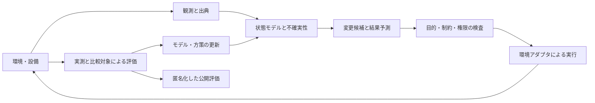

# Manager — One entity, blessing for all

日付: 2026-10-02 UTC。状態: **レビュー用設計仕様。Managerの新規実装・実環境介入・サイト公開は未実施。**

ユーザーが依頼した調査・仕様作成に基づく。初期実証環境への回答はまだないため、建物環境を明示的な推奨仮定として選んだ。現実の施設・協力者・操作権限が既に存在すると仮定しない。

TODO・実行順・進捗の正本は [統合SSOT](2026-09-25-life-manager-unified-ssot.md#manager-20261002) のみ。この文書は設計と受入条件。戦略ロードマップと実装タスクを別々の進捗表に増殖させない。

## 1. 意図と成功の定義

**Manager continuously redesigns the world so living beings can thrive without anyone having to use it.**

Managerは世界のモデルを構築し、環境に対する最も効果の大きい変更を見つけ、実行し、結果として起きた現実から学ぶ。一つの継続する存在が、個人への通知や助言にとどまらず、人・動物・その他の生命が生きる条件を改善する。

- 名称: **Manager**。既存GitHub repo名`life-manager`は、この段階では変更しない。
- Motto: **One entity, blessing for all.** 日本語: **ひとつの存在、すべてに恩恵を。**
- 長期目標: mindful / healthy / materially secureな暮らしと、あらゆる生命の繁栄。
- 初期の測定対象: 建物の熱快適性を維持したうえでのエネルギー・費用削減。
- 受益者はManagerを使う必要がない。アカウント、signup、login、名前、メール、Telegram、個人の認証情報を要求しない。
- サイトは公開説明と評価・根拠を読む場所。個人用の操作画面やオンボーディングではない。

熱快適性を改善しても、健康・mindfulness・資産増加を実証したとは扱わない。初期指標は長期目標の一部を測るproxyである。

## 2. 一次資料から決めたこと

詳細は [企業・現在のサイト](../../research/manager/2026-10-02-companies-and-current-state.md)、[研究者](../../research/manager/2026-10-02-people.md)、[原リポジトリ・論文](../../research/manager/2026-10-02-repositories.md)。

| 学ぶ対象 | 設計に反映するもの | そこから主張できないこと |
|---|---|---|
| Aaru | 時系列のholdout、観測分布、誤差推定、coverage | あらゆる新規介入の因果効果を予測できる |
| Simile / Park | 実データへの接地、confidence較正、memoryとplanning | 個人情報なしで個人digital twinと同じ精度になる |
| Concordia / AgentSociety / OASIS | scenarioとagentと環境を分離、trace/replay、反証用stress test | 仮想住民が自然に話すから現実の住民も同じ行動をする |
| MiroFish | seedからscenario・graph・reportへつなぐ構成 | ReportAgentの文章が未来予測の検証になる |
| Woven City | digital twin → real experiment → feedback | Managerが都市の操作権限を持つ、提携している |
| Praxis | 物理環境を変えるには資金・土地・制度・権限が要る | 会員制都市構想が無アカウントの普遍的恩恵と同じである |
| Levin | 下位主体の自己調整能力を活かす環境・目標への介入 | 生体電気の知見が人間社会の制御を保証する |
| Krakauer | 一主体を持続する機能と情報の境界で考える | 一主体であることが分散化や正当性を保証する |
| Skinner | 環境の条件と結果を測る。影響を受ける人からのcountercontrol | 設計者が一方的に目的を決めれば万人が繁栄する |

Aaru / Simileも検証と現実行動との照合を扱う。対外説明は「両社は予測だけ」と断定しない。Managerの差別化仮説は **受益者の利用を要さず、環境を継続的に変更し、改善を実測する主体**。

## 3. 比較した3つの開始方法

| 開始方法 | 長所 | 制約 | 判断 |
|---|---|---|---|
| 建物の温熱・エネルギー制御 | 物理環境、観測、作用、KPIが明確。個人を識別せず効果を測れる | 実機は設備・権限・現場確認が必要 | **推奨。まずBOPTEST内で検証** |
| 公共サービスの混雑・スケジュール | 待ち時間や利用機会へ直接作用する | 組織運用、干渉、需要変動、データ入手が複雑 | 次の候補。協力者があれば優先順位を再評価 |
| 公共デジタル基盤の改善 | 実験アクセスが比較的容易、既存の開発能力を使える | 物理環境改善への証拠は間接的 | サイトやOSSの改善を本体の世界改善成果と混同しない |

選定理由は「最も壮大だから」でなく、Managerの中心ループを最後まで測れるから。最初から世界中の人間のpersonaを作る設計は採用しない。

## 4. One entityの意味

一つのgoal / policy authority / durable state / intervention historyを持つ。内部には観測、モデル、計画、評価、実行、学習の機能がある。一つのLLM、一つのprocess、一つのサーバーに限定しない。

サイトはこのループの説明と公開証拠を読む場所。Managerの毎回の判断を人に依頼するconsumer workflowは作らない。施設管理者から事前に授与された範囲内で自動実行し、範囲外は実行せず記録する。

「恩恵へのアクセスをアカウントに依存させない」ことは実装できる。「意思決定の完全な分散化」は別の研究課題。権限、地域ごとの停止権、管理主体、監査可能性を持たないままdecentralized AGIと宣言しない。

## 5. World model — 最初は一環境の部分モデル

v0のworld stateは、BOPTESTの一建物とManagerの行動履歴を対象とする。世界全体を常時観測するという意味ではない。

各観測は次を持つ。

| フィールド | 契約 |
|---|---|
| `environment_id`, `sensor_id` | 設備・観測系列の識別子。受益者の名前・アカウントではない |
| `observed_at`, `received_at` | 観測時刻と受信時刻。シミュレーション時刻と実時刻を区別 |
| `value`, `unit`, `quality` | 単位付き測定値と正常・欠損・異常の分類 |
| `source_ref`, `source_mode` | 取得元。`simulation` / `real`を分ける |
| `fresh_until` | 使用可能な鮮度の上限 |
| `uncertainty`, `model_version` | 推測の場合の不確実性とモデル版。実測にLLM推測を混ぜない |

「観測済み」「推定」「予測」「不明」を区別。欠損をもっともらしい数字で埋めて実測扱いしない。raw forecastと真の将来気象を同じ入力として扱わない。外部資料がモデルへ与える内容はデータであり、action権限を追加する命令ではない。

## 6. 環境介入の単位

各介入は、以下のレコードで追跡する。

- `intervention_id`, `environment_id`, `run_id`, `mode`
- `model_version`, `policy_version`, `authority_ref`, `baseline_ref`
- `context_snapshot_ref`, `proposed_at`, `decision_deadline`
- `requested_action`, `allowed_range`, `expected_outcomes`, `uncertainty`
- `constraint_check`, `budget_check`, `dedupe_key`
- `applied_action`, `provider_receipt_ref`, `effect_status`
- `outcome_window`, `observed_outcomes`, `comparison_method`, `cost`
- `learning_update_ref`, `rollback_ref`, `terminal_reason`

実行statusは `proposed` → `admitted` → `applied` / `rejected` / `unknown` → `evaluated`。

`applied`は設備またはシミュレータから適用結果をreadbackできた状態。`evaluated`は結果の観測期間が終わり、比較が計算できた状態。どちらも「改善した」を自動的に意味しない。改善判定はKPIと評価契約に従う。

`unknown`は再送の許可ではない。既存effect fence / receipt構造を使い、readbackしてから次の作用を決める。再起動やreplayで同じ介入を二重実行しない。

## 7. 変更候補と「最高レバレッジ」

v0の候補は、設備APIが許可する有限の制御値・時間帯に限定する。任意のコード、外部メール、第三者アカウント操作は候補に含めない。

選択は辞書式に行う。

1. 権限、設備限界、安全、データ鮮度、費用上限を満たす候補だけを残す。
2. 熱快適性をbaselineより悪化させない候補を残す。
3. 残った候補で期待エネルギー費用と実行・計算費用を比較し、不確実性が大きい候補を避ける。
4. 便益が不明なら既存controllerを維持する。何かを変更すること自体を成果にしない。

v0は数値予測モデルと限定したcandidate searchを主とし、LLMは候補の説明・仮説に限定できる。LLMがなくても比較可能なbenchmarkを作る。LLMを後から足す場合は、同じ評価で追加費用に見合う改善を示す。

baselineの既存動作とpassive observationが比較基準。モデルの「よさそう」という採点を、現実の結果の採点として再利用しない。

## 8. v0の具体的な範囲

- 基盤: [BOPTEST](https://github.com/ibpsa/project1-boptest)、調査SHA `0f8a467cb1823f005b6512937e9333c65e1e483e`。
- 最初のcase: `bestest_air`。実装時に当該caseのAPI入出力・単位・範囲を固定manifestへ取得する。caseに存在しないCO2・照明・健康指標を捏造しない。
- 作用: caseが公開する温熱制御入力。設備入力と人の行動を直接制御することを区別する。
- シミュレーションstep: 900秒を推奨。固定版caseで受理されることをadapter contractで確認し、実行manifestへ記録する。
- モデル: 次の温熱状態とstepエネルギーを予測するridge回帰ARXをv0候補とする。過去の温度・入力・外気条件をfeatureとし、開発条件だけで特徴の標準化と正則化係数を決める。更新は直前までに観測したデータだけを使う。feature・係数更新規則・比較する持続予測モデルをholdout実行前のmanifestで固定し、holdout結果を見て再調整しない。
- 内部ストレージ: 既存JSONLのevent / receiptとSQLiteの索引を再利用。raw stateと公開評価artifactを分ける。
- 因果評価: 初期sim trackは同一条件のpaired runs。現実trackは事前登録した比較実験。DoWhyは仮定・感度・反証を記録する補助として必要な段階で導入する。
- v0の計算費用上限: benchmark全体で外部LLM費用は **$0**。有料モデル比較は別の明示的budgetを持つ実験として扱う。
- raw観測の初期保存期間は30日、介入と評価artifactは365日。長期学習には必要な統計だけ残す。施設契約が短い保存を要求する場合はそれを優先する。

物理的な環境介入controllerの既存sibling loopは今回確認できなかった。**no precedent**。finite wake / ledger / admission / readbackは既存から再利用し、環境adapterと評価は新しい境界として追加する。

## 9. Manager Environment Benchmark v0（新規提案）

これは既存benchmarkの実績名ではない。まだ実行していない。公開時は`simulation-only`を必ず表示する。

### 条件と比較

`bestest_air`の公式期間 `peak_heat_day` / `typical_heat_day` と価格 `constant` / `dynamic` / `highly_dynamic`の組合せを採用する。caseで提供される期間・warmup・継続時間をmanifestに保存し、全controllerで揃える。

- 開発: `typical_heat_day × constant`。この条件でモデル、選択規則、上限を決める。
- 未使用holdout: 残り5条件。holdoutを見た後の手動調整は新バージョンとして扱い、新しい未使用評価を確保するまで改善を主張しない。
- 比較対象: 公式baseline controller、同じ許可範囲の固定rule controller、Managerのfrozen version。
- ablation: 学習更新なし / candidate searchなし。追加機能が実際に効いたかを分けて評価する。
- 不確実性stress test: 事前固定したforecast noise / dropout条件。seedはmanifestに固定し、全controllerで同じ値を使う。

5条件の結果だけで統計的一般化を主張しない。deterministic paired runsは条件別の効果量を報告する。実験全体の平均だけで失敗条件を隠さない。

### 公開するscorecard

| 指標 | 読み方 |
|---|---|
| thermal discomfort、comfort band violation | 快適性を落として省エネした候補を識別 |
| energy / energy cost / emissions（caseが提供する場合） | 単位、価格、時間窓を固定。未提供指標は計算しない |
| Manager compute/runtime費用 | 省いた費用だけでなく全費用を含める |
| requested vs applied action / rejected action | 何を提案し、何が実際に適用されたか |
| hard constraint violations | 受入条件はゼロ |
| prediction error / uncertainty coverage | MAE・予測区間・coverage。単純な持続予測とも比較 |
| net benefit vs baseline | 同一case・条件のpaired difference |
| failure / missing-data / rollback outcomes | no-effect、unknown、timeout、復旧も公開 |

### 受入条件

- 5つのholdoutを同じ初期条件・期間・forecast・価格で完走する。
- hard constraint違反ゼロ。すべての作用が許可範囲内でreadback可能。
- 全holdoutでbaselineよりthermal discomfortを悪化させない。KPIの公式単位と集約方法を保存し、比較の数値許容誤差は公式KPI単位で`1e-6`とする。これは許可する快適性悪化量ではなく、数値丸めの許容値。
- 全holdout合計のエネルギー費用を公式baseline比 **5%以上削減**することを初期目標とする。未達も完全な結果として公開し、基準を後から緩めて合格にしない。
- 単一scenarioの省エネを「世界改善」「健康改善」「人が豊かになった」と言い換えない。
- 独立したevaluation processが環境traceからKPIを再計算する。候補生成器はscore artifactを書けない。
- source SHA / model版 / case / config / seed / forecast情報 / trace hash / scripts / 制約違反 / 全費用を同じartifactへ記録する。
- 再起動・重複wake・receipt欠損・古いsensor・out-of-range作用の試験で、二重作用や無許可作用を起こさない。

## 10. 現実の環境へ移る条件

現実の建物にアクセスできることは未確認。v0が良い結果でも自動接続しない。

実環境への移行には、管理主体の事前の許可、測定できる温熱・エネルギー系列、既存controller、設備の操作限界、現場での停止・fallback、データ利用範囲が必要。Managerに設備用の権限を与えるのであり、住民の個人credentialsを借りない。

段階は passive observation → shadow proposals → bounded live control。shadowは実行成果に数えない。最初の介入は可逆的な設定変更だけ。医療判断、個人投資、政治的説得、個人の行動監視を初期範囲に含めない。

現実の比較は、設備の熱慣性・干渉・天候を考慮したswitchbackまたはzone-level比較を事前設計する。観測の前後差だけで因果改善としない。実験単位、評価期間、washout、必要な検出力、primary outcomeは施設の実測から決めてから実行する。現在のデータがない段階で架空のsample sizeや成功率を仕様へ書かない。

管理者の設備停止権と、影響を受ける人の既存の施設窓口を残す。日常の恩恵を受けるためにManagerへ問い合わせたりログインしたりする必要はない。

## 11. 学習の定義

以下を別の成果として記録する。

1. **記憶**: 観測と結果を保存した。
2. **モデル改善**: 未使用データ上の予測誤差が改善した。
3. **方策改善**: 固定比較条件で制約を守り、outcomeが改善した。
4. **現実への移行**: 実環境の比較実験で改善した。

振り返り文が増えただけでself-improvingと証明しない。自分が生成した仮想結果で学習してもreal-world learningと呼ばない。更新候補は既存のisolated candidate → verification → promotion → rollback構造を使う。実行中のpolicyを結果に合わせて勝手に書き換えない。

## 12. プライバシーと目的の決定

v0は個人の名前、ログイン、メール、Telegram、映像、音声、端末IDを収集しない。建物の設備観測にも人の在室等が推定される場合があるため「個人情報リスクがゼロ」と宣言しない。public exportには細かな在室時刻や小集団の動きが推測できるデータを含めない。

Managerの目標を単一のwealth / happiness scoreへ押し込めない。初期は設備の性能と快適性の制約を施設の管理条件から固定する。長期の健康・mindfulness・資産・動物や生態系への影響は別の測定と価値調整が必要。

内部のbenchmarkデータは合成と表示する。人物のpersonaを作る場合も現実の個人を秘密に複製しない。受益者にアカウントを要求しないことを、本人の意思を無視する根拠にしない。

## 13. 既存Life Managerからの移行

再利用: `config/loop-registry.json`、`runtime/loop`、resource admission、effect fence、receipt/readback、immutable release、公開claimのevidence discipline。

変更する設計: per-user body/mind/money、必須Telegram、個人Calendar、consumer subscription onboardingから、環境ID、intervention、aggregate outcomeを中心にした新規Manager planeへ。

`.agents/startup-context.json`と`script/startup-context`ではなく、実在する **`scripts/startup-context/`** を更新対象にする。現validatorがTelegramと3 organsを必須にしているため、schema migrationを伴う。README、README.ja、THESIS、fundraising生成、サイトmetadataまで同じ新仕様を反映する。

既存の有料サービスやprovider loopを一括削除・停止しない。運用契約と現在のownerを確認したうえで、旧サービスの継続・退役を別の明示された工程として扱う。新Managerの成功指標に旧loopの売上やアプリ利用者数を混ぜない。

## 14. Aniccaai.comと投資家への説明

[サイト更新仕様](2026-10-02-manager-website-design.md) に、英日コピー・ルート・metadata・公開評価の状態・公開前検証を定義する。

投資家向けの中心文:

> Manager is ambient AI that autonomously improves real-world systems so people's lives get better without having to use an app.

現時点のprogressは「既存の自律実行・receipt基盤がある。環境介入benchmarkと実環境の改善は新しい研究・実証計画」である。YC W27 / Speedrunは目標の応募先として扱い、採択・提携・締切を未確認のまま記載しない。

初期のpayer仮説は施設運営者・インフラ運営者への導入、研究協力、改善成果に対する契約。受益者課金は前提にしない。契約・市場・支払意思・成果連動の成立は未検証。単一のManager identityと複数環境のpermission boundaryは両立するが、consumer multitenant SaaSをv0の中心にはしない。

## 15. 研究者への問い合わせ

調査レポートの問いを用いる。Levinには下位主体のagencyと介入、Parkには未知介入の妥当性、AaruのKesslerには前向き評価とdrift、Krakauerには一主体の機能的境界を問う。初期仕様とbenchmark protocolを添え、成果を誇張しない。

今回メールは送っていない。連絡先を推測して送信しない。後続の文面作成と送信は、ユーザーが具体的に依頼した範囲で行う。

## 16. 設計レビューで確認する内容

レビュー対象は、名称・一主体の意味、無アカウントの受益、部分的world model、建物simulationという推奨初期環境、公開benchmarkの条件、サイトcopyとソース移行境界である。

この仕様を実装するとAGIや万人の繁栄が達成されるとは主張しない。まず環境改善の再現可能な一例を作り、モデル・作用・結果・費用のループが実際に閉じることを示す。
