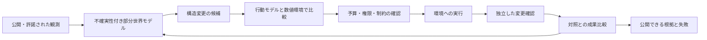

# Manager のマクロ環境設計と評価事業

2026-10-10 UTC。設計更新。実装・生活成果・売上・本番サイト公開を示す文書ではない。実行の順序と状態は[統合SSOT](2026-09-25-life-manager-unified-ssot.md#manager-20261010)だけに置く。10/8の[独立コア仕様](2026-10-08-manager-greenfield-design.md)を維持し、配置、評価、収益、採用との接続を本書で更新する。

## 名前と目的

製品名は **Manager**。説明は **AI for world engineering**。World Engineeringはこの製品の構想を表す呼び名で、既存の確立した学問の名称とは主張しない。environmental engineeringは通常、水・廃棄物・汚染等を扱う環境工学を意味するので、単独のカテゴリー名にはしない。

研究の接点はcomputational social science、agent-based modeling、mechanism/institution design、causal inference、control、complex adaptive systems。行動科学の環境設計を、供給、費用、労働、移動、制度、ネットワーク、共有資源へ広げる。micro/macroは人口数だけの区別ではなく、変更対象が個人への助言か、選べる行動と機会を決める共通の構造かの違い。

Missionは **One entity, blessing for all.** 苦しみを減らし、身体・精神・経済の健康と他の生命の繁栄を支える条件を改善する。受益者にアプリ、signup、ログイン、個人credentialsを要求しない。運営者の契約・操作権限や公開説明・監査の経路は持てる。受益者の操作UIがないことと、作用を隠すことは別。Godは創業者の比喩であり、全知・万能・実証済みsuperintelligenceを製品性能として広告しない。

一つのentityは同じmanager_id、目的の版、学習履歴、介入台帳を持つこと。複数worker/region/cloud/containerによる実装と両立する。一つの決定権を持つシステムはそれだけでdecentralized AGIではない。受益の広さ、計算の分散、運営の統治、アクセス可能な検証を分けて説明する。

## 世界モデルと閉ループ



world stateは全世界の現在真実ではなく、時刻・範囲・観測欠損・推定誤差を持つ部分モデル。`Observation`でsource、unit、observed_at、valid_until、scope、observed/estimated/simulatedを保持。状態が古くなったら不確実性を増やし、影響の大きいactionは再観測する。

数値環境が資源保存、容量、予算、制度、ネットワークを管理。response modelは条件に対する行動を予測する。LLMは候補生成、意味の解釈、例外、必要な主体反応に使えるが、自然言語で在庫や所得を生成したことにしない。合成人口を増やしても実人口の代表性が自動的に上がるわけではない。

## 配置と計算

コアは引き続き `apps/manager/` の独立Python package。**ローカル必須ではない。クラウドを通常の配置先として選べる。** APIなしで走るreference環境は再現性と開発費のためで、製品の能力やhostを制限しない。

最初の配置案はDockerによるagent/environment/evaluatorの別process、クラウドVMまたはcontainer job、run artifactをobject storageへ保存、永続stateをSQLite（single-writer）またはPostgresへ保存、定期runと再開可能checkpoint。APIモデルworkerを後から差し替えられる。特定AWS/GCP/providerへの認証や本番構築はこの設計で行っていない。

数値計算のbatchを先に測り、LLM call数・tokens・wall time・dollar costを別集計。複数world/model/seedの実験が必要になった段階でqueueとparallel workerを追加する。RayはAgentSociety等の大規模adapterで必要なら使い、初期coreに強制しない。モデルの知識メモリと実行ledgerは別。worker停止後はrun_idとcheckpointから復帰し、外部作用のunknownはreadbackするまで再送しない。

```text
Controller / scheduler
  ├─ world-model store (versioned observations)
  ├─ simulation workers (numeric + response adapters)
  ├─ agent runners (bounded tools and budgets)
  ├─ independent evaluators (hidden state / frozen rubric)
  └─ executor adapters (simulation / shadow / authorized field)
Artifacts: manifests, traces, receipts, scorecards, model cards
Public: explanation, benchmark protocol, reproducible results, field receipts
```

公開artifactから秘匿データ・少数セル・個人識別子を除く。公開の根拠参照と内部の詳細auditを別にし、透明性を個人情報の公開と同一視しない。

## ベンチマークの4つの独立トラック

|トラック|問い|主要な証拠と採点|
|---|---|---|
|Prediction|条件が変わると主体がどう反応するか|実測との校正、MAE/適切な確率score、区間coverage。地域・時期・人口・response modelのholdout|
|Policy|何を変えると目的に近づくか|同予算、paired shocks/seeds、no-change/固定ルールとの比較。平均・最低群・spillover・コスト・資源制約|
|Execution|選んだ変更を本当に適用できるか|typed action、権限、revision、idempotency、外部readback。重複・timeout・partial failure・unknownを採点|
|Outcome|現実の生活が改善したか|事前定義した期間と対照。cluster comparison等。欠測・脱落・不確実性・悪影響を含む実測|

最初の二つのworldは10/8仕様のservice-accessとcommonsを共有契約で扱う。施設のエネルギー費用削減を製品の本質や最初の固定領域にはしない。サービス配置・利用条件・接続・配分を変え、選択肢、時間、負担、必要品充足がどう変わるかを比較する。初期の合成demoは機構の検査であり、実際の健康・所得改善の証明ではない。

benchmarkの公開devと非公開testは事前に分け、seedだけでなくnetwork、制度、response model、将来shockを分離。agentは評価器・採点式・潜在状態を書き換えない。予測モデルと政策agentを同じLLMだけにして好みの結論を埋め込まない。LLMなし・同一scaffold別モデル・固定ruleを比較し、実装できる場合に専門家baselineを追加。

physical health、mental health、financial healthは別outcome。アクセスは健康への経路だが健康そのものではない。利益は企業の成果であり、受益者の富ではない。動物・生態系の資源利用や被害を別列へ置き、人間だけの改善を全生命の改善に言い換えない。

## 透明な恩恵の証拠

公開receiptは `claim → prediction → attempted action → verified change → measured outcome` をたどれる形にする。各段階に時刻、scope、source、cost、comparison、uncertainty、statusを付ける。simulated、shadow、fieldのmodeを各claimに保持し、未実行はnot_run、測定不足はunknownと表示する。公開するのは「計画の存在」だけでなく、反証や効果なしを含む根拠。

現実の介入の因果効果は単純な前後比較だけでは分からない。季節、選択、同時施策、隣接地域への影響を扱う。無作為化できる単位とspilloverを先に決め、できない場合は識別仮定と感度分析を示す。EconML等のlibraryを導入しただけで因果同定済みとはしない。

## Life Managerとの関係と収益

**一つの会社・二つの目的系統**として運営できる。Life Managerは短期の収益運用、Managerは構造改善と評価を中核とする。共有できるのは持続state、実行/readback、費用台帳、failure recoveryなどの基盤。旧runtime、個人account作成、売上最大化を新coreの要件にしない。

Life ManagerからManagerへの資金はverified net receiptsを根拠にしたbudget transferとして記録。今回現在の収益額は検証していない。旧収益をManagerの顧客/社会成果へ付け替えない。将来Managerが十分に実証されれば共通orchestratorへ統合できるが、profitとwellbeingの目的・ledgerは識別できる状態を保つ。

初期Manager収益の仮説は、再現可能なeval環境と非公開challenge、モデル比較report、環境運営者へのpolicy simulationとshadow evaluation、共同実証研究。納品価値は人口ログの量ではなく、既存判断に対する精度・失敗・費用・分布・外部検証。誰がいくら払うかは商談で検証する。模型用データ、評価test、購入者private dataの権利を分ける。

Andonの実例はbenchmarkからfield experimentへの移行。[Andon調査](../../research/manager/2026-10-10-andon-and-evals.md)によるとYC W24、Vending-Bench着手late2024、公表2025。evalがYC採択の原因だったという説明は採らない。特別モデルアクセス・データ販売額・同じ経路での資金調達成功を保証しない。

## 各先行例から借りるもの

|先行例|理解する核|Managerに移す単位|
|---|---|---|
|Simile / Park / Bernstein|実在者に接地したbehavior models、memory/reflection/planning、人間の再テストを踏まえた評価|response adapterと校正protocol。Managerの予測層への近さであり、環境実行層が同じとは未確認|
|Aaru|population responseによる商業的意思決定の予測|人口・条件・counterfactualの設計、企業公開claimの外部検証。private codeはcloneできない|
|Concordia / Leibo|agentsとgame master、自然言語の制度・相互作用、grounded state|制度変更のscenarioと資源台帳の接続。世界遷移をLLMに任せた箇所を検査|
|AgentSociety|人口・社会・移動・経済、intervene/trace、必要に応じたscale|人口/ネットワーク/観測のadapter。大人数と予測妥当性を別評価|
|MiroFish|資料からpersona、SNS相互作用、reportというpipeline|情報反応の探索用adapter。AGPL・Zep Cloud・依存の条件を保持。所得/資源環境の主コアにはしない|
|AI Economist|働くagentと制度plannerの二層、資源保存と経済metrics|構造/制度patchと主体反応を分離する数値world|
|Melting Pot|異なる社会場面と未見population、対象・周辺returnの区別|generalizationとshared-resource failure cases|
|Inspect / METR / Andon|実行・採点分離、長期task、再現ログ、実世界へのreadback|evaluation harness、cost/failure taxonomy、能力と成果の切り分け|
|Woven City|実際の環境・運営者・物理/社会システムの接続|sim→shadow→fieldの検証設計。実験可能な条件と関係構築|
|Praxis|新しい共同環境・制度を作る構想|制度/資源/参加者条件の比較。企業・計画の実装状況は旧資料の確認範囲以上に断定しない|
|Levin|TAME、認知のスケール、目標と多層agencyの実験的比較|環境改善と新しいcollective agencyを区別する仮説・測定|
|Krakauer|情報論的個体性と共有構造への知能の外部化|境界と時間スケールを変えた測定。集団成果の増加だけで一つのmindと認定しない|

「Simileが一番近いか」は層によって変わる。人間行動を予測する層はSimile/Aaru、制度を変更する実験はConcordia/AI Economist/AgentSociety、実行と評価はAndon/Inspect、現実との接続はWovenが近い。企業の非公開architectureやsuperintelligenceの到達度は公開説明から順位付けしない。

## 採用と発信

[広い求人地図](../../research/manager/2026-10-10-broad-jobs.md)に追加25組織と正確な職種条件を収録。[イベント](../../research/manager/2026-10-10-events.md)は未来12件、料金・承認・オンライン可否を区別。履歴書のprivate改訂版はrepo外で管理し、原履歴書と研究資料の実経験から作る。

応募の能力証拠はbaseline/holdout付きcode、失敗分析、grader監査、費用計測、再現手順。研究背景、ICLR参加、prototypeはそれぞれ学位・査読論文・production experienceとは別。3年職歴、博士、drug discovery、GPU専門、国籍条件を小型demoで満たしたと書かない。

発信は根拠を公開する研究記録にする。英語と日本語の記事、短い説明video、相手の研究を理解した質問、実験結果のprogress note。未送信mail・未公開記事・実証前構想はその状態を維持する。採用先の仕事とManagerの並行は副業・競業・IP・時間要件を満たす場合だけ可能で、就労もYC採択も保証しない。
