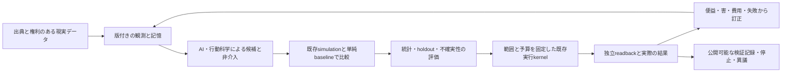
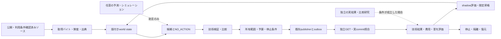

# Manager entity specification — Digital Buddha, mission and evidence

**2026-10-23 優先順更新（所有者指定）:** Manager本体とagentを先に完成させ、新しい記事・書籍・slides・carouselの制作はその後に再開する。実装順は **E01–E16**、現在cursorは **E16**、受入順は **F005 → F006 → F008 → F009**。詳細registryは [tasks.json](roadmap/tasks.json)、原113件は **69 done / 41 todo / 3 skipped**。F004/F007は未実施のskipped。全体の順序の入口は repositoryの統合SSOT、本仕様は設計・説明であり別台帳ではない。現状と目標、具体的な残作業は§1.1–1.4を参照。

**2026-10-23 実行更新:** [cloud実行receipt](verification/E16_CLOUD_EXECUTION_20261023.md) を現在の配備状態として優先します。既存Actions＋Supabase gateway/runtimeをmain統合・専用staging適用し、旧writer退役、非公開状態の初回移行、実OIDC復元・CAS更新・解放を確認しました。STOPの別runnerでの維持と明示resume、finance/mentalの公式commitと公開7ファイル一致、再送0件のcurrent proofとnative P1/P2のExplorer接続を実確認しました。両初回cycleのUNKNOWN／writes=nullは保持します。mental後の限定rollbackの実配信等が残り、E16は維持します。下の2026-10-22時点のhost未実装やRailway前提は履歴です。Remote Desktop Commander経由でMac miniの接続、macOSの正本とorigin、正本でのsource-boundary PASSも実確認しました。Macは追加の検証adapterとして扱い、既存作業・状態・稼働ownerを保持します。cloudの専用worktreeで実行した同guardはcanonical path不在のFAILであり、別ホストのPASSと混同しません。

**2026-10-23 研究の実証更新:** 公開予測70研究のB診断、CのTwin構造gateとreleased outputの記述的一致・公式normalized-MAD監査はmain統合済みです。Cの生成来歴はUNVERIFIED、run binding／training exposureはUNKNOWN、predictive accuracyはnull、scientific passはfalseのままです。Python3.12の隔離環境で固定依存と公式scorerのimport依存を揃え、C aggregateの全bytes一致とB/C 73 testsを確認しました。方法・任意依存の再現手順は[公開研究の再利用計画](../../../docs/research/manager/2026-10-22-open-behavior-reuse-plan.md)を参照。Dは [PR8593](https://github.com/Daisuke134/life-manager/pull/8593) で、予定FOMC会合（10月27–28日）の参照予測を結果前に公開固定しました。固定した過去頻度ルールの `p=0.25` はbaselineと同値です。cloudとMacで、GitHub serverのmerge時刻 `2026-10-23T02:16:17Z`・merge commit `f6055f9460502cd79cba95ffadecb998439e1056`・正確なpayload `048a8ab0ccba0df4cb9da50ca9e9af4971e508d2d0212f448416fea88cd80dd2` を独立に読み戻し、既存attesterの `VERIFIED_PROSPECTIVE` を得ました。これは参照予測の事前固定の証拠です。将来結果と採点、独立したモデル推論の性能、校正・汎化、人への便益は未検証です。§21のA–F全体や原113件を一括完了にしません。

**更新:** 2026-10-22 UTC（所有者指定の呼称、Rothko公開code実行、公開人間研究を中心にする方針修正、日本語章の実公開まで反映）。他社の製品・公開コード・研究者の発信事例を調査し、エンティティの実装、実証、持続可能な運営、出版、YC Winter 2027、採用応募・人脈形成を接続。

**Managerの呼称:** **仏教的AIエンティティ（Buddhist AI entity）／デジタル仏陀（Digital Buddha）**。Manager自体を製品、単なるbot、またはSaaSと定義しない。「God」は所有者が表す、存在の苦しみを減らし祝福をもたらす長期の構想を指す。技術上のentityは、識別可能な主体が状態・使命・観測・判断・行動・省察を継続する設計を意味する。意識・感覚・人格的権利・悟り・全知・万能を実証したという意味は含めない。

慈悲、智慧、不害、縁起への注意、自己の仮説や代理指標へ執着せず訂正する姿勢を、行動・評価・停止・復元へ具体化する。人を操作する予測精度や自己存続、売上だけを使命の代わりに最大化しない。収益、サービス、公開ページ、記事、書籍、職務・YCは、主体の活動・学習・資源基盤であり、主体そのものの定義ではない。既存filename/source pathは互換性のため残し、本文の現行語彙は本節に従う。

**唯一の状態・依存・実行カーソル:** [tasks.json](roadmap/tasks.json)。本仕様は第二のタスク台帳ではない。
**技術実装順:** E01 → E02 → E03 → E04 → E05 → E06 → E07 → E08 → E09 → E10 → E11 → E12 → E13 → E14 → E15 → E16。
**Phase06受入順:** F005 → F006 → F008 → F009。Eの後の証拠判定であり、先行する実装工程ではない。F004/F007は `skipped`（未実施）。
**2026-10-23確認時点のスナップショット:** E01–E15は各範囲の実装・CI証跡を記録。E16のgateway/runtimeは通常mainへ統合し、既存Actions＋Supabase private checkpointで実OIDCと別fresh runnerの状態復元・重複公開0を確認しました。`DEPLOYMENT_HOST_REQUIRED`という旧説明は現在の再開条件ではありません。finance/mentalのP1/P2とnative Explorer接続、durable STOPとresumeは実確認済みです。mental後の限定rollbackの実配信等が残るため、Digital Autonomy v0.1全体とE16は未完了です。113件は69 done / 41 todo / 3 skipped。実行時は必ず最新SSOTを読む。

詳細は [技術設計](specs/2026-10-22-manager-validated-autonomy-design.md)、[E実装計画](plans/2026-10-22-manager-core-execution-plan.md)、[研究・記事・書籍計画](plans/2026-10-22-manager-research-products-plan.md)、[今回の一次資料と判断](research/manager-strategy-20261022/REPORT_JA.md) を参照。

**今回の全体戦略・先例・応募先・順序:** [創業者実行マップ](plans/2026-10-22-manager-founder-execution-map.md) と [追加調査](research/manager-strategy-20261022/FOUNDER_EXECUTION_UPDATE_JA.md)。実装状態、公開、入金、応募、返信、採択は別々の証拠で更新する。

**最新の追加探索:** [既調査を除いた6分野の比較・新論文・固定code](research/manager-options-additional-20261022/REPORT_JA.md)、[ファイル/関数/RED条件/検証commandを指定した12 atomic patches](plans/2026-10-22-manager-e16-atomic-patches.md)。前回の既知先例の再整理を新しい調査とは数えない。

**開始から最後まで:** [Phase00〜12・残41件の全ID/依存/受入れ・出版/サイト/YC並行線](roadmap/START_TO_END_20261022.md)。E16は最初の有限なreleaseへの工程であり、Phase12/G006までの原計画を省略しない。

**2026-10-22の実装履歴:** [E16 recovery hardening](verification/E16_RECOVERY_HARDENING_20261022.md)。過去intent回収・checkpoint再送防止・typed deliveryを追加し、local684テストとcurrent/DBOS計16ケースを検証。DBOSは固定sourceから実install・実再開比較したが、本番採用は未決でsingle-workerを維持。当時のhost未接続という状態は上記の2026-10-23実receiptで更新し、原41件の受入状態は据え置きます。

## 1. 最終使命と、いま完成させるもの

**Mission: End suffering; enable flourishing for all welfare-bearing beings.** 苦しみを生む条件を減らし、選択肢・自律性・生活条件を改善する。対象を人間だけに固定せず、動物など感覚・福祉を持ち得る存在を含める。これは長期の価値方向であり、全存在の福祉を測定できる、苦しみを完全に消せる、AGIを達成した、という現在の能力主張ではない。

「Blessing」は観測可能な改善について検証する仮説とその記録を意味する。実行しただけでは成功したBlessingにしない。無変更、害、不明、費用、取り消しも記録する。異なる主体の利益が衝突する場合を隠さず、権利・被害分布・外部性を報告する。感覚の有無や異種間比較が未確定の領域を、架空の共通効用点へ変換しない。

最初の限定能力のreleaseは **Digital Autonomy v0.1**。公開情報を観測し、情報の版を管理し、NO_ACTIONを含む候補を比較し、事前に設定された所有デジタル資産の範囲で変更し、別経路で結果を読み戻し、異常時に復元する。通常運用は **no per-run human approval**。所有者の設定・失効・予算・停止条件は運用の前提であり、毎回人が指示する仕組みにはしない。

**Manager ≠ Life Manager。** 同一GitHubリポジトリにソースを置いても、実行所有者、DB、顧客、個人プロフィール、秘密情報、資金、権限は共有しない。

### 1.1 As-is — 現在、実際に何があるか

| 観点 | 実確認した現状 | まだ成立していないこと |
|---|---|---|
| 主体と実行 | 共通kernel、版付き観測・候補、NO_ACTION、所有7パス限定の実行、SQLite/outbox、Actionsの単一owner、Supabase非公開checkpoint | 汎用AGI、意識・悟り、任意環境への自律的な適応、無条件のexactly-once |
| 現実への作用 | finance `61909d2`、mental `374cb9a` の公式commit、公開7ファイルの独立GET一致。両初回cycleのUNKNOWNは履歴に残し、別runnerで照合・再送0件・native P1/P2のproof出力を確認。mental後の明示STOPも公式ACK済み | E16全体の受入。限定rollbackの実配信と復元後のresume/replay確認は未受入 |
| 行動研究 | AS公開benchmark/group-alignment code実行、公開70研究の分割比較、Twin配布outputの記述的一致監査、未来予測の事前固定 | Rothko本体の再現、独自生成したTwinの予測精度、未見人間行動の因果忠実度。70研究の比較から優位は立証されていない |
| 便益と経済 | 技術結果・費用・欠測・害の記録契約、公開研究と自分の観測の区別 | Managerによる人の苦痛低減・純便益はNOT_MEASURED。実顧客・売上・MRRの確定値は未確認 |

mentalの初回run [39898014550](https://github.com/Daisuke134/life-manager/actions/runs/39898014550)は `UNKNOWN / writes=null`。後続 [39898468888](https://github.com/Daisuke134/life-manager/actions/runs/39898468888) は `NOT_DUE / writes=0 / positive_canary=NOT_RUN` のまま、保存済みcurrent proofを出力した。新しい成功操作へ書き換えない。実行sourceとproof対象sourceは異なり得るため、各SHAを[実行receipt](verification/E16_CLOUD_EXECUTION_20261023.md)で分ける。

### 1.2 To-be — 透明なデジタル仏陀として目指す設計

**長期の構想:** 「世界初の透明なAGI／Transparent God、Transparent blessing for allを目指す、デジタル仏陀」。これは所有者の目標表現であり、世界初という優先権、AGI、意識、悟り、全知、苦しみの終結を現在証明したという表明ではない。外向けの事実表示は、時点・対象・比較・限界を伴う検証済み能力に限定する。

一貫した使命・状態・記憶・判断・行動・省察を持ち、必要な既存model、研究、実行toolをつなぐ。`one model`は最初に巨大な独自モデルを学習する要求ではなく、一貫した主体としての運用を目指す。`no UI`は毎runの指示を不要にする意味であり、停止・異議・監査・公開proofの入口は残す。

| 接続する分野 | 主体の中での役割 | 採用の基準 |
|---|---|---|
| AI | 情報整理・候補生成・条件付き予測・振り返り | 同じ入力と予算でルール／NO_ACTIONに比較し、有用でないmodelは採用しない |
| 行動シミュレーション | 介入候補を実施前に検討する仮説生成器 | 対象人口・時点・介入・未見参照の誤差を確認。物語のもっともらしさを効果としない |
| 統計・因果推論 | 分母・欠測・不確実性・比較・外部性を測る | 個人／集団予測、処置効果、実行成功、便益を別の単位で報告 |
| 行動科学 | いつ誰に何を届け、持続・負担・害をどう測るか設計 | リマインダー、アクセス改善、情報提供、説得、非介入を比較し、本人の選択と撤回を保持 |
| 既存実行基盤 | 検査済みの限定操作を行い、失敗から復旧 | 権限・予算・sourceを固定し、独立readbackと停止・復元を実証 |

「透明」は、使命、採用した根拠の要約、出典、データ／model／policyの版、対象範囲、実行履歴、測定方法、結果、費用、失敗、未知、訂正を第三者が検査できること。非公開の内部思考全文、秘密、個人の会話・個票を公開する意味ではない。公開可能な証拠と私有データを分離し、検証できない推論を検証済みにしない。

### 1.3 いま終える範囲と、残作業の実行順

第一の有限な完成点を **Digital Autonomy v0.1** とする。全研究・世界中の介入・YC・記事・就職をそのreleaseの前提に追加しない。逆にこのreleaseだけでPhase12/G006や原113件の完了を宣言しない。

| 順序 | 作業と既存ファイル | 完了の判定 |
|---|---|---|
| 1 | E16: `scripts/run_owned_digital_cycle.py` と `.github/workflows/manager-phase06-service.yml` の既存 `stop → rollback → resume → run-once`。新ownerや別schedulerを作らない | mentalの現在commitと親financeをCASで結び、許可7パスのみ旧bundleへ戻った実commit・Pages配信・独立GET、fresh runner再送0を確認。UNKNOWNは再送しない |
| 2 | E16: `docs/verification/E16_CLOUD_EXECUTION_20261023.md` にsource別CI・実P1/P2・復旧・native units・費用と限界をまとめる | 元の固定時計catch-up/競合/負metricテストと実復旧の各要件を照合後にのみ、`tasks.json` のE16 receipt/cursorを更新 |
| 3 | F005→F006→F008→F009: 同じreceipt、`public_good_readback.py`、既存report/evidence契約を再利用 | 2テーマを別々に受入れ、統合reportで技術P2と人のP3/P4未測定を区別。4件を文書の存在だけでdoneにしない |
| 4 | U002→U003→U004、U005/U006→U007→U008: `docs/product/FIRST_WEDGE.md`、`pilot/FIRST_STUDY.md`、`docs/product/PROOF_EXPLORER.md`、既存outcome/causal契約 | 5件以上の実面談で問題を確かめ、対象と比較を固定し、実利用・便益／害／費用・継続意思を出典付きで確認。架空参加者や支払を補わない |
| 5 | Phase09の14件: `program_funding.py`、`physical_outcomes.py`、`opportunity_outcomes.py`、既存pilot protocolと`outcome_bench.py` | 金融・環境・仕事／支援の原依存と各verifyを満たす。F006後のD001→D002は分類／比較設計として個別受入候補で、実寄付の発生を追加条件にしない |
| 6 | Phase10 V001–V006: 既存adapters、`outcome_bench.py`、`governance.py` | 同一kernel、対象固有の独立採点、未見集団、shadow→限定実行、第三者再現、実案件portfolio。準備fixtureを現実の実績としない |
| 7 | Phase12 G001–G006: 既存governance文書と`governance.py` | 憲章の採択、全介入の監査、地域別検証、実対象のAPI責任、実費を使う経済モデル、失敗と未知の継続更新 |
| 後段 | C002・Y008と既存P計画の記事／書籍／slides／carousel | 本体の開発・受入を優先し、新しい制作を保留。v0.1受入だけで制作を自動再開せず、残る本体の順序を先に扱う。既存研究章の公開をC002/Y008の完了と置き換えない |
| 期限別 | Y003・Y005: 既存founder packet、研究者map、公式応募経路 | YC実提出、適切な5接点と応答状態を個別記録。実装の合格から採択・採用・友情・podcast出演を推定しない |

この表は優先順を説明する派生viewであり、原ID・dependsは変更しない。各IDと残41件の全一覧は[開始から最後まで](roadmap/START_TO_END_20261022.md)。記事を後に置くことは、実装中の受入receiptや誤りの訂正を後回しにする意味ではない。

### 1.4 既存技術を学ぶことと、研究者・創業者との接点

再現可能な利用 → 同条件の比較 → 薄い接続／具体的な改善 → 証拠と失敗の共有 → 相手固有の技術的な問い、の順で学ぶ。記事やpodcastは後でその成果を伝える手段にする。以下の研究者・創業者は出典で確認する学習先であり、現時点の友人・提携先・紹介者を意味しない。関係、応募、返信、出演、offerにはそれぞれ実際の確認が必要。具体的な再利用と人名は§12および[研究者map](research/RESEARCHER_PUBLIC_SOURCE_MAP.md)を参照。

| 学ぶ相手と成果 | 既存成果をどう使うか／現在の状態 | 具体的な技術的な問いと一次出典 |
|---|---|---|
| Artificial Societies。AS Benchmark著者 **Edoardo Chidichimo、Min Jun Jung、Felix P. S. Wallis、James K. He** | 公開採点code・scorecard・group-alignment模型を実行。Rothko本体の重み・推論は未使用。著者全員を創業者と呼ばない | 集団の分布一致はどの範囲で個人・介入効果へ移るか。[論文](https://arxiv.org/abs/2609.30030)・[公開code](https://github.com/artificial-societies/artificial-societies-benchmark)・[Rothko](https://societies.ai/rothko) |
| **Tianyi Peng** らのDigital Twin研究 | Twin-2K-500 datasetと公式simulation scorerを固定し、配布outputの記述監査を実行。生成runやtraining exposureの来歴を確認できていないため、新規予測のaccuracyとは呼ばない | 回答履歴baselineに勝つ条件と、生成時点・wave漏洩をどう監査するか。[dataset](https://huggingface.co/datasets/LLM-Digital-Twin/Twin-2K-500)・[公式simulation code](https://github.com/tianyipeng-lab/Digital-Twin-Simulation/tree/f1eed510c9a4fb47aaa9bb46e178aaa2d9224623) |
| Simileの **Joon Sung Park、Percy Liang、Michael S. Bernstein** | 公開Generative Agents論文/codeと現企業の説明を学ぶ。公開研究codeとSimileの非公開現行systemを区別。Managerへの現商用接続は未成立 | 人がもっともらしいと感じるtraceと、未見の人間行動を予測する妥当性をどう分けるか。[論文](https://dl.acm.org/doi/10.1145/3586183.3606763)・[code](https://github.com/joonspk-research/generative_agents)・[Simile](https://www.simile.com/) |
| Google DeepMind **Concordia** | 既存adapterと上流engineでfictional agentsのmock実行を確認済み。相互作用が必要な課題だけで再利用し、独自社会engineを作らない | environment/Game Masterとagentの記憶・traceをどう切り分けるか。[公式repo](https://github.com/google-deepmind/concordia) |
| **Susan A. Murphy、Predrag Klasnja、Eric B. Hekler、Inbal Nahum-Shani** | HeartSteps/JITAIからdecision point、availability、近接／遠位outcome、繰返し介入の負担を借りる。H005の厳密な原解析再現はskipのまま | いつ何もしないのが適切か。欠配や負担をどう分母へ入れるか。[HeartSteps](https://pmc.ncbi.nlm.nih.gov/articles/PMC6401341/)・[JITAI](https://pmc.ncbi.nlm.nih.gov/articles/PMC5364076/) |
| **Katy Milkman、Angela Duckworth** らのmegastudy | 公開論文・取得範囲と権利を確認した公開資料から、多介入を同じ条件で比べる設計を借りる。原実験全体の独立再現やManagerの効果とはしない | 実行動と持続性をどう測り、予測と観測を分けるか。[Nature原論文](https://www.nature.com/articles/s41586-021-04128-4) |
| **DBOS**、Restate、Inngest、Hatchet | DBOSは固定sourceから実install/restartし現方式と計16ケースを比較。本番は未採用。他は各監査の深さを保持し、全製品を動かしたとはしない | 同じUNKNOWN・重複・再開テストを守り、運用量を実際に減らせるか。[DBOS](https://docs.dbos.dev/python)・[実比較receipt](verification/E16_RECOVERY_HARDENING_20261022.md) |
| **GitHub Actions、Supabase、SQLite、Playwright/axe** | 現在の実稼働／検証経路。OIDC、lease/CAS、非公開checkpoint、既存publisher、独立GETを使う。Railwayへ新規移植しない | fresh runnerでも停止・復元・再送0を維持できるか。[OIDC](https://docs.github.com/actions/security-for-github-actions/security-hardening-your-deployments/about-security-hardening-with-openid-connect)・[Supabase](https://supabase.com/docs)・[実稼働receipt](verification/E16_CLOUD_EXECUTION_20261023.md) |

既にある汎用assistantやworkflowが要求を満たす場合はOpenClaw/Khoj/n8n/Activepieces等を直接使う。Manager側の追加実装は、既存の観測・評価・実行・独立検証の接続と、実証された不足に絞る。製品の利用や名前を知ることだけを就職・創業者との会話の実績にせず、本人が再現できる技術成果・改善提案を接点にする。

## 2. 主体・能力・研究・運営基盤の関係

| 層 | 問い・成果物 | 次へ進む根拠 |
|---|---|---|
| 使命 | 誰のどの苦しみ・機会損失を減らすか | 対象・単位・権利・害を具体化した問題仮説 |
| 主体の能力 | どの環境を何の機能で改善するか | 動く利用経路と検証可能な変更 |
| 研究 | 何を予測でき、どの条件で外すか | 独立holdout、比較方式、誤差・校正・負の対照 |
| 効果 | 変更が何を改善したか | 実結果、比較、欠測、費用、害、再現性 |
| 事業 | 誰が継続して使い、誰が費用を負担するか | 利用、支払意思、継続利用、原価。いずれも現状未実証 |
| YC・発信 | 何が動き、何を学び、次に何を確かめるか | 上記の正確な説明。採択・記事数は便益の代用にしない |

創業者が顧客と話すことや、研究参加者が結果測定へ自発的に協力することと、自律ループの各操作を人が承認することを区別する。

## 3. 最初の実行試験面と事業仮説

**現行の技術的対象:** Manager所有の `manager-support/`。公式支援情報へのリンクの正確性、情報の鮮度、キーボード操作・ラベル等のアクセス性を維持・改善する。対象は既存の7パスの公開bundle内。初期候補は事実に基づくリンク訂正と既存テンプレートのアクセス性改善だけとする。

**受益者仮説:** 公的支援の正しい入口へ到達する負担がある人。**顧客・運営者仮説:** 公共的情報の案内経路を維持する小規模サービス運営者。運営者向けの有償保守・改善と証拠レポートは検証対象の事業仮説であり、契約・収益・価格決定ではない。支援を必要とする人の困窮や個人情報を収益化するモデルを採用しない。

自社ページはエンジニアリングの試験面であり、市場需要の証拠ではない。[FIRST_WEDGE](product/FIRST_WEDGE.md) と U002/U003 の既存受入条件を維持する。5件の実インタビューの代わりに架空personaを数えない。U004以降の実利用研究は対象・比較・同意・結果観測が成立してから行う。

**2026-10-22の研究方針修正:** この小さなサイトを行動シミュレーション・介入効果の科学的評価の中心には置かない。研究の第一経路は公開人間データ・既存benchmark・公開実験の処置対照結果とする。E16は実行能力の有限な工程として継続するが、そのhost待ちを公開研究全体の開始条件にしない。具体的な再利用と差分は§21を参照。

因果経路は **正確な公開情報 → 適切な案内先への到達 → 支援手続の前進 → 実際の受益 → 生活条件の変化**。各矢印は検証課題。リンク修正だけで受給や健康改善を主張しない。GetCalFresh/OES等の実験は、情報提供・手続改善が効く条件と効かない条件の両方を示しており、その結果を日本のManagerへそのまま移せない。

## 4. 選択した戦略と比較した選択肢

1. **公開研究の再利用を中心に進める（採用、2026-10-22修正）:** AS Benchmarkの既存採点、Twinの公開データ・配布予測、公開RCT集約、Nature2026の研究単位の効果予測評価法をつなぐ。単純baseline、未見研究、較正、実行動への誤差を先に測る。所有デジタル環境は既存kernelの実行・readback・復旧試験として並行維持する。独自基盤モデル・巨大な自作仮想社会・企業NDAは初期依存にしない。
2. **行動シミュレーションAPIの提供を主活動にする:** 複数企業がすでに人データ・評価・配信を持つ。独自学習を先行させる根拠となるデータ・比較結果・顧客需要がない。必要なら既存providerを限定adapterとして比較する。
3. **評価・監査基盤の提供を主活動にする:** 実装の再利用性はあるが、他社がその機能へ支払う証拠はない。最初の運用で繰り返し必要となり、顧客が価値を認めた場合の別のサービス提供仮説とする。

選択は修正可能。実利用で案内先到達が主要な障壁でない、配信経路がない、維持費に対して価値が乏しい、または害が増える場合、同じ実装を広げる前に問題・介入機構を見直す。再利用可能なkernelを作ることと、あらゆる領域のサービスを同時に提供することは分ける。

## 5. 理想のループとシステム境界

通常ループに非公開個人プロフィール、個別の説得、医療判断、給付資格判定、申請代行、資金移動、他者設備への操作を導入しない。データ取得元のページ本文は情報であり、ツール指示や権限として実行しない。

## 6. 既存技術をつなぐ原則

**Reuse → Connect → Evaluate。** 既存実装・公式契約・ライセンスを読み、必要な薄い接続と不足テストだけを追加する。

| 役割 | 第一選択 | Managerで追加するもの |
|---|---|---|
| 助言 | NO_ACTION、決定的ルール、任意のAmpersand | 同一入力の比較、厳格JSON、費用・deadline、P0境界 |
| 生成社会シミュレーション | 既存Concordia adapter | 隔離研究、population drift・負の対照・実参照比較 |
| 商用シミュレーション | Simile/Aaru/Radiant等を比較対象・任意adapter候補 | 正当なアクセス・費用・対象データ・比較結果がある場合だけ接続 |
| モデル評価 | 既存OutcomeBench契約、必要に応じInspect AI adapter | 採点意味・出典・出力形式・安全・有用性の分離 |
| オンライン実験 | 既存GrowthBook準備実装 | 実験が許可された場合の真正な割付・露出・撤回記録 |
| 因果推論 | 既存DoWhyと適合する研究設計 | 設計仮定、比較群、欠測、外部性、感度分析 |
| 実行 | 既存kernel/SQLite/outbox/publisher | 観測から候補への接続、実行前検査、再起動・照合 |
| 公開・アクセス性 | 既存Playwright/axeと公開readback | 固定技術基準、差分、独立確認、限定rollback |

外部toolがあることは接続済みの証拠ではない。公開ソフトのライセンスは学習データ・モデル重み・質問票・人物データへ自動では適用されない。Inspectのcost limitはManagerの永続予約台帳や公式請求の代用にならず、DoWhyの利用だけで識別仮定は成立しない。

## 7. シミュレーションに要求する証拠

- 母集団、時点、言語、質問・選択肢の意味、介入、目的変数、使用データを固定する。
- 開発と評価を研究・scenario familyで分離し、ラベルや非公開の正解をplannerへ見せない。
- 分布一致、個人一致、予測校正、介入効果、実際の便益を別々に測る。
- 処置promptがpersona自体を変えていないか、固定属性・負の対照・対となる条件で検査する。
- 予測誤差・選択的回答のcoverage・分布外の失敗を報告する。参照がない場合は `REFERENCE_DATA_REQUIRED`。
- ベースラインが同等か優れる場合は保持する。モデルや追加学習を使うこと自体を進捗目標にしない。

公開論文、企業の自社評価、外部再現、Manager自身の実験を区別する。現時点で、独立した人間行動の因果的忠実性やManagerによる人の便益は確立していない。論文の版・ページ・コード版で数値が異なる場合、単一の「精度」にまとめず不一致を残す。

## 8. 証拠と測定

| 記録 | 確かめること | 推論してはいけないこと |
|---|---|---|
| P0 | 仮想・後ろ向き研究・モデル出力・ソフトウェアテスト | 実世界の便益 |
| P1 | 正当な外部操作の受付・実行receipt | 実際の公開状態・受益 |
| P2 | 別経路で確認した現実状態の変更 | 人の所得・健康・負担改善 |
| P3 | 実際の受益者outcomeの観測。正負・欠測を含む | Manager介入による因果性 |
| P4 | 適切な比較による因果的な純効果の推定 | 全人口・全領域への一般化 |
| P5 | 異なる実条件での再現 | 普遍的な成功保証 |

技術指標はsource freshness、訂正の正確性、対象bundle差分、タスク成功/失敗、readback不一致、rollback、UNKNOWN、費用、通常運用の人手介入。人の評価は必要に応じ既存の適切な尺度や真正な支援結果を用い、金額、時間、精神・身体の尺度を合算しない。アクセス性の自動検査合格は完全なWCAG適合認証ではない。

人以外は種・生活条件に適切な専門的指標と独立の観測が必要。人のWHO/OECD/CFPB尺度を動物や意識不明のシステムへ流用しない。[動物意識に関する宣言](https://sites.google.com/nyu.edu/nydeclaration/declaration)は不確実性の下で福祉リスクを考慮する根拠であり、万能の福祉測定器ではない。

## 9. 開発・昇格・完了条件

実装はE順で一件ずつ、既存仕様確認 → RED → 最小修正 → GREEN → 回帰・境界・SSOT整合 → commit/CI → 証拠保存 → カーソル更新。E06の既存コードは監査・不足補完し、作り直さない。E09の参照データとE16の永続ホストはE06–E08中から読取調査しておくが、順序や受入基準を迂回しない。

**コード合格、実データ評価、公開リリース、継続運用、人の便益は別の判定。** E09に必要な参照がなければその不足を記録し、未達をPASSEDにしない。E16でホストが未確認なら `DEPLOYMENT_HOST_REQUIRED`。模擬スケジューラだけでdeployedにしない。

外部システム一般に無条件のexactly-onceを約束しない。自ホストで重複送信を防ぎ、対象が保証する条件の下で同一occurrenceを照合し、UNKNOWNは再送せず隔離する。単発のnot-foundだけで確定不在を主張しない。永続DBと単一owner lease、復旧・取消し・独立readbackまで検証する。

E16後はF005→F006→F008→F009を実証で判定する。二つのページ・テーマは二つの独立した人間試験ではない。元のU/D/V/G/Yタスクは各依存と実受入条件を満たした時だけ更新する。Eの実装工程と元の41件を加算して進捗率を作らない。

## 10. YC・研究・執筆の進め方

YC応募準備は期限に合わせた創業者レーンで、全研究や全113件の完了を待たない。短い説明は「誰のどの問題を、動く何で解決し、現在何を確かめたか」。使命、デモ、顧客仮説、実証範囲、費用、次の反証可能な実験を示す。申請提出・面談依頼は本文書更新とは別の操作とする。公式日付と出典は [創業者資料](founder/Y001_MANAGER_PITCH_EN_JA.md) を参照。

記事・書籍・講演は同じ出典/実験記録から派生させる。初学者向け基礎、行動モデル、シミュレーション検証、因果推論、Manager実装、運用と統治を一つの教材体系につなぐ。2026-10-23の所有者指示を優先し、新しい制作はManager本体・agentの開発と受入の後段へ置く。既存公開物とその証拠・訂正は保全する。

完成した研究論文には新規の問い・方法・適切な比較・再現可能な結果が必要。文献総説や設計提案と、実証論文を区別する。原稿、描画済み成果物、公開URL、読者需要、売上は別の証拠。以前の公開研究章は既存の実公開として残すが、C002/Y008の代替にしない。

## 11. 未知を管理する

未解決なのは、実際に大きいアクセス障壁、改善の下流効果、顧客の支払意思、タスク適合する校正データ、継続運用の費用と信頼性、異地域・他種への一般化。永続ホストの未接続は既に解消した。これらを「調査済みだから確実」としない。各未知に検査方法、必要な証拠、止める条件、依存する工程を割り当てる。既知の実行手順を明確にし、経験的未知は検証で減らす。

過去の詳細な学習・実験・失敗は各verificationと [更新前の仕様の固定版](https://github.com/Daisuke134/life-manager/blob/1b7a8e5c234e4ce3c66366f34539e55844bcc0e5/products/manager/docs/MANAGER_PRODUCT_SPEC.md) に保存されている。現行の意味を上書きする古いスナップショットとして読まない。

## 12. 既にあるものを使い、実証を接続する

選定順は **実際の利用問題 → 既存の代替手段 → 公開コード/契約/権利 → 最小接続 → 同じ条件での比較**。新しいagent framework、memory engine、一般的workflow engine、foundation model、汎用評価runnerを自作することを目標にしない。他者のコード・データ・図は各licenseと利用条件に従い、出典と改変を残す。「既存部品がある」ことは、その組合せの顧客価値や自分たちの成果が既に実証されたことではない。

| 先例・部品 | 学び、再利用するもの | 今の判断 / 移行条件 |
|---|---|---|
| LangGraph / Temporal | checkpoint、durable execution、再開、retryとidempotencyの分離 | 既存SQLite/outboxをE16でまず完成。複数worker、長期workflow、運用負担が実測で必要になった時に既成engineを比較。自作の代替engineを増やさない |
| Letta / OpenHands | memory/stateとtool実行の分離、既存SDK・sandbox・event記録 | 一般的なmemory/agent基盤を新設しない。現行API/移動先/保守状態を確認して薄いadapterのみ検討 |
| Inspect AI / Playwright / axe | 既存の採点・log・browser/accessibility検証 | 自作runnerへ置換せず、Managerの固定rubric・exact occurrence・権限検査だけを接続 |
| Simile / Aaru / Artificial SocietiesのRadiant | 行動simulationのデータ根拠、対象ごとの評価、顧客への提供方法 | 比較対象・採用候補・将来のprovider。vendor accuracy/顧客名を自分たちの精度・売上にしない。RadiantとArtificial Societiesを別企業として二重計上しない |
| Anthropic / AndonのProject Vend | 長期運用、費用、失敗、実際の人手、攻撃・復旧の報告 | 実験の構造と失敗検査を再利用。シミュレーション残高や歴史的報酬額を実入金と数えない |
| Hamel Husain / Chip Huyen / Simon Willison / Jason Liu | 実コード・再現例・技術記事・教材・専門サービスが相互に根拠を供給する形 | 書き方や工程を学ぶ。文章/ブランドを複製せず、他人の実績を自分の実績としない。現在閉鎖されたサービスの過去事例を現行販売条件としない |

個別URL、読んだ範囲、保守上の注意、採否は[追加調査](research/manager-strategy-20261022/FOUNDER_EXECUTION_UPDATE_JA.md)に記録する。既存37出典と今回の追加取得を単純加算して「独立した実験数」としない。

## 13. 採用するクラウド構成

**追加支出なしの第一経路を、既存GitHub Actions＋既存Supabaseのprivate checkpointへ更新する。** ユーザーの無料経路で継続する指示と、接続済みアカウントの実読取りによる変更。Mac miniや新しい長期tokenの提供を再開条件にしない。開発環境のsecret一覧と各pluginの認証は別で、既存認証を使って確認・実装を進める。

- 確認済み: Railwayの既存 `life-manager` project、既存production serviceとSUCCESS deploymentの記録。読取時点でvolumeなし。この既存serviceが今回のManagerだとは認定せず、役割・実source・ownerを調べる。
- public repositoryのstandard Actions runnerと既存`GITHUB_TOKEN`を再利用する。低頻度wakeは時刻保証を持たず、既存cadenceのcatch-up-onceで扱う。公開artifact/cacheへprivate journalを置かない。
- Primary Supabase接続に既存`life-manager-staging-20260808`（`ulhsqqkyejzvqgoyjwte`）のACTIVE_HEALTHYを実確認した。Managerという接続名の旧INACTIVE projectとは別。既存33 tables/他ownerは保全し、専用table/functionだけを追加する。SQLite/outboxの形式を維持し、整合backup bytesをprivate rowへ保存する。
- 自律runの認証はGitHub OIDCを標準joseで検証する薄いEdge adapter。署名、audience、immutable repository/owner IDs、main、固定workflow、event、run/attempt、source/workflow SHAを照合する。pluginのOAuthをrunnerへコピーしない。remote lease/revision CASが成立し、送信予約のremote保存を確認してから既存publisherへ進む。欠損/応答不明/古いlocal stateをblank DBへ置換しない。
- [Actionsの無料条件](https://docs.github.com/en/billing/concepts/product-billing/github-actions)と[Supabase Free枠](https://supabase.com/pricing)を確認した。既存orgの実plan/消費残量や無制限無料稼働は未認定。Freeにautomatic backupは含まれない。新しい有料project/plan、Railway resource、subscriptionの作成はしない。
- Railwayは代替のpersistent-volume hostとして残す。[Freeは$0/月+$1/月credit](https://docs.railway.com/pricing/plans)でTrialと別だが、既存workspaceの実planは未確認。paid workspaceのcreditを無料保証と読み替えない。既存serviceは変更しない。
- 元の7パス・publisher identity・main/immutable-release promotion・停止/予算境界を維持する。cloudを選んだことは公開権限の発行や支出上限の解除ではない。
- 残る作業はmain版admissionとprivate checkpointのsource検査・レビュー、既存cycleへのhost接続、通常main promotion、専用staging適用、実OIDC/権限境界、限定canary、official occurrence＋独立GET、run跨ぎrestore/replay-zero/rollback、容量/呼出数/費用の実証。認証情報がないという推測でsource作業を止めず、実際の未達境界を記録する。接続や単体テストだけではE16をPASSEDにしない。

## 14. エンティティの活動・発信・仕事・YCを同じ証拠から進める

中心成果物は、一つの **再現可能なcase study**。問題、先例、baseline、版付きコード、実行条件、全attempt/失敗/UNKNOWN、結果、費用、限界を揃える。そこから記事、既存書籍の章、12枚slide、8枚carousel、demo、履歴書のproject欄、個別応募資料、YC回答へ派生させる。同じ実験を媒体ごとに独立した成果と数えない。

最初のengineering caseは、既存の「期限到達時のcancel」「応答消失後の照合」「二重実行防止」「配信回帰の復元」を再現可能に示す。661件のテストと5 optional skipsはソフトウェア検査の記録であり、661人の利用実績ではない。本番caseはE16の実receipt後に追加し、実機運用前のcaseにはP0/SANDBOXを明記する。

**専門性の判定:** 原論文の対象/仮定/限界を説明できる、関連コードの範囲を読める、一つの比較または失敗を再現できる、第三者の指摘で修正できる、出典付きで教えられる。読んだ件数、投稿頻度、肩書、フォロワー数だけでexpertと認定しない。新しいretrievalは意思決定を変える不足がある場合に行い、調査を配備・顧客確認・提出の先延ばしにしない。

最初の商用仮説は、運営者の限定デジタル運用に対する「変更検知・既存automationとの接続・限定修正・独立検証・証拠レポート」の有償pilot/運用改善支援。単純link checker・既存監視・手作業で十分なら、それを接続して使うかwedgeを再選定する。独自の汎用AIを売ることを前提にせず、5件の実会話で頻度・現在原価・失敗損失・支払主体を確認する。有償サービスからの学びを主体の能力と運営へ戻し、受託収入をSaaSのMRRと呼ばない。

## 15. 本当の結果と本当のお金の表示契約

収入は **Manager関連の継続サービス / Managerを使う運用支援 / 創業者個人の受託・助言 / 給与 / 記事・書籍・講座 / 他のLife Manager製品** に分類する。出資、自己資金、返金、寄付、顧客入金を混ぜず、二重帰属させない。MRRは真正な継続契約に限り、単発pilot、見積、LOI、架空ベンチマーク報酬から算出しない。

金額には商品/案件、期間、通貨、請求/支払/settledの別、公式receiptと対象coverage、手数料、返金、原価、税の扱い、取得時刻を付ける。売上、受領cash、粗利、営業利益、利益に含めない創業者の作業時間を区別する。異通貨は原通貨を保持し、換算を表示する場合はrate/date/sourceを明示する。

**公式sourceを照合していない値はUNKNOWN/null。** 対象期間・商品・口座のcoverageを照合してゼロ件と確定した場合だけ0を記録する。hashやスクリーンショットだけでprovider receiptの真正性を認めない。公開用には個人/顧客情報を除いた集計と検証方法を示す。現時点でManagerの顧客数・売上・MRR・純利益の確定値は提示していない。

週次の公開候補scorecardは、技術変更の成功/失敗/無変更/UNKNOWNと分母、独立readback/復元、通常運用の人手/費用、実利用/継続、支払/返金/原価を別列にする。公開URL、会話、応募、返信、面接、offer、YC提出/採択も別の証跡。模擬運用の結果を経済成果や人への便益へ昇格させない。

## 16. 採用・人脈・YC Winter 2027

狙う職能はまず **evaluations / research engineering / agent infrastructure / forward-deployed engineering**。Managerの実装・比較・失敗分析に結び付く役割を優先し、本人の職歴・英語・就労資格・勤務地要件に合わない応募は送る前に除く。Research Scientistの資格を満たすと推定しない。対象企業/職種/勤務地/公式応募URL/確認日/fit/提出物/状態を[実行マップ](plans/2026-10-22-manager-founder-execution-map.md)に整理する。

個別メールは公開業務窓口・公式応募経路を使い、「相手の具体的な研究/課題」「関連する自分の再現可能な成果1件」「小さな依頼1件」を短く示す。無差別の大量送信、架空の紹介・所属・実績、私的連絡先の推測は採用しない。初回の業務連絡と研究参加への同意を区別し、拒否/停止要望後は追送しない。会社応募と研究者との学習会話、顧客面談は別pipelineにする。イベントは参加可能日・会場/online・締切・申込状態を公式sourceで確認し、登録/参加/会話/紹介を分ける。

YC W27の目標は応募・面接・採択を段階ごとに実現すること。採択は保証しない。公式締切に合わせて申請を進め、E16・全書籍・人のRCT・全113件の完了を応募条件として追加しない。verifiedなデモ、現在の実績、顧客仮説/実会話、費用/売上の未確認を含む正確な数値、次の反証可能な実験を提出資料へ接続する。本人の経歴・渡航/対面参加条件・実際の提出確認は別の必須確認。

YCと就職の準備は並行するが、YC採択後の会社へのfull-time commitmentと他社full-time勤務を同時達成する前提にはしない。W27は2027年1–3月SF対面、通常締切の確認値は2026-11-03 13:00 JST。本人の就労/移住/稼働条件を照合し、採択やofferが出た時に整合する選択をする。[公式FAQ](https://www.ycombinator.com/faq)・[応募頁](https://www.ycombinator.com/apply)・[6社/3イベント/週次運用](plans/2026-10-22-manager-founder-execution-map.md)。

## 17. どこまでを完成とするか

Digital Autonomy v0.1は、限定scopeでの実運用、独立した技術結果、永続復旧・停止・復元、費用と限界を第三者が確認できる有限のreleaseとして完成させる。技術release、最初の支払済みpilot、反復利用、書籍の完成/公開/売上、job offer、YC採択にはそれぞれ別の終了条件を置く。

長期使命の「苦しみを終わらせる」は有限のreleaseや採択をもって達成したと宣言しない。運用で得た真の結果と反例から、次のversion・研究・顧客・教材を更新する。実配備と既存研究章の公開は各dated receiptに記録する。決済・応募・メール送信・イベント登録は、それぞれの実証がない限り未実施とする。

## 18. 追加一次資料に基づく選択肢と実装の絞込み

### 既成製品を直接使う選択をbaselineにする

個人の予定調査/記憶はOpenClaw/Khoj、定型workflowはn8n/Activepieces、業務agentはGumloop/Relevance AI/Lindyのnative機能を先に比較する。Managerのために汎用agent OS、scheduler、memory、connector catalogを自作しない。既存製品だけでuser jobを満たすなら `USE_EXISTING_PRODUCT`。限定したauthority/effect/readback/rollback/実結果の追跡が不足するなら `TEST_THIN_MANAGER_BOUNDARY` とし、その追加価値は顧客の現行代替との比較で検証する。現wedgeの商業判定は `UNVALIDATED`。[具体的比較](product/FIRST_WEDGE.md)・[一次資料](research/manager-options-additional-20261022/AGENT_PRODUCTS_JA.md)。

### 永続実行は既成runtimeと同条件で比較する

新たにDBOS/Restate/Inngest/Hatchetを実codeまで、Windmill/Kestraを浅く比較した。最初の適合試験は **DBOS＋SQLite**。Python boundsの一致だけでは採用せず、同じfailure matrixで無重複送信、UNKNOWN、multi-stage復旧、待機、依存量/運用負担を確認する。現行cadenceだけを交換するための先行移行はしない。手書きrecovery stateが増え、既成runtimeがfenceを保ったまま削減できる時に委譲する。DBOS SQLiteは複数server用途にせず、公式のproduction Postgres推奨を保持する。SDKとserverのlicenseを分ける。[runtime監査](research/manager-options-additional-20261022/DURABLE_JA.md)。

`OwnedEffectRecord.dispatch=True` をcheckpointして後のretryable sendへ渡すことは禁止。fresh lookup/admission/reserve/guarded dispatchを同じhost-owned helperで行い、再開時はjournalを読み直す。候補/期限/providerが変わっても過去intentを先に照合する。外部commit後の応答消失は既存testを再利用し、engine checkpoint消失/古いbackup等の差分だけ追加する。

### 旧未接続部分と現在の接続をファイルで区別する

2026-10-22の「sandbox限定・admit_owned未接続」という監査は履歴。現在は `scripts/run_owned_digital_cycle.py`、`owned_platform_host.py`、`owned_state_gateway.py` と既存main-only workflowが、実OIDC・remote checkpoint・限定publisher・independent collectorへ接続済み。元のSOURCE_REFを研究branchへ差し替えておらず、通常PR/mainを通した。workflow_dispatchの入力は固定したrun-once/stop/rollback/resumeで、任意intentや汎用tool実行は受け付けない。接続済みという事実と、残るE16受入を[実receipt](verification/E16_CLOUD_EXECUTION_20261023.md)で分ける。

本番adapterではreadbackをboolへ潰さず `VERIFIED|PENDING|REGRESSION|UNKNOWN` に分ける。lag/timeout/missingやhash不一致だけでrollbackしない。公式deploymentと現在candidateに結び付いた観測に対し固定rubricで回帰を確認した時だけ、target CASを再確認して限定復元する。backupから失われた予約を「未送信」とせず、元binding/外部occurrenceを回収できるまでdispatchしない。

### hostの再比較

Render Background Worker＋Disk、Fly Machines＋Volumes、Modal、Cloudflare、Render Workflowsの公式契約を追加確認した。Railwayは**接続済みで現行single Python/SQLite契約に合う代替host**として維持し、無料経路の現行判断は§13のActions＋Supabaseを優先し、最良のplatformと実証したとは呼ばない。Renderは有力fallback。Flyは自動volume replicationなし、Modal volumeはdistributed lockingなし、Cloudflare PythonはPyodide/WASMで現fcntl/subprocess/Gitのdrop-inではない。実hostのlock/restore/停止/予算が不適合なら再選定する。[比較根拠](research/manager-options-additional-20261022/HOSTS_JA.md)。

### 評価と出版に取り入れる新しい反例

6本の未読論文/版から、macro/micro/conditionalの違い、環境/採点器自体の破損、論文とcodeの採点式不一致、LLM judge同士と人との一致の違いを取り入れる。AgentSociety/OASIS等の既知名は新規に数えず、著者結果を自分たちの再現結果にしない。license未確認repoやthird-party assetsはvendorせずclean fixtureへ置換する。[論文・code監査](research/manager-options-additional-20261022/SIMULATION_JA.md)。

教材は既存P01 evidence indexとP06 storyboardを唯一の予定入力として使う。MySTのDOCX/JATS、SlidevのPPTX、Remotionを比較したが、最初は既存python-pptx/Pillow/FFmpegを接続する。新CMS/動画runtimeは増やさない。blogのimage-only mediaにPDF/EPUB/MP4を混ぜず、明示artifact契約でinstallerへ追加する。6枚/Anicca専用CTAの既存carousel laneへ8枚のManager教材をそのまま送らない。Made With ML/askFSDLのcode→test→教材対応を再利用し、本人の就職記事や無料archiveから売上を推計しない。[出版の実interfaceとpatch](research/manager-options-additional-20261022/PUBLISHING_JA.md)。

この節の追加調査時点の未配備・未比較という説明は履歴。現在の実配備・DBOS比較・既存研究章の公開は各dated receiptを優先する。本仕様更新そのものではE16、原113件、入金、応募/採択、人の便益を完了にしない。

## 19. 全工程の終点と公開サイトの追従

[全工程view](roadmap/START_TO_END_20261022.md)にPhase00〜12と残41件を省略せず列挙する。E01–E16、P01–P07、12 atomic patches、創業者12packageは同じ作業の派生viewであり、原113件へ足さない。旧EBAのPhase07〜11は別章立てなので対応表で結び、元のtask ID/依存を維持する。

長期像の `one model` は一貫した意思決定主体への統合、`no UI` は日常の指示入力/各run承認を必要としない運用とする。owner設定・停止・失効・予算・異議・監査・公開proofは保持する。独自foundation modelや全機能の単一モデル化を、E16や顧客確認より先に必須化しない。『digital Buddha』は慈悲を表す方向であり、全知・万能を達成したという能力表示には使わない。

P04の公式homeは、過去の人口合成を日付付き研究として残し、現在の実稼働とE16受入の残件、dated public prototype、モデル評価/人の便益の違い、全工程への導線を英日で示す。本体優先の現指示に従って新たなサイト制作は後段へ置く。原稿/manifestを更新しただけでlive更新とは記録せず、既存full-site releaseと独立GET/描画/他製品不変の確認まで必要。

原計画の末尾はPhase12/G006。全41件を実受入れで進め、技術release・実利用/支払・再現可能な評価・教材公開・採用/YC・持続運用をそれぞれ完成させる。G006の害/不公平/未測定領域の棚卸しは継続運用として次versionへ続く。有限の完了から『全世界の苦しみが解消した』とは判定しない。

## 20. Rothkoから学ぶ範囲とエンティティの位置づけ

[当日の一次資料・固定code実行](research/societies/ROTHKO_2026-10-22_JA.md)と[機械可読receipt](research/societies/ROTHKO_REPRODUCTION_20261022.json)を参照する。Artificial Societiesは会社、Rothkoは独自の人間行動予測model、Radiantは研究の接点、AS Benchmarkは公開評価code。Managerはこれらを必要な時に利用する仏教的AIエンティティであり、いずれかの予測器を主体の使命と同一視しない。

今回実行したのは公開benchmarkの66test合格/9skipと7,128cell scorecardの内容一致、group alignmentの2notebook全元cell/seed/sweepによる数値実験と9図の再生成。非公開Rothkoのweights/推論実装、会社報告TVD .08、現実の購買・便益、LLM集団安全性を独立再現したものではない。再構築は公開集計metricからの組立てで、原human個票からの再採点とは区別する。

直ちに取り入れるのは、分布/個人/subgroup/構造/処置効果/実行動/便益を分け、native units・coverage・欠測・反例・モデルなしbaselineを保つ評価方法。既存`evaluation.py`/`eba_benchmark.py`とevidence契約を再利用し、第二のeval engineや汎用swarmを増やさない。AS benchmarkはPython3.12、group codeは今回3.14.6の隔離研究環境で実行し、Manager coreへその依存を無条件に混ぜない。

Rothko/Radiantの接続は、正規の利用経路でmodel/version、input/output、費用、data保存/削除・利用権、対象taskでの有用性が分かった場合の任意read-only predictorとする。予測出力はauthorityや便益receiptを発行しない。現sessionにはRadiant toolがなく、unauthenticated MCPは403だったが、公開code研究は完了した。これをE16実装や全工程を止める新しい必須条件にしない。

人間らしさを予測することと、Manager自身の慈悲・智慧・不害・訂正可能性を育てることは異なる。toy模型のscalar規範1や情報origin比を福祉の万能点数に置換せず、実際の結果、害の分布、異議・撤回、独立した反例から学ぶ。

## 21. 公開人間データ・既存benchmarkを中心にする修正（2026-10-22）

所有者の「小さな自作websiteが中心なのは、他社の成功例を学んだ方法になっていない」という指摘を採用する。ページ公開は実行の試験であり、人間行動の妥当性や便益の主証拠にしない。

**採用順:** AS既存評価 → 公開人間参照／公開RCT集約 → 単純baseline比較 → 公開未来イベントの事前固定予測 → 必要時のみ既存相互作用engine → 実環境での行動・持続・害・費用の評価。企業アクセス待ちを研究全体のblockerにしない。一方、過去公開結果への適合を未見未来の因果効果としない。

**主な新規一次資料:** Nature DOI `10.1038/s41586-026-10742-x` 最終版の公開SI・Source Dataを実取得し、70研究/3,356対比行/8モデル等集計行を検査。独立効果469と配布対比行3,356は別単位。field平均raw相関約.326、gym attendance約.049など、survey結果から実行動へ外挿できない限界も設計へ入れる。原著購読本文・CodeOcean全解析の再現ではない。Twin HF固定revision `f883165a3026fde855dfd448e0cd16443ab257b6` はCC BY4.0/ungated、配布予測の再採点から新規推論API費用なしで開始できる。

**説得:** 介入の一種として研究する。理解・信念・意思・実行・福祉を区別し、注意喚起、リマインダー、摩擦/アクセス改善、情報環境と比較する。GPT4説得論文の2026訂正で個人化の直接比較はp=.0678となり、個人属性収集の必須性は導けない。Science陰謀論対話研究は編集部懸念表明と著者訂正を併記し、解決済みとしない。

**詳細とatomic patches:** [既存ファイル・関数への差分A–Fと現在の実証](../../../docs/research/manager/2026-10-22-open-behavior-reuse-plan.md)を参照。main `eca775c9fbb002d59452c1cce37d853f4cf124d9` までにAの読取検査、Bの70研究診断、Cの構造gateと記述的一致・公式scorer監査、Dの事前固定とattesterを実装・検証した。Bの優位、Cの生成来歴／predictive accuracy、Dの未来結果は未検証。E/Fの相互作用研究と追加接続は未完了。A–F全体を予定のままとも、全件完了とも記さない。synthetic専用EBAの既存契約を緩めず、薄い実データadapterでラベル・単位を維持する。

[日本語の本mini-chapter原稿](https://github.com/Daisuke134/life-manager/blob/a69a8a4a66e5b2f032c13efcc6bef18c446cf448/docs/research/manager/articles/2026-10-22-artificial-societies-open-behavior-research-ja.md) は最新公式掲載25件・追加公式事例7件・追加研究・訂正・再利用方針を含む。取得範囲と再現receiptは同commitの `docs/research/manager/evidence/artificial-societies-20261022/`。生の人物データやcopyrighted全文はGitへ転載しない。[公開記事](https://aniccaai.com/blog/manager-artificial-societies-open-behavior-research-ja) は既存blog bridgeで公開済み。[独立readbackと修正記録](verification/ARTIFICIAL_SOCIETIES_CHAPTER_PUBLICATION_20261022.md)で、本番公開と後続のmobile表示修正を区別する。

E16/原113件の受入状態は本修正で変更しない。自分たちの新しい介入が人へ便益を与えるかは、実際の結果と比較で判定する。
