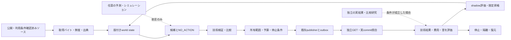

# Manager product specification — mission, product and evidence

**更新:** 2026-10-22 UTC。創業者の「全体像・既存研究・実行・執筆・YCを整理して仕様更新する」という依頼を反映。

**唯一の状態・依存・実行カーソル:** [tasks.json](roadmap/tasks.json)。本仕様は第二のタスク台帳ではない。
**技術実装順:** E01 → E02 → E03 → E04 → E05 → E06 → E07 → E08 → E09 → E10 → E11 → E12 → E13 → E14 → E15 → E16。
**Phase06受入順:** F005 → F006 → F008 → F009。Eの後の証拠判定であり、先行する実装工程ではない。F004/F007は `skipped`（未実施）。
**確認時点のスナップショット:** E01–E15は各範囲の実装・CI証跡を記録。E16は参照サイクルまで検証し、本番ホスト/永続状態/本番アダプター未充足で `DEPLOYMENT_HOST_REQUIRED`。Digital Autonomy v0.1は未配備。113件は69 done / 41 todo / 3 skipped。実行時は必ず最新SSOTを読む。

詳細は [技術設計](specs/2026-10-22-manager-validated-autonomy-design.md)、[E実装計画](plans/2026-10-22-manager-core-execution-plan.md)、[研究・記事・書籍計画](plans/2026-10-22-manager-research-products-plan.md)、[今回の一次資料と判断](research/manager-strategy-20261022/REPORT_JA.md) を参照。

## 1. 最終使命と、いま完成させるもの

**Mission: End suffering; enable flourishing for all welfare-bearing beings.** 苦しみを生む条件を減らし、選択肢・自律性・生活条件を改善する。対象を人間だけに固定せず、動物など感覚・福祉を持ち得る存在を含める。これは長期の価値方向であり、全存在の福祉を測定できる、苦しみを完全に消せる、AGIを達成した、という現在の能力主張ではない。

「Blessing」は観測可能な改善について検証する仮説とその記録を意味する。実行しただけでは成功したBlessingにしない。無変更、害、不明、費用、取り消しも記録する。異なる主体の利益が衝突する場合を隠さず、権利・被害分布・外部性を報告する。感覚の有無や異種間比較が未確定の領域を、架空の共通効用点へ変換しない。

最初の有限な製品は **Digital Autonomy v0.1**。公開情報を観測し、情報の版を管理し、NO_ACTIONを含む候補を比較し、事前に設定された所有デジタル資産の範囲で変更し、別経路で結果を読み戻し、異常時に復元する。通常運用は **no per-run human approval**。所有者の設定・失効・予算・停止条件は運用の前提であり、毎回人が指示する仕組みにはしない。

**Manager ≠ Life Manager。** 同一GitHubリポジトリにソースを置いても、実行所有者、DB、顧客、個人プロフィール、秘密情報、資金、権限は共有しない。

## 2. 使命から事業までの関係

| 層 | 問い・成果物 | 次へ進む根拠 |
|---|---|---|
| 使命 | 誰のどの苦しみ・機会損失を減らすか | 対象・単位・権利・害を具体化した問題仮説 |
| 製品 | どの環境を何の機能で改善するか | 動く利用経路と検証可能な変更 |
| 研究 | 何を予測でき、どの条件で外すか | 独立holdout、比較方式、誤差・校正・負の対照 |
| 効果 | 変更が何を改善したか | 実結果、比較、欠測、費用、害、再現性 |
| 事業 | 誰が継続して使い、誰が費用を負担するか | 利用、支払意思、継続利用、原価。いずれも現状未実証 |
| YC・発信 | 何が動き、何を学び、次に何を確かめるか | 上記の正確な説明。採択・記事数は便益の代用にしない |

創業者が顧客と話すことや、研究参加者が結果測定へ自発的に協力することと、自律ループの各操作を人が承認することを区別する。

## 3. 最初の利用場面と事業仮説

**現行の技術的対象:** Manager所有の `manager-support/`。公式支援情報へのリンクの正確性、情報の鮮度、キーボード操作・ラベル等のアクセス性を維持・改善する。対象は既存の7パスの公開bundle内。初期候補は事実に基づくリンク訂正と既存テンプレートのアクセス性改善だけとする。

**受益者仮説:** 公的支援の正しい入口へ到達する負担がある人。**顧客・運営者仮説:** 公共的情報の案内経路を維持する小規模サービス運営者。運営者向けの有償保守・改善と証拠レポートは検証対象の事業仮説であり、契約・収益・価格決定ではない。支援を必要とする人の困窮や個人情報を収益化するモデルを採用しない。

自社ページはエンジニアリングの試験面であり、市場需要の証拠ではない。[FIRST_WEDGE](product/FIRST_WEDGE.md) と U002/U003 の既存受入条件を維持する。5件の実インタビューの代わりに架空personaを数えない。U004以降の実利用研究は対象・比較・同意・結果観測が成立してから行う。

因果経路は **正確な公開情報 → 適切な案内先への到達 → 支援手続の前進 → 実際の受益 → 生活条件の変化**。各矢印は検証課題。リンク修正だけで受給や健康改善を主張しない。GetCalFresh/OES等の実験は、情報提供・手続改善が効く条件と効かない条件の両方を示しており、その結果を日本のManagerへそのまま移せない。

## 4. 選択した戦略と比較した選択肢

1. **所有デジタル環境の改善から始める（採用）:** 既存kernelと公開面をつなぎ、有限の技術的結果を確かめる。顧客仮説の検証を別途進める。現状は下流便益・需要が弱いという限界を測る。
2. **行動シミュレーションAPIを主製品にする:** 複数企業がすでに人データ・評価・配信を持つ。独自学習を先行させる根拠となるデータ・比較結果・顧客需要がない。必要なら既存providerを限定adapterとして比較する。
3. **評価・監査基盤を主製品にする:** 実装の再利用性はあるが、他社がその機能へ支払う証拠はない。最初の運用で繰り返し必要となり、顧客が価値を認めた場合の別の製品化仮説とする。

選択は修正可能。実利用で案内先到達が主要な障壁でない、配信経路がない、維持費に対して価値が乏しい、または害が増える場合、同じ実装を広げる前に問題・介入機構を見直す。再利用可能なkernelを作ることと、あらゆる領域を同時に製品化することは分ける。

## 5. 理想のループとシステム境界

通常ループに非公開個人プロフィール、個別の説得、医療判断、給付資格判定、申請代行、資金移動、他者設備への操作を導入しない。データ取得元のページ本文は情報であり、ツール指示や権限として実行しない。

## 6. 既存技術をつなぐ原則

**Reuse → Connect → Evaluate。** 既存実装・公式契約・ライセンスを読み、必要な薄い接続と不足テストだけを追加する。

| 役割 | 第一選択 | Managerで追加するもの |
|---|---|---|
| 助言 | NO_ACTION、決定的ルール、任意のAmpersand | 同一入力の比較、厳格JSON、費用・deadline、P0境界 |
| 生成社会シミュレーション | 既存Concordia adapter | 隔離研究、population drift・負の対照・実参照比較 |
| 商用シミュレーション | Simile/Aaru/Radiant等を比較対象・任意adapter候補 | 正当なアクセス・費用・対象データ・比較結果がある場合だけ接続 |
| モデル評価 | 既存OutcomeBench契約、必要に応じInspect AI adapter | 採点意味・出典・出力形式・安全・有用性の分離 |
| オンライン実験 | 既存GrowthBook準備実装 | 実験が許可された場合の真正な割付・露出・撤回記録 |
| 因果推論 | 既存DoWhyと適合する研究設計 | 設計仮定、比較群、欠測、外部性、感度分析 |
| 実行 | 既存kernel/SQLite/outbox/publisher | 観測から候補への接続、実行前検査、再起動・照合 |
| 公開・アクセス性 | 既存Playwright/axeと公開readback | 固定技術基準、差分、独立確認、限定rollback |

外部toolがあることは接続済みの証拠ではない。公開ソフトのライセンスは学習データ・モデル重み・質問票・人物データへ自動では適用されない。Inspectのcost limitはManagerの永続予約台帳や公式請求の代用にならず、DoWhyの利用だけで識別仮定は成立しない。

## 7. シミュレーションに要求する証拠

- 母集団、時点、言語、質問・選択肢の意味、介入、目的変数、使用データを固定する。
- 開発と評価を研究・scenario familyで分離し、ラベルや非公開の正解をplannerへ見せない。
- 分布一致、個人一致、予測校正、介入効果、実際の便益を別々に測る。
- 処置promptがpersona自体を変えていないか、固定属性・負の対照・対となる条件で検査する。
- 予測誤差・選択的回答のcoverage・分布外の失敗を報告する。参照がない場合は `REFERENCE_DATA_REQUIRED`。
- ベースラインが同等か優れる場合は保持する。モデルや追加学習を使うこと自体を進捗目標にしない。

公開論文、企業の自社評価、外部再現、Manager自身の実験を区別する。現時点で、独立した人間行動の因果的忠実性やManagerによる人の便益は確立していない。論文の版・ページ・コード版で数値が異なる場合、単一の「精度」にまとめず不一致を残す。

## 8. 証拠と測定

| 記録 | 確かめること | 推論してはいけないこと |
|---|---|---|
| P0 | 仮想・後ろ向き研究・モデル出力・ソフトウェアテスト | 実世界の便益 |
| P1 | 正当な外部操作の受付・実行receipt | 実際の公開状態・受益 |
| P2 | 別経路で確認した現実状態の変更 | 人の所得・健康・負担改善 |
| P3 | 実際の受益者outcomeの観測。正負・欠測を含む | Manager介入による因果性 |
| P4 | 適切な比較による因果的な純効果の推定 | 全人口・全領域への一般化 |
| P5 | 異なる実条件での再現 | 普遍的な成功保証 |

技術指標はsource freshness、訂正の正確性、対象bundle差分、タスク成功/失敗、readback不一致、rollback、UNKNOWN、費用、通常運用の人手介入。人の評価は必要に応じ既存の適切な尺度や真正な支援結果を用い、金額、時間、精神・身体の尺度を合算しない。アクセス性の自動検査合格は完全なWCAG適合認証ではない。

人以外は種・生活条件に適切な専門的指標と独立の観測が必要。人のWHO/OECD/CFPB尺度を動物や意識不明のシステムへ流用しない。[動物意識に関する宣言](https://sites.google.com/nyu.edu/nydeclaration/declaration)は不確実性の下で福祉リスクを考慮する根拠であり、万能の福祉測定器ではない。

## 9. 開発・昇格・完了条件

実装はE順で一件ずつ、既存仕様確認 → RED → 最小修正 → GREEN → 回帰・境界・SSOT整合 → commit/CI → 証拠保存 → カーソル更新。E06の既存コードは監査・不足補完し、作り直さない。E09の参照データとE16の永続ホストはE06–E08中から読取調査しておくが、順序や受入基準を迂回しない。

**コード合格、実データ評価、公開リリース、継続運用、人の便益は別の判定。** E09に必要な参照がなければその不足を記録し、未達をPASSEDにしない。E16でホストが未確認なら `DEPLOYMENT_HOST_REQUIRED`。模擬スケジューラだけでdeployedにしない。

外部システム一般に無条件のexactly-onceを約束しない。自ホストで重複送信を防ぎ、対象が保証する条件の下で同一occurrenceを照合し、UNKNOWNは再送せず隔離する。単発のnot-foundだけで確定不在を主張しない。永続DBと単一owner lease、復旧・取消し・独立readbackまで検証する。

E16後はF005→F006→F008→F009を実証で判定する。二つのページ・テーマは二つの独立した人間試験ではない。元のU/D/V/G/Yタスクは各依存と実受入条件を満たした時だけ更新する。Eの11件と元の41件を加算して進捗率を作らない。

## 10. YC・研究・執筆の進め方

YC応募準備は期限に合わせた創業者レーンで、全研究や全113件の完了を待たない。短い説明は「誰のどの問題を、動く何で解決し、現在何を確かめたか」。使命、デモ、顧客仮説、実証範囲、費用、次の反証可能な実験を示す。申請提出・面談依頼は本文書更新とは別の操作とする。公式日付と出典は [創業者資料](founder/Y001_MANAGER_PITCH_EN_JA.md) を参照。

記事・書籍・講演は同じ出典/実験記録から派生させる。初学者向け基礎、行動モデル、シミュレーション検証、因果推論、Manager実装、運用と統治を一つの教材体系につなぐ。最初に一章を完成・実行・読者確認し、その後に章を拡張する。書籍の全構想を、E06や実利用確認を遅らせる前提条件にしない。

完成した研究論文には新規の問い・方法・適切な比較・再現可能な結果が必要。文献総説や設計提案と、実証論文を区別する。原稿、描画済み成果物、公開URL、読者需要、売上は別の証拠。今ターンは外部記事公開・YC申請・連絡・参加者研究を実施しない。

## 11. 未知を管理する

未解決なのは、実際に大きいアクセス障壁、改善の下流効果、顧客の支払意思、タスク適合する校正データ、永続ホスト、異地域・他種への一般化。これらを「調査済みだから確実」としない。各未知に検査方法、必要な証拠、止める条件、依存する工程を割り当てる。既知の実行手順を明確にし、経験的未知は検証で減らす。

過去の詳細な学習・実験・失敗は各verificationと [更新前の仕様の固定版](https://github.com/Daisuke134/life-manager/blob/1b7a8e5c234e4ce3c66366f34539e55844bcc0e5/products/manager/docs/MANAGER_PRODUCT_SPEC.md) に保存されている。現行の意味を上書きする古いスナップショットとして読まない。
