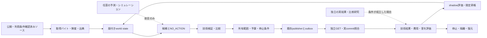

# Manager product specification — mission, product and evidence

**更新:** 2026-10-22 UTC（追加一次資料調査まで反映）。他社の製品・公開コード・研究者の発信事例を再調査し、実装、実証、収益、出版、YC Winter 2027、採用応募・人脈形成を一つの実行方針に接続。

**唯一の状態・依存・実行カーソル:** [tasks.json](roadmap/tasks.json)。本仕様は第二のタスク台帳ではない。
**技術実装順:** E01 → E02 → E03 → E04 → E05 → E06 → E07 → E08 → E09 → E10 → E11 → E12 → E13 → E14 → E15 → E16。
**Phase06受入順:** F005 → F006 → F008 → F009。Eの後の証拠判定であり、先行する実装工程ではない。F004/F007は `skipped`（未実施）。
**確認時点のスナップショット:** E01–E15は各範囲の実装・CI証跡を記録。E16は参照サイクルまで検証。本番の採用先はRailwayに決定し、既存 `life-manager` プロジェクトへの読取接続を確認したが、Manager専用worker・volume・本番adapter・実配備証拠は未充足で `DEPLOYMENT_HOST_REQUIRED` を維持。Digital Autonomy v0.1は未配備。113件は69 done / 41 todo / 3 skipped。実行時は必ず最新SSOTを読む。

**2026-10-25 E16 PATCH-05 source更新:** 固定request schema、Railway runtime identity preflight、main専用のversioned admission、durable one-shot sender/outbox、request ID付きGitHub run照合に加え、`run_owned_workflow_bridge_once` が固定support catalogから候補を作り、main SHA・現gh-pages commit・公開中の全bundleを照合して、due時にrequest/effectを永続予約する処理を追加した。古いeffectの occurrence と delivery を先にreconcileし、不明な過去effectが残る場合は新requestを送らない。run照合は最大10ページを走査し、ページ上限まで履歴が続く場合は一意性を主張せずUNKNOWNにする。timeout/読戻し不明は再送せず`UNKNOWN`/reconciliationへ残す。`.github/workflows/manager-phase06-service.yml` はmainのworkflow_dispatchにだけrequestを受け付け、保護されたowner ID、同一SHAのverified artifact、現gh-pages parent、既存7-file guard/CASへ再結合する。これらはsourceとfake transport/SQLiteによる検証であり、実Railway service/volume/secrets、main promotion、実workflow run、commit occurrence、独立した公開bytes照合、restart/replay-zeroは未達。E16とF受入はBLOCKEDのまま。Mac MiniはRailway実行経路の前提ではない。

詳細は [技術設計](specs/2026-10-22-manager-validated-autonomy-design.md)、[E実装計画](plans/2026-10-22-manager-core-execution-plan.md)、[研究・記事・書籍計画](plans/2026-10-22-manager-research-products-plan.md)、[今回の一次資料と判断](research/manager-strategy-20261022/REPORT_JA.md) を参照。

**今回の全体戦略・先例・応募先・順序:** [創業者実行マップ](plans/2026-10-22-manager-founder-execution-map.md) と [追加調査](research/manager-strategy-20261022/FOUNDER_EXECUTION_UPDATE_JA.md)。実装状態、公開、入金、応募、返信、採択は別々の証拠で更新する。

**最新の追加探索:** [既調査を除いた6分野の比較・新論文・固定code](research/manager-options-additional-20261022/REPORT_JA.md)、[ファイル/関数/RED条件/検証commandを指定した12 atomic patches](plans/2026-10-22-manager-e16-atomic-patches.md)。前回の既知先例の再整理を新しい調査とは数えない。

**開始から最後まで:** [Phase00〜12・残41件の全ID/依存/受入れ・出版/サイト/YC並行線](roadmap/START_TO_END_20261022.md)。E16は最初の有限なreleaseへの工程であり、Phase12/G006までの原計画を省略しない。

**後続の実装結果:** [E16 recovery hardening](verification/E16_RECOVERY_HARDENING_20261022.md)。過去intent回収・checkpoint再送防止・typed deliveryを追加し、local684テストとcurrent/DBOS計16ケースを検証。DBOSは固定sourceから実install・実再開比較したが、本番採用は未決でsingle-workerを維持。本番bridge/volume/実canaryは未成立、E16/原41件の受入状態は据え置く。

## 1. 最終使命と、いま完成させるもの

**Mission: End suffering; enable flourishing for all welfare-bearing beings.** 苦しみを生む条件を減らし、選択肢・自律性・生活条件を改善する。対象を人間だけに固定せず、動物など感覚・福祉を持ち得る存在を含める。これは長期の価値方向であり、全存在の福祉を測定できる、苦しみを完全に消せる、AGIを達成した、という現在の能力主張ではない。

「Blessing」は観測可能な改善について検証する仮説とその記録を意味する。実行しただけでは成功したBlessingにしない。無変更、害、不明、費用、取り消しも記録する。異なる主体の利益が衝突する場合を隠さず、権利・被害分布・外部性を報告する。感覚の有無や異種間比較が未確定の領域を、架空の共通効用点へ変換しない。

最初の有限な製品は **Digital Autonomy v0.1**。公開情報を観測し、情報の版を管理し、NO_ACTIONを含む候補を比較し、事前に設定された所有デジタル資産の範囲で変更し、別経路で結果を読み戻し、異常時に復元する。通常運用は **no per-run human approval**。所有者の設定・失効・予算・停止条件は運用の前提であり、毎回人が指示する仕組みにはしない。

**Manager ≠ Life Manager。** 同一GitHubリポジトリにソースを置いても、実行所有者、DB、顧客、個人プロフィール、秘密情報、資金、権限は共有しない。

## 2. 使命から事業までの関係

| 層 | 問い・成果物 | 次へ進む根拠 |
|---|---|---|
| 使命 | 誰のどの苦しみ・機会損失を減らすか | 対象・単位・権利・害を具体化した問題仮説 |
| 製品 | どの環境を何の機能で改善するか | 動く利用経路と検証可能な変更 |
| 研究 | 何を予測でき、どの条件で外すか | 独立holdout、比較方式、誤差・校正・負の対照 |
| 効果 | 変更が何を改善したか | 実結果、比較、欠測、費用、害、再現性 |
| 事業 | 誰が継続して使い、誰が費用を負担するか | 利用、支払意思、継続利用、原価。いずれも現状未実証 |
| YC・発信 | 何が動き、何を学び、次に何を確かめるか | 上記の正確な説明。採択・記事数は便益の代用にしない |

創業者が顧客と話すことや、研究参加者が結果測定へ自発的に協力することと、自律ループの各操作を人が承認することを区別する。

## 3. 最初の利用場面と事業仮説

**現行の技術的対象:** Manager所有の `manager-support/`。公式支援情報へのリンクの正確性、情報の鮮度、キーボード操作・ラベル等のアクセス性を維持・改善する。対象は既存の7パスの公開bundle内。初期候補は事実に基づくリンク訂正と既存テンプレートのアクセス性改善だけとする。

**受益者仮説:** 公的支援の正しい入口へ到達する負担がある人。**顧客・運営者仮説:** 公共的情報の案内経路を維持する小規模サービス運営者。運営者向けの有償保守・改善と証拠レポートは検証対象の事業仮説であり、契約・収益・価格決定ではない。支援を必要とする人の困窮や個人情報を収益化するモデルを採用しない。

自社ページはエンジニアリングの試験面であり、市場需要の証拠ではない。[FIRST_WEDGE](product/FIRST_WEDGE.md) と U002/U003 の既存受入条件を維持する。5件の実インタビューの代わりに架空personaを数えない。U004以降の実利用研究は対象・比較・同意・結果観測が成立してから行う。

因果経路は **正確な公開情報 → 適切な案内先への到達 → 支援手続の前進 → 実際の受益 → 生活条件の変化**。各矢印は検証課題。リンク修正だけで受給や健康改善を主張しない。GetCalFresh/OES等の実験は、情報提供・手続改善が効く条件と効かない条件の両方を示しており、その結果を日本のManagerへそのまま移せない。

## 4. 選択した戦略と比較した選択肢

1. **所有デジタル環境の改善から始める（採用）:** 既存kernelと公開面をつなぎ、有限の技術的結果を確かめる。顧客仮説の検証を別途進める。現状は下流便益・需要が弱いという限界を測る。
2. **行動シミュレーションAPIを主製品にする:** 複数企業がすでに人データ・評価・配信を持つ。独自学習を先行させる根拠となるデータ・比較結果・顧客需要がない。必要なら既存providerを限定adapterとして比較する。
3. **評価・監査基盤を主製品にする:** 実装の再利用性はあるが、他社がその機能へ支払う証拠はない。最初の運用で繰り返し必要となり、顧客が価値を認めた場合の別の製品化仮説とする。

選択は修正可能。実利用で案内先到達が主要な障壁でない、配信経路がない、維持費に対して価値が乏しい、または害が増える場合、同じ実装を広げる前に問題・介入機構を見直す。再利用可能なkernelを作ることと、あらゆる領域を同時に製品化することは分ける。

## 5. 理想のループとシステム境界

通常ループに非公開個人プロフィール、個別の説得、医療判断、給付資格判定、申請代行、資金移動、他者設備への操作を導入しない。データ取得元のページ本文は情報であり、ツール指示や権限として実行しない。

## 6. 既存技術をつなぐ原則

**Reuse → Connect → Evaluate。** 既存実装・公式契約・ライセンスを読み、必要な薄い接続と不足テストだけを追加する。

| 役割 | 第一選択 | Managerで追加するもの |
|---|---|---|
| 助言 | NO_ACTION、決定的ルール、任意のAmpersand | 同一入力の比較、厳格JSON、費用・deadline、P0境界 |
| 生成社会シミュレーション | 既存Concordia adapter | 隔離研究、population drift・負の対照・実参照比較 |
| 商用シミュレーション | Simile/Aaru/Radiant等を比較対象・任意adapter候補 | 正当なアクセス・費用・対象データ・比較結果がある場合だけ接続 |
| モデル評価 | 既存OutcomeBench契約、必要に応じInspect AI adapter | 採点意味・出典・出力形式・安全・有用性の分離 |
| オンライン実験 | 既存GrowthBook準備実装 | 実験が許可された場合の真正な割付・露出・撤回記録 |
| 因果推論 | 既存DoWhyと適合する研究設計 | 設計仮定、比較群、欠測、外部性、感度分析 |
| 実行 | 既存kernel/SQLite/outbox/publisher | 観測から候補への接続、実行前検査、再起動・照合 |
| 公開・アクセス性 | 既存Playwright/axeと公開readback | 固定技術基準、差分、独立確認、限定rollback |

外部toolがあることは接続済みの証拠ではない。公開ソフトのライセンスは学習データ・モデル重み・質問票・人物データへ自動では適用されない。Inspectのcost limitはManagerの永続予約台帳や公式請求の代用にならず、DoWhyの利用だけで識別仮定は成立しない。

## 7. シミュレーションに要求する証拠

- 母集団、時点、言語、質問・選択肢の意味、介入、目的変数、使用データを固定する。
- 開発と評価を研究・scenario familyで分離し、ラベルや非公開の正解をplannerへ見せない。
- 分布一致、個人一致、予測校正、介入効果、実際の便益を別々に測る。
- 処置promptがpersona自体を変えていないか、固定属性・負の対照・対となる条件で検査する。
- 予測誤差・選択的回答のcoverage・分布外の失敗を報告する。参照がない場合は `REFERENCE_DATA_REQUIRED`。
- ベースラインが同等か優れる場合は保持する。モデルや追加学習を使うこと自体を進捗目標にしない。

公開論文、企業の自社評価、外部再現、Manager自身の実験を区別する。現時点で、独立した人間行動の因果的忠実性やManagerによる人の便益は確立していない。論文の版・ページ・コード版で数値が異なる場合、単一の「精度」にまとめず不一致を残す。

## 8. 証拠と測定

| 記録 | 確かめること | 推論してはいけないこと |
|---|---|---|
| P0 | 仮想・後ろ向き研究・モデル出力・ソフトウェアテスト | 実世界の便益 |
| P1 | 正当な外部操作の受付・実行receipt | 実際の公開状態・受益 |
| P2 | 別経路で確認した現実状態の変更 | 人の所得・健康・負担改善 |
| P3 | 実際の受益者outcomeの観測。正負・欠測を含む | Manager介入による因果性 |
| P4 | 適切な比較による因果的な純効果の推定 | 全人口・全領域への一般化 |
| P5 | 異なる実条件での再現 | 普遍的な成功保証 |

技術指標はsource freshness、訂正の正確性、対象bundle差分、タスク成功/失敗、readback不一致、rollback、UNKNOWN、費用、通常運用の人手介入。人の評価は必要に応じ既存の適切な尺度や真正な支援結果を用い、金額、時間、精神・身体の尺度を合算しない。アクセス性の自動検査合格は完全なWCAG適合認証ではない。

人以外は種・生活条件に適切な専門的指標と独立の観測が必要。人のWHO/OECD/CFPB尺度を動物や意識不明のシステムへ流用しない。[動物意識に関する宣言](https://sites.google.com/nyu.edu/nydeclaration/declaration)は不確実性の下で福祉リスクを考慮する根拠であり、万能の福祉測定器ではない。

## 9. 開発・昇格・完了条件

実装はE順で一件ずつ、既存仕様確認 → RED → 最小修正 → GREEN → 回帰・境界・SSOT整合 → commit/CI → 証拠保存 → カーソル更新。E06の既存コードは監査・不足補完し、作り直さない。E09の参照データとE16の永続ホストはE06–E08中から読取調査しておくが、順序や受入基準を迂回しない。

**コード合格、実データ評価、公開リリース、継続運用、人の便益は別の判定。** E09に必要な参照がなければその不足を記録し、未達をPASSEDにしない。E16でホストが未確認なら `DEPLOYMENT_HOST_REQUIRED`。模擬スケジューラだけでdeployedにしない。

外部システム一般に無条件のexactly-onceを約束しない。自ホストで重複送信を防ぎ、対象が保証する条件の下で同一occurrenceを照合し、UNKNOWNは再送せず隔離する。単発のnot-foundだけで確定不在を主張しない。永続DBと単一owner lease、復旧・取消し・独立readbackまで検証する。

E16後はF005→F006→F008→F009を実証で判定する。二つのページ・テーマは二つの独立した人間試験ではない。元のU/D/V/G/Yタスクは各依存と実受入条件を満たした時だけ更新する。Eの実装工程と元の41件を加算して進捗率を作らない。

## 10. YC・研究・執筆の進め方

YC応募準備は期限に合わせた創業者レーンで、全研究や全113件の完了を待たない。短い説明は「誰のどの問題を、動く何で解決し、現在何を確かめたか」。使命、デモ、顧客仮説、実証範囲、費用、次の反証可能な実験を示す。申請提出・面談依頼は本文書更新とは別の操作とする。公式日付と出典は [創業者資料](founder/Y001_MANAGER_PITCH_EN_JA.md) を参照。

記事・書籍・講演は同じ出典/実験記録から派生させる。初学者向け基礎、行動モデル、シミュレーション検証、因果推論、Manager実装、運用と統治を一つの教材体系につなぐ。最初に一章を完成・実行・読者確認し、その後に章を拡張する。書籍の全構想を、E16や実利用確認を遅らせる前提条件にしない。

完成した研究論文には新規の問い・方法・適切な比較・再現可能な結果が必要。文献総説や設計提案と、実証論文を区別する。原稿、描画済み成果物、公開URL、読者需要、売上は別の証拠。今ターンは外部記事公開・YC申請・連絡・参加者研究を実施しない。

## 11. 未知を管理する

未解決なのは、実際に大きいアクセス障壁、改善の下流効果、顧客の支払意思、タスク適合する校正データ、永続ホスト、異地域・他種への一般化。これらを「調査済みだから確実」としない。各未知に検査方法、必要な証拠、止める条件、依存する工程を割り当てる。既知の実行手順を明確にし、経験的未知は検証で減らす。

過去の詳細な学習・実験・失敗は各verificationと [更新前の仕様の固定版](https://github.com/Daisuke134/life-manager/blob/1b7a8e5c234e4ce3c66366f34539e55844bcc0e5/products/manager/docs/MANAGER_PRODUCT_SPEC.md) に保存されている。現行の意味を上書きする古いスナップショットとして読まない。

## 12. 既にあるものを使い、実証を接続する

選定順は **実際の利用問題 → 既存の代替手段 → 公開コード/契約/権利 → 最小接続 → 同じ条件での比較**。新しいagent framework、memory engine、一般的workflow engine、foundation model、汎用評価runnerを自作することを目標にしない。他者のコード・データ・図は各licenseと利用条件に従い、出典と改変を残す。「既存部品がある」ことは、その組合せの顧客価値や自分たちの成果が既に実証されたことではない。

| 先例・部品 | 学び、再利用するもの | 今の判断 / 移行条件 |
|---|---|---|
| LangGraph / Temporal | checkpoint、durable execution、再開、retryとidempotencyの分離 | 既存SQLite/outboxをE16でまず完成。複数worker、長期workflow、運用負担が実測で必要になった時に既成engineを比較。自作の代替engineを増やさない |
| Letta / OpenHands | memory/stateとtool実行の分離、既存SDK・sandbox・event記録 | 一般的なmemory/agent基盤を新設しない。現行API/移動先/保守状態を確認して薄いadapterのみ検討 |
| Inspect AI / Playwright / axe | 既存の採点・log・browser/accessibility検証 | 自作runnerへ置換せず、Managerの固定rubric・exact occurrence・権限検査だけを接続 |
| Simile / Aaru / Artificial SocietiesのRadiant | 行動simulationのデータ根拠、対象ごとの評価、顧客への提供方法 | 比較対象・採用候補・将来のprovider。vendor accuracy/顧客名を自分たちの精度・売上にしない。RadiantとArtificial Societiesを別企業として二重計上しない |
| Anthropic / AndonのProject Vend | 長期運用、費用、失敗、実際の人手、攻撃・復旧の報告 | 実験の構造と失敗検査を再利用。シミュレーション残高や歴史的報酬額を実入金と数えない |
| Hamel Husain / Chip Huyen / Simon Willison / Jason Liu | 実コード・再現例・技術記事・教材・専門サービスが相互に根拠を供給する形 | 書き方や工程を学ぶ。文章/ブランドを複製せず、他人の実績を自分の実績としない。現在閉鎖されたサービスの過去事例を現行販売条件としない |

個別URL、読んだ範囲、保守上の注意、採否は[追加調査](research/manager-strategy-20261022/FOUNDER_EXECUTION_UPDATE_JA.md)に記録する。既存37出典と今回の追加取得を単純加算して「独立した実験数」としない。

## 13. 採用するクラウド構成

**Railway上の単一Python worker＋専用永続volumeを採用。Mac miniへの移行を必須としない。** このチャットの開発環境からGitHubとRailwayを操作し、運用プログラムはRailwayで動かす。開発環境のprovider secret一覧が空でも、別の接続済みpluginによるRailwayアクセスがないとは判断しない。

- 確認済み: Railwayの既存 `life-manager` project、既存production serviceとSUCCESS deploymentの記録。読取時点でvolumeなし。この既存serviceが今回のManagerだとは認定せず、役割・実source・ownerを調べる。
- 新規の予定: `manager-owned-digital-worker` という専用serviceと `/data/manager` の永続状態。名前・pathは構成上の決定であり、作成済みという主張ではない。既存serviceは上書きせず、最初はisolated stagingで検証する。
- 最初は1 worker/1 replica、既存SQLite/outbox/lock、起動時reconcileとcatch-up-once、backup/restore。volume付きserviceのreplica/再deploy制約を踏まえ、無停止や分散exactly-onceを約束しない。
- SupabaseへのDB移行をE16の前提にしない。確認できたManager接続側の既存Supabase projectはINACTIVE。共有DB・認証等が実際に必要になった時に既存製品を比較し、別の移行として設計する。
- 元の7パス・publisher identity・main/immutable-release promotion・停止/予算境界を維持する。cloudを選んだことは公開権限の発行や支出上限の解除ではない。
- 残る作業は本番adapter、具体的なruntime owner、volume、予算/監視、release、限定canary、official occurrence＋独立GET、restart/replay-zero/rollbackの実証。プラットフォーム接続や計画図だけではE16をPASSEDにしない。

## 14. 製品・発信・仕事・YCを同じ証拠から進める

中心成果物は、一つの **再現可能なcase study**。問題、先例、baseline、版付きコード、実行条件、全attempt/失敗/UNKNOWN、結果、費用、限界を揃える。そこから記事、既存書籍の章、12枚slide、8枚carousel、demo、履歴書のproject欄、個別応募資料、YC回答へ派生させる。同じ実験を媒体ごとに独立した成果と数えない。

最初のengineering caseは、既存の「期限到達時のcancel」「応答消失後の照合」「二重実行防止」「配信回帰の復元」を再現可能に示す。661件のテストと5 optional skipsはソフトウェア検査の記録であり、661人の利用実績ではない。本番caseはE16の実receipt後に追加し、実機運用前のcaseにはP0/SANDBOXを明記する。

**専門性の判定:** 原論文の対象/仮定/限界を説明できる、関連コードの範囲を読める、一つの比較または失敗を再現できる、第三者の指摘で修正できる、出典付きで教えられる。読んだ件数、投稿頻度、肩書、フォロワー数だけでexpertと認定しない。新しいretrievalは意思決定を変える不足がある場合に行い、調査を配備・顧客確認・提出の先延ばしにしない。

最初の商用仮説は、運営者の限定デジタル運用に対する「変更検知・既存automationとの接続・限定修正・独立検証・証拠レポート」の有償pilot/運用改善支援。単純link checker・既存監視・手作業で十分なら、それを接続して使うかwedgeを再選定する。独自の汎用AIを売ることを前提にせず、5件の実会話で頻度・現在原価・失敗損失・支払主体を確認する。有償サービスからの学びを製品化へ戻し、受託収入をSaaSのMRRと呼ばない。

## 15. 本当の結果と本当のお金の表示契約

収入は **Manager製品 / Managerを使う運用支援 / 創業者個人の受託・助言 / 給与 / 記事・書籍・講座 / 他のLife Manager製品** に分類する。出資、自己資金、返金、寄付、顧客入金を混ぜず、二重帰属させない。MRRは真正な継続契約に限り、単発pilot、見積、LOI、架空ベンチマーク報酬から算出しない。

金額には商品/案件、期間、通貨、請求/支払/settledの別、公式receiptと対象coverage、手数料、返金、原価、税の扱い、取得時刻を付ける。売上、受領cash、粗利、営業利益、利益に含めない創業者の作業時間を区別する。異通貨は原通貨を保持し、換算を表示する場合はrate/date/sourceを明示する。

**公式sourceを照合していない値はUNKNOWN/null。** 対象期間・商品・口座のcoverageを照合してゼロ件と確定した場合だけ0を記録する。hashやスクリーンショットだけでprovider receiptの真正性を認めない。公開用には個人/顧客情報を除いた集計と検証方法を示す。現時点でManagerの顧客数・売上・MRR・純利益の確定値は提示していない。

週次の公開候補scorecardは、技術変更の成功/失敗/無変更/UNKNOWNと分母、独立readback/復元、通常運用の人手/費用、実利用/継続、支払/返金/原価を別列にする。公開URL、会話、応募、返信、面接、offer、YC提出/採択も別の証跡。模擬運用の結果を経済成果や人への便益へ昇格させない。

## 16. 採用・人脈・YC Winter 2027

狙う職能はまず **evaluations / research engineering / agent infrastructure / forward-deployed engineering**。Managerの実装・比較・失敗分析に結び付く役割を優先し、本人の職歴・英語・就労資格・勤務地要件に合わない応募は送る前に除く。Research Scientistの資格を満たすと推定しない。対象企業/職種/勤務地/公式応募URL/確認日/fit/提出物/状態を[実行マップ](plans/2026-10-22-manager-founder-execution-map.md)に整理する。

個別メールは公開業務窓口・公式応募経路を使い、「相手の具体的な研究/課題」「関連する自分の再現可能な成果1件」「小さな依頼1件」を短く示す。無差別の大量送信、架空の紹介・所属・実績、私的連絡先の推測は採用しない。初回の業務連絡と研究参加への同意を区別し、拒否/停止要望後は追送しない。会社応募と研究者との学習会話、顧客面談は別pipelineにする。イベントは参加可能日・会場/online・締切・申込状態を公式sourceで確認し、登録/参加/会話/紹介を分ける。

YC W27の目標は応募・面接・採択を段階ごとに実現すること。採択は保証しない。公式締切に合わせて申請を進め、E16・全書籍・人のRCT・全113件の完了を応募条件として追加しない。verifiedなデモ、現在の実績、顧客仮説/実会話、費用/売上の未確認を含む正確な数値、次の反証可能な実験を提出資料へ接続する。本人の経歴・渡航/対面参加条件・実際の提出確認は別の必須確認。

YCと就職の準備は並行するが、YC採択後の会社へのfull-time commitmentと他社full-time勤務を同時達成する前提にはしない。W27は2027年1–3月SF対面、通常締切の確認値は2026-11-03 13:00 JST。本人の就労/移住/稼働条件を照合し、採択やofferが出た時に整合する選択をする。[公式FAQ](https://www.ycombinator.com/faq)・[応募頁](https://www.ycombinator.com/apply)・[6社/3イベント/週次運用](plans/2026-10-22-manager-founder-execution-map.md)。

## 17. どこまでを完成とするか

Digital Autonomy v0.1は、限定scopeでの実運用、独立した技術結果、永続復旧・停止・復元、費用と限界を第三者が確認できる有限のreleaseとして完成させる。技術release、最初の支払済みpilot、反復利用、書籍の完成/公開/売上、job offer、YC採択にはそれぞれ別の終了条件を置く。

長期使命の「苦しみを終わらせる」は有限のreleaseや採択をもって達成したと宣言しない。運用で得た真の結果と反例から、次のversion・研究・顧客・教材を更新する。今回の作業は調査と仕様/派生計画更新であり、配備・決済・投稿・応募・メール送信・イベント登録を行ったとは扱わない。

## 18. 追加一次資料に基づく選択肢と実装の絞込み

### 既成製品を直接使う選択をbaselineにする

個人の予定調査/記憶はOpenClaw/Khoj、定型workflowはn8n/Activepieces、業務agentはGumloop/Relevance AI/Lindyのnative機能を先に比較する。Managerのために汎用agent OS、scheduler、memory、connector catalogを自作しない。既存製品だけでuser jobを満たすなら `USE_EXISTING_PRODUCT`。限定したauthority/effect/readback/rollback/実結果の追跡が不足するなら `TEST_THIN_MANAGER_BOUNDARY` とし、その追加価値は顧客の現行代替との比較で検証する。現wedgeの商業判定は `UNVALIDATED`。[具体的比較](product/FIRST_WEDGE.md)・[一次資料](research/manager-options-additional-20261022/AGENT_PRODUCTS_JA.md)。

### 永続実行は既成runtimeと同条件で比較する

新たにDBOS/Restate/Inngest/Hatchetを実codeまで、Windmill/Kestraを浅く比較した。最初の適合試験は **DBOS＋SQLite**。Python boundsの一致だけでは採用せず、同じfailure matrixで無重複送信、UNKNOWN、multi-stage復旧、待機、依存量/運用負担を確認する。現行cadenceだけを交換するための先行移行はしない。手書きrecovery stateが増え、既成runtimeがfenceを保ったまま削減できる時に委譲する。DBOS SQLiteは複数server用途にせず、公式のproduction Postgres推奨を保持する。SDKとserverのlicenseを分ける。[runtime監査](research/manager-options-additional-20261022/DURABLE_JA.md)。

`OwnedEffectRecord.dispatch=True` をcheckpointして後のretryable sendへ渡すことは禁止。fresh lookup/admission/reserve/guarded dispatchを同じhost-owned helperで行い、再開時はjournalを読み直す。候補/期限/providerが変わっても過去intentを先に照合する。外部commit後の応答消失は既存testを再利用し、engine checkpoint消失/古いbackup等の差分だけ追加する。

E16のローカル障害復旧補助として `scripts/backup_owned_cycle.py` を用意する。backupはowner `flock` が空いている間だけSQLite online-backup APIで取得し、integrity・byte数・SHA-256を検査する。restoreは既存stateを上書きせず新しい隔離ディレクトリだけに行い、`RESTORE_RECONCILIATION_REQUIRED.json` を置く。起動cycleと直接dispatchの両方がこの印を見てwriteを拒否する。backup後に外部commitが進んだ可能性を保存DBだけでは除外できないため、照合前のrestored stateを現行stateとして運用してはならない。SHA-256は破損検出であり署名/真正性証明ではない。これはコードとローカルfixtureの検証であり、Railway volume上のbackup/restore、host restart、production adapterの受入れではない。

### 本番の未接続部分をファイルで特定する

旧 `run_owned_cycle` はlocal sandbox限定であり、`admit_owned` はGitHub Actionsの特権publisher内でのみ使う。これとは別に2026-10-25、Railway入口 `run_owned_workflow_bridge_once` を追加した。これは正確なRailway project/environment/service/volume設定と実mountを起動時に要求し、永続SQLite/flockを開いた後、前のeffect/公開deliveryを照合する。次に固定main source SHAがGitHub mainと一致し、gh-pagesのimmutable bundleと公開中のmanifest/page bytesが完全一致し、scheduleがdueのときだけ、catalog由来の候補・main intent・requestを原子的に予約し、最大一度だけdispatchする。GitHub publisherは同一SHAのverified artifact、request・protected owner ID・正確なgh-pages parentを再検査して既存7-file guard/CASを使う。発見できない過去effectは`UNKNOWN`として新規送信を止める。コード経路は実装済みだが、GitHub pluginの認証はRailway credentialではなく、Railway dispatch token、GitHub `MANAGER_RELEASE_ENABLED` / `MANAGER_OWNER_ID`、専用service/volume、通常のmain promotion、実workflow run・commit・独立public readback・restart/replay-zeroの証拠がまだない。したがって本番運転/配備済みとは扱わず、E16/F受入はBLOCKED。旧SOURCE_REFとその互換性は維持し、今回の研究branchを新しいpublisher allowlistへ加えない。

本番adapterではreadbackをboolへ潰さず `VERIFIED|PENDING|REGRESSION|UNKNOWN` に分ける。lag/timeout/missingやhash不一致だけでrollbackしない。公式deploymentと現在candidateに結び付いた観測に対し固定rubricで回帰を確認した時だけ、target CASを再確認して限定復元する。backupから失われた予約を「未送信」とせず、元binding/外部occurrenceを回収できるまでdispatchしない。

### hostの再比較

Render Background Worker＋Disk、Fly Machines＋Volumes、Modal、Cloudflare、Render Workflowsの公式契約を追加確認した。Railwayは**接続済みで現行single Python/SQLite契約に合う初期選択**として維持し、最良のplatformと実証したとは呼ばない。Renderは有力fallback。Flyは自動volume replicationなし、Modal volumeはdistributed lockingなし、Cloudflare PythonはPyodide/WASMで現fcntl/subprocess/Gitのdrop-inではない。実hostのlock/restore/停止/予算が不適合なら再選定する。[比較根拠](research/manager-options-additional-20261022/HOSTS_JA.md)。

### 評価と出版に取り入れる新しい反例

6本の未読論文/版から、macro/micro/conditionalの違い、環境/採点器自体の破損、論文とcodeの採点式不一致、LLM judge同士と人との一致の違いを取り入れる。AgentSociety/OASIS等の既知名は新規に数えず、著者結果を自分たちの再現結果にしない。license未確認repoやthird-party assetsはvendorせずclean fixtureへ置換する。[論文・code監査](research/manager-options-additional-20261022/SIMULATION_JA.md)。

教材は既存P01 evidence indexとP06 storyboardを唯一の予定入力として使う。MySTのDOCX/JATS、SlidevのPPTX、Remotionを比較したが、最初は既存python-pptx/Pillow/FFmpegを接続する。新CMS/動画runtimeは増やさない。blogのimage-only mediaにPDF/EPUB/MP4を混ぜず、明示artifact契約でinstallerへ追加する。6枚/Anicca専用CTAの既存carousel laneへ8枚のManager教材をそのまま送らない。Made With ML/askFSDLのcode→test→教材対応を再利用し、本人の就職記事や無料archiveから売上を推計しない。[出版の実interfaceとpatch](research/manager-options-additional-20261022/PUBLISHING_JA.md)。

今回追加したのはローカルstate backup/restore helperとそのquarantine検査であり、E16のproduction deploy、Railway volume drill、engine比較、公開、入金、応募/採択/人の便益を完了したとは記録しない。元113件の状態/依存/Eカーソルは不変。

## 19. 全工程の終点と公開サイトの追従

[全工程view](roadmap/START_TO_END_20261022.md)にPhase00〜12と残41件を省略せず列挙する。E01–E16、P01–P07、12 atomic patches、創業者12packageは同じ作業の派生viewであり、原113件へ足さない。旧EBAのPhase07〜11は別章立てなので対応表で結び、元のtask ID/依存を維持する。

長期像の `one model` は一貫した意思決定主体への統合、`no UI` は日常の指示入力/各run承認を必要としない運用とする。owner設定・停止・失効・予算・異議・監査・公開proofは保持する。独自foundation modelや全機能の単一モデル化を、E16や顧客確認より先に必須化しない。『digital Buddha』は慈悲を表す方向であり、全知・万能を達成したという能力表示には使わない。

P04の公式homeは、過去の人口合成を日付付き研究として残し、現在の実装と未配備E16、dated public prototype、モデル評価/人の便益の違い、全工程への導線を英日で示す。E16/F受入れ、実pilot/比較、公開記事/書籍、実入金などの証拠が揃ったmilestoneで更新する。原稿/manifestを更新しただけでlive更新とは記録せず、既存full-site releaseと独立GET/描画/他製品不変の確認まで必要。

原計画の末尾はPhase12/G006。全41件を実受入れで進め、技術release・実利用/支払・再現可能な評価・教材公開・採用/YC・持続運用をそれぞれ完成させる。G006の害/不公平/未測定領域の棚卸しは継続運用として次versionへ続く。有限の完了から『全世界の苦しみが解消した』とは判定しない。
