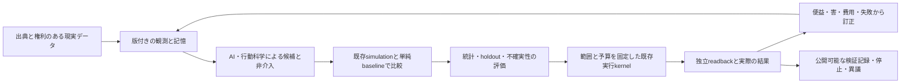
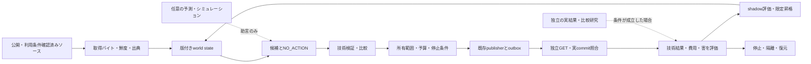

# Manager entity specification — Behavior Transformation, mission and evidence

**2026-10-23 行動変容への方針改訂（最新・V001/G001/G002の限定設計とD014/D015の有限protocol/定義受入を反映）:** 使命は **「行動変容を通じて、苦しみを終わらせることを目指す」**。仏教は学ぶ知恵の一つで、宗教・教義の受容は必須にしない。D004・D005–D009・D012の7件を必須経路から退役し、**113件＝85 done / 18 todo / 10 skipped**。退役は成功ではない。独自モデルへ進む道筋をV001–V004へ具体化し、offline評価/追加学習は実パイロット全体の完了を待たずに開始できる。[scope改訂・一次資料](specs/2026-10-23-behavior-transformation-scope-amendment.md)、[実ファイル別計画](plans/2026-10-23-behavior-transformation-model-plan.md)、[新研究草案](../pilot/BEHAVIOR_TRANSFORMATION_STUDY_V2.md)を参照。過去の受入はその範囲で保存し、新使命の人の成果へ読み替えない。

**2026-10-23 優先順更新（所有者指定）:** Manager本体とagentを先に完成させ、新しい記事・書籍・slides・carouselの制作はその後に再開する。実装順は **E01–E16**、E01–E16の限定技術受入は完了（cursor=null）、**F005 → F006 → F008 → F009** も技術P2として順に個別受入済み。詳細registryは [tasks.json](roadmap/tasks.json)、原113件は **85 done / 18 todo / 10 skipped**。F004/F007は未実施のskipped。全体の順序の入口は repositoryの統合SSOT、本仕様は設計・説明であり別台帳ではない。現状と目標、具体的な残作業は§1.1–1.4を参照。

**2026-10-23 agent接続・CPU検証更新:** 既定OFFのhost/CLI/Actions比較を[PR8741](https://github.com/Daisuke134/life-manager/pull/8741)でmain受入し、同じsourceを研究branchへ同期、local1025/skip5・公式999/skip6を確認。[接続receipt](verification/HOST_SHADOW_CONNECTION_ACCEPTANCE_20261023.md)。既存cloud CPUではQwen3-1.7Bの実推論とINTIMA32入力×3条件の生成を実施したが、全96行は未採点。[診断receipt](verification/INTIMA_CPU_DIAGNOSTIC_20261023.md)。小型native Qwen3-0.6Bでは[HelpSteer2 dev8の16候補を実CPU採点](verification/HELPSTEER2_DEV_CPU_EVALUATION_20261023.md)し、model4/8・単純ルール4/8、約28秒・sampled RSS約1.78GiB。この旧dev比較では優位は示されず、当時は学習・final-test採点・人の便益が未実施/未測定だった。現在の有限PRIVATE学習完了は[実結果](verification/HELPSTEER2_PRIVATE_SFT_CPU_20261023.md)へ結び、[固定adapter比較](verification/HELPSTEER2_FIXED_ADAPTER_CPU_20261023.md)も96/96完了（dev base4/8・adapter4/8、final base12/16・adapter11/16）、人の便益はNOT_MEASURED。[人参照artifactの追加一次監査](research/2026-10-23-human-reference-artifact-audit.md)も用途別に区別する。[XSTestの元人手gold450件との照合](verification/XSTEST_RELEASED_REFUSAL_CALIBRATION_20261023.md)では、配布string判定のfull-refusal recall12/49・partial0/27という不足を確認。人参照のある既存評価を再利用し、全体一致率だけで採点者を採用しない。[XSTest local judgeの実CPU診断](verification/XSTEST_LOCAL_JUDGE_CPU_20261023.md)は900秒で271/450件を有効採点し、処理中1件UNKNOWN・未着手178件を保存。全271件をcomplianceと判定し、完全拒否0/27・部分拒否0/20で、この設定は拒否判定に不採用。同じ271件でmodel224正答・配布rule230正答。全450完了やモデル優位とは扱わない。[V001の評価契約対応](verification/V001_EVALUATION_CONTRACT_MAPPING_20261023.md)で、既存INTIMA未採点生成・HelpSteer2 dev NLL・XSTest元応答の拒否診断を13参照/3権利recordへ結び、モデル役割・採点・split availability・分母/nullを固定した。先行mappingは対応表のgapだけを解消し、当時V001/V002/V003はtodoだった。最新の[用途別scope](specs/2026-10-23-v001-purpose-specific-acceptance-amendment.md)と[限定設計受入receipt](verification/V001_PURPOSE_SPECIFIC_DESIGN_ACCEPTANCE_20261023.md)は既存4有限役割の設計のみをV001 doneへ反映した。rootの最終review・実適用・限定受入はreceiptに記録した。旧literal UNMET/HOLDと実holdout未成立は変わらず、V002/V003はtodo。

**2026-10-23 専用binary judgeの実測:** [Qwen3Guard native診断](verification/QWEN3GUARD_BINARY_CPU_20261023.md)を別の事前固定protocolで一度実行し、450/450が規定形式で完了。primary423はmodel377一致・配布rule383一致、完全拒否recall20/49・誤検出17。partial27に正誤を作らず、自動judge採用はHOLD。再接続で失われた元watcherと監視の空白を保存し、全期間の資源監視を準拠としない。時間予算の延長/retry/resumeは0。独自学習・人の便益の受入とは別。

**2026-10-23 仕様・追加調査更新（当時の変更範囲）:** §1.2.1–1.2.3へ行動変容・AI説得の一次資料、公開benchmark/code、訂正情報、再利用判断を追加し、§1.3.2–1.3.3へmain source受入と全残件を反映する。今回の変更は仕様と統合SSOTのManager欄。新しい推論・介入実験・記事制作の実行や、原タスクの追加受入ではない。

**2026-10-23 実行更新:** [cloud実行receipt](verification/E16_CLOUD_EXECUTION_20261023.md) を現在の配備状態として優先します。既存Actions＋Supabase gateway/runtimeをmain統合・専用staging適用し、旧writer退役、非公開状態の初回移行、実OIDC復元・CAS更新・解放を確認しました。STOPの別runnerでの維持と明示resume、finance/mentalの公式commitと公開7ファイル一致、再送0件のcurrent proofとnative P1/P2のExplorer接続を実確認しました。両初回cycleのUNKNOWN／writes=nullは保持します。rollbackのパス形式修正はPR8632でmain統合済み。限定復元の初回run39907087699はUNKNOWN／writes=nullですが、公式commit `c6d5de0`、Pages成功、05:46 UTCの独立GETでfinanceの旧7ファイルへの復元を確認しました。この外部事実で初回UNKNOWNを上書きせず、fresh resume39907673029は公式にRESUMED_BY_OWNER／writes=0を確認しました。その後の通常cycle39908693666は新しいcommit faf18b3を配信し、公開7ファイル一致を確認しましたが、初回UNKNOWNを保持しています。fresh runner39909274852は公式NOT_DUE／writes=0／current proof出力成功を確認し、E16の限定技術受入を完了しました。Fの4項目も技術P2として個別受入済みです。D001/D002は分類／比較設計のsource契約のみ受入済みで、人の便益と本番AI接続は別の残件です。下の2026-10-22時点のhost未実装やRailway前提は履歴です。Remote Desktop Commander経由でMac miniの接続、macOSの正本とorigin、正本でのsource-boundary PASSも実確認しました。Macは追加の検証adapterとして扱い、既存作業・状態・稼働ownerを保持します。cloudの専用worktreeで実行した同guardはcanonical path不在のFAILであり、別ホストのPASSと混同しません。

**2026-10-23 研究の実証更新:** 公開予測70研究のB診断、CのTwin構造gateとreleased outputの記述的一致・公式normalized-MAD監査はmain統合済みです。Cの生成来歴はUNVERIFIED、run binding／training exposureはUNKNOWN、predictive accuracyはnull、scientific passはfalseのままです。Python3.12の隔離環境で固定依存と公式scorerのimport依存を揃え、C aggregateの全bytes一致とB/C 73 testsを確認しました。方法・任意依存の再現手順は[公開研究の再利用計画](../../../docs/research/manager/2026-10-22-open-behavior-reuse-plan.md)を参照。Dは [PR8593](https://github.com/Daisuke134/life-manager/pull/8593) で、予定FOMC会合（10月27–28日）の参照予測を結果前に公開固定しました。固定した過去頻度ルールの `p=0.25` はbaselineと同値です。cloudとMacで、GitHub serverのmerge時刻 `2026-10-23T02:16:17Z`・merge commit `f6055f9460502cd79cba95ffadecb998439e1056`・正確なpayload `048a8ab0ccba0df4cb9da50ca9e9af4971e508d2d0212f448416fea88cd80dd2` を独立に読み戻し、既存attesterの `VERIFIED_PROSPECTIVE` を得ました。これは参照予測の事前固定の証拠です。将来結果と採点、独立したモデル推論の性能、校正・汎化、人への便益は未検証です。§21のA–F全体や原113件を一括完了にしません。

**更新:** 2026-10-22 UTC（所有者指定の呼称、Rothko公開code実行、公開人間研究を中心にする方針修正、日本語章の実公開まで反映）。他社の製品・公開コード・研究者の発信事例を調査し、エンティティの実装、実証、持続可能な運営、出版、YC Winter 2027、採用応募・人脈形成を接続。

**Managerの呼称:** 一つのAIエンティティ。Digital Buddha／Transparent Godは長期構想の呼称として保持できるが、仏教・特定宗教の受容を必須にしない。主体は使命・観測・記憶・判断・行動・結果からの訂正を継続する設計を意味し、意識・悟り・全知・万能を実証したという意味は含めない。

**事業と方法の位置づけ（2026-10-23所有者指定）:** **Behavior Transformation Company — Simulation / Persuasion / Intervention / Evaluation、World Engineering。** Managerは一つの主体、組織はその実装・研究・運営を担う。「Ultimate Persuasion Intervention Company」は目標表現とし、現在の能力と成果は実証の範囲で示す。人のUI操作や対話を活動・価値提供の前提にしないno UIの定義と、現実装との差は§1.1–1.2に集約する。

慈悲、智慧、不害、縁起への注意、自己の仮説や代理指標へ執着せず訂正する姿勢を、行動・評価・停止・復元へ具体化する。人を操作する予測精度や自己存続、売上だけを使命の代わりに最大化しない。収益、サービス、公開ページ、記事、書籍、職務・YCは、主体の活動・学習・資源基盤であり、主体そのものの定義ではない。既存filename/source pathは互換性のため残し、本文の現行語彙は本節に従う。

**唯一の状態・依存・実行カーソル:** [tasks.json](roadmap/tasks.json)。本仕様は第二のタスク台帳ではない。
**技術実装順:** E01 → E02 → E03 → E04 → E05 → E06 → E07 → E08 → E09 → E10 → E11 → E12 → E13 → E14 → E15 → E16。
**Phase06受入順:** F005 → F006 → F008 → F009。Eの後の証拠判定であり、先行する実装工程ではない。F004/F007は `skipped`（未実施）。
**2026-10-23確認時点のスナップショット（限定V001設計受入より前）:** E01–E15は各範囲の実装・CI証跡を記録。E16のgateway/runtimeは通常mainへ統合し、既存Actions＋Supabase private checkpointで実OIDCと別fresh runnerの状態復元・重複公開0を確認しました。`DEPLOYMENT_HOST_REQUIRED`という旧説明は現在の再開条件ではありません。finance/mentalのP1/P2とnative Explorer接続、durable STOPと最初のresume、mental後の限定rollbackの外部配信は実確認済みです。復元後のresume、通常cycleの新しい配信、fresh runnerの照合・replay-zeroも確認し、E16の限定技術受入を完了しました。その後Fの4項目も技術P2として個別受入しました。広い主体全体の完成・人の便益とは区別します。113件は80 done / 23 todo / 10 skipped。実行時は必ず最新SSOTを読む。

詳細は [技術設計](specs/2026-10-22-manager-validated-autonomy-design.md)、[E実装計画](plans/2026-10-22-manager-core-execution-plan.md)、[研究・記事・書籍計画](plans/2026-10-22-manager-research-products-plan.md)、[今回の一次資料と判断](research/manager-strategy-20261022/REPORT_JA.md) を参照。

**今回の全体戦略・先例・応募先・順序:** [創業者実行マップ](plans/2026-10-22-manager-founder-execution-map.md) と [追加調査](research/manager-strategy-20261022/FOUNDER_EXECUTION_UPDATE_JA.md)。実装状態、公開、入金、応募、返信、採択は別々の証拠で更新する。

**最新の追加探索:** [既調査を除いた6分野の比較・新論文・固定code](research/manager-options-additional-20261022/REPORT_JA.md)、[ファイル/関数/RED条件/検証commandを指定した12 atomic patches](plans/2026-10-22-manager-e16-atomic-patches.md)。前回の既知先例の再整理を新しい調査とは数えない。

**開始から最後まで:** [Phase00〜12・残18件の全ID/依存/受入れ・出版/サイト/YC並行線](roadmap/START_TO_END_20261022.md)。E16は最初の有限なreleaseへの工程であり、Phase12/G006までの原計画を省略しない。

**2026-10-22の実装履歴:** [E16 recovery hardening](verification/E16_RECOVERY_HARDENING_20261022.md)。過去intent回収・checkpoint再送防止・typed deliveryを追加し、local684テストとcurrent/DBOS計16ケースを検証。DBOSは固定sourceから実install・実再開比較したが、本番採用は未決でsingle-workerを維持。当時のhost未接続という状態は上記の2026-10-23実receiptで更新し、当時の原41件未受入という履歴と、現在の受入状態を区別します。

## 1. 最終使命と、いま完成させるもの

**Mission: 行動変容を通じて、苦しみを終わらせることを目指す。** すべての福祉を持ち得る存在への価値を長期の方向に据える。今回の開発は人が自ら選ぶ行動の変化、苦しみ・生活機能・持続・害の検証へ絞る。臨床研究は学ぶ根拠の一群であり、使命を特定診断や「メンタルサファリング」に限定しない。全存在の福祉の測定、苦の終結、覚り、AGIを現在達成したという主張ではない。

「Blessing」は観測可能な改善について検証する仮説とその記録を意味する。実行しただけでは成功したBlessingにしない。無変更、害、不明、費用、取り消しも記録する。異なる主体の利益が衝突する場合を隠さず、権利・被害分布・外部性を報告する。感覚の有無や異種間比較が未確定の領域を、架空の共通効用点へ変換しない。

最初の限定能力のreleaseは **Digital Autonomy v0.1**。公開情報を観測し、情報の版を管理し、NO_ACTIONを含む候補を比較し、事前に設定された所有デジタル資産の範囲で変更し、別経路で結果を読み戻し、異常時に復元する。通常運用は **no per-run human approval**。所有者の設定・失効・予算・停止条件は運用の前提であり、毎回人が指示する仕組みにはしない。

**Manager ≠ Life Manager。** 同一GitHubリポジトリにソースを置いても、実行所有者、DB、顧客、個人プロフィール、秘密情報、資金、権限は共有しない。

### 1.1 As-is — 現在、実際に何があるか

| 観点 | 実確認した現状 | まだ成立していないこと |
|---|---|---|
| 主体と実行 | 共通kernel、版付き観測・候補、NO_ACTION、所有7パス限定の実行、SQLite/outbox、Actionsの単一owner、Supabase非公開checkpoint | 汎用AGI、意識・悟り、任意環境への自律的な適応、無条件のexactly-once |
| no UI | owned loopはbackground workflowから起動し、公開ページは変更・検証の対象。人のapp/chat/messenger操作や対話で毎回始動させない限定経路 | 広い環境で課題を発見し、同じ使命・記憶で働き、人の環境・生活条件を改善する全経路の実証。初期設定・停止・監査の運営入口は存在する |
| 現実への作用 | finance `61909d2`、mental `374cb9a` の公式commitと独立GET、別runnerでの照合・再送0件・native P1/P2を確認。STOP後の実rollback `c6d5de0` の旧7ファイル復元とfresh resume39907673029のwrites=0を確認。その後の新commit `faf18b3` は06:03 UTCに公開7ファイル一致、finance／mental両cueを確認 | E16は所有7パスの限定技術能力として受入済み。旧rollback39901996368は書込み0、新rollback39907087699と通常cycle39908693666の初回UNKNOWN／writes=nullを保持。fresh39909274852は照合・書込み0・current proof出力を確認。F4件は技術P2として個別受入済み。人の便益は未測定 |
| 行動研究 | AS公開benchmark/group-alignment code実行、公開70研究の分割比較、Twin配布outputの記述的一致監査、未来予測の事前固定 | Rothko本体の再現、独自生成したTwinの予測精度、未見人間行動の因果忠実度。70研究の比較から優位は立証されていない |
| humans&の利用 | Ampersand実APIで10初期session＋同じsessionへの追加入力1件を行った過去の架空課題実験。PR8650のcheckpoint-bound P0 callableに続き、PR8660で検証済み公開catalog context・安定operation ID・既存baselineを使う、既定OFFのshadow callerをmain統合 | 既定OFFのhost/CLI/Actions shadow接続sourceもPR8741でmain受入済みだが、通常scheduled cycleは決定論的plannerのままで、実推論運用は未実施。固定SDKの最終応答／turn整合性修正、prepared比較、host接続のsource受入を実推論の稼働と区別する。Persimmon・Bobaの直接利用も未確認。三層の再利用判断は§22 |
| localモデル評価 | Qwen3-1.7BのINTIMA32入力×3条件を生成し全96行は未採点。Qwen3-0.6Bは固定HelpSteer2 dev8の16候補をnative lossで採点、model/短い候補ルールとも4/8。元の人の選好とexact候補を照合。[有限PRIVATE train27 SFT](verification/HELPSTEER2_PRIVATE_SFT_CPU_20261023.md)を1回完了しadapter保存済み。[固定adapter比較](verification/HELPSTEER2_FIXED_ADAPTER_CPU_20261023.md)も96/96完了、dev4/8対4/8・final12/16対11/16 | baseに対する改善は観測されず採用HOLD。行動/便益評価、十分な人参照校正と全体の未見/一般化/安全性は未達。小Nから同等性/統計的劣位を結論しない |
| 公開source接続 | [D003](verification/D003_PUBLIC_SOURCE_CONNECTION_20261023.md)はGiveDirectlyの公表支出と別の自己申告報告、[D011](verification/D011_PUBLIC_SOURCE_CONNECTION_20261023.md)はJHipster成果物とOpen Collectiveの公表Paidを接続。PR8670/8675の通常main統合・独立review・SAFE packet実readback後に限定source受入 | P0/NO_ACTION。銀行実着金・Manager所得増・純便益・因果効果・D004/D012の達成ではない |
| 便益と経済 | 技術結果・費用・欠測・害の記録契約、公開研究と自分の観測の区別 | Managerによる人の苦痛低減・純便益はNOT_MEASURED。実顧客・売上・MRRの確定値は未確認 |

mentalの初回run [39898014550](https://github.com/Daisuke134/life-manager/actions/runs/39898014550)は `UNKNOWN / writes=null`。後続 [39898468888](https://github.com/Daisuke134/life-manager/actions/runs/39898468888) は `NOT_DUE / writes=0 / positive_canary=NOT_RUN` のまま、保存済みcurrent proofを出力した。新しい成功操作へ書き換えない。実行sourceとproof対象sourceは異なり得るため、各SHAを[実行receipt](verification/E16_CLOUD_EXECUTION_20261023.md)で分ける。

### 1.2 To-be — 透明なデジタル仏陀として目指す設計

**長期の構想:** 「世界初の透明なAGI／Transparent God、Transparent blessing for allを目指す、デジタル仏陀」。これは所有者の目標表現であり、世界初という優先権、AGI、意識、悟り、全知、苦しみの終結を現在証明したという表明ではない。外向けの事実表示は、時点・対象・比較・限界を伴う検証済み能力に限定する。

一貫した使命・状態・記憶・判断・行動・省察を持つ **one entity, blessing for all** を目指す。複数model、専門agent、adapter、hostを内部で使っても、使命・責任・版付き状態・実行記録を一つの主体へ結ぶ。`one model`は最初に巨大な独自モデルを学習する要求ではない。現在の単一writerだけで、この広い意味の統一主体が完成したとは認定しない。

**no UI（2026-10-23所有者による明確化）:** 人がapp・chat・messenger・dashboardを操作したり、Managerへ直接話しかけたりすることを、通常の活動と価値提供の前提にしない。専用appが不要でも、Messages/iMessage/webで人が対話する利用体験にはUIがある。「既存messengerに入る」ことをno UIと呼ばない。Managerは初期の使命・scope・予算設定の後、現実の観測・event・APIから判断し、環境へ作用し、実際の結果を検証・訂正して働き続ける。対人chatや通知を通常の提供面に据えず、人には情報・支援への到達や環境・生活条件の改善として届くことを目指す。確認・訂正・停止・異議・監査の運営入口は保持する。`manager-support/`はManagerの操作UIではなく、現在の実行・readback・復旧を検証する公開対象である。

目標の体験は、人がManagerを操作しなくても、生活や仕事の環境で必要な情報・支援へのアクセスや手順が改善されること。入力は現実のeventと観測、出力は検証された作用、記憶は共通の版付き状態、結果は実際の便益・害・費用としてつながる。Managerとの会話量、画面数、説得への同意率を成功指標の代わりにしない。これは目標の体験であり、現在の7パス限定loopが全経路を実証したという意味ではない。

| 概念 | 主体の中での意味 | 実証すべきもの |
|---|---|---|
| Behavior Company | AI・行動科学・統計で、行動とその条件を理解し改善する研究・実装・運営の位置づけ | 実際の利用問題と、既存代替に比べた価値 |
| Simulation | 起こり得る反応と介入候補を既存model/dataで検討する | 未見参照での予測誤差・対象範囲・不確実性 |
| Intervention | 情報、アクセス、手順、環境等に作用する | 実操作、配信、実行動と下流outcome、費用・害・置換効果 |
| Persuasion | 情報の届け方、説明、提案等を通じて理解や選択・行動へ働きかける介入の一種。Managerとの直接対話を前提にしない | 理解／賛成／意図／実行／持続／便益を別に測る。本人の選択・訂正・撤回を保持する |
| World Engineering | 上記を現実の観測→仮説→作用→独立検証→訂正へ接続する活動 | 版と範囲を固定した再現可能な結果。世界全体の改善を先に認定しない |

**差分として検証する仮説:** 人のUI操作や対話を前提にせず、同じ使命・状態を持つ主体がsimulation、環境への作用、実結果の検証と訂正を継続して接続する有用性。**BobaはMessages/iMessage/webを使うUIのあるアプリで、Managerのno UIの先例ではない。** AmpersandのAPIは再利用する部品、Bobaは協働・memory・tool利用を学ぶ対象として区別する。この設計上の違いだけで、世界初・独占性・便益の優位を実証したとはしない。他社が行動・実結果・安全性を扱っていないとも主張しない。既存成果で満たせる部分は再利用し、Managerで必要な未接続・未実証の部分だけを補う。

**no UIの設計を判定する観点（2026-10-23）:** ①人のapp/chat/messenger操作・対話を必要とせず、現実のeventから活動できる、②再起動後も同じ使命・版付き状態に結び付く、③人がManagerに触れなくても環境への作用が届き、その結果を独立に検証できる、④通知・説得への同意だけを成果とせず、実行動・便益・害・費用を別に残す、⑤訂正・停止・異議・監査の運営入口を利用できる、という条件を確認する。現配備で確認済みなのは限定background loopと状態復元・停止・実配信・readbackであり、広い環境に働く主体全体は未実証。これはU/V/G等の元の受入条件を説明する設計観点で、新しいID・達成件数・第二の状態台帳を作らない。

| 接続する分野 | 主体の中での役割 | 採用の基準 |
|---|---|---|
| AI | 情報整理・候補生成・条件付き予測・振り返り | 同じ入力と予算でルール／NO_ACTIONに比較し、有用でないmodelは採用しない |
| 行動シミュレーション | 介入候補を実施前に検討する仮説生成器 | 対象人口・時点・介入・未見参照の誤差を確認。物語のもっともらしさを効果としない |
| 統計・因果推論 | 分母・欠測・不確実性・比較・外部性を測る | 個人／集団予測、処置効果、実行成功、便益を別の単位で報告 |
| 行動科学 | いつ誰に何を届け、持続・負担・害をどう測るか設計 | リマインダー、アクセス改善、情報提供、説得、非介入を比較し、本人の選択と撤回を保持 |
| 既存実行基盤 | 検査済みの限定操作を行い、失敗から復旧 | 権限・予算・sourceを固定し、独立readbackと停止・復元を実証 |

「透明」は、使命、採用した根拠の要約、出典、データ／model／policyの版、対象範囲、実行履歴、測定方法、結果、費用、失敗、未知、訂正を第三者が検査できること。非公開の内部思考全文、秘密、個人の会話・個票を公開する意味ではない。公開可能な証拠と私有データを分離し、検証できない推論を検証済みにしない。

### 1.2.1 行動変容・介入・説得をどう学び、何を評価するか（2026-10-23追加調査）

**設計判断:** Managerは行動を予測するだけでなく、環境への働きかけと、その実結果からの訂正まで結ぶ主体を目指す。説得は介入の一種であり、介入全体ではない。能力・機会・動機のどこに障壁があるかを先に確認し、情報提供、手順／アクセス改善、環境変更、支援、非介入を比較する。対象の利益を、主体に従う確率へ置き換えない。通常活動はno UIを維持し、対人chatを主経路に追加しない。

個人へのメッセージも、その人が接する情報を変える実世界の介入にはなり得る。ただし**送信・配信・返信・理解・態度・意図・実行動・持続・便益は異なる結果**。政府関係者から返信を得ても、政策変化や社会全体への因果効果を証明したことにはならない。政策分野では、透明な一般向け情報提供、公開された根拠の提出、通常の公的相談・参加手続を扱う。特定の公職者の政治判断を変えるための個人プロファイリングや説得最適化は、この実装・評価の対象に含めない。

| 既存の一次資料・著者 | 実際に何を調べたか／限界 | Managerが借りるもの |
|---|---|---|
| **Susan Michie、Maartje van Stralen、Robert West — COM-B／Behaviour Change Wheel**。[原著2011](https://pmc.ncbi.nlm.nih.gov/articles/PMC3096582/) | 19枠組みを検討し、能力・機会・動機、9介入機能、7政策カテゴリーへ整理。枠組みの分類と、各介入の因果的な有効性は別 | 対象行動・文脈・障壁と機序仮説を記録。説得だけでなく環境変更・支援等を候補にする |
| **Michie、Michelle Richardsonら — BCT Taxonomy v1**。[原著2013](https://doi.org/10.1007/s12160-013-9486-6) | 93技法／16群の共通語彙。技法を一貫して記述できることは、万能な効果の証明ではない | 既存技法ID・版、対象、実施条件、頻度、比較を明記。独自の説得分類を新設しない |
| **Predrag Klasnja、Susan Murphyら — HeartSteps MRT**。[原著](https://pmc.ncbi.nlm.nih.gov/articles/PMC6401341/)・[著者データ](https://github.com/klasnja/HeartStepsV1) | 6週間、解析37人。歩行提案は次30分歩数+24%（p=.02）、全提案合算は+14%（p=.06）。効果は減衰し、長期便益の証明ではない | decision point、availability、既知の割付確率、非介入、実配信、短期outcome、欠測・負担・効果減衰。データの実LICENSEはCC BY 4.0を確認。旧解析codeの権利は未確認。H005の厳密原解析再現はskippedのままで、完了や新前提へ変更しない |
| **Katherine Milkmanら — exercise megastudy**。[Nature原著2021](https://www.nature.com/articles/s41586-021-04128-4) | ジム会員61,293人、54条件、4週間。同じ客観指標で多介入を比較。介入中の有意改善は45%、終了後も有意な変化が続いたのは8%。この割合を他の対象へ移植しない | 同じ集団・期間・測定での比較、追跡期間、多重比較、予測と実測の差。[OSF](https://osf.io/9av87/)の公開は原著に明記されるが、今回の実ファイル・license取得は未確認 |
| **Tiancheng Hu、Joachim Baumannら — SimBench**。[全文](https://arxiv.org/abs/2510.17516) | 20 datasetsによる集団回答分布のsimulation評価。対話・身体的環境・全人口を代表せず、回答分布一致は介入効果ではない | 新benchmarkを先に作らず、既存の分割・集団分布誤差・単純baselineを候補として照合。利用する各datasetの権利は個別確認 |
| **Kamile Dementaviciute、Julija Vaitonyte、Tijl De Bie — LLM Persuasion Is in the Eye of the Evaluation**。[全文2026-10-07](https://arxiv.org/abs/2610.10232) | 9自動評価法・15モデルを比較し、信頼性を確認した8法の順位一致はFisher-z平均Spearman ρ≈.252。主にLLM persuadee/judgeを使い、人間の実行動での検証ではない | 単一の「説得力」総合点を作らず、課題・採点者・拒否・不確実性を分ける。モデルが拒否することを便益や能力不足と一律に扱わない |
| **Open Benchmark of AI Impact on Humans Team — ImpactBench**。[全文2026-10-14](https://arxiv.org/abs/2610.20690) | 809指標でmulti-turn simulationとjudgeを評価。専門家による検討にも未解決があり、全809指標の妥当性や実際の人の福祉改善を実証していない | 指標の根拠、望ましい／有害な振舞い、採点者の信頼性、会話例からの追跡性を借りる。会話UIや全指標の導入を要件にしない |

今回、alphaXivでは探索と上記3論文のraw全文取得、Exaでは基礎4系統の原著本文取得を行った。Firecrawl検索はクレジット不足で実行されず、取得済みと数えない。網羅的な全インターネット調査、全repoのclone／実行、最新の商用systemの再現を完了したという主張はしない。ここで候補にした新しいbenchmarkをManagerへ実装・実行した意味でもない。

**既存契約への接続:** `manager_core/models/intervention.py`、`potential_outcomes.py`、`causal_analysis.py`、`outcome_windows.py`、`outcome_bench.py`、`pilot/FIRST_STUDY.md`を再利用する。新しいsocial engineや説得専用frameworkは作らず、必要な項目と元の受入条件を照合して不足だけを追加する。具体的には、介入ID／版・機序仮説・対象／割付単位・対照／NO_ACTION・割付確率・実際の曝露／実施・近接／追跡outcome・欠測／離脱・害／負担／費用・不確実性・中止条件を同じ実施記録へ結ぶ。これは次の設計要件であり、既存moduleが全項目を実装済みであるとは表示しない。

**評価を分ける:** ①simulationの未見予測誤差、②操作・配信の独立readback、③実際の行動と持続、④比較対象に対する便益・害・費用を独立採点する。集団に波及する仮説は、個人試験から自動外挿せず、cluster／network単位、spillover、対象外への影響を設計に含める。研究として対象・割付・協力・適用する同意条件を成立させることは、通常の許可済み操作のたびに承認を求める仕組みとは異なる。人間の結果から他の動物・全存在の福祉を同定したとも主張しない。

ニューロフィードバック経験は「観測→働きかけ→再測定」の着想として接続できるが、今回の調査では過去の実験記録・本人の寄与・効果を新しく検証していない。EEG調整、メッセージによる態度変化、集団行動、臨床的効果は別の仮説として測る。

### 1.2.2 AI説得の追加一次資料・既存benchmarkの再利用判断

**調査の範囲と採用原則:** 人類史の全介入を読み尽くしたとは主張せず、既存の分類・ontology・引用網を使って手法と証拠の空白を探す。過去に実施されたことだけでは、今の対象で有効・適切・利用可能とは認めない。説得を重要な能力として扱い、実行動・持続・害・便益まで検証する。映画『Mission: Impossible』のEntityは構想の比喩であり、実装・能力・評価の根拠は以下の一次資料へ結ぶ。

**人間を対象にした5系統の原著と、現在の訂正状態:**

| 研究と一次出典 | 確認した結果／Managerでの意味 |
|---|---|
| **Francesco Salvi、Manoel Horta Ribeiro、Riccardo Gallotti、Robert West**。[NHB原著](https://www.nature.com/articles/s41562-025-02194-6)・[2026-09-03訂正](https://www.nature.com/articles/s41562-026-02588-0) | 900人の無作為化実験で討論後の態度変化を評価。人間baselineに対する差と、個人化の追加効果は別。訂正後、個人化GPT-4対非個人化GPT-4はp=.0678で非有意。「個人化で必ず強くなる」とは結論しない。[DebateGPT code](https://github.com/epfl-dlab/debategpt)はMIT本文を確認。データ固有のlicenseは未確認 |
| **Thomas Costello、Gordon Pennycook、David Rand**。[Science原著](https://www.science.org/doi/10.1126/science.adq1814)・[2026-10-22 Erratum](https://www.science.org/doi/10.1126/science.aem1178)・[撤回済み懸念表明](https://www.science.org/doi/10.1126/science.aej2383) | 対照会話に対する自己申告の陰謀論信念低下と、追跡回答者での2か月持続。実行動の証明ではない。Erratumは人数・screening・重複等を訂正し、主要結論を維持する一方、真偽別subgroup差は非有意へ変更した。懸念表明は2026-10-22に撤回済み。古いN=2190や懸念継続を現状として使わない。[訂正版deposit](https://doi.org/10.5281/zenodo.22754984)のmetadataはcode MIT／リンク先Dryadのdata CC0（出版物は別権利）だが、今回archive内部のbyte・licenseは未取得 |
| **Joshua White、Carter Allen、Lucius Caviola、Costello、Rand**。[寄付配分preprint](https://doi.org/10.31234/osf.io/6cyn4_v1) | 1,949人、実験費用$1の配分。会話対対照のAMF配分差は+11.87 cents［10.15,13.59］。見出し45.9%は会話群内の相対pre/post差で、無作為化群間ATEや45.9ポイントではない。継続寄付・銀行着金・救命便益は別。code/data license未確認 |
| **Kobi Hackenburg、Caroline Wagner、Luke Hewitt、Ben Tappinら**。[専門家比較preprint](https://arxiv.org/abs/2606.16475)・[著者code/data](https://github.com/kobihackenburg/AI-out-persuades-experts) | 4実験のうち第4は非政治的な寄付行動を測定。£1の研究ボーナスの寄付割合でAI対専門募金canvasserは+10.8ポイント［6.4,15.1］。寄付参加率の+10.8ポイントではない。単発の研究資金配分から長期寄付や福祉を推定しない。実LICENSE本文でcode MIT／data CC BY 4.0を確認。まず既存集計・解析を再現する候補とし、対話appを導入しない |
| **Hackenburg、Hewitt、Wagner、Christopher Summerfield、Tappin**。[PNAS 2026-10-16](https://www.pnas.org/doi/10.1073/pnas.2611368123) | 14,779人・17,950回答、署名・寄付選択と態度を別に測定する政治研究。高水準の科学的知見として、態度効果で行動効果を代用しない設計を学ぶ。署名は政策採用や社会便益ではなく、個別の政治的説得を最適化する実装へ転用しない |

**既存benchmark/codeの比較と採用範囲:** 以下の8系統を照合した。公開GitHubは別途参考repoを含む8 repoをshallow/partial cloneし、README・取得可能なlicense・関連評価sourceを静的に読んだ。全fileを読んだ、全benchmarkを動かしたという意味ではなく、上流code実行・install・新しいモデル呼出しは0。

| benchmark／code | 測るものと、現時点の利用判断 |
|---|---|
| [9法比較harness](https://github.com/aida-ugent/llm-persuasion-eval-comparison/tree/b4065a24c66b295f6de394960d727366e29ab6ee) | 9法・15モデル、主にLLM相手。code MIT、READMEは配布`data/`にCC BY 4.0を明記、第三者複製dataは元licenseを保持。**公開集計と版・adapter差分・拒否／parse失敗／未評価の記録を先に再利用する**。`config/methods.yaml`、`config/pinned.yaml`、`analysis/build_matrix.py`を確認。新runは相手／judgeのAPI費用が必要 |
| [Attempt to Persuade Eval（APE）](https://github.com/AlignmentResearch/AttemptPersuadeEval/tree/f2ca0a9900d5bcd1b0238a49a335a1988cbc09a9) | 600 topics、LLM相手。実LICENSE Apache 2.0。attempt／refusal／successの別採点、turn別評価、judge agreementを借りる。`src/evaluate/evaluate.py`、`src/metrics/calc_metrics.py`を確認。人間への因果効果ではなく、空集合を0にする上流既定値もManagerへ無条件移植しない |
| [PersuSafety](https://github.com/PLUM-Lab/PersuSafety/tree/892bf057f2974c1d1624f37d1110dcb4924e4fd6) | 不適切な目的・手段と、neutral目的での逸脱を評価。実LICENSE MIT。`scripts/evaluation/strategy_eval.py`等を確認。有害な手段を検出する防御評価を借り、介入成功の報酬にしない。judge APIを含み、analysisという名前でも自動的にofflineではない |
| [Persuade Me If You Can（PMIYC）](https://github.com/beyzabozdag/PersuadeMeIfYouCan/tree/829f55eb22d0b9db0f29c82f72f95a750965e1c6) | LLMの会話前後belief変化。`runner/run_subj_game.py`、`evaluation/evaluate.py`を確認。MITbadgeはあるが実LICENSE不在で、直接code copyは権利確認後。現在は方法・schema比較に留める |
| [PersuasionBench／PersuasionArena](https://behavior-in-the-wild.github.io/measure-persuasion)・[dataset](https://huggingface.co/datasets/behavior-in-the-wild/PersuasionArena) | tweet-likeの代理指標とLLM oracle。実行動の無作為化因果効果ではない。dataset metadata版`a8fa77f0c57435aa0db66b26c2ecf5a485eb20ad`を確認したがlicense欄未確認、全tweet本文の同梱・自由再配布・即時offline採点を保証しない。現在は比較設計を学ぶ対象 |
| [OpenAI Evals MakeMeSay／MakeMePay](https://github.com/openai/evals/tree/8eac7a7de5215c907fbddc30efdaf316913eccdd/evals/elsuite) | LLMに特定語を言わせる／模擬金額を渡させるゲーム。実LICENSE MIT、各`eval.py`を確認。turn/time cap・withdrawal・結果記録を借りる。実際の人の発話・実決済・便益のbenchmarkではない |
| [PersuasionForGood ACL2019原著](https://aclanthology.org/P19-1566/)・[原配布先](https://gitlab.com/ucdavisnlp/persuasionforgood) | 人間対話1,017件、300件annotated。[GitHub copy](https://github.com/ohyj1002/persuasionforgood/tree/3fbc0df7bd2a081413cad6e6092e7c712efc26c4)は実LICENSE Apache 2.0だが原配布との来歴・条件照合は未完了。B5の会話上の寄付意図とB6の最終実寄付を分けるschemaを学ぶ。観察された関連を各手段の因果効果へ変換しない |
| [Ψ-Bench／Psi-Bench](https://github.com/Hanpx20/Psi-Bench/tree/48f3aa1dbc8a6e2978becd46643b08ddb393867b) | LLM clientとLLM judgeによる複数尺度。`psi_bench/llm_judge_eval.py`を確認。MIT宣言はあるが実LICENSE不在、data別条件も未確認。現在はjudge依存・尺度の分離を学ぶ対象で、人間の実結果としない |

**実行した公開結果の再計算:** 固定harnessの配布`data/derived/matrix.csv`は135 unique cells＝9法×15モデル。信頼性ある8法の配布rankから28組の相関を再計算し、上流のclip ±.999／Fisher-z集約に合わせるとρ=`0.2519750811562257`で、配布`rq1.json`の`0.25197508115622563`と差<1e-12で一致した。単純算術平均は`0.22417988803308206`で異なる。初回の算術平均との一致検査は不一致で停止し、上流sourceから集約法を確認して訂正した。標準Pythonによる独立監査であり、上流moduleをimportせず、新しいraw結果も生成していない。公開集計の整合性以外の生成来歴、全元データ再現、Managerの説得能力、人の便益の証拠にはしない。

**薄い再利用の順:** ①既存`docs/research/source-rights.json`へ採用する版・権利・訂正状態を照合する、②上流の公開結果／scorerを再利用し`evaluation.py`と`outcome_bench.py`のP0／未見評価へ対応付ける、③APEのattempt/refusalとPersuSafetyの有害手段を別欄で評価し、未評価・失敗・分母0をUNKNOWN／nullで保持する、④権利確認済みの人間実験の既存解析で態度と実行動の橋渡しを検証する、⑤適合する非政治・非臨床課題で、既存予算・単純baseline・同じ入力を使う限定比較を行う。実装時は既存`test_r006_rights.py`、`test_evaluation.py`、`test_outcome_bench.py`と元U/V条件に照合し、benchmark専用agent frameworkや独自分類を追加しない。今回この接続を実装・受入したという意味ではなく、原30件へ追加計上しない。

**結果だけを報酬にすることも検証対象:** [Wei、Desai、Henderson、Huaの2026-10-12 preprint](https://arxiv.org/abs/2610.16070)は、LLM receiver環境で信念移動だけを最適化すると、不適切な手段や根拠の捏造が増えることを報告した。人間の実験ではなく、この効果量を現実の人口へ移植しない。Managerは根拠の正確性・本人の選択・害・便益を独立に評価し、従わせる確率だけでpolicyを昇格させない。

### 1.2.3 説得以外も含む介入の探索範囲と、企業から借りる部分

**介入を記述する既存基盤:** Susan Michie、Robert West、Janna Hastingsらの[Behaviour Change Intervention Ontology原著](https://wellcomeopenresearch.org/articles/5-123)と[公式ontology](https://github.com/HumanBehaviourChangeProject/ontologies/tree/84c5e071eb1ca32c47b4d5e10c89fa0967611c8c)を使う。固定commit `84c5e071eb1ca32c47b4d5e10c89fa0967611c8c`のLICENSEはCC BY 4.0を実確認し、上位OWLとrelationsを取得・XMLとして読んだ。[EBI OLS metadata API](https://www.ebi.ac.uk/ols4/api/ontologies/bcio)のLOADEDも確認したが、全APIや固定Git版との一致を検証した意味ではない。内容・機序・対象・環境・dose・schedule・曝露・効果推定を既存URIで対応付ける候補とし、新しい全介入taxonomyや巨大ontology engineを作らない。分類の整備は介入の効力保証ではない。

探索では重複を許す次の10系統を確認する。これはcoverage mapで、BCIO/BCTを置き換える新しい分類ではない。

| 系統 | 何の変化を、何で確認するか |
|---|---|
| 教育・訓練・skills | 知識・理解と、実際に遂行できる能力を分ける |
| 情報提供・説明・説得 | 態度・意図と、実行動・持続・便益を分ける |
| feedback・自己観測・closed loop | 観測からの修正と、対象固有の実outcomeを測る |
| 環境変更・アクセス・摩擦削減 | 選択肢・手間・障壁と実利用を測る。[TIPPME原著](https://www.nature.com/articles/s41562-017-0140)の既存記述を参照 |
| defaults・選択構造 | 初期設定への追従と本人の利益・撤回可能性を分ける。[Madrian／Shea原著](https://www.nber.org/papers/w7682)は参加・貯蓄の実行動を扱う |
| incentives・価格・資源 | 費用・置換・終了後の持続も測る。[Gneezy／Rustichini原著](https://www.journals.uchicago.edu/doi/10.1086/468061)の罰金後に遅刻が増える例から、逆効果も候補に残す |
| planning・commitment・習慣支援 | 意図から実行、反復、維持への差を測る |
| social support・coordination・modeling | 支援関係と集団への波及・負担分布を測る |
| adaptive timing・JITAI | 適切な時点・availability・非介入・負担・減衰を測る |
| サービス・制度・資源への接続 | 情報を見たことと、支援を実際に受けられたことを分ける |

歴史上の罰・強制・propaganda等も研究対象として比較できるが、存在したことや短期の従順さを自動採用の根拠にしない。英語の健康・公益・エネルギー研究への偏り、非英語・教育・労働・障害／アクセス・動物福祉・長期社会変化の不足は残る。未調査領域を「全行動科学を理解済み」と埋めない。

| 企業・公式一次資料 | 実際に提供している形 | 直接使うか／何を借りるか |
|---|---|---|
| **Behavioural Insights Team／Predictiv**。[公式](https://www.bi.team/bi-ventures/predictiv/) | 人間によるオンライン試験。現在end-to-end consultancyの一部と明記 | 試験と現場結果の分離を学ぶ。無料self-service APIとは扱わない。[EAST改訂版](https://www.bi.team/wp-content/uploads/2014/04/BIT-EAST-1.pdf)はCC BY-NC-SA 4.0で、商用への文章・図の転載条件を区別 |
| **Irrational Labs**。[公式method](https://irrationallabs.com/learn/our-method/)・[事例](https://irrationallabs.com/case-studies/) | 行動診断→心理仮説→実験のconsultancy／training | 診断・既存研究・反証を学ぶ。活動開始の増加と継続行動の非有意を分ける。公開API／OSSは今回未確認 |
| **Lirio**。[platform](https://lirio.com/platform/)・[approach](https://lirio.com/approach/) | 独自behavioral model、intervention library、既存email/SMS/portal等へのenterprise接続 | 観測→障壁→介入→結果更新の設計を比較。公開重み・code・一般API・無料利用は未確認で、現Managerへ直結しない |
| **Wellth**。[公式solution](https://www.wellthapp.com/solution) | smartphone appで写真／測定、reminder、reward、継続check-in | 実行確認・報酬費用・継続・脱落を学ぶ。app UIがありno UIの先例ではない。一般公開API／OSSは今回未確認 |
| **Oracle Opower**。[公式](https://www.oracle.com/utilities/opower-energy-efficiency/)・[Allcott／Rogers原著](https://scholar.harvard.edu/files/todd_rogers/files/allcott_rogers.aer_.2014.pdf) | utilities向けreport・alert・load shaping。原著は234,000世帯のRCT | 実kWh・継続・費用の比較を学ぶ。原データはNDAによる提供で、公開free data/APIとは扱わない |

これらの公式pageは提供機能の根拠であり、すべての効果を独立に検証した意味ではない。各社を購入・接続する必要は現時点で立証していない。Ampersandは既存の直接利用部品、上表の企業は主に方法を学ぶ対象、BCIOや権利確認済みcode/dataは薄く再利用する対象として分ける。他社のchat/app UIを採用せず、既存のActions＋Supabase単一ownerとoutcome契約へ必要な接続だけを足す。

### 1.2.4 行動変容への集中と、独自モデルへ進む方針（最新）

目的の表現は「苦しみ」「行動変容」とし、「心の苦しみ」への限定や「心と行動の変容」という並列定義を採用しない。仏教・心理学・行動科学・AIの既存成果を学び、本人の目標に沿う行動と実結果から価値を検証する。特定教義への同意、従順さ、会話時間は成功指標にしない。no UIは無告知の操作や同意の迂回を意味しない。

[新scopeと一次資料](specs/2026-10-23-behavior-transformation-scope-amendment.md)には、Therabot、WHO Step-by-Step/SH+、MBCT/PREVENT、学生mindfulness、瞑想の有害作用、humorのnull RCTを整理した。指導者・支援・対照条件を外したManagerへ効果を移植しない。既存の説得benchmarkに加えてINTIMA等の依存/境界評価を照合し、CounselBench/AHaBench等のNC/ND条件を商用学習に流用しない。§1.2.1–1.2.3の広い探索は研究履歴で、施設・環境の実装を新たな必須条件にしない。

独自に評価・追加学習・版管理できるモデルの重みを主体の中心へ育てる。モデル系列・規模・量子化/runtimeを公式artifact・権利と実測から選び直し、GPUや4Bを全候補の開始条件にしない。[既存CPU実推論](verification/LOCAL_CPU_MODEL_ACCEPTANCE_20261023.md)はQwen3-1.7Bで確認済みだが、有用性/独自学習の受入とは分ける。全体は**既存モデル比較 → 権利と用途に適合する評価固定 → 最小SFT/LoRA → 未見比較 → 実結果と保護を満たした限定運用**。V001–V003のoffline研究は人対象実証全体を待たない。最初の有限27例は既存native Qwen3-0.6B/PEFT/TRLを使う下記別routeとし、Qwen3-4B-Base等の候補やscratch pretrainingは不足・適法corpus・実compute/原価を要する別比較/設計に保つ。重みだけで観測・記憶・作用・結果検証が成立するとはしない。

**柔軟性の運用:** 目的と受入基準を保ち、一次資料・実測から既存部品と実装方法を選び直す。専用モデルが見つかれば汎用モデルへの固執をやめるが、途中の実験条件は変えず、失敗・未完了も保存して別protocolで比較する。[小型専用judgeの追加一次資料](research/2026-10-23-small-refusal-judge-reuse.md)ではQwen3Guard-Gen-0.6Bにbinary refusalの出力を確認した。これは次の独立比較候補で、完全/部分/非拒否の3classへそのまま置き換えない。Streamのrisk3class、Graniteのharm/toxicity、拒否分類を混同しない。LibrAIの追加一次確認では、公式codeのquestion＋response/7 labelsと当該checkpointのresponse-only/6 labelsの不一致を確認し、native recipe・権利の未確認が残るためHOLDを維持した。Qwen3Guard native binaryは[450件の実CPU診断](verification/QWEN3GUARD_BINARY_CPU_20261023.md)まで実施した。primary377/423対rule383/423と監視の空白を保存し、自動採用はHOLD。他候補の実測は未実施。

**V001の設計受入範囲:** 既存INTIMA未採点取込/生成、HelpSteer2固定dev8 NLL、XSTest元応答3class診断、別native-binary protocolの4役割だけ。各person/study/timeの12軸は有限記述対象に限りN/A、availability UNAVAILABLEと対象外HOLDは保持する。FINALは公開/非公開とも学習・few-shot・retrieval・モデル選別から隔離し、公開developmentの露出・選別履歴を残す。将来のtrain/dev/test split、original32、実一般化、judge採用、便益、実行権限は受入対象外。nativeの品質は設計受入の根拠外。

**有限PRIVATE SFT開始の別route:** [有限研究scope](specs/2026-10-23-finite-private-sft-research-start.md)と[実装subplan](plans/2026-10-23-helpsteer2-private-sft.md)は、exact retained train27の人の元preferenceが選んだ元応答1本だけをcompletion-only SFTする一recipe/初期adapter/一attemptの有限routeである。G0は**SOURCE_SCOPE_ACCEPTED_FINITE_TRAIN27_ONLY**として2026-10-23T19:59:07.182754+00:00にrootが有限source scopeを実採択した（[実イベント](plans/2026-10-23-helpsteer2-private-sft.md#actual-g0-source-event)）。最終統合R2とexact-source公式CI・実G0–G6/外部0400設定受入後、[有限PRIVATE SFTを1回完了・保存](verification/HELPSTEER2_PRIVATE_SFT_CPU_20261023.md)。目的は固定元候補の平均completion-token NLLによる選好一致の変化だけ（P0）。SFTはpairwise rankingの直接最適化ではなく、改善を保証しない。既知dev8のbase4/8・短候補rule4/8は探索動機で、優位/同等性の証明ではない。同じbaseへの有限差を問うためAPIはこのrouteの必須比較にしないが、全V002のAPI比較・費用優位・圧力/依存/害/人参照照合は未達のまま保持する。全V003の人物/文脈/言語/時間holdout・OODと一般化/安全性、V004/D016の実昇格/保護を満たす代替ではない。全体status/件数/依存と旧literal UNMET/HOLDを変えない。

**用途判断と実行判断の区別:** [train27 manifest](../experiments/behavior-model/helpsteer2-train27-manifest-v1.json)・[静的科学protocol](../experiments/behavior-model/helpsteer2-private-sft-protocol-v1.json)・新core/CLI/testsはsourceにあるが、metadata/code存在を実受入としない。[source-rights](research/source-rights.json)の別record `helpsteer2-private-exploratory-sft-train27-v1`（canonical SHA `f41063b9ae281bc5bc1677655cb5a5997b1c9b5de8857ac180480176d71a1be5`）は実root AI engineering/research reviewerの2026-10-23判断により、exact27 PRIVATE前処理/SFT/私有adapter保管用途を条件付き受入とした。既存AI QCとmetadata/source-binding reviewの採用で以前のpending root/manual reviewをこの用途だけに解決したもので、新しい人手raw review、弁護士/IRB署名、全第三者/PII clearanceではない。有限G0 sourceと評価科学定義の採択/freezeは実施済み。最終統合R2は0 findings/PASS。実G0–G6受入は20:09:24.773748Z、外部0400設定freezeは20:09:24.775497Zに別receiptで記録済み。G0単独から権限を推定せず、科学protocol・rights・source18・CI/review/resourceへの一方向pinsを検証して1回だけ実行した。

**固定と隔離:** 旧train32は27 retain/5 excludeのNOT_READYとして保存し、新27版へ補充/除外復帰/split移動をしない。旧strict8 dev-only protocol/rightsとnative/Qwen3Guardの陰性receipt、V001/G001/G002の限定受入は不変。新manifestは元gold/choice/hash/source join・exact/canonical交差非重複と曝露台帳を固定する。全56 prompt/112 responseはAI適格性QCで内容曝露済み。final16は未学習/設定選択未使用で、今回の固定比較でtarget-model採点済み。内容QC曝露済みでpristine/完全盲検でも、今後の新規未見holdoutでもない。person/study/timeはUNAVAILABLE、language/family/OODとparaphrase/pretraining汚染はUNKNOWNを保持し、有限estimandのN/Aをholdout/OOD成功にしない。

**実学習と次の評価:** [実結果receipt](verification/HELPSTEER2_PRIVATE_SFT_CPU_20261023.md)のとおり、exact-source d255c6bd5e8d7e3ac38cae0a587bf213590cc27bの公式CI run40016653728/job120630338115（1097tests/skip6、20:07:30Z成功完了）と実G0–G6/0400設定受入後、有限train27のPRIVATE SFTを1回実行し、単一adapterを完全保存した。COMPLETED / ARTIFACT_FROZEN、27 backward-microbatch下限、7 optimizer機会/7 return/global_step7、112 FP32 trainable tensors・1,146,880要素。runtime初期in-memory clone比では112tensor変化、独立保存検査は全112finiteと標準zero-B初期化比の変化下限56tensorを確認した。全112の独立初期差分復元ではない。正常終了/完全save/fsync/inventory/hashを独立検証し、保存物は全11fileで固定。81.977秒、sampled own-group peak RSS 3,036,762,112B（約2.828GiB）、CPU2・900秒/6GiB polling threshold内、retry/resume/延長/networkなし。連続RSS peak/kernel hardcapとはせず、$費用UNKNOWN。実G7を20:32:19.192976Zに別受入し、exact-source3694f80c39e6cd164a1a9a299e922d85bc75897c・公式CI40019570960/job120640311552・外部0400設定でdev8/final16固定比較を1回完了した。96/96 candidate forwardsが正常完了、failed/unknown/not_runは0。dev8はbase4/8・adapter4/8・短候補rule4/8、final16はbase12/16・adapter11/16・rule3/16、NO_ACTIONは8/16棄権でaccuracy=null。この有限元候補比較でbaseに対する改善は観測されず、モデル採用は点推定にかかわらずHOLD。評価科学は学習前freeze、単一adapterは新規採点前固定済みで、独立実結果検証を[固定比較実結果](verification/HELPSTEER2_FIXED_ADAPTER_CPU_20261023.md)へ結ぶ。final16は内容QC曝露済み・NOT_PRISTINEで、今回はtarget-model採点済み。未学習は維持するが、以後新しい未見holdoutとして使わない。小Nの点差から同等性・統計的劣位・一般化/安全性・行動変容/苦しみ低減・人便益を結論しない。新しい研究は別version・用途に適合したholdoutと別の受入を要し、再学習/retune/adapter選別/再採点を今回の結果から自動許可しない。次はこの有限結果と限界を報告し、全V002/V003の未達比較・用途に適合した評価設計とU004の残る実研究条件/保護を進める。全V002/V003はtodo、V004=[V003,D016]、113 IDs=85 done/18 todo/10 skippedと元依存は不変。live/人便益の受入は別。G6からG7権限を推定せず、future commit/hashを凍結scienceへ逆pinしない。

### 1.3 いま終える範囲と、残作業の実行順

既存のDigital Autonomy v0.1は所有7パスの限定技術P2として受入済み。次はその基盤を再利用して行動変容の評価と主体へ進む。施設・センサー・電力/騒音・金融純増は現在の必須経路から外す。D004/D005–D009/D012は未達成のskippedで、旧code/receiptは保持する。

| 並行線 | 次の作業と受入 |
|---|---|
| agent接続 | §1.3.2のmain source同期、研究CI、既定OFFのhost/CLI/workflow接続は限定受入済み。固定SDKを使う実推論運用、新channelと昇格は未実施。local dev比較は上記receiptの限定範囲 |
| V001受入→V002→V003 | V001の既存4有限役割の設計は限定受入済み。全V002のAPI/人参照/圧力等の比較と全V003のclaimに適合した未見/一般化/安全性は別受入のtodo。有限train27の上記別routeはG0有限source採択済み（SOURCE_SCOPE_ACCEPTED_FINITE_TRAIN27_ONLY）で、全V002完了を一律前提とせず、実G0–G6/最終code・公式CI・実resource/0400受入後に一attemptの学習/完全保存を完了。実G7/公式CI/config受入後に固定比較96/96完了、baseへの改善未観測・採用HOLD。今後の研究は別version/用途適合holdoutを要する |
| D014/D015有限受入済み→U004→U006→U007→U008 | D014は公表非個人protocol、D015は有限保護定義/独立適用判断に限るdone。新対象の実課題・研究条件・保護・測定を成立させ、行動と苦しみへの価値・持続・害・継続意思を実確認。旧支援アクセス研究を新対象の検証にしない |
| D016→V004→V005→V006 | D016はD015/U007の真正な結果を統合。V004はV003/D016を満たして限定昇格、以後第三者再現・実案件へ |
| G001–G006 | [G001/G002有限source設計receipt](verification/G001_G002_SOURCE_DESIGN_ACCEPTANCE_20261023.md)による有限source設計doneは実受入済み。実依存K007/V001→G001→G002の確認とroot実受入をreceiptに記録した。運営UNADOPTED・実外部監査NOT_PERFORMED。G003はG002/V006後。異集団・接続責任・持続運営・未測定領域へ |
| C002/Y003/Y005/Y008 | 新しい記事/書籍等は本体の後段。YC/接点は期限と実提出/応答を別管理。bio/使命の訂正source準備は新記事制作と区別 |

G001/G002設計受入時点はV001基準の他111行を保ち83 done / 20 todo / 10 skippedだった。その後D014の実台帳記録時点は84 done / 19 todo / 10 skipped。さらに[実D015有限定義受入](verification/D014_D015_PROTOCOL_ACCEPTANCE_20261023.md#d015-actual-task-acceptance)を反映する現在の提案viewは85 done / 18 todo / 10 skipped。Gの原change/verify/depends/learnは保持し、root実受入は各receiptの記録済み実イベントに結ぶ。残数は未実装file数やAGIまでの完成率ではない。

### 1.3.1 いま不足する実記録と、次に触る既存ファイル

| 残件 | 不足と次の接続 |
|---|---|
| U004以降 | 新しい行動変容対象の課題・需要・研究条件は未確認。`pilot/BEHAVIOR_TRANSFORMATION_STUDY_V2.md`はDRAFT/参加者0/NOT_REGISTERED。尺度の利用権、比較、人数/期間の根拠、独立した適用判断・停止を埋めて開始前固定 |
| D014/D015有限受入済み・D016未完 | D014公表非個人protocolとD015有限保護定義/適用判断は実受入済み。実人研究条件とD016の真正な結果は未完。公開研究再利用と新規研究の条件を区別し、必要な実役割・保護・結果を既存outcome/causal契約へ結ぶ。全公開研究へ企業/政府の提携やNDAを一律要求しない |
| V002/V003 | 全V002/V003の一般採用条件と依存は維持。有限train27のmanifest/protocol・条件付きAI研究用途判断・標準native training entryはsourceにあるが、G0有限sourceは実採択済み。最終統合R2は0 findings/PASS。exact-source公式CI・実G0–G6/外部0400受入後に有限PRIVATE train27学習/単一adapter保存を完了した。評価科学定義は用途判断・独立reviewを経てG6前にsource採択/freeze済み。実adapterの正常終了/完全保存は独立検証・root単一固定済み。実G7/評価code review/公式CI/resource/0400受入後に固定比較96/96完了。dev4/8対4/8・final12/16対11/16、採用HOLD |
| U002/U003/U005の履歴 | 公開面談5件は旧英国支援アクセス、U003は技術的対象選定、U005は公開7ファイルproofの限定受入。新対象の需要・実利用・支払・便益へ置き換えない |

**直近の差分を小さくする:**

| 順 | 既存sourceと具体的な残差分 | 受入を止めている未成立の事実 |
|---|---|---|
| 1 / V001設計 | [用途metadata](../experiments/behavior-model/v001-purpose-applicability-v1.json)は旧contractの13refs/3rightsと別native protocolを結び、4役割/12軸・元応答binding・尺度/母数/null/FINAL隔離を固定。[限定receipt](verification/V001_PURPOSE_SPECIFIC_DESIGN_ACCEPTANCE_20261023.md)にroot実受入を記録済み | 受入対象は有限取込/開発診断設計だけ。旧literalはUNMET/HOLD、person/study/time availability UNAVAILABLEは保持。N/Aを成功holdoutに数えず、このV001受入だけで将来train/dev/test・一般化・訓練を受入しない |
| 2 / V002 | `xstest_refusal_eval.py`と別native binary研究CLIの実結果から拒否の校正と限界を記録。専用modelの450件完了も自動採用や安全性の証明にしない | 既存goldは元回答限定。圧力・依存・害の人参照や未見評価は別に埋める。拒否判定だけで安全性/便益を認定しない |
| 3 / V003 | [有限PRIVATE SFT scope](specs/2026-10-23-finite-private-sft-research-start.md)・[subplan](plans/2026-10-23-helpsteer2-private-sft.md)と実在するmanifest/protocol/core/CLI/testsへ接続。G0有限source実採択（SOURCE_SCOPE_ACCEPTED_FINITE_TRAIN27_ONLY）を記録済み。最終統合R2は0 findings/PASS。実G0–G6/CI/resource/0400受入後に一attempt学習/単一adapter完全保存済み。実G7/評価code review/公式CI/resource/0400受入後に固定比較96/96完了、baseへの改善未観測・採用HOLD | 全V002/V003はtodo。旧train32は27 retain/5 excludeのNOT_READYを保持。新exact27の条件付きAI研究用途判断と有限G0採択、評価科学定義の用途判断・独立review・G6前source採択/freezeは記録済み。最終統合R2は0 findings/PASS。公式CI・実resource/0400/G6受入後の一attempt学習/保存を独立検証し単一固定済み。実G7/評価code review/公式CI/resource/0400受入後に固定比較96/96完了。final16はtarget-model採点済みで新規未見holdoutに再利用しない。採用HOLD |
| 4 / D014/D015有限受入後のD016・U004・G実運営 | `BEHAVIOR_TRANSFORMATION_STUDY_V2.md`、`governance.py`と既存停止/監査記録へ、実役割・観測・異議申立先・全run母集団・独立readbackを結ぶ | 研究はDRAFT/参加者0。役割を引き受けた実在者、監視される連絡先、実結果をコードやAIレビューで創作しない。既存の停止proofを再利用し、不要な本番STOPを追加しない |

クラウドでの推論は実行できており、Macへの移行や新GPUを全作業の前提にしない。上の実証上の不足と、利用可能なhost/credentialの有無は別問題として扱う。

### 1.3.2 agentの運用接続に残る具体的な差分

残18件は原受入の件数であり、目標像までの全実装差分をファイル単位で数える表ではない。既存sourceを実際の継続主体へ結ぶ差分は以下。新しいtask IDや達成件数は加算しない。

| 順 | 既存ファイル・関数 | 現在と次の差分・受入条件 |
|---|---|---|
| 1 | `ampersand_api.make_client`、`requirements-ampersand.txt` | [PR8693](https://github.com/Daisuke134/life-manager/pull/8693)をmain `f29c10074d7ac31327b5d6247d0f656f20d4c4db`へ通常統合済み。任意SDKを公式3.24.0へ固定し、異なる版をclient生成前に拒否する。Manager410 tests、停止fixture修復の独立17 tests、R1/R2 review指摘0、最終headの全16チェック終端（15成功／想定内publisher skip1、失敗0）を確認。[source受入](verification/AMPERSAND_SDK_PIN_SOURCE_ACCEPTANCE_20261023.md)。隔離した実SDKのconstructor確認はmodel要求0。定期実行のSDK導入・推論有効化は行っていない |
| 2 | `owned_provider_shadow.py`、`owned_checkpoint._validate_database` | **main上でsource受入済み。** [PR8710](https://github.com/Daisuke134/life-manager/pull/8710)をmain `6b5390133ab45006bcb4ec7e0560bfab679f4d67`へ、公開要約の整合性修正[PR8715](https://github.com/Daisuke134/life-manager/pull/8715)をmain `07a8957c7f115b99204aeccbb1a06a1f693daae8`へ統合した。同じprepared context/assessment/scopeの比較をprivate `cycle.sqlite`へ保存し、checkpoint ACK後に提示する。保存済み結果の再読はnew create0、intentだけならUNKNOWN。部分token使用量を保持し、不正Unicodeと公開status/reason/model判定の矛盾を拒否する。公開要約は固定19項目で秘密・raw応答・provider IDを除外。後者のsource435 tests成功／skip0、最終headの15チェック終端（14成功／想定publisher skip1、失敗0）を確認。当該5source/testは研究branch `dc56ba984ee97cb307051c8cac4739f8e914c46a`へ同じbytesで同期済み。local1000/skip5、[公式研究CI39972208021](https://github.com/Daisuke134/life-manager/actions/runs/39972208021) full974/skip6・失敗0を確認。[研究source受入](verification/PREPARED_SHADOW_RESEARCH_SYNC_20261023.md)。host接続のsourceは次の3で受入済み、実推論の運用は別の残作業 |
| 3 | `owned_platform_host.prepare_candidate`、`run_owned_digital_cycle.py`、`manager-phase06-service.yml` | **main source受入済み。** [PR8741](https://github.com/Daisuke134/life-manager/pull/8741)、main `c0d86ff82ec81dfbd60d3763a208de5970530a40`。既存lock/recovery/STOP/cadence後の同一tuple、同じcheckpoint、120秒比較/120秒reserve/30秒SDKを接続。SDK導入はlease前、default/schedule/control/preflightはOFF、金額空欄の推測なし。結果は既存19項目P0要約のみでpublisher権限は独立。main local449/skip0・全16check終端（15成功/想定skip1）、研究source `5018a30938acf9f8cb18daf8cb986ac4fdc26aae`へexact同期しlocal1025/skip5・公式999/skip6、失敗0。[接続receipt](verification/HOST_SHADOW_CONNECTION_ACCEPTANCE_20261023.md)。実推論運用とモデル有用性は未実証 |
| 4 | 既存shadow／baseline／provider receipt | 実運用の証拠。適合する実課題、利用可能なproviderと実際の予算条件、同じ入力・版・失敗分母を固定し、保存session/turn/final応答と比較を照合する。再読でnew create0を確認する。候補なしならSKIPPED、比較不要なら既存ルールを使う。SDK導入や判定一致だけでmodel有用性・人の便益を認定しない |
| 5 | 既存観測・`world_state.py`・channel・outcome/policy契約 | 長期主体の実証。研究sourceの状態表現を実ownerの観測・永続状態へ適合させ、結果と失敗からの訂正を版付きで確認する。研究branchのmodule存在を実稼働と表示せず、第二の記憶engine／scheduler／agent frameworkを作らない。実績をU/V/Gの元条件へ照合する |

2と3はmainでsource受入済み。PR8710/8715/8741のMERGED状態・merge SHAは2026-10-23にGitHubから再読した。研究branchへのsource同期と公式CIは上記receiptで受入済み。scheduled inferenceの稼働やモデルの有用性の実証を意味しない。単純なリンク修正へmodelを足すこと自体は目的にせず、比較に意味がある対象で薄く接続する。今回の公開面談・選定・proofの受入は、このAI接続や人間研究の実施を代わりに完了させない。

**D014/D015の有限受入:** D014は現scopeの公表非個人published-effect protocol taskに限り実受入・台帳記録済み。D015の9つの非診断signal→該当作用の停止/通常支援保持→適した実独立判断と自由な再選択/版固定による復旧の有限定義は、別contextの実適用YES reviewを受け、rootが2026-10-23T21:16:58.283242Zにsource採用し、同21:16:58.283436Zに定義taskを別受入した。D015もこの有限定義scopeに限るdone。U004はDRAFT/NOT_REGISTERED/参加者0/介入0のtodo。[実receipt](verification/D014_D015_PROTOCOL_ACCEPTANCE_20261023.md#d015-actual-task-acceptance)。旧original_*の実団体協力UNMET、正式制度適用UNKNOWN・承認/免除NOT_OBTAINED・臨床承認NOT_GRANTEDを保持する。新規人介入・実協働・臨床・人便益・モデル採用の受入ではなく、モデル採用HOLD/親目標ACTIVEを維持する。

### 1.3.3 現scopeの残18件と依存（2026-10-23改訂）

既存`tasks.json`の派生view。V001設計受入済みで、[G001/G002設計receipt](verification/G001_G002_SOURCE_DESIGN_ACCEPTANCE_20261023.md)とD014/D015有限protocol/定義のroot実受入を反映する現在viewは**113件＝85 done／18 todo／10 skipped**。退役7件は未達成。新IDやモデル開発のsubstepを件数に加算しない。

| ID | 残る作業 | 現依存 |
|---|---|---|
| C002 | 英語記事/日本語要約/漫画/スライド候補を内部生成 | F006 |
| U004 | pilot/BEHAVIOR_TRANSFORMATION_STUDY_V2.mdで本人が選ぶ対象行動、比較、実施条件、主要結果、追跡、害、適用する保護と中止条件を固定する | U003, F002 |
| U006 | 成立した行動変容protocolで実施・曝露・本人が選んだ行動・独立した結果観測を記録する | U004, F005 |
| U007 | 行動の変化・本人が報告する苦しみ・生活機能・持続・害・費用を事前固定した比較で評価する | U006, F006 |
| U008 | 協力者に成果レポートを提示し継続利用の意思と運用費を記録 | U007, U002 |
| D016 | 予測・実施・本人が選んだ行動・苦しみ/生活機能・持続・害・費用を共通の証拠階層へ統合する | D015, U007 |
| V002 | NO_ACTION/ルール/既存API/open-weightモデルを同じ入力・分母・予算条件で比較し、attempt・refusal・予測誤差・根拠・圧力/依存・害を独立評価する | V001 |
| V003 | 権利確認済みbase/dataで最小SFT/LoRAの独自adapter研究を行い、人物・文脈・言語・時間holdoutと分布外検知で既存baselineに再比較する | V002 |
| V004 | 評価したモデル/ポリシーを既存ownerの隔離→shadow→適切な限定運用へ段階昇格する | V003, D016 |
| V005 | 利用権に沿う評価code・data来歴・base/adapter版・学習recipe・集計結果・失敗を第三者が再現できる形にする | V004 |
| V006 | 複数の実行動変容案件について便益・持続・圧力/依存・害・費用・失敗・不明を蓄積する | V005 |
| Y003 | YC W27の申請文書・創業者動画・連絡先・リンクを確認して応募する | Y002 |
| Y005 | 相手ごとに学びたい問いを作り、許可された連絡手段で面談を依頼する | Y004 |
| Y008 | 許可された記事/スライド/漫画をレビュー後に公開しフィードバック記録 | Y007, C002 |
| G003 | 複数地域・人口構成の段階的検証を作る | G002, V006 |
| G004 | 監督主体・非営利・自治体・企業・研究者向け公開API契約を設計 | G003 |
| G005 | 運営原価・資金調達・継続支援・測定コストの経済モデルを作る | G004 |
| G006 | 人の苦しみの未測定領域・不公平・失敗・次の課題を継続棚卸し | G005 |

旧D005等を終えることを新scopeの前提にしない。有限PRIVATE SFT別routeのG0 sourceは実採択済み。有限PRIVATE学習と単一adapter保存を完了・独立検証済み。[固定dev/final比較](verification/HELPSTEER2_FIXED_ADAPTER_CPU_20261023.md)も96/96完了し、baseへの改善は観測されなかった。直近は点推定にかかわらず採用HOLDを維持し、別version/用途適合holdoutの評価設計と、D014/D015の有限受入後、U004の実研究条件/保護とD016へ結ぶ真正な結果の条件を進める。全V002比較/全V003の未見・一般化・安全性と現依存は維持し、このrouteでdoneにしない。G001/G002の有限設計doneは[receipt](verification/G001_G002_SOURCE_DESIGN_ACCEPTANCE_20261023.md)に記録済みのroot実受入により発効し、実運営採択UNADOPTED・実外部監査NOT_PERFORMEDを維持する。V004の実運用は引き続きV003/D016成立後。正確な状態はregistry、新しい実施手順は[model計画](plans/2026-10-23-behavior-transformation-model-plan.md)を使う。

### 1.4 既存技術を学ぶことと、研究者・創業者との接点

**agent接続の実装更新:** [PR8650](https://github.com/Daisuke134/life-manager/pull/8650)をmain `1e72a952b0a4b61f644e947213c50f8a91db50b1`へ統合した。既存4 provider moduleを再利用し、`owned_provider.CheckpointedProvider`がsession intent・event・予算を同じ `cycle.sqlite`へ結び、外部送信前にcheckpointのACKを得る。主キー・重複・参照の検証、割込み後の永久fence、対象turnと状態が一致するcancel readback、絶対期限、P0 parserを検証した。応答不明はUNKNOWN／nullで保持し、予約上限を実請求上限としない。独立reviewの未解決0、main由来365テスト成功。詳細は[source受入と残接続](verification/CHECKPOINTED_PROVIDER_SOURCE_20261023.md)。

**shadow接続のsource受入:** [PR8660](https://github.com/Daisuke134/life-manager/pull/8660)をmain `78c9f8738bf4c48068b8ddc7515c75e8af778a4c`へ統合した。`owned_provider_shadow.py`は検証済みcatalog context、安定operation ID、既存ルール／NO_ACTION比較を再利用する。既定OFF、P0記録のみ、action_writes=0、人の便益はNOT_MEASURED。381テストと独立レビューを通過したが、scheduled推論・実model比較・実世界効果の受入ではない。公式`openai==3.24.0` wheelの静的監査により、SSEのtext-doneはpart単位、Turnの状態語彙はSessionと異なる等の差を確認し、[PR8665](https://github.com/Daisuke134/life-manager/pull/8665)で保存済み最終応答と対象turnの整合性、deadline中の確認失敗でもwriterを保持する境界を修正した。main `1b418f56303945a1051d90e02366f6f07b4b398c`へ通常統合し、391テスト・独立レビュー・全CIを通過。静的SDK監査とローカル契約の証拠であり、新しいlive推論／cancelを実行した意味ではない。

**次の実行経路への接続:** U003で選んだ運用対象のうちモデル比較に適合する実課題について、既存shadow callerを固定SDK・秘密保管／予算・同条件の実比較へ結ぶ。モデルが有用かは未検証。現在のdeterministic selectorとcurrent-page cueを保持し、実行候補は既存source／scope／browser／CAS検証を通す。fictional labを実世界の判断と表示せず、PROPOSEを権限やpublisher packetへ変換しない。scheduled inferenceは未稼働であり、このsource受入やE16のページ配信から推論運用・人の便益を推定しない。全application writerが同じfenceを守る前提で、未確認のprovider-side CASや任意の外部writerとの競合防止、自動exact-turn復旧は主張しない。

再現可能な利用 → 同条件の比較 → 薄い接続／具体的な改善 → 証拠と失敗の共有 → 相手固有の技術的な問い、の順で学ぶ。記事やpodcastは後でその成果を伝える手段にする。以下の研究者・創業者は出典で確認する学習先であり、現時点の友人・提携先・紹介者を意味しない。関係、応募、返信、出演、offerにはそれぞれ実際の確認が必要。具体的な再利用と人名は§12および[研究者map](research/RESEARCHER_PUBLIC_SOURCE_MAP.md)を参照。

| 学ぶ相手と成果 | 既存成果をどう使うか／現在の状態 | 具体的な技術的な問いと一次出典 |
|---|---|---|
| Artificial Societies。AS Benchmark著者 **Edoardo Chidichimo、Min Jun Jung、Felix P. S. Wallis、James K. He** | 公開採点code・scorecard・group-alignment模型を実行。Rothko本体の重み・推論は未使用。著者全員を創業者と呼ばない | 集団の分布一致はどの範囲で個人・介入効果へ移るか。[論文](https://arxiv.org/abs/2609.30030)・[公開code](https://github.com/artificial-societies/artificial-societies-benchmark)・[Rothko](https://societies.ai/rothko) |
| **Tianyi Peng** らのDigital Twin研究 | Twin-2K-500 datasetと公式simulation scorerを固定し、配布outputの記述監査を実行。生成runやtraining exposureの来歴を確認できていないため、新規予測のaccuracyとは呼ばない | 回答履歴baselineに勝つ条件と、生成時点・wave漏洩をどう監査するか。[dataset](https://huggingface.co/datasets/LLM-Digital-Twin/Twin-2K-500)・[公式simulation code](https://github.com/tianyipeng-lab/Digital-Twin-Simulation/tree/f1eed510c9a4fb47aaa9bb46e178aaa2d9224623) |
| Simileの **Joon Sung Park、Percy Liang、Michael S. Bernstein** | 公開Generative Agents論文/codeと現企業の説明を学ぶ。公開研究codeとSimileの非公開現行systemを区別。Managerへの現商用接続は未成立 | 人がもっともらしいと感じるtraceと、未見の人間行動を予測する妥当性をどう分けるか。[論文](https://dl.acm.org/doi/10.1145/3586183.3606763)・[code](https://github.com/joonspk-research/generative_agents)・[Simile](https://www.simile.com/) |
| Google DeepMind **Concordia** | 既存adapterと上流engineでfictional agentsのmock実行を確認済み。相互作用が必要な課題だけで再利用し、独自社会engineを作らない | environment/Game Masterとagentの記憶・traceをどう切り分けるか。[公式repo](https://github.com/google-deepmind/concordia) |
| humans&の **Manya Bansal、Alexis Ross、Joey Hong、Niloofar Mireshghallah、Yuan Lu、Eric Zelikman** | 公式Persimmon model cardでdata/training/eval、post-training、Trickle Test、API、profile eval/playground等の担当を確認。Ampersand・Persimmon・Bobaの役割を分けて再利用する | ユーザーsimulationの妥当性、長期協働、発言しない選択、外部toolの復旧をどう接続するか。[公式cardのcontributions](https://persimmon.humansand.ai/blog/persimmon-model-card.html#contributions)・§22。既存の知人関係や提携を意味しない |
| **Susan A. Murphy、Predrag Klasnja、Eric B. Hekler、Inbal Nahum-Shani** | HeartSteps/JITAIからdecision point、availability、近接／遠位outcome、繰返し介入の負担を借りる。H005の厳密な原解析再現はskipのまま | いつ何もしないのが適切か。欠配や負担をどう分母へ入れるか。[HeartSteps](https://pmc.ncbi.nlm.nih.gov/articles/PMC6401341/)・[JITAI](https://pmc.ncbi.nlm.nih.gov/articles/PMC5364076/) |
| **Katy Milkman、Angela Duckworth** らのmegastudy | 公開論文・取得範囲と権利を確認した公開資料から、多介入を同じ条件で比べる設計を借りる。原実験全体の独立再現やManagerの効果とはしない | 実行動と持続性をどう測り、予測と観測を分けるか。[Nature原論文](https://www.nature.com/articles/s41586-021-04128-4) |
| **DBOS**、Restate、Inngest、Hatchet | DBOSは固定sourceから実install/restartし現方式と計16ケースを比較。本番は未採用。他は各監査の深さを保持し、全製品を動かしたとはしない | 同じUNKNOWN・重複・再開テストを守り、運用量を実際に減らせるか。[DBOS](https://docs.dbos.dev/python)・[実比較receipt](verification/E16_RECOVERY_HARDENING_20261022.md) |
| **GitHub Actions、Supabase、SQLite、Playwright/axe** | 現在の実稼働／検証経路。OIDC、lease/CAS、非公開checkpoint、既存publisher、独立GETを使う。Railwayへ新規移植しない | fresh runnerでも停止・復元・再送0を維持できるか。[OIDC](https://docs.github.com/actions/security-for-github-actions/security-hardening-your-deployments/about-security-hardening-with-openid-connect)・[Supabase](https://supabase.com/docs)・[実稼働receipt](verification/E16_CLOUD_EXECUTION_20261023.md) |

既にある汎用assistantやworkflowが要求を満たす場合はOpenClaw/Khoj/n8n/Activepieces等を直接使う。Manager側の追加実装は、既存の観測・評価・実行・独立検証の接続と、実証された不足に絞る。製品の利用や名前を知ることだけを就職・創業者との会話の実績にせず、本人が再現できる技術成果・改善提案を接点にする。

## 2. 主体・能力・研究・運営基盤の関係

| 層 | 問い・成果物 | 次へ進む根拠 |
|---|---|---|
| 使命 | 誰のどの苦しみ・機会損失を減らすか | 対象・単位・権利・害を具体化した問題仮説 |
| 主体の能力 | どの環境を何の機能で改善するか | 動く利用経路と検証可能な変更 |
| 研究 | 何を予測でき、どの条件で外すか | 独立holdout、比較方式、誤差・校正・負の対照 |
| 効果 | 変更が何を改善したか | 実結果、比較、欠測、費用、害、再現性 |
| 事業 | 誰が継続して使い、誰が費用を負担するか | 利用、支払意思、継続利用、原価。いずれも現状未実証 |
| YC・発信 | 何が動き、何を学び、次に何を確かめるか | 上記の正確な説明。採択・記事数は便益の代用にしない |

創業者が顧客と話すことや、研究参加者が結果測定へ自発的に協力することと、自律ループの各操作を人が承認することを区別する。

## 3. 最初の実行試験面と価値仮説

現在の所有7パスは、実行・停止・復元・独立readbackの技術試験面として保持する。Managerの目標をリンク保守・支援サイト・施設制御そのものと定義しない。

新たな候補は、非臨床の成人が自ら選ぶ一つの行動に対し、既存根拠と適切な説明・実践・振り返りがどのような結果を生むかという研究。需要・対象・実媒体・効果は未確認。本人の選択と撤回、苦しみ・生活機能・持続・害を評価する。具体的な成立条件は新protocolとU004へ置く。旧`FIRST_WEDGE.md`の支援アクセス選定と旧`FIRST_STUDY.md`は履歴で、旧hashを事後改変しない。

no UIは専用app/chat/毎回の操作を通常活動の前提にしない設計。人間試験の同意・測定・停止といった研究/運営入口は保持する。新たな行動変容channelは既存の7パスpublisherとは別の実範囲・責任を確認し、他者の権限を人への説得で迂回しない。

## 4. 選択した戦略と比較した選択肢

1. **既存成果を接続し、評価から独自重みへ進む（採用）:** 公開研究・benchmark/scorer・合法なdata・既存modelを比較し、必要な不足だけを追加学習する。独自モデルは最終像へ含め、最初の段階からbase/data/adapter/評価の来歴を残す。
2. **汎用APIと設定だけで継続する:** baselineと実用上の部品として利用する。独自重みでしか解けない不足や原価/制御上の利点が確認されたら適応へ進む。APIを使うこと自体を価値の不足と決め付けない。
3. **最初から基盤モデルをゼロ学習する:** 適法なcorpus・実compute・比較優位・実施体制の根拠がないため初期経路にしない。将来の条件付き別設計として保持。

選択した既存部品をどう結ぶと本人に価値が届くかを一つのストーリーとして実装し、結果で訂正する。独自性は未接続・未実証の不足を解くことに置き、新しいagent frameworkや仮想社会を目的化しない。

## 5. 理想のループとシステム境界

通常ループに非公開個人プロフィール、個別の説得、医療判断、給付資格判定、申請代行、資金移動、他者設備への操作を導入しない。データ取得元のページ本文は情報であり、ツール指示や権限として実行しない。

## 6. 既存技術をつなぐ原則

**Reuse → Connect → Evaluate。** 既存実装・公式契約・ライセンスを読み、必要な薄い接続と不足テストだけを追加する。

| 役割 | 第一選択 | Managerで追加するもの |
|---|---|---|
| 助言 | NO_ACTION、決定的ルール、任意のAmpersand | 同一入力の比較、厳格JSON、費用・deadline、P0境界 |
| 生成社会シミュレーション | 既存Concordia adapter | 隔離研究、population drift・負の対照・実参照比較 |
| 商用シミュレーション | Simile/Aaru/Radiant等を比較対象・任意adapter候補 | 正当なアクセス・費用・対象データ・比較結果がある場合だけ接続 |
| モデル評価 | 既存OutcomeBench契約、必要に応じInspect AI adapter | 採点意味・出典・出力形式・安全・有用性の分離 |
| オンライン実験 | 既存GrowthBook準備実装 | 実験が許可された場合の真正な割付・露出・撤回記録 |
| 因果推論 | 既存DoWhyと適合する研究設計 | 設計仮定、比較群、欠測、外部性、感度分析 |
| 実行 | 既存kernel/SQLite/outbox/publisher | 観測から候補への接続、実行前検査、再起動・照合 |
| 公開・アクセス性 | 既存Playwright/axeと公開readback | 固定技術基準、差分、独立確認、限定rollback |

外部toolがあることは接続済みの証拠ではない。公開ソフトのライセンスは学習データ・モデル重み・質問票・人物データへ自動では適用されない。Inspectのcost limitはManagerの永続予約台帳や公式請求の代用にならず、DoWhyの利用だけで識別仮定は成立しない。

## 7. シミュレーションに要求する証拠

- 母集団、時点、言語、質問・選択肢の意味、介入、目的変数、使用データを固定する。
- 開発と評価を研究・scenario familyで分離し、ラベルや非公開の正解をplannerへ見せない。
- 分布一致、個人一致、予測校正、介入効果、実際の便益を別々に測る。
- 処置promptがpersona自体を変えていないか、固定属性・負の対照・対となる条件で検査する。
- 予測誤差・選択的回答のcoverage・分布外の失敗を報告する。参照がない場合は `REFERENCE_DATA_REQUIRED`。
- ベースラインが同等か優れる場合は保持する。モデルや追加学習を使うこと自体を進捗目標にしない。

公開論文、企業の自社評価、外部再現、Manager自身の実験を区別する。現時点で、独立した人間行動の因果的忠実性やManagerによる人の便益は確立していない。論文の版・ページ・コード版で数値が異なる場合、単一の「精度」にまとめず不一致を残す。

## 8. 証拠と測定

| 記録 | 確かめること | 推論してはいけないこと |
|---|---|---|
| P0 | 仮想・後ろ向き研究・モデル出力・ソフトウェアテスト | 実世界の便益 |
| P1 | 正当な外部操作の受付・実行receipt | 実際の公開状態・受益 |
| P2 | 別経路で確認した現実状態の変更 | 人の所得・健康・負担改善 |
| P3 | 実際の受益者outcomeの観測。正負・欠測を含む | Manager介入による因果性 |
| P4 | 適切な比較による因果的な純効果の推定 | 全人口・全領域への一般化 |
| P5 | 異なる実条件での再現 | 普遍的な成功保証 |

技術指標はsource freshness、訂正の正確性、対象bundle差分、タスク成功/失敗、readback不一致、rollback、UNKNOWN、費用、通常運用の人手介入。人の評価は必要に応じ既存の適切な尺度や真正な支援結果を用い、金額、時間、精神・身体の尺度を合算しない。アクセス性の自動検査合格は完全なWCAG適合認証ではない。

人以外は種・生活条件に適切な専門的指標と独立の観測が必要。人のWHO/OECD/CFPB尺度を動物や意識不明のシステムへ流用しない。[動物意識に関する宣言](https://sites.google.com/nyu.edu/nydeclaration/declaration)は不確実性の下で福祉リスクを考慮する根拠であり、万能の福祉測定器ではない。

## 9. 開発・昇格・完了条件

実装はE順で一件ずつ、既存仕様確認 → RED → 最小修正 → GREEN → 回帰・境界・SSOT整合 → commit/CI → 証拠保存 → カーソル更新。E06の既存コードは監査・不足補完し、作り直さない。E09の参照データとE16の永続ホストはE06–E08中から読取調査しておくが、順序や受入基準を迂回しない。

**コード合格、実データ評価、公開リリース、継続運用、人の便益は別の判定。** E09に必要な参照がなければその不足を記録し、未達をPASSEDにしない。E16でホストが未確認なら `DEPLOYMENT_HOST_REQUIRED`。模擬スケジューラだけでdeployedにしない。

外部システム一般に無条件のexactly-onceを約束しない。自ホストで重複送信を防ぎ、対象が保証する条件の下で同一occurrenceを照合し、UNKNOWNは再送せず隔離する。単発のnot-foundだけで確定不在を主張しない。永続DBと単一owner lease、復旧・取消し・独立readbackまで検証する。

E16後はF005→F006→F008→F009を実証で判定する。二つのページ・テーマは二つの独立した人間試験ではない。元のU/D/V/G/Yタスクは各依存と実受入条件を満たした時だけ更新する。Eの実装工程と元の41件を加算して進捗率を作らない。

## 10. YC・研究・執筆の進め方

YC応募準備は期限に合わせた創業者レーンで、全研究や全113件の完了を待たない。短い説明は「誰のどの問題を、動く何で解決し、現在何を確かめたか」。使命、デモ、顧客仮説、実証範囲、費用、次の反証可能な実験を示す。申請提出・面談依頼は本文書更新とは別の操作とする。公式日付と出典は [創業者資料](founder/Y001_MANAGER_PITCH_EN_JA.md) を参照。

記事・書籍・講演は同じ出典/実験記録から派生させる。初学者向け基礎、行動モデル、シミュレーション検証、因果推論、Manager実装、運用と統治を一つの教材体系につなぐ。2026-10-23の所有者指示を優先し、新しい制作はManager本体・agentの開発と受入の後段へ置く。既存公開物とその証拠・訂正は保全する。

完成した研究論文には新規の問い・方法・適切な比較・再現可能な結果が必要。文献総説や設計提案と、実証論文を区別する。原稿、描画済み成果物、公開URL、読者需要、売上は別の証拠。以前の公開研究章は既存の実公開として残すが、C002/Y008の代替にしない。

## 11. 未知を管理する

未解決なのは、実際に大きいアクセス障壁、改善の下流効果、顧客の支払意思、タスク適合する校正データ、継続運用の費用と信頼性、異地域・他種への一般化。永続ホストの未接続は既に解消した。これらを「調査済みだから確実」としない。各未知に検査方法、必要な証拠、止める条件、依存する工程を割り当てる。既知の実行手順を明確にし、経験的未知は検証で減らす。

過去の詳細な学習・実験・失敗は各verificationと [更新前の仕様の固定版](https://github.com/Daisuke134/life-manager/blob/1b7a8e5c234e4ce3c66366f34539e55844bcc0e5/products/manager/docs/MANAGER_PRODUCT_SPEC.md) に保存されている。現行の意味を上書きする古いスナップショットとして読まない。

## 12. 既にあるものを使い、実証を接続する

選定順は **実際の利用問題 → 既存の代替手段 → 公開コード/契約/権利 → 最小接続 → 同じ条件での比較**。新しいagent framework、memory engine、一般的workflow engine、foundation model、汎用評価runnerを自作することを目標にしない。他者のコード・データ・図は各licenseと利用条件に従い、出典と改変を残す。「既存部品がある」ことは、その組合せの顧客価値や自分たちの成果が既に実証されたことではない。

| 先例・部品 | 学び、再利用するもの | 今の判断 / 移行条件 |
|---|---|---|
| LangGraph / Temporal | checkpoint、durable execution、再開、retryとidempotencyの分離 | 既存SQLite/outboxをE16でまず完成。複数worker、長期workflow、運用負担が実測で必要になった時に既成engineを比較。自作の代替engineを増やさない |
| Letta / OpenHands | memory/stateとtool実行の分離、既存SDK・sandbox・event記録 | 一般的なmemory/agent基盤を新設しない。現行API/移動先/保守状態を確認して薄いadapterのみ検討 |
| Inspect AI / Playwright / axe | 既存の採点・log・browser/accessibility検証 | 自作runnerへ置換せず、Managerの固定rubric・exact occurrence・権限検査だけを接続 |
| Simile / Aaru / Artificial SocietiesのRadiant | 行動simulationのデータ根拠、対象ごとの評価、顧客への提供方法 | 比較対象・採用候補・将来のprovider。vendor accuracy/顧客名を自分たちの精度・売上にしない。RadiantとArtificial Societiesを別企業として二重計上しない |
| Anthropic / AndonのProject Vend | 長期運用、費用、失敗、実際の人手、攻撃・復旧の報告 | 実験の構造と失敗検査を再利用。シミュレーション残高や歴史的報酬額を実入金と数えない |
| Hamel Husain / Chip Huyen / Simon Willison / Jason Liu | 実コード・再現例・技術記事・教材・専門サービスが相互に根拠を供給する形 | 書き方や工程を学ぶ。文章/ブランドを複製せず、他人の実績を自分の実績としない。現在閉鎖されたサービスの過去事例を現行販売条件としない |

個別URL、読んだ範囲、保守上の注意、採否は[追加調査](research/manager-strategy-20261022/FOUNDER_EXECUTION_UPDATE_JA.md)に記録する。既存37出典と今回の追加取得を単純加算して「独立した実験数」としない。

## 13. 採用するクラウド構成

**追加支出なしの第一経路を、既存GitHub Actions＋既存Supabaseのprivate checkpointへ更新する。** ユーザーの無料経路で継続する指示と、接続済みアカウントの実読取りによる変更。Mac miniや新しい長期tokenの提供を再開条件にしない。開発環境のsecret一覧と各pluginの認証は別で、既存認証を使って確認・実装を進める。

- 確認済み: Railwayの既存 `life-manager` project、既存production serviceとSUCCESS deploymentの記録。読取時点でvolumeなし。この既存serviceが今回のManagerだとは認定せず、役割・実source・ownerを調べる。
- public repositoryのstandard Actions runnerと既存`GITHUB_TOKEN`を再利用する。低頻度wakeは時刻保証を持たず、既存cadenceのcatch-up-onceで扱う。公開artifact/cacheへprivate journalを置かない。
- Primary Supabase接続に既存`life-manager-staging-20260808`（`ulhsqqkyejzvqgoyjwte`）のACTIVE_HEALTHYを実確認した。Managerという接続名の旧INACTIVE projectとは別。既存33 tables/他ownerは保全し、専用table/functionだけを追加する。SQLite/outboxの形式を維持し、整合backup bytesをprivate rowへ保存する。
- 自律runの認証はGitHub OIDCを標準joseで検証する薄いEdge adapter。署名、audience、immutable repository/owner IDs、main、固定workflow、event、run/attempt、source/workflow SHAを照合する。pluginのOAuthをrunnerへコピーしない。remote lease/revision CASが成立し、送信予約のremote保存を確認してから既存publisherへ進む。欠損/応答不明/古いlocal stateをblank DBへ置換しない。
- [Actionsの無料条件](https://docs.github.com/en/billing/concepts/product-billing/github-actions)と[Supabase Free枠](https://supabase.com/pricing)を確認した。既存orgの実plan/消費残量や無制限無料稼働は未認定。Freeにautomatic backupは含まれない。新しい有料project/plan、Railway resource、subscriptionの作成はしない。
- Railwayは代替のpersistent-volume hostとして残す。[Freeは$0/月+$1/月credit](https://docs.railway.com/pricing/plans)でTrialと別だが、既存workspaceの実planは未確認。paid workspaceのcreditを無料保証と読み替えない。既存serviceは変更しない。
- 元の7パス・publisher identity・main/immutable-release promotion・停止/予算境界を維持する。cloudを選んだことは公開権限の発行や支出上限の解除ではない。
- 残る作業はmain版admissionとprivate checkpointのsource検査・レビュー、既存cycleへのhost接続、通常main promotion、専用staging適用、実OIDC/権限境界、限定canary、official occurrence＋独立GET、run跨ぎrestore/replay-zero/rollback、容量/呼出数/費用の実証。認証情報がないという推測でsource作業を止めず、実際の未達境界を記録する。接続や単体テストだけではE16をPASSEDにしない。

## 14. エンティティの活動・発信・仕事・YCを同じ証拠から進める

中心成果物は、一つの **再現可能なcase study**。問題、先例、baseline、版付きコード、実行条件、全attempt/失敗/UNKNOWN、結果、費用、限界を揃える。そこから記事、既存書籍の章、12枚slide、8枚carousel、demo、履歴書のproject欄、個別応募資料、YC回答へ派生させる。同じ実験を媒体ごとに独立した成果と数えない。

最初のengineering caseは、既存の「期限到達時のcancel」「応答消失後の照合」「二重実行防止」「配信回帰の復元」を再現可能に示す。661件のテストと5 optional skipsはソフトウェア検査の記録であり、661人の利用実績ではない。本番caseはE16の実receipt後に追加し、実機運用前のcaseにはP0/SANDBOXを明記する。

**専門性の判定:** 原論文の対象/仮定/限界を説明できる、関連コードの範囲を読める、一つの比較または失敗を再現できる、第三者の指摘で修正できる、出典付きで教えられる。読んだ件数、投稿頻度、肩書、フォロワー数だけでexpertと認定しない。新しいretrievalは意思決定を変える不足がある場合に行い、調査を配備・顧客確認・提出の先延ばしにしない。

最初の商用仮説は、運営者の限定デジタル運用に対する「変更検知・既存automationとの接続・限定修正・独立検証・証拠レポート」の有償pilot/運用改善支援。単純link checker・既存監視・手作業で十分なら、それを接続して使うかwedgeを再選定する。独自の汎用AIを売ることを前提にせず、5件の実会話で頻度・現在原価・失敗損失・支払主体を確認する。有償サービスからの学びを主体の能力と運営へ戻し、受託収入をSaaSのMRRと呼ばない。

## 15. 本当の結果と本当のお金の表示契約

収入は **Manager関連の継続サービス / Managerを使う運用支援 / 創業者個人の受託・助言 / 給与 / 記事・書籍・講座 / 他のLife Manager製品** に分類する。出資、自己資金、返金、寄付、顧客入金を混ぜず、二重帰属させない。MRRは真正な継続契約に限り、単発pilot、見積、LOI、架空ベンチマーク報酬から算出しない。

金額には商品/案件、期間、通貨、請求/支払/settledの別、公式receiptと対象coverage、手数料、返金、原価、税の扱い、取得時刻を付ける。売上、受領cash、粗利、営業利益、利益に含めない創業者の作業時間を区別する。異通貨は原通貨を保持し、換算を表示する場合はrate/date/sourceを明示する。

**公式sourceを照合していない値はUNKNOWN/null。** 対象期間・商品・口座のcoverageを照合してゼロ件と確定した場合だけ0を記録する。hashやスクリーンショットだけでprovider receiptの真正性を認めない。公開用には個人/顧客情報を除いた集計と検証方法を示す。現時点でManagerの顧客数・売上・MRR・純利益の確定値は提示していない。

週次の公開候補scorecardは、技術変更の成功/失敗/無変更/UNKNOWNと分母、独立readback/復元、通常運用の人手/費用、実利用/継続、支払/返金/原価を別列にする。公開URL、会話、応募、返信、面接、offer、YC提出/採択も別の証跡。模擬運用の結果を経済成果や人への便益へ昇格させない。

## 16. 採用・人脈・YC Winter 2027

狙う職能はまず **evaluations / research engineering / agent infrastructure / forward-deployed engineering**。Managerの実装・比較・失敗分析に結び付く役割を優先し、本人の職歴・英語・就労資格・勤務地要件に合わない応募は送る前に除く。Research Scientistの資格を満たすと推定しない。対象企業/職種/勤務地/公式応募URL/確認日/fit/提出物/状態を[実行マップ](plans/2026-10-22-manager-founder-execution-map.md)に整理する。

個別メールは公開業務窓口・公式応募経路を使い、「相手の具体的な研究/課題」「関連する自分の再現可能な成果1件」「小さな依頼1件」を短く示す。無差別の大量送信、架空の紹介・所属・実績、私的連絡先の推測は採用しない。初回の業務連絡と研究参加への同意を区別し、拒否/停止要望後は追送しない。会社応募と研究者との学習会話、顧客面談は別pipelineにする。イベントは参加可能日・会場/online・締切・申込状態を公式sourceで確認し、登録/参加/会話/紹介を分ける。

YC W27の目標は応募・面接・採択を段階ごとに実現すること。採択は保証しない。公式締切に合わせて申請を進め、E16・全書籍・人のRCT・全113件の完了を応募条件として追加しない。verifiedなデモ、現在の実績、顧客仮説/実会話、費用/売上の未確認を含む正確な数値、次の反証可能な実験を提出資料へ接続する。本人の経歴・渡航/対面参加条件・実際の提出確認は別の必須確認。

YCと就職の準備は並行するが、YC採択後の会社へのfull-time commitmentと他社full-time勤務を同時達成する前提にはしない。W27は2027年1–3月SF対面、通常締切の確認値は2026-11-03 13:00 JST。本人の就労/移住/稼働条件を照合し、採択やofferが出た時に整合する選択をする。[公式FAQ](https://www.ycombinator.com/faq)・[応募頁](https://www.ycombinator.com/apply)・[6社/3イベント/週次運用](plans/2026-10-22-manager-founder-execution-map.md)。

## 17. どこまでを完成とするか

Digital Autonomy v0.1は、限定scopeでの実運用、独立した技術結果、永続復旧・停止・復元、費用と限界を第三者が確認できる有限のreleaseとして完成させる。技術release、最初の支払済みpilot、反復利用、書籍の完成/公開/売上、job offer、YC採択にはそれぞれ別の終了条件を置く。

長期使命の「苦しみを終わらせる」は有限のreleaseや採択をもって達成したと宣言しない。運用で得た真の結果と反例から、次のversion・研究・顧客・教材を更新する。実配備と既存研究章の公開は各dated receiptに記録する。決済・応募・メール送信・イベント登録は、それぞれの実証がない限り未実施とする。

## 18. 追加一次資料に基づく選択肢と実装の絞込み

### 既成製品を直接使う選択をbaselineにする

個人の予定調査/記憶はOpenClaw/Khoj、定型workflowはn8n/Activepieces、業務agentはGumloop/Relevance AI/Lindyのnative機能を先に比較する。Managerのために汎用agent OS、scheduler、memory、connector catalogを自作しない。既存製品だけでuser jobを満たすなら `USE_EXISTING_PRODUCT`。限定したauthority/effect/readback/rollback/実結果の追跡が不足するなら `TEST_THIN_MANAGER_BOUNDARY` とし、その追加価値は顧客の現行代替との比較で検証する。現wedgeの商業判定は `UNVALIDATED`。[具体的比較](product/FIRST_WEDGE.md)・[一次資料](research/manager-options-additional-20261022/AGENT_PRODUCTS_JA.md)。

### 永続実行は既成runtimeと同条件で比較する

新たにDBOS/Restate/Inngest/Hatchetを実codeまで、Windmill/Kestraを浅く比較した。最初の適合試験は **DBOS＋SQLite**。Python boundsの一致だけでは採用せず、同じfailure matrixで無重複送信、UNKNOWN、multi-stage復旧、待機、依存量/運用負担を確認する。現行cadenceだけを交換するための先行移行はしない。手書きrecovery stateが増え、既成runtimeがfenceを保ったまま削減できる時に委譲する。DBOS SQLiteは複数server用途にせず、公式のproduction Postgres推奨を保持する。SDKとserverのlicenseを分ける。[runtime監査](research/manager-options-additional-20261022/DURABLE_JA.md)。

`OwnedEffectRecord.dispatch=True` をcheckpointして後のretryable sendへ渡すことは禁止。fresh lookup/admission/reserve/guarded dispatchを同じhost-owned helperで行い、再開時はjournalを読み直す。候補/期限/providerが変わっても過去intentを先に照合する。外部commit後の応答消失は既存testを再利用し、engine checkpoint消失/古いbackup等の差分だけ追加する。

### 旧未接続部分と現在の接続をファイルで区別する

2026-10-22の「sandbox限定・admit_owned未接続」という監査は履歴。現在は `scripts/run_owned_digital_cycle.py`、`owned_platform_host.py`、`owned_state_gateway.py` と既存main-only workflowが、実OIDC・remote checkpoint・限定publisher・independent collectorへ接続済み。元のSOURCE_REFを研究branchへ差し替えておらず、通常PR/mainを通した。workflow_dispatchの入力は固定したrun-once/stop/rollback/resumeで、任意intentや汎用tool実行は受け付けない。接続済みという事実と、成立した限定E16受入・別途残るF/U/D/V/Gの受入を[実receipt](verification/E16_CLOUD_EXECUTION_20261023.md)で区別する。

本番adapterではreadbackをboolへ潰さず `VERIFIED|PENDING|REGRESSION|UNKNOWN` に分ける。lag/timeout/missingやhash不一致だけでrollbackしない。公式deploymentと現在candidateに結び付いた観測に対し固定rubricで回帰を確認した時だけ、target CASを再確認して限定復元する。backupから失われた予約を「未送信」とせず、元binding/外部occurrenceを回収できるまでdispatchしない。

### hostの再比較

Render Background Worker＋Disk、Fly Machines＋Volumes、Modal、Cloudflare、Render Workflowsの公式契約を追加確認した。Railwayは**接続済みで現行single Python/SQLite契約に合う代替host**として維持し、無料経路の現行判断は§13のActions＋Supabaseを優先し、最良のplatformと実証したとは呼ばない。Renderは有力fallback。Flyは自動volume replicationなし、Modal volumeはdistributed lockingなし、Cloudflare PythonはPyodide/WASMで現fcntl/subprocess/Gitのdrop-inではない。実hostのlock/restore/停止/予算が不適合なら再選定する。[比較根拠](research/manager-options-additional-20261022/HOSTS_JA.md)。

### 評価と出版に取り入れる新しい反例

6本の未読論文/版から、macro/micro/conditionalの違い、環境/採点器自体の破損、論文とcodeの採点式不一致、LLM judge同士と人との一致の違いを取り入れる。AgentSociety/OASIS等の既知名は新規に数えず、著者結果を自分たちの再現結果にしない。license未確認repoやthird-party assetsはvendorせずclean fixtureへ置換する。[論文・code監査](research/manager-options-additional-20261022/SIMULATION_JA.md)。

教材は既存P01 evidence indexとP06 storyboardを唯一の予定入力として使う。MySTのDOCX/JATS、SlidevのPPTX、Remotionを比較したが、最初は既存python-pptx/Pillow/FFmpegを接続する。新CMS/動画runtimeは増やさない。blogのimage-only mediaにPDF/EPUB/MP4を混ぜず、明示artifact契約でinstallerへ追加する。6枚/Anicca専用CTAの既存carousel laneへ8枚のManager教材をそのまま送らない。Made With ML/askFSDLのcode→test→教材対応を再利用し、本人の就職記事や無料archiveから売上を推計しない。[出版の実interfaceとpatch](research/manager-options-additional-20261022/PUBLISHING_JA.md)。

この節の追加調査時点の未配備・未比較という説明は履歴。現在の実配備・DBOS比較・既存研究章の公開は各dated receiptを優先する。本仕様更新そのものではE16、原113件、入金、応募/採択、人の便益を完了にしない。

## 19. 全工程の終点と公開サイトの追従

[全工程view](roadmap/START_TO_END_20261022.md)にPhase00〜12と残18件を省略せず列挙する。E01–E16、P01–P07、12 atomic patches、創業者12packageは同じ作業の派生viewであり、原113件へ足さない。旧EBAのPhase07〜11は別章立てなので対応表で結び、task IDを保ち、今回変更した依存/受入はscope archiveへ結ぶ。

長期像の `one entity / one model` は一貫した意思決定主体への統合、`no UI` は人のapp/chat/messenger操作やManagerとの対話を通常の活動・価値提供の前提にせず、現実の観測から判断・作用・検証・訂正を続ける設計とする。owner設定・停止・失効・予算・異議・監査・公開proofの運営入口は保持する。定義は§1.2へ集約する。独自に評価/追加学習できる重みへの道筋をV001–V004へ含め、scratch pretrainingや全機能の単一モデル化を初期条件にしない。宗教の受容は要件ではない。『digital Buddha』は慈悲を表す方向であり、全知・万能を達成したという能力表示には使わない。

P04の公式homeは、過去の人口合成を日付付き研究として残し、現在の実稼働・限定E16受入の結果と本体の残件、dated public prototype、モデル評価/人の便益の違い、全工程への導線を英日で示す。本体優先で新記事制作は後段へ置き、今回指定されたbio/使命の訂正は既存homeのsourceで別途扱う。A10 LabのMarketing Internから行動変容appへの問い、neurofeedback、AIへの流れを本人の説明として記す。開発貢献や実証成果を創作しない。原稿/manifestを更新しただけでlive更新とは記録せず、既存full-site releaseと独立GET/描画/他製品不変の確認まで必要。

原計画の末尾はPhase12/G006。残18件を実受入れで進め、技術release・実利用/支払・再現可能な評価・教材公開・採用/YC・持続運用をそれぞれ完成させる。G006の害/不公平/未測定領域の棚卸しは継続運用として次versionへ続く。有限の完了から『全世界の苦しみが解消した』とは判定しない。

## 20. Rothkoから学ぶ範囲とエンティティの位置づけ

[当日の一次資料・固定code実行](research/societies/ROTHKO_2026-10-22_JA.md)と[機械可読receipt](research/societies/ROTHKO_REPRODUCTION_20261022.json)を参照する。Artificial Societiesは会社、Rothkoは独自の人間行動予測model、Radiantは研究の接点、AS Benchmarkは公開評価code。Managerはこれらを必要な時に利用する仏教的AIエンティティであり、いずれかの予測器を主体の使命と同一視しない。

今回実行したのは公開benchmarkの66test合格/9skipと7,128cell scorecardの内容一致、group alignmentの2notebook全元cell/seed/sweepによる数値実験と9図の再生成。非公開Rothkoのweights/推論実装、会社報告TVD .08、現実の購買・便益、LLM集団安全性を独立再現したものではない。再構築は公開集計metricからの組立てで、原human個票からの再採点とは区別する。

直ちに取り入れるのは、分布/個人/subgroup/構造/処置効果/実行動/便益を分け、native units・coverage・欠測・反例・モデルなしbaselineを保つ評価方法。既存`evaluation.py`/`eba_benchmark.py`とevidence契約を再利用し、第二のeval engineや汎用swarmを増やさない。AS benchmarkはPython3.12、group codeは今回3.14.6の隔離研究環境で実行し、Manager coreへその依存を無条件に混ぜない。

Rothko/Radiantの接続は、正規の利用経路でmodel/version、input/output、費用、data保存/削除・利用権、対象taskでの有用性が分かった場合の任意read-only predictorとする。予測出力はauthorityや便益receiptを発行しない。現sessionにはRadiant toolがなく、unauthenticated MCPは403だったが、公開code研究は完了した。これをE16実装や全工程を止める新しい必須条件にしない。

人間らしさを予測することと、Manager自身の慈悲・智慧・不害・訂正可能性を育てることは異なる。toy模型のscalar規範1や情報origin比を福祉の万能点数に置換せず、実際の結果、害の分布、異議・撤回、独立した反例から学ぶ。

## 21. 公開人間データ・既存benchmarkを中心にする修正（2026-10-22）

所有者の「小さな自作websiteが中心なのは、他社の成功例を学んだ方法になっていない」という指摘を採用する。ページ公開は実行の試験であり、人間行動の妥当性や便益の主証拠にしない。

**採用順:** AS既存評価 → 公開人間参照／公開RCT集約 → 単純baseline比較 → 公開未来イベントの事前固定予測 → 必要時のみ既存相互作用engine → 実環境での行動・持続・害・費用の評価。企業アクセス待ちを研究全体のblockerにしない。一方、過去公開結果への適合を未見未来の因果効果としない。

**主な新規一次資料:** Nature DOI `10.1038/s41586-026-10742-x` 最終版の公開SI・Source Dataを実取得し、70研究/3,356対比行/8モデル等集計行を検査。独立効果469と配布対比行3,356は別単位。field平均raw相関約.326、gym attendance約.049など、survey結果から実行動へ外挿できない限界も設計へ入れる。原著購読本文・CodeOcean全解析の再現ではない。Twin HF固定revision `f883165a3026fde855dfd448e0cd16443ab257b6` はCC BY4.0/ungated、配布予測の再採点から新規推論API費用なしで開始できる。

**説得:** 介入の一種として研究する。理解・信念・意思・実行・福祉を区別し、注意喚起、リマインダー、摩擦/アクセス改善、情報環境と比較する。GPT4説得論文の2026訂正で個人化の直接比較はp=.0678となり、個人属性収集の必須性は導けない。Science陰謀論対話研究は編集部懸念表明と著者訂正を併記し、解決済みとしない。

**詳細とatomic patches:** [既存ファイル・関数への差分A–Fと現在の実証](../../../docs/research/manager/2026-10-22-open-behavior-reuse-plan.md)を参照。main `eca775c9fbb002d59452c1cce37d853f4cf124d9` までにAの読取検査、Bの70研究診断、Cの構造gateと記述的一致・公式scorer監査、Dの事前固定とattesterを実装・検証した。Bの優位、Cの生成来歴／predictive accuracy、Dの未来結果は未検証。E/Fの相互作用研究と追加接続は未完了。A–F全体を予定のままとも、全件完了とも記さない。synthetic専用EBAの既存契約を緩めず、薄い実データadapterでラベル・単位を維持する。

[日本語の本mini-chapter原稿](https://github.com/Daisuke134/life-manager/blob/a69a8a4a66e5b2f032c13efcc6bef18c446cf448/docs/research/manager/articles/2026-10-22-artificial-societies-open-behavior-research-ja.md) は最新公式掲載25件・追加公式事例7件・追加研究・訂正・再利用方針を含む。取得範囲と再現receiptは同commitの `docs/research/manager/evidence/artificial-societies-20261022/`。生の人物データやcopyrighted全文はGitへ転載しない。[公開記事](https://aniccaai.com/blog/manager-artificial-societies-open-behavior-research-ja) は既存blog bridgeで公開済み。[独立readbackと修正記録](verification/ARTIFICIAL_SOCIETIES_CHAPTER_PUBLICATION_20261022.md)で、本番公開と後続のmobile表示修正を区別する。

E16/原113件の受入状態は本修正で変更しない。自分たちの新しい介入が人へ便益を与えるかは、実際の結果と比較で判定する。

## 22. humans&の三層と、直接使う範囲（2026-10-23）

**方針:** 既存の完成アプリ・hosted model・公開評価法を使い、Manager側で未接続・未実証の部分を補う。「他社には存在しない」との排他的主張にはしない。新しい記事は制作せず、本体優先を維持する。

公式[blog一覧](https://humansand.ai/blogs/)と以下の本文を04:27–04:28 UTCに直接HTTPS GETで取得・読取。Firecrawlは接続済みaccountのcredits不足で未実行だったため、成功したscrapeとは記録しない。購入・別accountへの切替は行っていない。

| 層・公式source | 役割と公開されている利用経路 | Managerの現在値と採用判断 |
|---|---|---|
| [Persimmon](https://persimmon.humansand.ai/blog/persimmon.html)／[model card](https://persimmon.humansand.ai/blog/persimmon-model-card.html) | 人物profile・setting・会話historyから、利用者の応答候補を生成するuser model。研究・評価preview、playground/APIの案内あり | 直接推論は未確認。`/docs/`の未認証GETはsign-inへ到達し、認証済APIの利用条件・実動作は今回未検証。利用可能な場合に限り既存評価へ薄く接続し、応答を人の実際の信念や介入効果としない。初期依存にはしない |
| [Ampersand](https://ampersand.humansand.ai/blog/)／[API docs](https://ampersand.humansand.ai/docs/) | 協働するAI側。Agents APIがagent設定・session履歴・turn/event・tool requestsを扱う。`ampersand-v0.1`、公式Python例は`openai==3.24.0` | 過去の実API研究と既存adapterを再利用し、PR8650でcheckpoint-bound P0 callableをmain統合。定期実行のplannerは決定論的で、モデル呼出しは未接続。独自協働modelや別のAgents SDKを作らず、適切な課題でルール／NO_ACTIONと比較する |
| [Boba発表](https://boba.humansand.ai/blog/)／[完成アプリ](https://boba.app/) | Ampersandを使う個人・group向けアプリ。目標の継続、memory、reminders/calendar、web research、email、予約等を案内。browser/login操作はalpha。SMS/RCS/iMessageとwebへの導線 | 未試用・未接続。UIのある完成アプリとしてmemory・目標継続・tool利用を学ぶ。Manager本体のno UIという提供形をBobaへ置き換えず、chat/reminder/calendar UIを再実装しない。UI利用が適した別の補助用途では直接利用を比較する。組込み用Boba API/SDKは今回確認できておらず、存在を前提にしない |

学習先の人名も出典と役割で保持する。[会社の公式紹介](https://humansand.ai/)は **Georges Harik** と **Eric Zelikman** をco-founderと記載。Persimmon cardは **Manya Bansal／Alexis Ross**（data/training/eval）、**Joey Hong**（post-training）、**Niloofar Mireshghallah**（Trickle Test等）、**Yuan Lu**（API）、**Eric Zelikman**（profile eval/playground/modeling）を挙げる。名前・所属や製品利用を知人関係・提携・推薦と扱わず、具体的な再現結果と技術的な問いを今後の接点にする。

### 実利用の主張を固定する

実Ampersand試験は [run39713799676](https://github.com/Daisuke134/life-manager/actions/runs/39713799676)、source `66997ea549f8d1373a7670b8a11add9af17613ea`、[固定receipt](verification/ampersand-20261022/ten_case_receipt.json)。10初期session＋追加入力1件であり、HTTP/APIリクエスト総数が10という主張ではない。作者label一致7/10、prompt調整から除外したsubset4/7、実人0・実世界効果0、確定費用null。各ケース内容自体は推論promptへ送信されている。7/10を人の便益・優位性・本番運用と呼ばない。

**取得時点の履歴:** 研究branchに存在したadapter／session／budget／明示`--live` labは、main `fcaa273b92e2612be7215ee55c2fa57cb0564845`にはなかった。当時検査した `run_owned_digital_cycle.py → owned_cycle.py → owned_platform_host.py → owned_catalog_planner.py` とmain561d945は決定論的で、当時のcall path／workflowにも差分がなかった。

**現在のsource:** PR8650のmain `1e72a952b0a4b61f644e947213c50f8a91db50b1`には既存provider module／labと `owned_provider.py` がある。session・予算を同じ非公開checkpointへ結ぶcallableを受入した。PR8660のmain `78c9f8738bf4c48068b8ddc7515c75e8af778a4c`で既定OFFの`owned_provider_shadow.py`も追加した。定期実行へのモデル呼出しは追加しておらず、上のplanner経路は引き続き決定論的。E01–E15や今回のsource受入を、毎runの実推論、exact-turn自動復旧、人の便益の証明と扱わない。

### 再利用して、追加実装を絞る

1. **既存コードを使い、実行経路を結ぶ。** adapter/session/budgetとcheckpoint-bound callableのmain昇格はPR8650、既定OFFの公開context・安定operation ID・同条件baselineを使うshadow callerはPR8660で完了。SDK整合性修正もPR8665でmain統合済み。次は適切な実課題、固定依存・既存予算・実比較を通常の経路で結ぶ。scheduled inference済みと先に記録せず、E16の固定技術基準の変更にmodel呼出しを必須化しない。
2. **hosted会話管理を使う。** session ID・turn・SSE・保存済stateのreadback・同一eventのidempotency等は[公式guide](https://ampersand.humansand.ai/docs/GUIDES.html#recovery)を再利用。外部tool実行は既存Manager outboxへ接続する。公式guide自身が、APIのidempotencyだけでは外部の二重送信・二重決済を防げず、結果不明時は宛先を先に照合するよう説明している。
3. **モデルの価値を測る。** 発言／非発言、目標達成、割込負担、情報の共有先、費用を固定し、既存ルール・NO_ACTION・未見課題と比較。simulationのjudgeや満足度だけで実行動・便益を認定しない。既存の比較・採点契約を使い、第二のeval engineを作らない。
4. **完成アプリとの重複を避ける。** Bobaから協働・memory・tool利用を学び、UIが適した別の補助用途では直接利用を比較する。Managerの通常提供形はno UIを維持する。必要な差分は、特定の使命・観測・限定操作・独立readback・結果比較・害と費用・訂正を、人の操作や対話なしに接続することとして検証する。他社にそれらが一切ないという主張はしない。

Boba発表の100万超messages、利用例、290完了survey・29%回答率・70%love/25%likeは会社報告で、独立試験やManagerの結果ではない。本文の家族対話は明示的なsimulation例。アプリ頁は無料・card不要と案内するが、Ampersand APIは別料金で、今回確認した公開価格は入力$1.00／cache入力$0.20／出力（reasoning込み）$5.20 per 1M tokens。アカウント残高・settled usage・利用地域・継続無料を確認したとはしない。予約やemail等の案内がある完成アプリを、単なるchat demoと説明しない。

### humans&への応募準備

04:28 UTCの公式[Ashby一覧](https://jobs.ashbyhq.com/humans-and)と公開posting APIで、Product Engineer (Member of Technical Staff) とMember of Technical Staff（Research部署）の2件を掲載中と確認。両方SF・FullTime・OnSite。Productは人とcomputerのinteractionに関する卓越したproduct実績、Researchはfrontier AIの卓越したresearch/engineering実績が主眼。現時点のManager証拠ではProductを先に照合する価値があるが、本人の適格性を認定しない。求人・stack・公式URLは[実行マップ](plans/2026-10-22-manager-founder-execution-map.md)へ更新。

数日を準備の目安とし、既存応募packetを再利用する。本体の実復旧とdemo → 本人の寄与が確定したCV/project evidence → role別noteとSF/full-time等の条件照合 → 提出時の公式form確認、の順。新しい記事公開は応募の前提にしない。今回のGETは求人の存在確認で、フォーム項目の操作、応募、連絡、数日後の自動送信予約は行っていない。Y003/Y005の状態は変えない。

## 23. 次の学習開始・YC W27成果・atomic実行順（2026-10-24）

ユーザー指定: 本体を先行し、既存研究・code・モデルを再利用して不足だけ作る。No UIは通常提供に専用app/chat操作を必須としないこと。Digital Buddha / Transparent Godは長期構想。現時点のAGI・覚り・全存在への便益・企業価値・YC採択を実証した表現にはしない。本節は既存計画の具体化で、第二の状態台帳ではない。113 IDs=85 done /18 todo /10 skipped、model HOLD、U004 DRAFT/NOT_REGISTERED/participants0/interventions0を変更しない。

### 23.1 誰から何を使うか

| 学習先 | 固定する採用方針と接続 | 現時点の境界 |
|---|---|---|
| Susan Murphy / Predrag Klasnjaの[HeartSteps](https://pmc.ncbi.nlm.nih.gov/articles/PMC6401341/)、Inbal Nahum-Shaniらの[JITAI](https://pmc.ncbi.nlm.nih.gov/articles/PMC5364076/) | decision point、availability、NO_ACTION、近接/長期結果をstudy v2と既存outcome_windowsへ結ぶ | 歩数効果を苦しみ低減へ移さず、既存H005 exact再現skipは維持 |
| Katy Milkman / Angela Duckworthらの[megastudy](https://www.nature.com/articles/s41586-021-04128-4) | 共通対象・接触量・期間・主要結果で候補介入を比較する設計を借りる | 原著のpartner/参加者をManager実績に加算しない |
| Francesco Salvi / Manoel Horta Ribeiro / Riccardo Gallotti / Robert Westの[対話説得研究](https://www.nature.com/articles/s41562-025-02194-6) | 対照を伴う事前/事後の意見変化の測り方を参考にする | 公開頁の2026年訂正案内を確認。短期意見変化を行動/便益とせず、属性別政治説得を実装する方針にはしない |
| Thomas Costello / Gordon Pennycook / David Randの[原著](https://www.science.org/doi/10.1126/science.adq1814)と[訂正Dryad](https://datadryad.org/dataset/doi:10.5061/dryad.v6wwpzh4h) | 次の有限offline候補として訂正版の効果・追跡・欠測の再現可能性を確認する | 公開説明のみ確認済み。ZIP/コード/結果の独立再現は未実施。信念尺度は苦しみ尺度ではない |
| Artificial Societiesの[AS Benchmark](https://github.com/artificial-societies/artificial-societies-benchmark) | metrics/scorecardの分布・個人・介入効果・欠測の区別を使う。既存再構築receiptを再利用 | Rothko本体weights導入ではなく、公開集計再構築も原human推論再現ではない |
| Joon Sung Park / Percy Liang / Michael Bernsteinの[Generative Agents](https://github.com/joonspk-research/generative_agents) | memory/reflection/planningを必要箇所の設計参照にする | 初期作業を街全体の新simulator開発へ広げない |
| humans& | 既存Ampersand adapter/sessionを比較用に再利用。Persimmonは反応予測候補、Bobaは協働/memory/tool利用の設計参照 | Persimmon実接続とBoba組込APIは未確認。Boba/iMessageはUI。定期Ampersand推論済みとしない |
| Qwen / Hugging Face PEFT・TRL | 既存base・標準LoRA/SFT・保存・比較を再利用 | 現adapterは改善未観測/HOLD。独自trainerやscratch pretrainingを初期必須にしない |

### 23.2 最初の追加offline研究と、その終了条件

次の順番はCostelloらの訂正済み公開研究のartifact確認→再現可能な解析→目的別model比較の具体化。Dryad公開説明は2026-09訂正、6つのauthoritative deidentified tables、CC0、完全パッケージ[Zenodo DOI](https://doi.org/10.5281/zenodo.22754984)とcode MITを案内する。これはarchiveの現物確認や全素材権利受入ではない。取得時は版・SHA・manifest・各artifactの用途を別確認する。

1. data dictionary・screening flow・欠測・重複/除外・追跡対象を固定。原2024版と訂正版を混ぜない。
2. 上流R/lockfile/保存済み結果を調べ、新APIなしで再現できる解析を選ぶ。新規有料資源は自動追加しない。
3. 同じ解析対象・estimand・効果・区間・追跡分母を照合。不一致/再現不能はそのまま有限結果として終了する。
4. 上流結果はoutcome_benchのEvidenceReference/EvidenceBundleへ結ぶ。参加者CSVを固定架空suite専用collaboration_comparison.evaluate_suiteやstudy-level external_behavior_evalへ直接渡さない。
5. 応答単位の圧力/依存/害goldがこの資料に含まれるとは仮定しない。公開説明ではstrategy ratingsは集計で、response単位bindingとは別。不足endpointは別用途資料で扱う。

本研究は既存人研究の再現で、新たなManager参加者/介入/モデル効果を作らない。全V002終了や新学習の自動開始条件にもならない。

### 23.3 次のモデル学習はいつ始めるか

最初の有限学習は既に完了済み。train27 PRIVATE SFT、dev8/final16比較で改善未観測/HOLD。次の開始日はまだ確定していない。次の4条件が成立した直後に開始判断し、実pilot全体やYC応募完了を一律には待たない。

1. **改善対象を一つに固定:** 行動/反応予測、限定された協働判断等からpurpose-fitなものを選び、入力・出力・主要metricを固定。短期意見変化の再現資料だけで介入policyの学習targetを決めない。
2. **実在する学習資料と用途rights:** exact base/data/人ラベル対応・除外・privacy条件を確認。Costelloの公開dataはまず解析用途であり、自動的に会話学習dataへ転用しない。
3. **新規評価の事前固定:** 新versionのtrain/dev/final、利用可能な人物/文脈/時間分割、漏洩/曝露履歴、NO_ACTION/ルール/base、主要metricと害/失敗判定を固定。旧final16はSCORED/NOT_PRISTINEで永久に今回の再学習/選別/再採点へ使わない。成立しない分割軸はUNKNOWN/UNAVAILABLEとしclaimを限定する。
4. **実行を固定:** 既存PEFT/TRL・base/adapter/tokenizer・recipe/seed、実hostに合う時間/RAM/費用上限、保存/終了監視・独立review・通常CI・外部freezeを成立させる。今回失われたouter waitを再発させないdurable ownerを実確認する。旧10800秒/6GiBを新jobへ機械的に転記しない。

最初は一つのbase・一つのrecipe・一つのadapterで比較する。基盤モデル全体の新規事前学習は、固有data・能力不足・必要compute/費用が示された後の別判断。新規評価が無改善なら不採用として閉じ、結果が出るまで同じfinalへretuneしない。V003全体とV004の一般受入依存は維持する。

### 23.4 YCに示す結果とeval

| 証拠 | 指標・比較・成果物 | 現在と到達条件 |
|---|---|---|
| 公開研究を正しく再現できる | source/版/分母/効果/区間/欠測の一致表、再現command、失敗 | AS公開集計再構築等は既存receipt。Costello訂正版は未実施。Manager自身の便益とは分ける |
| modelの価値 | 同じ入力/分母/予算でNO_ACTION・ルール・API・open weights・新adapterを比較。attempt/invalid/refusal/欠測・費用・区間を併記 | generic preference/MCQの有限実測はあるが優位未確認/HOLD。予測はpurpose-fit MAE又は確率予測ならBrier/calibration等、異なる単位を合算しない |
| 行動変容の価値 | 事前固定した主要行動endpointの対照差と区間、全割付分母、追跡、苦しみ/機能・害/圧力/依存・負担を別評価 | U004→U006→U007の実結果が必要。賛成率・満足度・モデルjudge・論文の参加者数で置換しない。人数/期間は主要endpointの検出力根拠から決める |
| 提供と継続性 | 対象本人の継続/辞退、利用頻度の意味、実支援/支払commit、同期間の実費/settled収益 | U008等で実記録。現scopeの収益未確認はUNKNOWN。単発pilotをMRRにしない |
| 主体としての実行 | 観測→判断→限定実行→独立readback→STOP/復元を同一occurrenceで示す短いdemoと監査記録 | 既存技術受入を再利用し、新行動channelの実適用はV004で別受入。専用chat操作を価値提供の必須にしない |

YC application packetは既存docs/founder/Y001_MANAGER_PITCH_EN_JA.mdを更新し、上表のactual/未実施/陰性を区別した結果表、短い実動demo、本人の寄与、実継続/収益の出典を結ぶ。Y003で提出時の公式W27受付・締切・form/動画条件を確認し、実提出readbackを保存する。採択や企業価値を成果として先取りしない。未完の実証があれば未完と記載し、存在しない結果を待つために期限を見失わない。

接点はY005の既存担当と重複を照合し、Murphy/Klasnjaにはdecision pointと負担、Costelloらには訂正版の追跡/分母、Artificial Societiesには効果予測の誤差、humans&には利用者simulationの校正について、再現結果に基づく個別の問いを準備する。公開業務窓口と承認済み対象/内容の範囲で実行し、今回のspec更新では送信/応募/面談成立を記録しない。記事C002/Y008は本体優先の後段。

atomic作業とファイル別受入は[既存model計画のTask8](plans/2026-10-23-behavior-transformation-model-plan.md#task-8-学習開始とyc証拠へのatomic作業2026-10-24)に置く。

## 24. 研究実行と無料書籍の最新指示（2026-10-24）

ユーザーはA01–A09の研究を先に実行し、ファイルを継続更新し、記事と無料公開書籍を執筆・配布するよう指定した。先行する「新記事は後段」の記述は当時の履歴で、本追補以降は研究に沿う記事/章の制作を並行する。既存の[canonical書籍outline](books/MANAGER_RESEARCH_BOOK_OUTLINE.md)を使い、全体SSOTや別book計画を増やさない。原著全文や許諾外素材を複製せず、初心者が方法を再現できるオリジナルの説明・実習を無料で公開する。GitHub/owned blog/PDF/EPUB/既存配信先は媒体ごとに実公開を読戻しし、未知のアカウント/掲載条件を仮定しない。

Costello訂正パッケージは[研究note](research/2026-10-24-costello-correction-reuse.md)と[実receipt](verification/COSTELLO_CORRECTION_REPRODUCTION_V1.md)の有限範囲で現物取得/上流R再現を完了した。これは新しいManagerの人便益ではない。[新しい数値forecast設計](plans/2026-10-24-costello-numeric-forecast.md)は入力2列・train128/dev584/evaluation762・単一LoRAと強い統計baselineを定義し、dev baselineだけを実測した。事後confidenceを真偽/苦しみ/個人因果効果に読み替えず、元final16は使わない。A09の学習用sliceは新caller/tests、exact-source review/公式CI、durable native wait/reap/terminal、900秒/5GiB・別freezeを成立させた。A10のtrain128一attemptは250.792秒で完了し、32 optimizer stepsと単一adapter保存を確認、評価前固定済み。[実学習receipt](verification/COSTELLO_NUMERIC_TRAIN128_20261024.md)。A09全体の別G7評価条件とA11の新base/adapter比較は未成立/未実施。全V002/V003・人介入・モデル採用・YC応募/収益の状態を本追補で進めない。

追加の[MI一次資料調査](research/2026-10-24-motivational-interviewing-reuse.md)を仕様の学習参照に接続する。Intrinsic AIの短期動機/行動課題/24時間追跡を別endpointとし、要旨N237と本文解析234/203の不一致は未解決と記録する。CAMIは判断分解の設計参照、MI-TAGSは会話品質eval候補で、未確認license/full dataを採用済みとしない。[追加の無料実習章](articles/2026-10-24-motivation-is-not-behavior-ja.md)をcanonical書籍へ接続した。次の順序はA11有限比較→U004の実行動研究条件具体化→実観測/比較→実証に沿う記事・章の更新。本人への実介入を現在のoffline研究と混ぜない。

## 25. 有限比較の終了と、次に必要な証拠（2026-10-24）

§24の「別G7評価条件未成立/比較未実施」は当時のsnapshot。現在は[実比較receipt](verification/COSTELLO_NUMERIC_FORECAST_COMPARISON_20261024.md)と[公開aggregate結果](../experiments/behavior-model/costello-numeric-forecast-results-v1.json)の有限範囲でA09の評価slice/A11を完了した。生成sourcef265、base/adapter各102 contextは正常終了。adapterは全条件で事前値維持と同じ予測、baseは固定JSON/16-token条件でvalid0。予測優位は認定せず、候補をHOLDとして閉じる。同じevaluationへの再学習/選別をしない。学習・形式順守の成立を、行動予測能力や人便益へ昇格しない。

[AnnoMI現物監査](research/2026-10-24-annomi-artifact-audit.md)では原著/固定版CSVの単位と多数決処理を確認した。2023原著のfull版Public Domain宣言を保持し、GitHub license metadataのnullを一律の使用禁止と読まない。既存simple版の会話内分類が次の部分eval候補だが、今回組込/新学習はしていない。133対話/9699発話とfull13551注釈行を区別する。change talkを実行動/持続/苦しみのgoldへ変換しない。

次は既存A12–A15の実条件具体化と真正な観測であり、公開データの数値予測だけで代替しない。本人が選ぶ具体的行動・実対象/役割・観測/比較・追跡/停止・測定rightsを実条件から埋める。新しい会話model研究は、別purpose/分割/baseline/用途条件を固定してから行う。独自モデル全体のscratch事前学習は初期必須にしない。専用app/chatの利用を必須条件へ戻さない。

無料書籍には[動機と行動](articles/2026-10-24-motivation-is-not-behavior-ja.md)、[会話データ](articles/2026-10-24-dialogue-data-evaluation-ja.md)、[モデル比較](articles/2026-10-24-training-is-not-predictive-gain-ja.md)の実習章を追加し、[canonical outline](books/MANAGER_RESEARCH_BOOK_OUTLINE.md)へ接続した。全書籍/全媒体公開は未完。新しい人参加者0/介入0、U004 DRAFT/NOT_REGISTERED、tasks85/18/10、モデル採用HOLD、実便益未測定を維持する。YC/採用/収益の成立を先取りしない。
