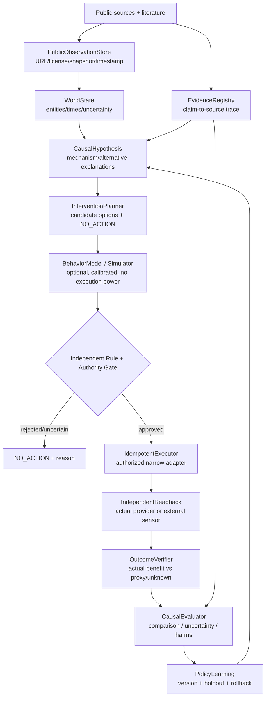

# Manager — domain-general intervention kernel

Status: design only, **not a working impact system**. Updated 2026-10-20.

## Immutable product boundary

- Manager is independent from Life Manager. No imports, shared credentials, shared DBs or hidden runtime links.
- World-facing observation uses lawful/public data and its own terms/rights manifest. Public availability does not erase individual privacy or copyright restrictions.
- Observability does not grant execution authority. Money, institutional policy or actuators need separately issued, narrowly scoped permissions.
- Simulated human behavior != predicted causal impact != real-world world-state change != reduced suffering.
- Missing data are missing, never assumed to mean no suffering.

## Components and contracts

### Read-only types (proposed, **not implemented**)

- `Source`: `source_id`, `url`, `rights`, `retrieved_at`, `content_hash`, `public_classification`, `data_quality`.
- `Observation`: `source_id`, `measure_id`, `recorded_at`, `unit`, `value`, `missingness`, `coverage_scope`.
- `Problem`: `target_scope`, `harm_mechanism`, `observed_proxy`, `target_outcome`, `alternative_explanations`.
- `InterventionOption`: `action_type`, `dose`, `target`, `cost_ceiling`, `expected_effect_distribution`, `side_effects`, `no_action`.
- `Authority`: `issuer`, `scope`, `expiry`, `revocation`, `operator_approval`, `budget`. Never infer from public URL.
- `Execution`: `idempotency_key`, `authorized_adapter`, `attempts`, `external_reference`, `receipt`, `status`.
- `Readback`: `independent_source`, `measured_value`, `timestamp`, `receipts_matched`, `unknown`.
- `Evaluation`: `pre_registered_outcome`, `comparator`, `effect`, `uncertainty_interval`, `harms`, `proof_level`.

### State machine (proposed)

`OBSERVED → HYPOTHESIZED → PROPOSED → RISK_CHECKED → AUTHORIZED → EXECUTED → VERIFIED → EVALUATED → LEARNED`

Separate terminal/error states: `NO_ACTION`, `REJECTED`, `UNKNOWN_EFFECT`, `MEASUREMENT_MISSING`, `ROLLBACK_REQUESTED`. Unknown provider execution must be reconciled, never blindly retried.

### Proof levels

- **P0:** simulation, theory, or anecdote only.
- **P1:** executed and authenticated receipt.
- **P2:** observed real-world change from independent public data.
- **P3:** evidence of substantive benefit to people or relevant exposures, not just activity/clicks.
- **P4:** credible causal net improvement vs comparison, uncertainty and harms disclosed.
- **P5:** replicated, safe net improvement across materially different populations/domains.

### Domain adapters, not domain-specific kernel

- Finance: public grants/donation ledgers, escrow/transfer adapters with formal access; check actual additional net funds, not self-contributed matching money. No live funding by default.
- Physical: public air-quality/sensors; authorized common-space actuator; independently measured pollution, energy costs and plausible health mechanism. No live actuation by default.
- Behavior research: HeartSteps and SocSci210 public **historic experimental data** for offline learning; not equivalent to real-time user data collection.

### Cross-domain acceptance

A second domain must be added without modifying these core invariants: provenance, alternative hypotheses, NO_ACTION, authority, budget, idempotence, independent readback, evaluation, learning rollback.

## R005 causal fidelity invariant (2026-10-20)

- **Descriptive behavior simulation** may predict a distribution of answers and actions, with TVD / MAE / calibration metrics. It does NOT issue action permissions.
- **Causal effect forecast** is a separate estimand based on changes under different interventions; audit signed/absolute ATE errors *against original randomized experiments*, report context, population, confidence and version.
- **World readback and causal impact** are separate again. Changes require actual operator authority, an independent external source and a valid comparator; never give P3/P4 credit to a simulation alone.
- Li & Ji 2026 provides a counterexample: improving descriptive fit can worsen action-ATE error. Original paper and source-linked machine-readable values: `docs/research/R005_LI_JI_JA.md` and `docs/research/R005_CAUSAL_ERROR_EVIDENCE.json`.
- Population discrepancy remains unresolved: original Vlasceanu experiment 63 countries / 59,440 versus Li & Ji reported 62 countries / 59,508. Do not combine without reconciliation.

## R006 licensed-source and privacy boundary (2026-10-20)

`SourceRights` are evaluated *before* source ingestion or model acquisition. `docs/research/source-rights.json` is the review record (not a universal grant). A public URL is **neither commercial-use consent nor actuation authority**.

- `study_read`, `local_research`, `raw_redistribution`, `product_use` are independently gated, not inherited from a single boolean.
- `hold` blocks the corresponding use until source license, contributor/participant permissions and data governance are documented. Personal data inside a publicly accessible dataset are still privacy-sensitive.
- HeartSteps V1 data CC BY 4.0 has separate status from its OUP copyrighted paper and its analysis-code repository without a confirmed code license.
- SocSci210 is composed of many upstream studies; preserve source-specific conditions. Socrates derivative models need separate base/fine-tune license review.
- Concordia Apache 2.0 and imozuru MIT permit reuse with license/notice conditions, but do not grant rights to papers/datasets gathered using them.
- Downstream article/slides/PDF artifacts must be original analysis with citations, not mirrors of copyrighted PDFs or respondent data.

No R006 analysis implies live monitoring or automatically authorized intervention. `R007` will implement typed source-level fail-closed guards; this phase only establishes the review and acceptance checks.
