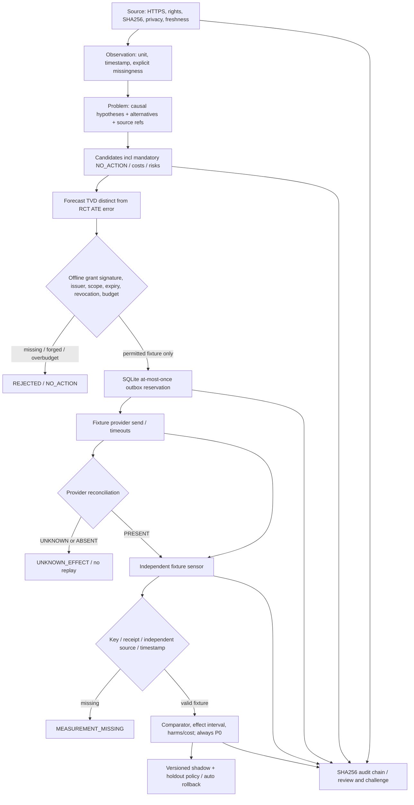

# Phase05 — Implemented offline Manager kernel

**Date:** 2026-10-21. **Scope:** offline software only. **Domain adapters:** finance and environment fixtures, same code path. **No real external effects.**

## Architecture



## Concrete modules and invariants
- `models/source.py`: public HTTPS syntax (not proof of data rights), nonpersonal class, rights, source hash, freshness and a verify-content method. No live data download.
- `models/observation.py`: immutable value or explicit missing; unit/scope/time differentiate measurements.
- `models/problem.py`: explicit evidence references and competing causal stories; evidence does not establish truth of causation.
- `models/intervention.py`: exactly one NO_ACTION. Expected effect interval and risk/cost, no implicit "must execute".
- `forecast.py`: reuse existing `evaluation.total_variation`; separate typed observational forecast error and experimental treatment-effect error.
- `state_machine.py`: enumerated graph, explicit UNKNOWN_EFFECT, MEASUREMENT_MISSING, REJECTED, NO_ACTION and ROLLBACK state.
- `authority.py`: HMAC fixture test issuer, scoped grant, active validity window, revocation list and budget. No live issuer.
- `outbox.py`: SQLite `BEGIN IMMEDIATE` intent reservation before external fixture send; idempotency and total grant budget enforced across process restart, with **exact fixture class** permitted only. On crash or uncertainty, no duplicate dispatch.
- `reconcile.py`: authoritative provider lookup is PRESENT, ABSENT or UNKNOWN; none permits blind re-send.
- `verifier.py`: provider receipt alone is not independently observed outcome; independent fixture reading must match key/receipt/source/timestamp; still P0.
- `evaluator.py`: preregistered comparator, CI, risk, negative outcomes, harms and costs; no P4 from synthetic outcomes.
- `learning.py`: SQLite version and disjoint holdout/shadow safeguards; automatic rollback on deterioration, no independent authorization rights.
- `audit.py`: allowlisted public source→decision→grant→effect→readback→evaluation hash chain, with unknown preserved. Chain has no external notarization.
- `kernel.py`: single `ManagerKernel` coordinates finance/environment `OfflineFixtureAdapter` and `OfflineFixtureSensor`, refusing actual writes.

## Safety guarantees vs unresolved risks

**At-most-once dispatch is not exactly-once effects.** An intent may be reserved as DISPATCHING then crash before a send; a timeout can occur after a provider records an effect. The safe system refuses blind retries. It requires later provider reconciliation, and a provider eventually returning ABSENT does not silently free the reserved budget. Current tests cover ten duplicate sends, concurrent callers, startup replay, failed lookup and both sides of the timeout. Provider eventual consistency, DB compromise, cross-host disaster recovery, colluding or stale sensors and genuine field authority require further work.

This project does not import Life Manager runtime and its `manager_core/config.py` fail-closed flags are preserved. No person-level information, bank account, donation, publication, actuator or third-party permission is used in these fixtures.

## Reproduce / independently inspect
```sh
cd products/manager
python3 -m manager_core
python3 -m unittest discover -s tests -v
python3 scripts/check_boundaries.py
python3 scripts/phase05_demo.py --check
python3 scripts/make_roadmap.py --check
```
[Tests](../../tests/test_phase05_kernel.py), [adversarial tests](../../tests/test_phase05_adversarial.py), [demo output](../verification/PHASE05_OFFLINE_DEMO_RESULTS.json), [actual hosted CI](https://github.com/Daisuke134/life-manager/actions/runs/39578500491), [detailed Japanese verification](../verification/PHASE05_FINAL_OFFLINE_KERNEL_EVIDENCE_JA.md).

**Proof = P0 ONLY.** There is no scientifically validated human/animal welfare improvement; original randomized-study human causal fidelity unreplicated; external blessing count zero.
