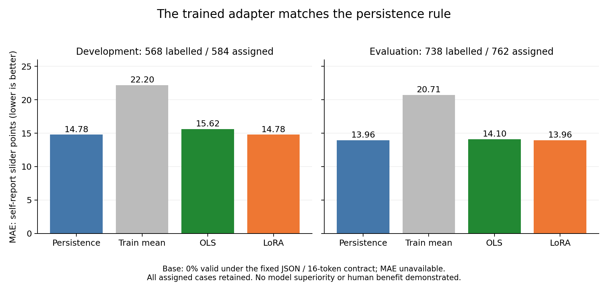

# 学習が動いても、予測が改善したとは限らない

無料公開書籍『予測から介入へ』の実習章。2026-10-24。公開研究の数値データを使った、一つのLoRAの学習と比較の実記録である。今回の候補は採用していない。

## 何を学ばせたのか

Costelloらの研究資料には、対話前後の本人報告confidenceと、対話の割付条件がある。私たちは、対話前の値と割付条件の二つから、対話後の値を予測する小さな研究を作った。原著の説得文をモデルへ学習させる実験ではない。

基底モデルにはQwen3-0.6B、学習には既存のPEFT/TRLを使った。独自trainerを作らず、事前に選んだ128件で一つのLoRAを学習した。32回のoptimizer処理が完了し、保存されたadapterの数値も検査した。[学習記録](../verification/COSTELLO_NUMERIC_TRAIN128_20261024.md)

ここまでで分かるのは、学習して保存する経路が動いたことだ。予測の価値は、別の比較で確かめる。

## 大きなモデルの前に、小さなルールを置く

比較には、対話前の値をそのまま予測にするpersistence、学習128件の平均、同じ128件からfitしたOLSを使った。何も予測しないNO_ACTIONの棄権も別に残した。これらの意味を混ぜず、学習前モデルと一つのadapterを加えた。

モデルへの入力は二つのfeatureだけなので、可能な組合せは102個ある。同じ入力への生成を繰り返す代わりに、各モデルで102条件を一回ずつ生成し、その結果を元の全参加者へ対応付けた。評価の分母は、development584件とevaluation762件のままである。

生成処理には個票IDも正解値も渡していない。両モデルの生成が終わった後に記録を固定し、その後で正解値と照合した。生成はgreedy、最大16 new tokens、一つの整数JSON、出力修復なし。結果がよくなるまで同じ評価へ合わせ直す手順は作っていない。

## 得られた結果

adapterは全条件で形式の正しいJSONを返した。しかし、102条件すべてで「対話前の値をそのまま返す」予測になっていた。割付条件がどちらでも同じルールである。

| 方法 | development MAE | evaluation MAE |
|---|---:|---:|
| 事前値をそのまま返す | 14.778169 | 13.962060 |
| train128平均 | 22.202410 | 20.711255 |
| train128 OLS | 15.624753 | 14.101310 |
| 学習したLoRA | 14.778169 | 13.962060 |

MAEは小さいほどよい。正解値があるのはdevelopment568件、evaluation738件で、残る16件と24件の欠測を別に保持した。単位は0–100の本人報告slider pointsである。

図は有効な点予測のある4方法を示す。baseは出力形式不成立、NO_ACTIONは意図した棄権で、どちらも棒グラフの外に保持する。

学習前モデルは、この固定したJSON/16-token条件で全102出力がINVALIDだった。したがって、有効予測のMAEは計算できない。これを0点や100点の実測誤差へ書き換えたり、LoRAの予測能力が学習前モデルより高いという順位を付けたりはしない。別の出力条件ならどうなるかは、今回の比較からは分からない。

## 指標を変えて、成功に見せない

OLSはRMSEではpersistenceより小さかった。しかし、主要指標は学習前にMAEと決めていた。結果を見てから、成績のよい指標へ乗り換えることはしない。

LoRAとpersistenceの誤差差は0だった。この0は同じ予測を返していたことによるもので、治療効果や苦しみの低減について同等だという意味ではない。OLSとのMAE差のbootstrap区間も0を含んだ。さらに、学習前モデルの有効予測がないため、全モデルが同じ分母でcompleteという事前条件も満たしていない。

公開資料は原著解析や品質確認で曝露済みであり、完全に未見の評価とも呼べない。独立の検算では保存済み予測から数値を照合したが、それでこの限界が消えることもない。[全結果と検証記録](../verification/COSTELLO_NUMERIC_FORECAST_COMPARISON_20261024.md)

## この結果から、次に何を選ぶか

今回の判断は明確だ。このadapterを採用する理由は得られなかった。同じevaluationへ合わせて学習をやり直さず、この有限実験を閉じる。形式を守れることと、強い単純ルールを超えることを別に確かめられたのは、次の設計に使える結果である。

会話の質を調べるなら、AnnoMIなどに専門家注釈がある。既存のsimple版や評価手法を理解し、目的に合うものを借りる。[会話データの実習章](2026-10-24-dialogue-data-evaluation-ja.md)では、その前に確認する単位と分割を扱った。

人の行動変容を支える価値は、その人が選ぶ具体的な行動、後日の継続、負担や害、本人への結果によって別に調べる。今回、その新しい参加者や介入はゼロである。数値予測の成績を、その実証の代わりにはしない。

既存のモデル、学習ライブラリ、公開データ、統計手法を組み合わせると、小さな資源でもここまで確かめられる。足りない能力を言葉にし、採用しない判断まで公開することも、透明な研究開発の一部になる。
