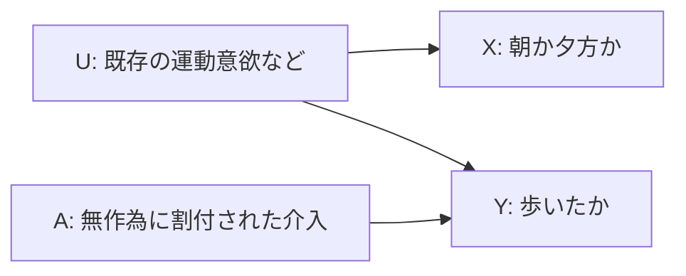

# L005 — 因果DAG：観測的相関 ≠ 実験介入の効果

**一次資料**：HeartSteps（無作為化された提案）https://pmc.ncbi.nlm.nih.gov/articles/PMC6401341/ ; Hernán & Robins *Causal Inference: What If* https://miguelhernan.org/whatifbook

## DAGと交絡（confounding）

**U --> X** と **U --> Y** が共通原因の経路。`P(Y|X)` は、Xが示す人々の違いを含む。一方、`P(Y|do(X))` はXを実際に設定した場合を考える**介入**であり、通常は両者が一致する保証がない。介入Aが無作為化されても、運転中など availability の違いを無視してよいわけではない。

## 実装でわざと作る反例

`manager_core/causal_examples.py` の架空データは、活動的な人の多くが朝を選ぶ状況を仮定する。朝に歩いた比率が .90、夕方に歩いた比率が .10 → **observed gap=.80**。ただし `朝/夕方` のラベルを外から変えても、歩くかどうかが運動意欲だけで決まる構造にしたため、**oracle effect of changing label=0**。実際の人間に介入した結果ではない。

ここでの目的はDAGと交絡の意味を理解することだけ。個別介入の安全性や実際の効果を保証するものではない。
