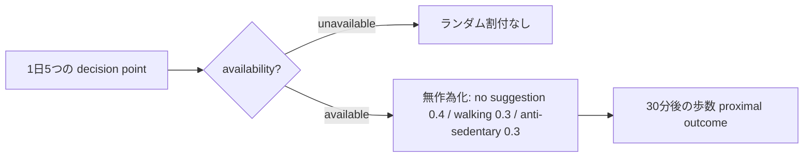

# L008 — Micro-Randomized Trial（MRT）

原著：Murphy lab FAQ https://people.seas.harvard.edu/~samurphy/JITAI_MRT/faq.html ; HeartSteps https://pmc.ncbi.nlm.nih.gov/articles/PMC6401341/

MRTは人を一度だけ二群に分ける通常のRCTと異なり、**1人の中で何度も decision point が訪れ、その時点で available なら無作為割付する**。

## 原研究と架空教材を分ける

HeartStepsでは5 decision points/day、available時には .4/.3/.3（合計1）の割付、介入直後30分の歩数が近接指標。研究の観測値を使った再現はPhase03で別途行う。

`manager_core/mrt_demo.py`は上記の**設計形式だけを再現する架空例**であり、元論文のデータや実結果を生成しない。`unavailable`を`no suggestion`の対照群に勝手に追加しない。外部への通知も一切実行しない。
