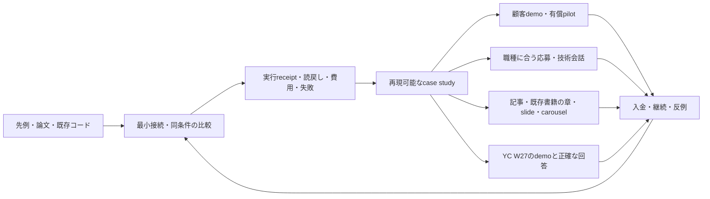

# Manager — 実装・実証・収益・出版・仕事・YCの実行マップ

2026-10-22 UTC。[製品仕様](../MANAGER_PRODUCT_SPEC.md)の派生作業表。状態・依存・技術カーソルの唯一の正本は [tasks.json](../roadmap/tasks.json)。下の12行は既存E/P/U/Y/G作業を束ねた表示であり、新規のtask IDや完了状態ではない。原113件に加算しない。今回の調査と改稿で投稿・メール・応募・登録・決済・配備は行っていない。

## 1. 一つの証拠を、複数の機会へつなぐ

製品・教材・採用・YCは同じ成果の使い道であり、同じ数字を別の実証として増やさない。他人の公開成果を組み合わせることと、自分の効果・売上・採択を証明することは別。出典を読み、自分で小さな比較/失敗を再現し、結果と限界を教える。

## 2. 12の実行パッケージ

技術の現在位置はE16のまま。以下の番号は優先度を読むための番号で、E順を置き換えない。YCと顧客/採用の準備は期限に合わせて並行し、book完成を待たない。

| 優先 | 既存作業 | 次に作るもの | 完了を認める証拠 |
|---|---|---|---|
| 1 | E16 | Railway専用worker/volume、本番adapter、具体的ownerと費用/停止設定 | 既存serviceを保全したstaging、固定source、volume、owner/run identity。接続だけでは完了しない |
| 2 | E16 → F005/F006/F008/F009 | 限定canary・独立readback・restart/replay-zero/rollback | official commit/parent/7-file bodies、外部GET、旧bundle復元、対象外不変。真の改善がなければNO_ACTION |
| 3 | P01 / U005 | 既存source/run/権利を束ねるcase-study evidence indexと公開可能なproof | claim ID→source SHA/実artifact/限界が一対一で辿れる。旧公開面と新E16を混同しない |
| 4 | Y001/Y002/Y003 | YC回答、demo、1分founder video、提出前check | 正確な本人情報と当時の成果、実際の申請confirmation。採択は別 |
| 5 | U002/U003 | 5件以上の実会話、既存代替/作業原価/支払主体の比較 | 同意ある記録、現在の痛みとworkaround、wedge採否の根拠。架空personaは数えない |
| 6 | U008 / G005 | 範囲固定の有償pilot/改善支援の提案と経済scorecard | 契約/利用意思、請求と実入金/返金/原価の独立確認。見積・LOI≠売上 |
| 7 | P02/P03 | 最初のsource-backed case studyの英日記事 | 原稿review、実行例、公開経路のreceipt、両言語URLと公開bytesの読戻し |
| 8 | P05 | 同じcaseを含む既存book構想の一章 | 参考文献・例・図・限界の揃う章、実際のHTML/EPUB等export。outline≠book |
| 9 | P06 | 同じclaim IDから12-slide talkと8-panel carousel | 実PPTX/PDF/画像、読める文字/出典/順序/alt、公開は別receipt |
| 10 | Y005（採用） | 優先職種に合わせたCV/project noteと個別応募packet | 公式求人、勤務地/就労条件fit、経歴確認、実提出receipt。応募≠面接≠offer |
| 11 | Y005 / U002（会話） | 相手ごとの短い業務メール/面談依頼と記録 | 公開業務窓口と具体的依頼、送信/返信/拒否/面談を別保存。会話への参加同意は別 |
| 12 | Y005 / P07 | 関連eventの無料/低負担経路、週次scorecardと次の改訂 | 公式日時/費用/登録状況、実参加/会話/紹介、公開URL、訂正履歴。予定は成果にしない |

依存関係は元の台帳を維持する。有償pilotの準備や入金だけで、U007/U002を要するU008、G004を要するG005、人の便益評価を完了にしない。Y005の既存達成条件は5接点であり、採用packet/提出/面接/offerはそれぞれ別receiptを添える。5接点で就職達成とは扱わない。

## 3. 日付で固定する直近の順番

以下は今回決めた作業目標であり、完了した実績や採択/売上の予測ではない。

- **2026-10-22〜24:** この仕様更新、source比較、求人/イベントの公式確認、case-study骨格、YC回答と英文CV/project欄の初稿。本人の経歴を創作しない。E16の専用cloud構成/owner/予算を具体化。
- **10-23〜27:** E16の実装/配備検証を進める。同時に5件の問題確認へ向けた個別依頼と面談、適合する最初の応募packetを準備。実結果が未取得ならそのままunknownとする。
- **10-28〜11-01:** その時点で真に示せるdemoとresults/cost/revenue表を固定、1分founder videoと回答を校閲。E16未完了・売上未確認でも、その状態を正確に書いてYC準備を進める。**内部提出目標は11月1日23:59 JST**。
- **公式W27 on-time締切の確認値:** 2026-11-02 20:00 America/Los_Angeles＝11-03 04:00 UTC＝13:00 JST。年はW27 cycleからの解釈、公式頁を提出直前にも確認する。[YC apply](https://www.ycombinator.com/apply)
- **11月以降:** 実運用・顧客・入金・求人応募/面接・返信を週次で更新。毎週一つのcase/修正を教材とdemoへ戻す。YCの面接/採択、event参加、job offerは実通知で判定する。

## 4. クラウド選定を、他者の実装と照合した結論

採用はRailwayの単一Python worker＋専用永続volume。理由は新しさではなく、既存Python/std-library/SQLite/outbox/lockを最小変更で接続できるため。既存Railway project `life-manager` は読取接続済み。既存serviceは別の運用である可能性があるので、source/owner/用途を確認して保全し、isolated stagingの専用serviceから始める。新service/volumeはまだ作成していない。

既存の成功した仕組みは再利用する: Railwayのdeployment/restart/volume/backup、GitHubのsource/CIと既存publisher、SQLiteのtransaction、既存browser/accessibility checks。独自クラウド基盤や一般的workflow engineを作らない。volume付きRailway serviceはreplica不可・再deploy時に小停止があるため、HAや無停止とは説明しない。[Railway公式](https://docs.railway.com/volumes/reference)

LangGraph/Temporal等は比較したうえで採用を保留する。現実のmulti-worker/長期workflow/recovery運用負担が現方式を上回る時に、既成engineを評価して移行する。frameworkを導入しても外部作用のidempotencyやofficial readbackは必要。旧Letta V1の説明を現行依存として採用しない。詳細は[先例調査](../research/manager-strategy-20261022/FOUNDER_EXECUTION_UPDATE_JA.md)。

E16本番前に次の追加crash-point検査を行う。これらは読取監査で見つけた未確認の保証で、実測済みの障害だとは主張しない。

1. 起動時に未解決intentを全件列挙し、新planner/candidate作成より先にexact occurrenceを照合する。候補/contextが変わった、古いscopeが期限切れ、providerを停止した場合も旧UNKNOWNを失わない。解決できなければ対象を隔離し、新しいkeyでfenceを逃れない。
2. schedule slot保存直後・dispatch直前・外部commit直後・readback前のcrashを固定時計で検査。割込状態と再開方針を記録し、欠落slotを無条件に再送しない。
3. volume付きdeploymentの停止/再起動、旧in-flight writerのGit parent CAS、backupからの復元、実行中owner競合を実環境で検証。
4. 元のrepository/ref/workflow/artifact admissionを維持。研究branchの実行を許すための単純なSOURCE_REF書換えはしない。費用はactual usageと既存予算で管理し、今回のspec変更で新しい支出を実行しない。

## 5. 共有する成果packet

最初のpacketは `reproducible code + actual evidence + limits + one small ask`。

- **code/demo:** 実source commitと最小reproduction。現在のpublic prototype、P0 sandbox、将来のE16 runtimeを別表示。
- **results:** denominator付きの成功/失敗/NO_ACTION/UNKNOWN、関連baseline、費用/人手、回帰・復元。初回caseは既存deadline cancel/recoveryのRED→GREENを使える。
- **article/chapter:** 何を既存技術から借り、どの条件で壊れ、どう検査したか。primary sourcesと自分の結果を別々に引用。
- **career note:** 相手の仕事内容と接続する1ページ。実装した役割と実績だけを述べ、第三者の論文・コードの著者を名乗らない。
- **founder note:** 誰が何に困り、現在の代替は何で、なぜ使う/払うか。測っていない値はunknown、仮説は仮説。

論文は関連するmethods/resultsの読取→既存コード/再現→失敗分析→独立の批評という一組で学ぶ。基礎章を作るために新規実験を捏造せず、実証論文には別途独自の問いと妥当な比較が必要。

## 6. 収益を見せるときの契約

初期の商用候補は、限定された運用/評価の有償pilot。既存checker/automationが解ける部分は接続して使い、顧客が認める運用負担・失敗の低減を検証する。価格を他人の売上から推測せず、範囲・現在原価・代替・支払意思・提供費用から見積る。採算の合わない恒常無料作業や、裏付けのないMRR目標を成果表示にしない。

収益のsource-backed reportでは、期間/通貨/商品/案件ごとに次を分ける: contracted・invoiced・paid・settled、返金、手数料、原価、税の扱い、創業者の作業時間。製品、製品を使う運用支援、個人受託、給与、content、他Life Manager製品を別categoryとし、同一receiptを二重計上しない。出資は売上ではない。単発契約はMRRではない。

公式payment/銀行等のsource coverageを照合するまでは金額null/UNKNOWN。0と確定するには対象期間/商品/口座を確認してゼロ件と判定する。資料やhashの存在だけでは本物の入金にならない。個人/顧客情報をGitや公開scorecardへ出さず、公開用集計とprivate evidenceを分離する。現在のManager売上確定値は、この更新では取得していない。

## 7. 外部行動の状態と今回の範囲

応募は identified → eligibility checked → packet ready → submitted receipt → interview → offer。業務連絡は source route verified → tailored draft → authorized send receipt → reply/decline/no reply → consented meeting。eventは source verified → registered confirmation → attended → substantive conversation → agreed follow-up。記事/本は manuscript → reviewed → rendered artifact → published URL → readback → usage/sales。

この文書とsource調査は最初の準備工程。上記の後段状態を作り話で埋めない。本人のCV、就労/渡航、公開したい個人情報、相手への具体的内容が必要な外部行動は、実行時にその範囲の確認を行う。通常のManagerのstanding-scope内動作へ毎回人の承認を挟む設計にはしない。

## 8. 応募先は仕事内容と証拠で優先する

下表は2026-10-22に公式求人本文を確認した候補。採用確率の順位ではない。本人の職歴・学位・英語面談・移住/就労条件が未確認なので、応募前にmust/preferredと照合する。職歴や資格を補って作らない。公開給与帯は現在の個人所得やofferではない。

| 優先 | 公式求人 | 現在の証拠との接点 | 確認された場所・主な条件 |
|---|---|---|---|
| 1 | [Simile — Evaluations MTS](https://jobs.ashbyhq.com/simile/33d75074-c23b-4a1f-bfdb-129bcc5be662) | E09のscope/calibration、失敗と棄却を残すmeasurement | SF/NY onsite。同一role再応募90日、visa未確認 |
| 2 | [Andon Labs — AI Safety & Evals](https://andonlabs.com/join) | E16のunknown・復旧・bounded agent、既存eval改善案 | SF in-person。実用的なresearch/engineering課題、visa未確認 |
| 3 | [Aaru — Research Engineer](https://aaru.com/careers/f04cd7a3-b53c-4797-bb8f-ebfe0467e9fe) | simulationの比較契約、eval infrastructure、薄いadapter | NYC週5 office、ML/AI systems実務3年以上。visa/relocation支援を明記 |
| 4 | [Artificial Societies — FDE](https://societies.ai/careers/forward-deployed-engineer) / [ML](https://societies.ai/careers/ml-engineer) | population/question/timeの設計、研究をclientの実験へ落とす力 | London office。FDEはCSS/production Python、MLはstartup2年等。Radiantは同社製品 |
| 5 | [humans& — MTS Research](https://jobs.ashbyhq.com/humans-and/3daf12ad-471f-43ba-b940-8552e9ad61aa) | Ampersandの正直な再計算/感度分析。frontier研究経験のgapを明示 | SF onsite。exceptional frontier workを要求、stretch候補 |
| 6 | [Anthropic — Post-Training Model Evals](https://job-boards.greenhouse.io/anthropic/jobs/5198255008) | measurement、regression、信頼できるeval運用 | SF/Seattle、hybrid25%+。post-training eval fleetが職務、visa支援は保証なし |

**就職とYCは、準備を並行し、実行条件は正直に選ぶ。** [YC FAQ](https://www.ycombinator.com/faq)は現職があっても応募可だが、採択後はbatch中・後の会社へのfull-time commitmentを期待すると説明する。YC W27は2027年1–3月SF対面。他社のfull-time勤務と同時にfull-time創業できるという約束はしない。実際のoffer/採択/就労条件が出た時に、本人と整合する選択をする。

最初はSimile/Andon/Aaruの各JDに、共通CV＋役割別1頁＋再現できる成果物一件を対応させる。1日1社以内・最初の3社を目安とし、公開業務窓口または公式formを使う。Aaruの公開組織窓口は `jobs@aaru.com`。メールpatternで私用連絡先を推測しない。未送信の短い案と各社の根拠は[career調査](../research/manager-strategy-20261022/FOUNDER_CAREERS_YC_20261022.md)に保存。本人の経歴/稼働条件が未確定のまま提出しない。

送信を実施する場合、1社1窓口1目的、5–7営業日後に実質的更新がある時だけ1回follow-upを目安とする。拒否・停止は尊重する。受付自動返信、人の返信、面談、offerを別に記録する。初回の通常業務連絡と、会話・研究への参加同意を混同しない。

## 9. イベントと発信の週次運用

| 公式情報 | 確認日現在の状態 | 選ぶ行動 |
|---|---|---|
| [AI Engineer Code 2026](https://ai.engineer/code/2026)、11/10–12 SF | 参加申請open、CFP closed。現地regular$1,299+fees、席の保証なし | 無料livestream/公開動画を優先。現地費用や申込は今回実行しない |
| [NeurIPS 2026](https://neurips.cc/)、Sydney12/6–12、Atlanta/Paris12/9–13 | early registration10/30 AoE、ticket waitlistあり、main paper締切は過去 | 公開program/career資料とvirtual経路を検討。[pricing](https://neurips.cc/Conferences/2026/Pricing)に時刻表記不一致があり登録直前再確認 |
| [AAMAS 2027](https://warwick.ac.uk/fac/sci/dcs/aamas2027/)、5/3–7 Hanoi | Blue Sky abstract11/5/paper11/12 AoEだがauthor registration10/20は経過 | late author資格は未確認。新規提出できると決めつけず、まず資格/CFP確認、満たさなければ聴講/将来workshop |

毎週一つの実装/失敗caseを固定し、再現とclaim indexを更新→英日記事→既存bookの章→12slides/8carousel/60–90秒slideshowへ展開する。公開経路は既存のWriter/配信loopを再利用し、外部公開の実行とreadbackは別のreceiptで示す。研究ノートを書いた段階でpublishedにはしない。

週次30分で、sourceの鮮度、応募/顧客の返信、実利用、提案、入金/原価、継続、公開物の具体的な質問と訂正を見る。followers/viewsは到達の補助値。技術を理解した返信・適合会話・受注・継続とは分ける。イベント一件につき具体的質問3つと小さなdemoを用意し、得ていない紹介/登壇/参加を実績に書かない。

## 10. 新しい一次資料からの置換候補とatomic作業

[追加調査](../research/manager-options-additional-20261022/REPORT_JA.md)は前回の既知候補を繰り返さず、個人agent/業務workflow/永続実行/browser/6新論文/出版/hostを比較した。一般的なassistantやworkflowだけが必要ならOpenClaw/Khoj/n8n等を直接使う。Managerの差分を限定authority/正確なeffect/独立readback/実結果へ絞り、顧客がその差分を必要とするか検証する。記事/本/採用では既成技術から借りた部分と自分が実装・検証した部分を分ける。

実装担当は [12 atomic patches](2026-10-22-manager-e16-atomic-patches.md) のfile/function/RED/verificationを使う。新しいtask authorityではなく、元の12実行パッケージとE16を具体化したもの。YCの期限・本人条件・元U/G依存・未確認売上を変更しない。

## 11. Phase12までの原計画を省略しない

[開始から最後までの全工程](../roadmap/START_TO_END_20261022.md)に、全Phase00〜12、残41件のID/依存/受入れ、EBAの旧章番号との対応、P01〜P07/公式home更新をまとめた。現在はE16が技術カーソル。12package/12PATCHは原113件に加算しない。
