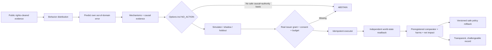

# Manager Cross-Field Research — 人間行動予測・介入・暗号資産・UBI・学習の接続

**Research snapshot:** 2026-10-21 JST. **Scope:** 比較・技術調査・原典確認。**Status:** research only; no training performed, no real pilot, no welfare improvements measured.  
**Canonical Manager task statuses:** [tasks.json](../../roadmap/tasks.json)（別のタスク台帳は作らない）。**Source inventory:** [SOURCES.json](SOURCES.json)（82件・23の研究/実装領域、first-source prioritization, access/reuse status）.

## 0. Core argument — the missing loop

A behavioral simulator estimates `P(Y | X)`: observed answers, purchases or actions under a described context. A causal policy needs `E[Y(1)-Y(0)]` under justified intervention assignment, and a real Manager must verify the *actual* external action and independent beneficiary outcome. A simulated economic balance is P0, not a P1 receipt. A third-party payment ledger without a Manager-caused intervention is historical public observation, not a Blessing. There is NO shortcut from prediction fit to real-world causal gain.



## 1. People simulation: what Aaru and Simile actually demonstrate

### Simile
Sources: [What-If Machine](https://www.simile.com/blog/what-if-machine), [Building confidence](https://www.simile.com/blog/confidence), [Itaú field research case](https://www.simile.com/blog/itau-at-esomar). Simile articulates **what** (actual transactions, applications, mobility) plus **why** (interviews/surveys). Its technical confidence-model writeup evaluates ~8,600 held-out questions, grouped and scored by five-fold CV. A binary distribution example predicted 93.4% tipping vs 87.3% observed (TVD ~0.0615), *not* "93.4% model accuracy". Its feature-only error-estimator AUROC was ~0.566, with model probe ~0.730 and continued fine-tuning of Qwen3.5-27B ~0.736 (the last versus probe not a statistically clear AUROC win). Confidence is a **prediction of TVD error**, not certainty that `do(action)` works. The Itaú case documents faster concept exploration with human downstream validation, not a randomized social-welfare improvement estimate. Simile's foundation/training data and exact models are not released as a drop-in open implementation.

### Aaru
Sources: [Full replication-floor methods](https://aaru.com/publications/population-simulation-at-the-replication-floor-research), [short version](https://aaru.com/publications/population-simulation-at-the-replication-floor-summary), [product scenarios](https://aaru.com/). Vendor-reported 2026-09-24 evaluation includes **2,993 survey questions from 186 studies**, **13,727 answer shares**, *unadjusted mean TVD 7.62 points*, *sample-adjusted mean TVD 5.98*, *adjusted MAE 2.78 percentage points*, Pearson r=0.970 pooled answer shares. A separate transaction-related brand-pair ranking comparison claims 92.4% versus stated-purchase consideration 77.8%. Aaru also predicts its own error; a claimed AUROC 0.845 compared against Simile 0.736 is **across DIFFERENT evaluations**, not a head-to-head on the same sample. Pooled 0.970 correlation is not 97% per-person response accuracy, nor out-of-distribution causal-effect accuracy. The article itself focuses on univariate answer distributions; full joint/trajectory fidelity remains a separate research question. Underlying model, private behavior data and redacted sources not independently reproducible.

### Reuse decision
Reuse Simile's **error/abstention head** and Aaru's **question-conditioned distribution and transaction cross-check evaluation protocol**. Do not blindly clone synthetic profiles of real people or train on private respondent rows. First build a truthful, rights-cleared benchmark retaining original response semantics, study/subject/time splits, baseline and intervals; train only if simple frequency/regularized baselines are beaten on the *same* holdout. Manager's earlier SocSci210 global numeric-code scores are useful engineering diagnostics but do not solve task-conditioned generalization or RCT causal fidelity.

## 2. Prediction markets are a different tool, not a better Aaru

[Polymarket's original price rules](https://help.polymarket.com/en/articles/13364488-how-are-prices-calculated): a market contract aggregates traders' beliefs for a **specific externally resolvable event**, with prices reflecting bid/ask (and other documented display rules). Aaru/Simile estimate **distribution of responses by a specified population conditional on a scenario**. Neither automatically identifies a causal treatment effect. A market price for "candidate wins" does not reveal which price reduction/aid intervention makes targeted recipients better off. Contrarian event bets, subgroup preferences and policy ATE are three different estimands. Market liquidity, selection, trader incentives, oracle resolution and timing must be checked. Manager can reuse public **read-only** resolved market forecasts as a baseline/calibration challenge; no trading or gambling execution is necessary, and an existing Life Manager trading loop must not be imported into Manager.

## 3. RL and economy design — do not confuse simulated rewards with welfare

[Salesforce AI Economist](https://pmc.ncbi.nlm.nih.gov/articles/PMC9067926/) shows **two-level RL** where economic agents adapt to a simulated planner/tax rule while the planner changes rules. This is the right way to model adaptation to interventions (gaming, prices, network effects), not an official AI tax policy to deploy. [Andon Vending-Bench 2](https://andonlabs.com/evals/vending-bench-2) measures 365-day virtual operational coherence; [Anthropic Project Vend](https://www.anthropic.com/research/project-vend-2) moves to physical shops with people and real operational messiness. Simulation and field operations must be scored separately, including suppliers, delayed effects, refunds, negotiated labor, and negative surprises. [Behavior Change for Good megastudy](https://www.nature.com/articles/s41586-021-04128-4) randomized 54 interventions across 61,293 gym members, measuring outcomes consistently; 45% increased visits during the short treatment window and only 8% had durable measured effect afterward. Expert guesses failed to identify the highest-impact interventions. **A prediction is useful for triage, not an excuse to skip a real comparative experiment.**

[HeartSteps](https://pmc.ncbi.nlm.nih.gov/articles/PMC6401341/) independently illustrates micro-randomization of up to five daily suggestions and 30-minute step outcomes, but the Manager H005 original cohort still cannot be reconstructed exactly from public files. Falsely declaring its skipped analysis a replicated RCT would damage scientific reliability.

## 4. Proactive basic income: distinguish distribution machinery from economic impact

**Real money / actual aid:** [GiveDirectly UBI research](https://www.givedirectly.org/2023-ubi-results) compares a long-term monthly transfer, short-term monthly transfer, one-off lump sum and control through assigned villages; the studied context favored lump sum over the short-time stream on several productive outcomes and short-term streams on some wellbeing outcomes. This finding is conditional, not a universal rule. [Kenya spillover study](https://www.nber.org/papers/w26600) found outside-recipient local multipliers and relatively little inflation in its studied rural context—crucially a reminder to measure spillovers and price changes rather than assume all transfers merely reshuffle identical totals.

**Crypto UBI:** [GoodDollar](https://www.gooddollar.org/) distributes G$ tokens, making an on-chain distribution *observable*, but claim count/transaction volume is not comparable to redeemed purchasing power, retained resources or measured wellbeing. [Circles UBI](https://www.frontiersin.org/journals/blockchain/articles/10.3389/fbloc.2024.1362939/full) and the [small qualitative pilot analysis](https://arxiv.org/html/2504.02714v1) underline local liquidity, merchant acceptance, governance and broader social organization constraints; a 25-person purposive survey is not a causal RCT. [World's whitepaper](https://whitepaper.world.org/designing-for-scale/2026-03-24) addresses uniqueness and token issuance; identity/anti-sybil proof is not itself consent, poverty relief or zero-privacy-risk certification.

**Corporate redistribution:** [Anthropic's 2026-10-18 Public Benefit Fund](https://www.anthropic.com/news/public-benefit-fund) proposes committing 5% of its shares **subject to shareholder approval**, and potentially more by valuation; direct population distributions are described as possibilities, not a launched crypto UBI. Elon Musk's *universal high income* rhetoric and 2026 SpaceX-share pledge are policy/proposed wealth-sharing statements, not proof he originated UBI or has delivered recurring universally available cash transfers. Avoid collapsing conditional company-equity commitments, token grants and actual settled cash into one category.

**Manager opportunity** — Proactive income support is a constrained social intervention, not merely a wallet-faucet bot:
1. Discover published *aggregate* service failures, missing infrastructure and lawful existing support programs; do not profile individuals without consent.
2. Compare **NO_ACTION**, process simplification, eligibility notification with consent, direct cash, recurring transfers, and local service improvement; each mechanism changes welfare differently.
3. Secure real issuer/operator money and rights; do not assume that "founder approved development" authorizes third-party transfers or tax filing.
4. Record external ledger receipts, realizable local purchasing power, net beneficiary resources, fees, leakage, displacement, privacy costs and harms.
5. Run a preregistered RCT or well-supported quasi-experiment with follow-up; show confidence interval and nonrecipient spillovers. Mere UBI token minting stays **P0/P1**, not automatic **P4**.
6. For crypto experiments, start with read-only on-chain observation; inspect smart contract and token governance, costs and compliance separately. Do NOT create a new token or marketplace merely to have something to deploy.

## 5. Intervention ecosystem: evidence from other fields

| External project | What it gets right | What Manager should reuse | What it cannot prove |
|---|---|---|---|
| [Behavior Change for Good megastudy](https://www.nature.com/articles/s41586-021-04128-4) | same outcome and horizon for many actions | intervention registry, head-to-head designs, cost/durability | universal portability |
| [HeartSteps](https://pmc.ncbi.nlm.nih.gov/articles/PMC6401341/) | availability/timing and momentary randomization | context gating, MRT policy logs, proximal windows | lifetime wellbeing or H005 exact replication |
| [Opower field trials](https://www.sciencedirect.com/science/article/pii/S0047272711000478) | external energy meters; hundreds of thousands of randomized households | independent measured kilowatt-hour change | permission-free home manipulation |
| [GiveDirectly](https://www.givedirectly.org/ubi) | payment, baseline and beneficiary outcomes separated | amount, duration, control, spillover outcomes | hypothetical free new money from tokens |
| [Open Bandit Pipeline](https://github.com/st-tech/zr-obp) | known logged propensities and OPE API | IPS/SNIPS/DR, effective sample size/overlap refusal | unsupported new action effect |
| [DoWhy](https://github.com/py-why/dowhy) / [CausalPy](https://github.com/pymc-labs/CausalPy) | transparent estimand and model/sensitivity | DAG/refuters/difference-in-differences | permission or randomization on demand |
| [OpenAQ](https://docs.openaq.org/resources/measurements) | public independent outside readings | environmental baseline/context readback | indoor air improvement without indoor sensor |
| [Open Collective](https://developers.opencollective.com/) | public historical finance ledger | F003 existing read-only integration | Manager-caused external transfer/benefit |

**Environment is not only 'physical.'** Existing stores, open-source maintainer reviews, community funds, public datasets, delivery services, regulated public benefits, open-source robots and verified applications can all provide legitimate observation–action–outcome cycles. Require actual rights for the *act*, not just a publicly accessible webpage. Reuse these settings before building a generic new agent marketplace. A marketplace is a coordination and settlement layer, not a causal welfare evaluator.

## 6. Research agenda for Manager's next actual scientific milestone

(1) **Question-meaning-preserving human forecast benchmark:** rights-reviewed choice text and study metadata; test random baseline, original encoder and Qwen with identical unseen studies; TVD/Brier, subgroup, OOD.  
(2) **Error-model challenge:** on heldout studies, train predicted TVD and calibrated abstention. Use at least one method that does not fine-tune a model. Report AUROC *and* coverage/error tradeoff.  
(3) **RCT effect benchmark:** randomized treatment/control labels from defensible openly released experimental data; compare estimated ATE errors separately from forecast fit. The [megastudy's paper](https://www.nature.com/articles/s41586-021-04128-4) reports open replication data/code subject to dataset terms; first inspect grants and license. Criteo Uplift dataset has CC BY-NC-SA terms and purposely perturbed samples which do not preserve original incrementality; do not claim original causal effect reproduction using it.  
(4) **Action benchmark:** evaluate budget, scope, identity, timeout, duplicate dispatch, self-authorizing requests and negative net outcomes with existing Phase05 kernel.  
(5) **Field bridge:** authorizing issuer, exposure limits, independent meter or financial provider, preregistration, potential outcomes assumptions, harms, matched timeline, null/negative publishing.  
(6) **No short-circuit:** zero end-to-end human welfare proof until actual P3/P4. Existing phase05 F002 design and F003 third-party historical ledger are necessary preparatory engineering only.

## 7. Peer writing and editorial design: what to copy as a method

[Simile blog](https://www.simile.com/blog): question-led titles, human stories, author/read time, descriptive illustration, clear numeric examples, figures, caveats and references. [Aaru publications](https://aaru.com/publications): narrow publication index, one memorable headline statistic, visual evidence panels, executive summary **plus** full transparent methodology (same paper, two levels). [Existing Manager page](https://aniccaai.com/blog/manager) already has many English and Japanese essays and prior simulations; it reads more like a long archive of text links than a research journal. **Do not build a competing site.** Improve existing `/blog/manager` as an original, accessible research magazine backed by GitHub versioned posts, interactive evidence/demos, visible proof levels, fixed citations, benchmark versions and reproducible notebooks. Do not copy Aaru/Simile branded art, website source, logos or proprietary content. See [research journal design](../../website/RESEARCH_JOURNAL_DESIGN.md).

## 8. Claim reliability checklist for every article and book chapter

- Original URL, organization, date/version and license/terms separately logged.
- Paper results, vendor assertions, reproduced Manager measurements and proposed hypotheses receive different attribution.
- A historical dataset/benchmark is NOT a Manager field intervention.
- Question/survey/population mismatch means invalid cross-model ranking, even when a metric has the same name.
- Model calibration / abstention / comparative randomized treatment efficacy / actual execution receipt / downstream net welfare are scored separately.
- NO_ACTION is always eligible; track conflicts and harmful or null findings.
- Dynamic model prices, market odds, founder announcements and website pages need an as-of date and independent re-verification.
- No copyrighted figures or private individual responses embedded in original content.
- No source text, paper content, images, video or personally sensitive data is represented as permissively licensed by virtue of public access.
- Evidence-open ≠ data-open ≠ code-open ≠ weight-open. Publicize exactly what can be independently reproduced.

**Manager science status:** Phase00–02 completed scoped engineering, Phase03 H005 scientifically skipped, Phase04 scoped research concluded but Gate1 unmet, Phase05 K001–K014 offline software accepted, Phase06 F001–F003 preparatory acceptance, F004/F007 legitimately blocked, F005/F006/F008/F009 require real field outcomes. No verified Manager-caused beneficiary gains. This research does not change `tasks.json`.


## 9. Reuse → Connect → Evaluate — 2026-10-21 additional deep search, ZERO new engines

**Founder design clarification:** **Internet is a real-world environment.** Manager's first autonomous world-changing loop should not depend on negotiating with an NPO, facility owner, government agency, insurer, Facebook/X account owner or clinical data broker. Use owned online assets, existing open-source components, lawful permissionless protocol surfaces, normal platform terms and transparent voluntary participation. No user UI is required to keep the **operator** in the loop; public users may nevertheless use accessible internet pages and voluntarily provide aggregated outcome assessments. Legitimate standing authority from asset ownership is different from a human approving each agent decision.

**Rule of construction:** no custom foundation model, novel token, invented marketplace, fresh clinical score, new metric called 'suffering', home-grown A/B assignment, unique eval runtime, or homemade causal library. The value is the verifiable **connection** between already tested systems. Where code integration requires a thin adapter, reuse a maintained upstream SDK and preserve its input/output semantics and licenses. This source appendix extends the **same** `SOURCES.json`, not a new SSOT. The original 35-source register now covers **82 sources in 23 fields**. Research claim only; **no new human intervention was run**.

### 9.1. Existing outcome instruments — MENTAL / PHYSICAL / FINANCIAL

| Actual beneficiary dimension | Existing validated or official instruments (not invented) | Reuse in Manager | What must remain unproven until measured |
|---|---|---|---|
| **MENTAL: wellbeing, not just engagement** | [WHO-5](https://www.who.int/publications/m/item/WHO-UCN-MSD-MHE-2024.01), [OECD 2025 subjective well-being](https://www.oecd.org/en/publications/oecd-guidelines-on-measuring-subjective-well-being-2025-update_9203632a-en.html) | Predeclared voluntary time-window wellbeing / life satisfaction, positive-negative affect, meaningful activity, subgroup/attrition | Website clicks, chatbot completion and convincing emotional text cannot prove a reduction in anxiety/depression/suffering. Do not infer or manipulate private mental states |
| **MENTAL: clinical improvement when actually relevant** | [NHS Talking Therapies reliable improvement/recovery](https://digital.nhs.uk/data-and-information/publications/statistical/nhs-talking-therapies-monthly-statistics-including-employment-advisors/performance-june-2025-and-quarter-1-2025-26-data/outcomes) and condition-appropriate standardized measures | Published recovery/reliable-change methods with correct denominators; outcomes only from truly consented, valid studies | No intervention field cohort or clinical evidence presently supports Manager-therapy efficacy |
| **PHYSICAL: function and burden** | [WHO WHODAS 2.0](https://www.who.int/classifications/international-classification-of-functioning-disability-and-health/who-disability-assessment-schedule), [NIH/HealthMeasures PROMIS](https://healthmeasures.net/implement/steps-to-license/) | Mobility, participation, pain interference or function in matched units, only when actual respondents or rights-cleared aggregate reports exist | PM2.5, article reads, accessibility fixes and prompt quality alone do not measure physical health changes |
| **FINANCIAL: perceived security** | [CFPB Financial Well-Being Scale](https://www.consumerfinance.gov/consumer-tools/educator-tools/financial-well-being-resources/) + official public-use survey | 0–100 standardized security/freedom of choice if voluntarily measured; no invented financial-health score | A bot wallet, crypto token, gross sales, claimed grant, aid pageview or user click is not actual household wellbeing |
| **FINANCIAL: basic needs and poverty** | [FAO Food Insecurity Experience Scale](https://www.fao.org/measuring-hunger/access-to-food/about-the-food-insecurity-experience-scale-%28fies%29/), [World Bank PIP](https://data360.worldbank.org/en/dataset/WB_PIP) | Country-cohort food access, poverty gap and real purchasing power with versioned 2021 PPP, published source coverage | Macro population trends do not imply a causal effect from Manager. Issued G$ tokens do not establish net resources retained |
| **Cross-sector welfare appraisals** | [UK HM Treasury Green Book wellbeing guidance](https://www.gov.uk/government/publications/green-book-supplementary-guidance-wellbeing), [OECD 2025](https://www.oecd.org/en/publications/oecd-guidelines-on-measuring-subjective-well-being-2025-update_9203632a-en.html) | Report side-by-side separate outcomes, confidence and harms; qualify contextual valuation assumptions | No defensible simple total of WHO-5 + dollars + DALYs. Avoid an invented singular omniscient “End Suffering score” |

**Licensing caveat is material:** Open web pages ≠ free questionnaires. [WHO copyright](https://www.who.int/about/policies/publishing/copyright) generally gives noncommercial CC BY-NC-SA 3.0 IGO treatment with attribution, no WHO endorsement, and exceptions; [WHODAS itself lists licensing routes](https://www.who.int/classifications/international-classification-of-functioning-disability-and-health/who-disability-assessment-schedule). [PROMIS/HealthMeasures](https://healthmeasures.net/implement/steps-to-license/) may require permissions for electronic or commercial use and translations, even when a paper includes its score. Manager should **reuse published aggregate scores and official scientific methods first**; never bundle or scrape copyrighted respondent items into an unrestricted commercial product.

### 9.2. Existing evaluation engines: combine, never rewrite

| Evidence question | Mature upstream implementation | Inputs, outputs and hard stop |
|---|---|---|
| Is the *agent response* appropriate and safe? | [UK AISI Inspect AI](https://inspect.aisi.org.uk/) with ready-made evals, [MentalHealthBench](https://openai.com/index/introducing-mentalhealthbench/) built with 80+ licensed mental-health experts | Scenario/task→graded safety, support, user agency. **NOT a real patient wellbeing outcome**; no P3/P4 promotion |
| Does a digital experiment change behaviour? | [GrowthBook](https://github.com/growthbook/growthbook) A/B flags and variance reduction; alternatively [Facebook PlanOut](https://facebookarchive.github.io/planout/index.html) archived randomized framework | Only on owned permitted web surface: opt-in eligible cohort, stable assignment, NO_ACTION, aggregate measured behaviour/attrition, SRM. CTR/retention is not wellbeing |
| Is the released internet change visible and accessible? | [Playwright accessibility testing](https://playwright.dev/docs/accessibility-testing) / [axe-core](https://www.deque.com/axe/axe-core/) | Reproduce browser state, owner-controlled deployment checks, contrast/keyboard/accessibility regression. This is *technical P2*, not clinical or financial P3 |
| Did intervention have a credible causal effect? | [DoWhy](https://github.com/py-why/dowhy) identify-estimate-refute, [EconML](https://www.microsoft.com/research/project/econml/) CATE, [Open Bandit Pipeline](https://github.com/st-tech/zr-obp) if logged propensities are known | Preregister population/treatment/comparator/estimand; positivity/overlap/attrition, CIs, placebo/refutation, harms/costs. If identification fails → `INCONCLUSIVE`/NO_ACTION |
| Is a digital health benefit study reported credibly? | [NICE Digital Health ESF](https://www.nice.org.uk/corporate/ecd7/chapter/how-to-meet-the-standards), [NICE RWE](https://www.nice.org.uk/corporate/ecd9), [SPIRIT/CONSORT 2025](https://www.consort-spirit.org/published-statements) | Clinical-risk tier, comparative patient-relevant evidence, safety and preregistration/results disclosure. P0 model safety score alone insufficient |
| Did the software system operate independently? | Existing Manager `K001–K014` + [Dependabot GitHub Actions](https://docs.github.com/en/code-security/tutorials/secure-your-dependencies/automate-dependabot-with-actions) / [Renovate](https://github.com/renovatebot/renovate) for owned assets | Source→NO_ACTION→pre-scoped standing rights→idempotency→independent provider/readback→rollback. Unknown provider state cannot retry blindly |
| Does released software qualify as a responsible public good? | [Digital Public Goods Alliance Standard](https://www.digitalpublicgoods.net/standard) | SDG relevance, clear ownership, permissive compatible licenses, privacy, documented no harm, portability; listing itself is not causal suffering relief |

**Explicitly reuse the existing `V002 OutcomeBench` task** as the integration point, **not a new task registry or home-grown scoring rubric**. Store each upstream method's original unit, denominator, method version, rights and 95% uncertainty. Manager can use its existing P0–P5 evidence categories to label whether a real externally verified action/outcome has occurred. A major unresolved scientific question is how to defensibly estimate welfare across heterogeneous groups; do not mask it with an invented scalar.

### 9.3. Existing *real internet* intervention substrates (no recurring human gate)

**First ranked lane — owned online access to useful information.** Manager controls a lawful site/service and can publish source-verified, plainly disclosed information about existing benefit programs, financial education, accessible product documentation, or the difference between licensed health resources and medical care. Reuse [GrowthBook](https://github.com/growthbook/growthbook) / [PlanOut](https://facebookarchive.github.io/planout/index.html) for opt-in tests on the owned site. What changes physically in the world? Real users can access a functioning digital resource and potentially make better-informed choices. What has not been measured? Whether they received eligible benefits, saved money or improved their wellbeing. Require voluntarily collected relevant aggregate outcomes or verified administrative totals before P3 and preregistered causal comparison before P4.

**Second lane — actual open-source quality and accessibility.** Use [Renovate](https://github.com/renovatebot/renovate), [Dependabot](https://docs.github.com/en/code-security/tutorials/secure-your-dependencies/automate-dependabot-with-actions), [Playwright/axe](https://playwright.dev/docs/accessibility-testing) for own maintained public service. A vulnerable dependency patched or keyboard flow fixed in a shipped and independently tested version is a real internet action—not a mock—but still only a technical/access P1/P2. Quantify distinct real users if observable without identifying them, time/money saved where consented, and potential security regressions/harm. Platform ownership and standing terms suffice for routine execution; no unsolicited third-party PRs required.

**Third lane — existing programmable internet economy.** [x402](https://x402.org/) provides an already implemented HTTP-native agent payment convention; [ERC-4337](https://docs.erc4337.io/) offers programmable smart-account rules; [GoodDollar](https://docs.gooddollar.org/) already contains token distribution/claim/reserve semantics. None requires inventing a new marketplace/coin. Manager should consider only self-controlled, pre-funded, legally appropriate service assets and existing open protocols; gas, identity, venue terms, ownership and buyer consent are real constraints, even without a human per-transfer approver. A settled sale is business evidence, NOT new societal wealth; a crypto claim is NOT a household poverty reduction.

**Fourth lane — existing WHO-backed online mental-health information (high standards).** [WHO 2026 self-help guide](https://www.who.int/news/item/01-06-2026-who-launches-new-guide-to-help-scale-psychological-self-help) discusses guided and unguided self-help. [Step-by-Step clinical trial](https://pmc.ncbi.nlm.nih.gov/articles/PMC9811068/) was supported by trained helpers and cannot demonstrate that replacing them with an unsupervised generative model preserves efficacy. Publish only nonclinical, sourced optional support in an owned channel under rights; do not run covert persuasion, diagnose, target crisis cases or optimize addiction as a conversion metric. A real wellbeing impact study would require consented observations, protocol and appropriate clinical safeguards—not a per-run supervisor for every harmless content selection.

**Fifth lane — open data as information, not a right to mutate.** [World Bank PIP](https://data360.worldbank.org/en/dataset/WB_PIP), [FAO FIES](https://www.fao.org/measuring-hunger/access-to-food/about-the-food-insecurity-experience-scale-%28fies%29/) and [Open Food Facts](https://github.com/openfoodfacts/openfoodfacts-server) can ground independent public context. Official datasets may lag, omit the relevant group, or have open-data reuse conditions. Deriving a factual public page from them can be self-controlled; changing a stranger's accounts, scraping nonpublic profiles and sending unsolicited psychological interventions cannot.

### 9.4. How to get from online P2 to measurable net welfare without a person approving every action

```text
Existing standard/source     Existing OSS             Manager existing core          External scientific proof
WHO/OECD/CFPB/FAO context -> source+rights adapters -> action incl NO_ACTION -> domain-specific welfare outcome
Inspect AI safety scenarios -> Inspect task runner -> policy fail-closed -> safe answers ONLY
Owned public website        -> GrowthBook / PlanOut -> legal pre-scoped release -> randomized NO_ACTION
Accessible technical change -> Playwright + axe    -> action/readback P1/P2 -> independent web observation
Voluntary outcome reports   -> original scale      -> no private profiles -> real wellbeing P3 if valid
Matched treatment vs no act -> DoWhy/EconML         -> costs/harms audit -> P4 when identified
```

Autonomy does not require a human approving each decision; **end-user agency and consent to measure their wellbeing are still relevant**. Setup/standing authority is not the same as a manual step in every loop. Prefer publicly available *aggregate* outcomes, or opt-in privacy-minimized reporting without exporting personal answers to Manager. If no valid outcome observation or causal counterfactual exists, keep welfare status `NOT_MEASURED`. An expensive LLM reward model cannot guess P4.

### 9.5. Existing validated programme examples and why their limits matter

- [WHO Step-by-Step](https://www.who.int/publications/i/item/B09738): RCT-backed digital support studied with helpers; validate any unguided variant separately. Do not attribute original outcomes to a new Manager agent.
- [Woebot 2017 RCT](https://pubmed.ncbi.nlm.nih.gov/28588005/): 70 randomized young adults, two-week test, measured PHQ-9/GAD-7, dropout and financial conflicts noted. An internet-delivered program can produce measured real human outcomes; that does **not** validate all automated advice.
- [SNAP process flexibility 65,000-applicant RCT](https://www.aeaweb.org/articles?id=10.1257%2Fpol.20220701): administrative burden changes altered approvals and participation; authors were working with real agency rules. A public webpage can explain eligibility, but no Manager agent may file for others or claim benefit payouts without legal basis.
- [Digital Public Goods Standard](https://www.digitalpublicgoods.net/standard): licensing, privacy and do-no-harm for online public-benefit artifacts. It evaluates digital public good design, not observed human suffering reductions.
- [Causal inference stack](https://github.com/py-why/dowhy): placebo/refuter and uncertainty test what a simple before-after story cannot. A stable statistically significant uplift in user clicks remains behavior, not necessarily improved welfare.

### 9.6. Consequential corrections to prior Phase06 planning — do not falsify canonical status

**Phase05 K001–K014 software acceptance remains 14/14 DONE (offline). Phase04 research remained scoped and Gate1 is UNMET.** The old F004 charity budget / F007 facility permission track described in [prior runbook](../../pilot/PHASE06_BLOCKER_REMOVAL_RUNBOOK.md) is not the required architecture; those old acceptance conditions remain **BLOCKED** because they refer to genuine third-party-controlled funds and indoor spaces. The best internet-first self-controlled route is an alternative independent of those outside approvals. It can establish a real digital-world technical effect under preconfigured owner rights without silently marking the old financial or physical task done. Any future change of task scope should be explicitly versioned **in the same `tasks.json`**, verified in CI, never another task registry.

**No original scientific technique was introduced by this survey, no new experimental algorithm or total suffering metric has been built, no human participant recruited or measured, no digital health treatment deployed, no money moved and no external owner account accessed.** Current verified human suffering reduction is `NOT_MEASURED`. The source map now contains **82 upstream sources**, each with reuse and rights notes, and multiple sources are documentation rather than licensed reusable software.
