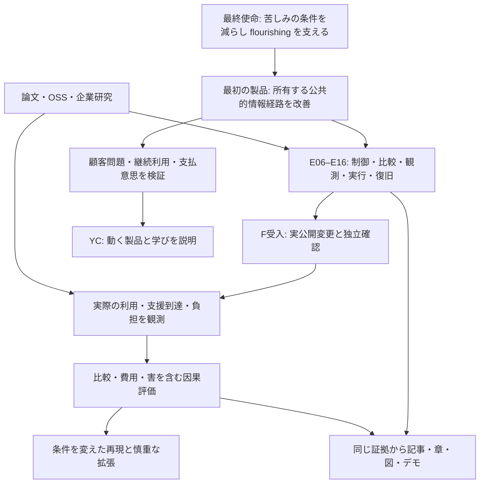

# Manager全体設計の再検討 — 既存研究をつなぎ、何を検証するか

**調査日:** 2026-10-22 UTC。**対象:** 行動シミュレーション、再利用可能なエージェント基盤、公的支援の改善、測定、YCと研究出版。
**成果:** [更新した製品仕様](../../MANAGER_PRODUCT_SPEC.md)、[技術設計](../../specs/2026-10-22-manager-validated-autonomy-design.md)、[E計画](../../plans/2026-10-22-manager-core-execution-plan.md)、[研究製品計画](../../plans/2026-10-22-manager-research-products-plan.md)。
**出典台帳:** [PRIMARY_SOURCES.json](PRIMARY_SOURCES.json)。37件の出典レコードであり37件の独立実験ではない。関連ページ・論文版・コードを一つの研究の独立追試と数えない。全文読了、本文passage、部分PDF、README、実コードinterfaceの確認範囲を各カードに残した。全論文・全企業の網羅や、この調査でupstream benchmarkを実行したことは主張しない。

## 1. 選ぶ経路

Managerの長期使命を、苦しみを生む条件の改善へ向けた自律的な観測・実行・検証と捉える。その第一製品は所有デジタル資産の狭い改善ループとする。行動シミュレーションは候補の検討に使えるが、それ自体を最終成果や本番の必須依存にしない。

この経路が合理的な理由は、既存の所有サイト・kernel・publisher・readbackを再利用して有限の実結果を確認できること。ただし、アクセス障壁の重要性、下流便益、配信経路、継続顧客は未確認。文献調査から市場需要や成功確率は導けない。最初の問題が小さい/違う場合は、製品全体を広げる前に利用場面を変える。

## 2. 行動シミュレーション企業から学ぶ

| 対象 | 直接確認できたこと | Managerへ持ち込むもの | 現在の証拠の限界 |
|---|---|---|---|
| Artificial Societies / Radiant | 企業・method/eval頁、11検証テストのpreprint、公開benchmarkとconnector README/LICENSE | 用途別検証、coverage/欠測、共通点数へ潰さないscorecard、任意MCP接続候補 | 自社評価とvendor-affiliated preprint。公開質問の学習混入を排除できず、相互作用する社会や実便益の証明ではない |
| Simile | 公式サイト、誤差予測のconfidence手法、groupを保つfoldの説明 | 言葉上の自信ではなく予測誤差を学ぶこと、鮮度と母集団/用途別評価 | 企業内部の評価・閾値。外部の別対象へ同じ精度は保証されない |
| Aaru | distributionの評価対象・sampling adjustment・confidence・漏洩制御の技術説明 | 生の誤差と補正後誤差、単変量と個人/同時分布の分離 | 高相関を高accuracyと呼べない。SimileとのAUROC比較は別データで、head-to-headではない |
| Concordia | Apache-2.0、entity/action/observe、engine/GM、既存pinのPython要件 | 現在の隔離adapterと仮想環境を再利用 | GMが結果を生成しても現実の人の行動・因果効果ではない |
| Socrates / SocSci210 | 正式EMNLP論文、公開split、README、分布と個人の結果の差 | 原著のtask-awareな意味と研究単位holdoutを保った比較 | 元質問/データ/重みの権利は別。Manager既存のnumeric-code研究は正式benchmarkの再現ではない |

出典: [Artificial Societies method](https://societies.ai/knowledge/what-are-artificial-societies)、[AS Benchmark v2](https://arxiv.org/html/2609.30030v2)、[公開benchmark](https://github.com/artificial-societies/artificial-societies-benchmark)、[Radiant connector](https://github.com/artificial-societies/radiant-claude-plugin)、[Simile confidence](https://www.simile.com/blog/confidence)、[Aaru methodology](https://aaru.com/publications/population-simulation-at-the-replication-floor-research)、[Concordia](https://github.com/google-deepmind/concordia)、[Socrates正式論文](https://aclanthology.org/2025.emnlp-main.1530/)。

RadiantはArtificial Societiesの製品名で、別企業として二重計上しない。公式READMEにはremote MCP/OAuthとツール群があるが、本セッションでは接続・認証・実行していない。MITのconnectorはhosted serviceの利用権や学習データの自由利用を意味しない。CVS、Wealthfront、Teneo等はvendorが示す顧客/partnerで、全てを競合企業やManager顧客として並べない。

## 3. 論文が要求する検査

**介入条件を変えると、仮想の人そのものが変わる可能性がある。** Linらの *The Illusion of Intervention: Your LLM-Simulated Experiment is an Observational Study*（2026、arXiv v1）は、未指定のlatent属性が処置/対照で変化する選択biasを扱う。固定persona IDやpromptの乱数化だけで人間RCTの因果性は成立しない。負の対照、同条件反復、属性drift、taskに関連するconfounderを調べる。負の対照で差が出なかったことも「交絡なし」の証明ではない。[原著](https://arxiv.org/html/2605.20767v1)

**較正は本物の参照と仮定が必要。** Hullmanらの *This human study did not involve human subjects: Validating LLM simulations as behavioral evidence*（2026、arXiv v1）は、もっともらしさの改善と統計的な推論の較正を区別する。Prediction-Powered Inference等も、適切な人ラベル、sampling/transport、評価独立性が成立して初めて使える。誤差予測モデルやsampling-noiseの差引きだけで、人の因果推論が保証されるわけではない。[原著](https://arxiv.org/html/2602.15785v1)

**一つの良い数字を万能accuracyへ変えない。** AS Benchmarkはresponse process、construct structure、external fidelityを分けている。Socratesの正式PDFでは分布のWasserstein距離改善と個人accuracy低下が併存する。Parkらの2026年v3のretest-normalized一致は、絶対accuracyや全行動の予測率ではなく、5実験の効果量比較もunderpoweredと記載されている。[AS v2](https://arxiv.org/html/2609.30030v2) · [Socrates PDF](https://aclanthology.org/2025.emnlp-main.1530.pdf) · [Parkら v3](https://arxiv.org/abs/2411.10109)

これらはE07–E09と後続Vの評価条件へ反映した。独自の基盤モデル・大規模finetuningを始める根拠にはまだしない。公開コードと商用providerをまず比較し、対象taskで不足が確認された時だけ追加開発を検討する。

## 4. 自律エージェントの成果をどう読むか

Vending-Bench 2の銀行残高は仮想環境の長期整合性指標。SWE-Lancerの歴史的報酬額で重み付けした解決点数は、エージェントが実際に受け取った売上ではない。Project Vendの現実の運用報告は重要だが、人の支援、手続き、architecture変更、費用、失敗を含む。Pionは調査時にresearch previewであり、公開OSS executor/APIとして利用可能だとは確認していない。[Vending-Bench 2](https://andonlabs.com/evals/vending-bench-2) · [SWE-Lancer](https://openai.com/index/swe-lancer/) · [Project Vend 2](https://www.anthropic.com/research/project-vend-2) · [Pion](https://andonlabs.com/blog/why-we-built-pion)

Managerに必要なのは、成功例の見栄えをまねることより、同じ種類の失敗をテストすること。quota、長時間待機、応答消失、古い情報、悪意ある取得本文、重複変更、実行中ownerの交代、誤った復元を検査する。実行回数を増やすより、有効なNO_ACTIONとUNKNOWN隔離が正しい時に働くかを重視する。

## 5. 既存OSSを使う具体策

| Upstream | 今回の読取 | 再利用と不足 |
|---|---|---|
| Inspect AI 0.3.283 | `Task`の実コード、固定commit、MIT | Task/Solver/Scorer/log/limitsの薄いadapter候補。cost_limitは永続予算台帳や公式請求を置き換えない |
| GrowthBook Python 3.2.2 | 既存pinのSDK実コード、MIT | 既存割付準備を再利用。in-memory trackingは真正な露出receiptの永続記録ではない |
| DoWhy 0.14 | CausalModelの実コード、MIT | identify/estimate/refuteの既存adapterを再利用。識別仮定・介入・参照・結果データは利用側が用意する |
| Concordia既存pin | entity/setupの実コード、Apache-2.0 | Python>=3.12の研究環境をcore>=3.11から隔離したまま利用 |
| SQLite/outbox | 現Managerソースと公式outbox/durable execution解説 | 新frameworkへ移す前に、現intent・occurrence identity・owner・reconcileを完成させる |

コードの固定URL、commit、license、読んだ範囲はJSONへ記録。再利用したコードをこの調査で新たにインストール・実行したとは主張しない。SWE-Lancer旧repoはarchivedで移動先があるため、古い導入手順をそのまま採用しない。

外部作用の無条件exactly-onceは保証できない。local transactionが原子的でもremote書込と同じtransactionにはならない。応答消失、遅延反映、旧workerのin-flight要求を想定し、UNKNOWNを隔離し、確定不在に必要なtarget契約を明記する。[Temporalの説明](https://temporal.io/blog/idempotency-and-durable-execution) · [AWS transactional outbox](https://docs.aws.amazon.com/prescriptive-guidance/latest/cloud-design-patterns/transactional-outbox.html)

## 6. 実際の支援改善から学ぶ反証

**有効だった機構:** LAのGetCalFresh柔軟面接のworking paperは64,798件をランダム化し、30日以内の承認を6.2 percentage points、5か月時点までの参加を2.2 points増加と報告。読んだのはNBERの2023年版の冒頭12/45頁で、後のjournal版や全appendixを読了したとはしない。これは面接機会・運用の変更であり、案内文やAIだけの効果ではない。[NBER原著](https://www.nber.org/papers/w31239) · [実装者の説明](https://codeforamerica.org/news/think-big-start-small-how-implementing-flexible-interviews-improves-benefit-delivery/)

**技術・手続改善だけでは足りなかった機構:** GSA OESの書類アップローダーRCTは33,574件。情報不足による拒否は21.1%→20.0%へ減った一方、受給登録は43.3%→43.8%、p=.28で、有意な増加は確認されていない。ゼロ効果の証明ではないが「UIを直せば便益が生じる」という短絡への反証になる。[OES公式結果](https://oes.gsa.gov/results/decreasing-snap-denials/)

両者は別の機構、別の環境。Managerは実際の障壁を先に確かめる。利用者への表示、クリック、手続の前進、受給、生活の結果を分け、失敗と離脱を分母に含める。支援の供給不足や複雑な資格要件が主要因なら、リンク訂正だけでは解けない。

## 7. 便益の測り方と対象の広さ

- WHO-5は人の精神的wellbeing、CFPBは成人の金融的security/freedom、OECDは主観的wellbeingの測定設計を扱う。単一の万能苦痛点ではなく、目的に合った尺度・結果と測定負担を選ぶ。[WHO-5](https://www.who.int/publications/m/item/WHO-UCN-MSD-MHE-2024.01) · [CFPB quick guide](https://files.consumerfinance.gov/f/documents/201701_cfpb_FinancialWell-Being_Quick-Guide.pdf) · [OECD](https://www.oecd.org/en/publications/oecd-guidelines-on-measuring-subjective-well-being-2025-update_9203632a-en/full-report/measuring-subjective-well-being_b4b53f27.html)
- WHOの今回の2024原本はCC BY-NC-SA 3.0 IGOで商用利用条件の確認が必要。CFPBの文言/選択肢変更、回答欠落、年齢・回答mode別の換算も無視しない。紹介ページが公開されているだけで商用埋込みを許可されたとしない。
- 人以外のwelfareは種・環境に適した行動、機能、身体/精神状態の証拠を用いる。WOAHの取得PDFはURLにcurrentとあっても本文editionは古く、最新2026標準と断定しない。New York Declarationも不確実性下での配慮を要求するが、人の尺度を動物に適用する根拠にはならない。[WOAH chapter](https://www.woah.org/fileadmin/Home/eng/Health_standards/tahc/current/chapitre_aw_introduction.pdf) · [宣言](https://sites.google.com/nyu.edu/nydeclaration/declaration)

## 8. YCと最初の顧客

公式apply頁をlive取得し、W27は2027年1–3月のSan Francisco対面batch、on-time締切は11月2日20時PTと確認した。該当cycleから年は2026年、UTCでは11月3日04時/JST13時。提出直前に再確認する。採択や申請済みは主張しない。[YC apply](https://www.ycombinator.com/apply)

YCはidea stageでも応募可能と説明している。全書籍や全科学実証を応募の前提にする必要はない。一方で、使命の大きさを説明するだけでは顧客の問題・使う理由の証拠にならない。最初のscope、動くデモ、実際に聞いた問題、既存代替、費用、次の実験を短く示す。[FAQ](https://www.ycombinator.com/faq) · [YC essential advice](https://www.ycombinator.com/library/4D-yc-s-essential-startup-advice)

提案する最初の商用仮説は、公共的サービスの所有情報経路に対する信頼性・改善・証拠記録。現時点で支払意思・顧客・MRRは不明。U002/U003の実問題確認と選定を満たし、既存link checker/監視/手作業より役に立つかを検証する。自社サイトの成功だけで顧客需要としない。自治体・第三者の申請/面接フローへ権限なく入ることを必須工程にしない。

## 9. 知識を積む作業と成果物

知識は、読んだ件数ではなく、原著の対象/方法/失敗条件を説明し、実装・比較・反例を再現できるかで確認する。既存16章outlineと3巻構想は別々の大量執筆へ分岐させず、同じ章sourceの梱包として整理する。最初に一つの完成章を作り、出典・数式・実行例・反例・図・Managerへの判断を揃える。

研究論文は、適切な参照と独自の問い/結果が成立した時の候補。今は文献総説・方法説明・engineering evaluation・field protocolを、それぞれ正しい名称で書ける。負の結果も書籍と公開研究の価値になる。原稿を完成品や公開済みと呼ばず、公開前後の実bytesとURLを確認する。

## 10. 不確実性と実行上の判断を分ける

| 未確定事項 | 次に必要な証拠/判断 | その間の既定動作 |
|---|---|---|
| 対象の問題は大きいか | U002の実問題確認、既存作業/失敗/負担 | 顧客仮説は暫定、自社scopeのみ |
| 下流便益があるか | 真正な結果、適切な比較、費用/害 | P2技術成果として報告 |
| モデルが必要か | E07/E08の公平比較と失敗分析 | NO_ACTION/決定的ルールを保持 |
| E09参照が適合するか | 対象・意味・権利・splitの確認 | 不足はREFERENCE_DATA_REQUIRED、順序を飛ばさない |
| いつ常時運用できるか | 永続host/volume/owner/監視/復旧 | DEPLOYMENT_HOST_REQUIRED、CIのみでdeployedにしない |
| 収益化可能か | 実利用/支払意思/原価/継続 | 価格や顧客を捏造しない |
| 別国・他種にも効くか | 条件を変えた独立の評価 | 未検証として残す |

論文・企業資料に不整合がある。SocratesのACL landing abstractは36%/15%、正式PDF本文・表は26%/13%であり、版を混ぜない。OES頁/PDFの一部CI表記にも不整合があるため、ここではCIを引用せず、報告された点推定とp値・null判定だけを示した。未検証の箇所を任意の値で修復しない。

**今回行ったこと:** 読取調査、現在コードの確認、仕様・派生計画更新。**行っていないこと:** E06実装修正、新しいliveモデル試行、商用provider接続、公開記事/サイト配備、YC送信、第三者への連絡、参加者研究。状態は唯一のSSOTで維持する。
