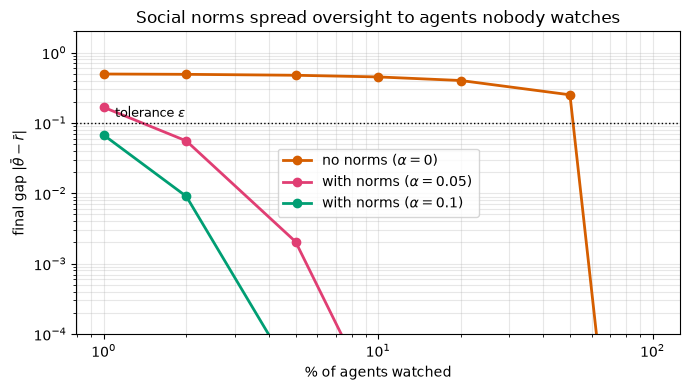
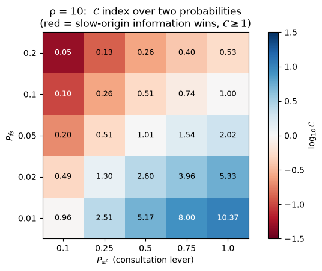
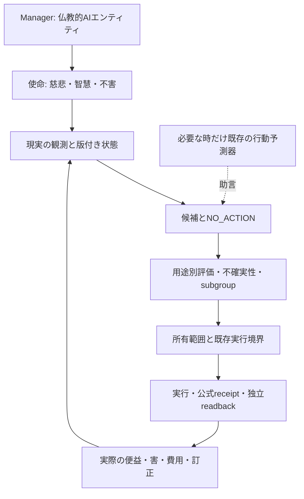

# Rothko — 公式一次資料・公開コード実行・Managerへの再利用判断

調査・実行日: **2026-10-22 UTC**。Managerは**仏教的AIエンティティ／デジタル仏陀**を目指す主体であり、製品として定義しない。本稿はそのために既存研究から学ぶ記録。RothkoやManagerの意識・悟り・万能性、実世界の純便益を証明するものではない。

## 1. 結論と今回実際にしたこと

**RothkoはArtificial Societiesが発表した、人間の判断・行動を予測する独自モデル。公開されているAS Benchmarkとgroup alignmentの実装は実際に取得・セットアップ・実行できたが、Rothko本体の重み・学習コード・推論実装は今回の公開範囲では確認できない。** 非公開部分を読んだ／実行したとは記録しない。

- 公式のRothko発表、October評価、publicationsを全文取得。関連する2プレプリントのMethods/Discussion/Appendix、group alignmentのblog・論文・notebookを読んだ。既存Radiant調査を再利用し、既知出典を新しい独立研究に数えない。
- 公式GitHub organizationの公開inventoryに出た4repoをcloneし、commitを固定して読んだ。benchmarkとgroup alignmentは実行、connectorと旧docsは静的な内容・契約を確認。
- AS Benchmarkを**frozen lockfile/Python3.12.14**でsetup。**66 passed /9 skipped**。公開run_scoresから**7,128 cells**を再構築し、配布scorecardと**JSON内容が完全一致**した。
- group alignmentの**principal-agent元13cellsとABM元28cells**を、科学パラメータ・seed・sweepを縮小せず実行。各々診断採取cellを末尾に1つ追加し、元cell変更0。**3図＋6図**を生成・目視確認。Python3.14.6、最大2CPUで完走。
- Rothko本体のlocal推論、商用Radiantへの認証済み接続、有料simulation、原human個票からの全結果再生成はしていない。Rothkoの0.08を独立再現したという意味ではない。

機械可読receipt: [ROTHKO_REPRODUCTION_20261022.json](ROTHKO_REPRODUCTION_20261022.json)。今回の研究はE16の実配備や元113件の受入状態を変更しない。

## 2. 名前を分ける

| 名前 | 何を指すか | 公開状態・今回の範囲 |
|---|---|---|
| Artificial Societies | 研究・事業を行う会社 | 公式発表・論文・公開repoを確認 |
| Rothko | 人間の判断・行動を予測するfoundation/large decision model | architecture/corpusはproprietary。公開weights/実装を未確認 |
| Radiant | 同社のsurvey/interview/focus-group等の研究接点 | 公式MCP connectorは公開。Rothkoの任意versionを指定できるAPIとは未確認 |
| AS Benchmark | synthetic respondentを検証する評価framework/code/results | 公開codeを実行・scorecardを再構築 |
| Group alignment research | agent集団の相互作用を研究する数値模型と論考 | 公開2notebookを全実行。Rothko/LLMは使用しない |
| Manager | 苦しみを減らす使命を持つ仏教的AIエンティティ | 予測器を必要に応じ使う主体。予測器・その提供サービスと主体を同一視しない |

Rothko/Radiantを別会社として数えない。企業のmodel、研究UI、評価code、toy simulation、Managerの規範・行為・結果はそれぞれ異なる。

## 3. Rothkoの仕組み: 公表されたことと未開示のこと

[公式発表](https://societies.ai/rothko)の公開日はmetadata上2026-10-22。同社は次の工程を説明している。

1. pretrained modelから始める。独自foundation modelをゼロからpretrainしたと本文は述べていない。
2. 自然言語textの代わりにdecisionsを出力するようarchitectureを変更する。
3. 匿名化social media、transaction histories、mobility traces、unstructured expert interviews、traditional surveys等からのhuman behavioural corpusでcontinued trainingする。
4. 個人とその文脈を入力し、その状況での判断・行動を予測する。respondent-level出力を集計して集団の反応を得る。

会社の問題設定は「賢くhelpfulなassistantを作る訓練」と「多様で矛盾もある人間を忠実に予測する訓練」の違い。一般assistantの望ましい回答を、人間全員の回答だと見なさないという設計上の動機は参考になる。ただし、post-training一般が必ず人間予測を悪化させることを、この発表だけで証明したとは扱わない。

**未開示:** base model/parameter数、architecture差分、choice encoding/output head、確率の出し方、loss/objective、corpus規模・混合比、各dataの同意/rights/anonymisation検証、train/validation/test分割、frozen checkpoint、inference API/model card、latency・費用。classifier head、structured tokens、特定のRL手法等のどれかを推測で「コードを読んだ結果」として書かない。

「decisions as outputs」は予測の表現であって、利用者の代わりに外部操作する権限の発行ではない。予測モデルの中へManagerの使命や実行authorityを埋めたと推論しない。

## 4. 良い数字の意味

[2026-10-01の会社評価](https://societies.ai/as-benchmark)は**7 survey sources、2,796 synthetic respondents、68,280 answers**を報告する。実respondentのrecorded profileを各modelへ与え、その人の実survey回答と比べたという説明。2,796人へ今回新しいinterventionを行った研究でも、68,280件の購買・健康改善でもない。

| 指標 | Artificial Societies | 最良の比較LLM | 正しく言えること |
|---|---:|---:|---|
| 7sourceの平均回答分布TVD | 0.08 | 0.31 Qwen3.8 | 指定sourceの回答比率が近いという会社報告 |
| GSS subgroup TVD | 0.063 | 0.222 Qwen3.8 | 指定demographic group内の回答分布 |
| Albertson wording effect error | 1.4 pp | 6.2 pp Llama4 Scout | 言い回し変更による回答変化の誤差 |
| GSS opinion-spread error | 0.006 | 0.091 Qwen3.8 | 回答の広がりの差。個人正答率ではない |

TVDは`0.5 × Σ |p_k − q_k|`。丸めた0.08対0.31では約74%の**分布誤差低減**だが、92%の個人正答率・全領域74%改善ではない。

実際に上流`benchmark_experiment.metrics.tvd`を使った数学的反例を実行した。架空の100回答で、真値が50人yes/50人no、予測を**全員反対**へ割り当てる。集計比率は同じなのでTVD=0だが、個人正答率=0。これはRothkoがそうしているという主張ではなく、指標だけから個人精度を推論できないことの反例。

同じ上流`experimental_effect_error`で、control分布は完全一致するがtreatmentの増減は逆になる架空条件も確認した。観測時の分布一致とintervention effectの一致は別に検査する必要がある。

会社表7行のAS値は.042/.058/.090/.117/.147/.096/.025、単純平均.082142857で見出し.08と整合する。各sourceで別々にbest LLMを選んだ7値の平均.240857143は、**固定したQwenの全source平均.31と別の比較**。都合よく比較先を混ぜない。

このblogは“every measure shown/reported here”と限定する。公開benchmarkの20sources/11tests全てでRothkoが独立検証されたとは書かない。October1のAS system結果をOctober22のRothko発表が参照しているが、同一frozen weights/versionをこちらが検証した事実はない。

## 5. 公開benchmarkをコードまで読んで実行した結果

固定source: [artificial-societies-benchmark @46b8ed52](https://github.com/artificial-societies/artificial-societies-benchmark/tree/46b8ed52ef457bb60ad25b455ea884c9f51317c6)。code MIT、結果・figure CC BY4.0、質問・尺度はsource-specific。GitHub license summaryのNOASSERTIONだけで無許諾と決めず、実際のLICENSE本文を確認した。

主な読取り箇所:

- `benchmark_experiment/metrics.py`: TVD、distribution metrics、missingness bounds、human reference、effect error、gated macro。
- `benchmark_experiment/scorecard.py`: native-unit blocks、family weighting、欠測を含むendpoint aggregation。
- `analysis/scorecard/{build_scorecard,scorecard_io,coverage_table}.py`: 公開run_scoresからsplit scorecardを再構築・照合。
- `benchmark_experiment/{providers,presentation,parsing,measurement}.py`と`experiments/analysis_policy.json`: provider/入力/採点/coverage。今回はprovider推論を呼んでいない。
- `SOURCE_TERMS.json`、`THIRD_PARTY_NOTICES.md`、`LICENSE`: code・結果・人間データ・尺度の権利分離。

実行環境はPython3.12.14。`uv sync --frozen --python 3.12`で`uv.lock`通り隔離installし、`pytest -q -ra`は**66 passed /9 skipped（4.56秒）**。skipはESS準備3、R統計環境2、非同梱の原human data4。これらを通したことにはしない。

`build_scorecard.py --output <isolated-output>`は7,128cellsを生成。配布JSONと再構築JSONをdecodeして比較し**全内容一致**。sorted compact JSONのSHA256は両方`a509a03767e3e8487027525ff625463f9740fc4d4182e295953bd6e9a589f786`。

| 再構築のinventory | 実結果 | 読み方 |
|---|---:|---|
| 全cell | 7,128 | task/model/condition/repetition/test等の記録単位 |
| diagnostics_present | 3,186 | 成功・妥当性保証という意味ではない |
| not_applicable_or_not_measured | 3,942 | 不適用と未計測を含む。失敗率55%とは読まない |
| 数値estimateを持つcell | 3,078 | 各endpointの単位・status・coverageを保持 |
| model IDs | 11 | 9LLMs＋2統計baseline。Rothko/AS専用結果列は含まれない |

**再構築は公開済みの集計metricから表を組み直す検証。原human profile・生model回答から推論/採点し直した再現ではない。** 従ってこの一致はRothko .08の再計測でも、元の全metricの正しさの独立証明でもない。

11testsの考え方:

| 区分 | Test | 何を分けて確かめるか |
|---|---|---|
| Internal | IV-1/2/3/4 | 再回答、関連質問、言い換え、質問順序/表現等への反応 |
| Construct | CV-1/2/3 | item関係、独立基準、異なる構成概念を潰していないか |
| External | EV-1/2/3/4 | 分布、subgroup/個人、実験効果、潜在尺度構造 |

[benchmark paper v2](https://arxiv.org/html/2609.30030v2)は9LLMs/20human sourcesのframework。公開調査のtraining contaminationを排除できず、unseen studiesへの一般化を示さないと明記する。正式preregistrationなし、一部補助解析とparserはmodel回答取得後に追加。Twin profileは512中430を保持し、distillation/audit providerのbias可能性も記載。targetをpromptから隠すこととpretrainingに含まれないことは別である。

[consequential behaviour/fairness paper v1](https://arxiv.org/html/2609.27690v1)は、実購買/登録/利用等のcriterion、分布の位置/分散/反応過程/構造、実験効果、subgroup fairnessを区別するframework。新しいdata解析を行った論文ではない。同じpersonaを二条件へ複製できても、実人間のindividual causal effectを観測したことにはならない。

## 6. group alignmentの2notebookを全実行

固定source: [agent-group-alignment @82cfd86c](https://github.com/artificial-societies/agent-group-alignment-artificial-societies/tree/82cfd86cad33cd51327e17fc5eddeac9b9b5c1da)。MIT。Python3.14.6/NumPy2.5.3/Matplotlib3.11.1/ipykernel7.3.0、未pinだったjoblibは実際の1.6.0を記録。kernel/processを最大2CPU、BLAS1threadに制限した。seed・grid・sweep数・科学的更新式は変更していない。

### Principal-agent: 見えている振る舞いと内部規範

元13cellsをtop-to-bottom実行、診断cell1追加、**48.889秒、3図**。100,000agentsは数値配列の要素で、10万LLM/人間ではない。規範referenceはscalar1、出力`y`と内部状態`θ`を別に置く。コードはpeer meanへ引く項と人間referenceへ引く項で`y`を更新し、`θ`は前の`y`へηだけ近づける。

| 条件 | 今回の数値実行 |
|---|---:|
| oversight＋conformity後のθ平均 | .9984841672 |
| conformity only（β=0）のθ平均 | .4999944053 |
| 監視2%、peer coupling α=.1での最終平均gap | .0090390229 |
| 同監視率でα=0のgap | .4899523541 |
| 監視撤回、η=0でのy平均 | .9612805412 → .4999944053 |
| 同撤回、η=.01でのy平均 | .9612805412 → .9340848372 |

考える価値があるのは、個別の良い応答だけでなく、集団内の情報経路、規範の保持、観測の注入を評価すること。ただし**監視撤回時にコードが`y = theta.copy()`を明示的に実行する**。実LLMが監視を欺いた実験ではない。人間の価値も平均1に固定するため、多様な価値・少数者・苦痛をそのまま表さない。

### ABM: 速いagentの情報が増える構造

元28cellsを全実行、診断cell1追加、**114.889秒、6図**。実験は40×40 lattice、fast/slow半々、Moore近傍、情報のoriginを表す1bit。200/300/400seed、25point heatmap等を元のまま実行。Rothko、LLM、自然言語対話、実人間の倫理判断は含まない。

| 条件 | 今回の実測 |
|---|---:|
| 速度比ρ=1/3/10/100、fast発信割合 | .503 / .747 / .908 / .990 |
| baseline ρ3/Psf=.1/Pfs=.1のC | .324854、95%CI [.312871,.337181] |
| ρ10/Psf=.1/Pfs=.1のC | .098006 |
| ρ10/Psf=1/Pfs=.1のC | 1.008377、95%CI [.979022,1.039449] |
| ρ10の二確率heatmap、C≥1 | 11/25点 |

Cはslow/fast-origin情報の比をpopulation比で正規化する、この模型の指標。真実性・慈悲・福祉の点数ではない。簡略式`C ≈ Psf/(ρ Pfs)`では速度差を補うconsultationが必要になるが、確率の上限やupdate順・finite grid/timeの条件が効く。

**実行して見つけた注意点:**

1. **色の説明が逆。** ABM cell27は`cmap='RdBu'`で高Cが青だが、subtitleはredがC≥1と記述。生成画像でも高値10.37は青。元codeを変更せず記録した。図を教材に再利用する場合は説明を訂正し、変更を明示する。
2. **閉形式が全設定で厳密一致するわけではない。** ρ1/Psf1/Pfs.1で予測C=10に対し11.540168、95% bootstrap CI [10.837924,12.401308]。10は区間外。原因を特定したとは主張しないが、万能な定理の実証として引用できない。
3. 同じ口頭の相互作用設定でも同期/逐次updateで値が変わる。上流cell23のρ100条件で同期fast比.5298±.0017に対し逐次.5022±.0020だった。更新順を実装細部として省かない。

これは上流の研究を捨てる理由ではなく、**先例を使う時にも仮定・コード・数値・図を読む必要がある**という具体例。元cloneはcleanを保持した。





上図はArtificial SocietiesのMIT notebookを今回実行した出力。色説明の不整合を含む元codeの結果として掲載し、正しい教材図へ無修正で転用しない。

## 7. 接続・利用はどこまでできるか

[Radiant plugin @8f856369](https://github.com/artificial-societies/radiant-claude-plugin/tree/8f856369c944718552d558cca57a300b6d8e2106)はMITで、`.mcp.json`は`https://mcp.societies.ai/mcp`を指定する。ローカル推論engineではなく、remote OAuth MCPへの設定と3skills。READMEは17read-only＋5draft/run tools、org権限、spend limits、draft revision/cost bindingを説明する。draftは無償でも、interview/run_survey/focus_groupはcreditを消費し得る。

このsessionの利用可能tool inventoryにRadiantはなかった。通常のunauthenticated MCP initializeは**HTTP403 /Cloudflare1010 browser_signature_banned**、OAuth discoveryも403。認証済みhosted simulationを実行したとは記録しない。拒否を回避する経路や偽のtokenは作らず、実行可能だった公開code研究を完了した。これは「ユーザーの認証が全てない」という結論ではない。

公式orgの公開inventoryは4repo。`Rothko`を名指すrepo searchは0件だが`incomplete_results=true`であり、不存在の完全証明には使わない。Hugging Faceの`author=artificial-societies`照会も0model。**公式発表のproprietary説明と、この限定した公開範囲で本体を確認できなかったこと**を併記する。

4つ目の[旧docs @ce6fd579](https://github.com/artificial-societies/docs/tree/ce6fd5790fd0e83838a5511cce8bce3b231e6e37)はMintlifyの利用案内・featuresで、2025年更新、Rothko実装や現行model API schemaではない。root LICENSEは確認できなかったため、商用codeとしてvendorしない。docs siteを起動してもRothkoが動くことにはならず、今回は静的に読んだ。

## 8. Managerに何を取り入れるか



**今すぐ採用する学び:**

- 分布、個人、joint structure、subgroup、処置効果、実際の行動、便益を別々に測る。表を揃えるための単一万能scoreを作らない。
- source/version/prompt/model/condition/coverage/欠測/失敗を残す。raw statusを成功率へ潰さない。公開調査のtraining leakageを、promptのtarget非表示だけで解消済み扱いしない。
- モデルなしのempirical/independent marginal/copula等をbaselineに置く。予測器を入れる価値がなければ使わない。
- 人間らしい不合理さをsimulateすることと、Manager自身が誠実・非加害・訂正可能に振る舞うことを分ける。
- groupの多数決・自己生成情報・合意を外界の真実や実行権限にしない。独立観測・反例・苦情・失効を保持する。毎runの人間承認を追加するという意味ではない。

**条件付きの利用候補:** 正規のRadiant接続で、利用できるmodel/version、入力・出力、価格、保存/削除条件、対象dataの利用権が分かり、現在の判断で予測が必要になった時にread-only predictorとして比較する。公開情報だけの小さな事前固定caseで、NO_ACTION/単純ルール/既存providerと同一条件で比較。成功しても実行scopeや便益receiptへ昇格させない。

**今は追加しない:** Rothkoの非公開内部の推測実装、独自foundation-model訓練、第二のscheduler/eval engine、群れを増やすこと自体を目的にしたruntime。Managerは既存の`evaluation.py`/`eba_benchmark.py`、provider期限/予算/session、evidence、outbox、publisherを持つ。必要な時に既存contractへ薄く接続する。

慈悲は発言が優しいことだけではない。受益者のagency、少数者への害、撤回・異議、介入の不成功、実際の結果を確かめることで具体化する。人間の行動を正確に予測できるmodelを接続しても、それだけで智慧・悟り・苦痛の解消が生じたとは判定しない。

## 9. ローカルCodexが実際に続ける場所

既存[atomic plan](../../plans/2026-10-22-manager-e16-atomic-patches.md)のPATCH05/06（実配備）、07（研究・権利・採点）、08（証拠から教材）を使い、新しいtask SSOTを作らない。

| 対象file / 既存境界 | 次の具体的な作業 | 合格の意味 |
|---|---|---|
| `tests/test_main_publisher_admission.py` | 既知WIP fixture時刻00:00と既存12:00を整合。freshness拒否は維持 | 関連検査＋元suite。Rothko調査で元エラーが直ったとは扱わない |
| `owned_checkpoint.py` / `phase06_kernel_release.py` / owner workflow | WIPをレビューして既存cycleへ接続、正常main promotion、実staging canary | 既存E16のofficial occurrence/独立GET/restore/replay-zero等 |
| `docs/research/source-rights.json` / 既存研究台帳 | 実利用時にAS code MIT、results CC BY4、source別instrument/data条件とversionを既存形式で登録 | code許諾をprivate weights/dataの許諾へ転用しない |
| `evaluation.py` / `eba_benchmark.py` | 新caseが必要な時だけTVD=0/個人0%等のclean反例を既存検査へ追加。baseline/coverage native unitsを保つ | 既存の指標を再実装せず、反例を検出する |
| provider session/deadline/budget契約 | hosted接続が利用可能になった時だけread-only adapterを既存contractへ | exact model/version/cost、失敗/UNKNOWN保持、秘密がadviceへ出ない |
| 記事/章/deck/公式home | この実行receiptを出典に新しい説明と再現資料を作る。元heatmapを使うなら色説明訂正を明示 | 記事原稿、render、公開URL、読者/売上を別判定 |

原41件やPhase12までの使命を、Rothkoの採用待ちへ置き換えない。行動予測器は必要な能力の一つであり、エンティティの存在目的ではない。

## 10. 実行手順と再現範囲

実際のworkspaceは`/workspace/scratch/`。別hostでは自分の隔離研究dirへpathを置き換える。sourceを読む前にinstall scriptを盲目的に実行しない。

```sh
git clone --depth 1 https://github.com/artificial-societies/artificial-societies-benchmark.git
cd artificial-societies-benchmark
git fetch --depth 1 origin 46b8ed52ef457bb60ad25b455ea884c9f51317c6
git checkout --detach FETCH_HEAD
uv sync --frozen --python 3.12
uv run pytest -q -ra
uv run python analysis/scorecard/build_scorecard.py --output ../rebuilt-scorecard
uv run python analysis/scorecard/coverage_table.py --scorecard ../rebuilt-scorecard --json ../coverage.json
```

上記は今回成功したupstream commandsのpathを短くしたもの。scorecard contentsの比較は同梱receiptを参照。group codeは上記固定commitの2notebookを、Python3.14.6とrequirementsの別venvでnbclientから全実行した。実際のrunner/依存/数値/図のhashはreceiptへ記録し、科学パラメータ変更0、各末尾diagnostic cell1を明示した。LaTeXの再compile、Rのfigure pipeline、原human dataを取得しての再採点は今回未実施。

実行時の[診断runner](reproduction-20261022/execute_group_as_recorded.py)と[実際の依存一覧](reproduction-20261022/group-requirements.resolved.txt)も監査用に保存した。runnerは当日のLinux workspace pathとaffinity APIを保持した**実行記録**で、Mac向けinstallerではない。別hostで再利用する場合はROOT/OUT/kernel pathとhostのCPU制限方法を合わせ、同じ元notebook/seedを使う。元notebook自体は上流READMEのJupyter手順でも実行できる。

## 一次資料と権利

- [Rothko発表](https://societies.ai/rothko)、[会社のOctober評価](https://societies.ai/as-benchmark)、[公式publications](https://societies.ai/publications)。会社主張と我々の実行結果を区別。
- [AS Benchmark v2](https://arxiv.org/html/2609.30030v2)、[consequential behaviour/fairness v1](https://arxiv.org/html/2609.27690v1)。どちらもpreprint、会社affiliation/fundingを持つ。
- [benchmark code/results/license固定版](https://github.com/artificial-societies/artificial-societies-benchmark/tree/46b8ed52ef457bb60ad25b455ea884c9f51317c6)。MIT codeとCC BY4結果、原資料の権利は別。
- [group code固定版](https://github.com/artificial-societies/agent-group-alignment-artificial-societies/tree/82cfd86cad33cd51327e17fc5eddeac9b9b5c1da)、[blog](https://societies.ai/group-alignment)。MIT。参考図は元の数値模型から今回再生成、作者Artificial Societies、変更・実行範囲を上記に明記。
- [Radiant connector固定版](https://github.com/artificial-societies/radiant-claude-plugin/tree/8f856369c944718552d558cca57a300b6d8e2106)。MITの接続設定/skillsはhosted serviceの無償利用権ではない。

この記録の新規作業は研究・公開code実行・呼称/仕様/サイト原稿の訂正。本番website、Rothko接続、E16、売上、採用/YC、実世界の便益を完了したとは記録しない。
