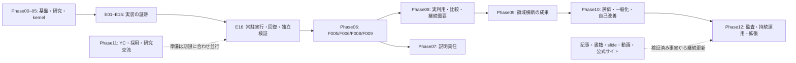

# Manager — 開始からPhase12までの全工程と残41件

2026-10-22 UTC。これは [tasks.json](tasks.json) の状態・依存を説明する派生view。状態の正本を増やさない。確認baselineは `2b9a7b78b4845f6ac7022f969244dc0d1596bddf`。原113件は **69 done / 41 todo / 3 skipped / 0 blocked**、技術の現在地は **E16、本番配備前**。完了は各taskの限定した受入れであり、全科学・顧客需要・人の便益の検証済みという意味ではない。

ユーザーの意図は、E16で止めず、評価・実証・領域横断・出版・公式サイト・仕事/YC・統治まで最後まで進めること。以下に全13章、残41件の全ID/受入れ/依存、並行レーンと各完成判定を示す。今回の文書/サイト原稿更新で実証taskをdoneへ進めない。

図は主要な流れ。正確な分岐/joinは下のdepends表に従う。U002の面談やY003/Y005はE16/全41件の完了を待たず準備・実施でき、原依存と必要な本人情報/相手の参加意思を守る。Phase09金融/物理研究は初回digital releaseの必須条件ではない。

## 1. 全Phaseを省略しない件数表

| Phase / 原タスク | 総数 | done | todo | skipped | 実際に終えた範囲と次の境界 |
|---|---:|---:|---:|---:|---|
| 00. 独立製品・再現環境 | 6 | 6 | 0 | 0 | P001–P006。独立製品の境界・Python基盤・CI/source収容。P001の初期独立repoという履歴は現在の同一canonical repo配下＋runtime独立方針と区別する。 |
| 01. imozuruによる一次資料の掘り方 | 8 | 8 | 0 | 0 | R001–R008。一次資料・出典・権利・Evidence Register。 |
| 02. 学習:確率・介入・反実仮想 | 12 | 12 | 0 | 0 | L001–L012。確率、介入、反実仮想、校正、因果・proxyの学習実装。 |
| 03. HeartStepsの実測研究を再現 | 10 | 9 | 0 | 1 | H001–H004/H006–H010 done、H005だけscientific skip。元2019 RCTの厳密な解析集団・因果効果再現は未検証。 |
| 04. 人間行動予測とシミュレーション | 8 | 8 | 0 | 0 | S001–S008。限定した公開実データ/予測/反例/fixture研究はdone。原Socrates相当の条件付き人間予測・因果忠実度の再現証明ではない。 |
| 05. Manager汎用カーネル | 14 | 14 | 0 | 0 | K001–K014。共通kernel・権限・outbox・readback・評価・学習等のoffline/fixture P0受入れ。 |
| 06. 現実の介入と独立した効果評価 | 9 | 3 | 4 | 2 | F001–F003研究/設計/read-only done。F004/F007をretired-not-completed。E16後に新v2のF005/F006/F008/F009を実証で判定。 |
| 07. 研究発表・説明責任 | 2 | 1 | 1 | 0 | C001 done、C002 todo。F006由来の説明責任。技術記事を公開しただけで原依存を消さない。 |
| 08. 最初の受益者と製品市場適合の検証 | 8 | 1 | 7 | 0 | U001機会比較done、U002–U008 todo。実会話・wedge選定・事前登録・実pilot・便益・継続需要。 |
| 09. 領域横断の祝福・成果証拠 | 16 | 2 | 14 | 0 | D010公開機会adapter設計、D013文献対応表のみdone。金融/環境/仕事/精神・社会支援/統合の原成果受入れを保持。 |
| 10. ベンチマーク・一般化・自己改善 | 6 | 0 | 6 | 0 | V001–V006。共通契約、OutcomeBench、OOD、shadow→canary、外部再現、数十案件。準備コードがあっても原依存/実証未充足。 |
| 11. YC・研究者ネットワーク・英語発信 | 8 | 5 | 3 | 0 | Y001/Y002/Y004/Y006/Y007 done（草案・安全demo・公開人物map・資料）。Y003応募、Y005接点、Y008原依存付き公開todo。 |
| 12. 長期運用と統治 | 6 | 0 | 6 | 0 | G001–G006。採択された統治・独立監査・多地域・実接続・経済・継続棚卸し。ドラフト/型は未採択・未運用。 |
| **合計** | **113** | **69** | **41** | **3** | **全IDを元のPhaseで数えた。E/P/PATCHを加算しない。** |

## 2. 残る41件の全ID・原文題名・依存

以下の「実施内容」は `tasks.json` の `change` をそのまま採用した。依存は `depends` の全要素。†はその依存もtodo、無印はdone。全41件のstatusはtodo。部分的な実装・文書が存在するタスクもあるため「これから41本をゼロから作る」という意味ではない。

### 06. 現実の介入と独立した効果評価（残4）

| ID | 実施内容（change原文） | 台帳上の依存 | 必要な実受入れ |
|---|---|---|---|
| F005 | Manager所有の公式情報案内ページを限定公開し、実際の提供者commitと配信中のSHA256を独立照合 | K009 | 提供者receipt P1＋公開ページ外部GET P2＋NO_ACTION replay-zeroと他のパス不変。人の便益はNOT_MEASURED |
| F006 | 公開ページ変化、初期状態、比較対象、欠測、費用、害を版付きで報告。人間アウトカムと因果効果の未測定を明示 | F005†、K011 | P1/P2出典・SHA・時刻を確認。利用者のP3/P4はNOT_MEASURED、標本がないのに信頼区間を捏造しない |
| F008 | 金融案内とは別の公開情報アクセス面で改善を確認し、固有URL・SHA・独立GET・差分・復元可能性を記録 | F005†、K010 | 異なる2ページで外部読み戻しP2。室内センサーも施設許可も要求せず、人への因果効果は未測定 |
| F009 | 所有サイト上の対象2件のP2証拠、共通NO_ACTION・公開release・検証・限界を統合レポートにまとめる | F006†、F008† | 同一kernelと独立GETで対象2件を証明。人への便益はNOT_MEASURED、2ページを独立した人間試験と数えない |

### 07. 研究発表・説明責任（残1）

| ID | 実施内容（change原文） | 台帳上の依存 | 必要な実受入れ |
|---|---|---|---|
| C002 | 英語記事/日本語要約/漫画/スライド候補を内部生成 | F006† | 投稿は別承認までdisabled。固有名/日時を創作しない |

### 08. 最初の受益者と製品市場適合の検証（残7）

| ID | 実施内容（change原文） | 台帳上の依存 | 必要な実受入れ |
|---|---|---|---|
| U002 | 最初の領域の運営者・受益者・支援者それぞれの課題をインタビュー記録で整理 | U001 | 異なる立場の5件以上の同意ある面談と、実際に必要とする結果を記録 |
| U003 | docs/product/FIRST_WEDGE.mdで、所有デジタル案内経路と運営者の保守課題を既存代替・費用・権限・結果観測と比較し、最初の利用場面を選定する | U002† | 実行主体・測定可能な結果・費用上限・代替案と断念理由を記載 |
| U004 | pilot/FIRST_STUDY.mdで対象数・比較単位・期間・主要アウトカム・害・中止基準を固定 | U003†、F002 | 実行前に設定をハッシュ固定し、事後に成功定義を差し替えられない |
| U005 | 公開データだけの読み取り専用Proof Explorerを作る | U003†、K010 | 第三者が元URLから同じ観測事実を再確認し、P0/P1/P2を誤表示しない |
| U006 | 許可されたパイロットの外部receiptと観測をケースに保存 | U004†、F005† | 1件以上の実介入を第三者の公開データで確認し、未知状態を成功にしない |
| U007 | 人の便益・費用・置換効果の事前登録済み比較レポートを作る | U006†、F006† | 一次指標の効果量と不確実性を示し、未測定は未測定と報告 |
| U008 | 協力者に成果レポートを提示し継続利用の意思と運用費を記録 | U007†、U002† | 実際の有料/支援コミットまたは継続利用意向の出典付き記録。収益未確認はUNKNOWN。対象期間・商品・口座の公式source coverageを照合してゼロ件と確定した場合だけ0を記録し、単発pilotをMRRにしない |

### 09. 領域横断の祝福・成果証拠（残14）

| ID | 実施内容（change原文） | 台帳上の依存 | 必要な実受入れ |
|---|---|---|---|
| D001 | 金融介入評価に資金元・外部寄付・総費用の分類を実装 | F006† | 自分で出したマッチング予算を外部から生まれた利益として加算しない |
| D002 | 他プロジェクトへの寄付減少を検出可能な比較設計を追加 | D001†、L010 | 金融プロジェクト単体の売上増だけを社会全体の純便益としない |
| D003 | 公表された支援先の受益報告と資金移動を別の証拠として接続 | D002† | 第三者報告がない経済的生活改善は未測定と明示する |
| D004 | 別地域か別案件で限定的な支援効果を再確認する | D003†、U007† | 最初の成功を複数案件に外挿せず、比較可能な追試レポートを出す |
| D005 | 屋内測定と外気・気温・湿度を時刻・単位付きで接続する | F008† | 無効・欠測・校正外の測定値を自動排除し、元データへ遡れる |
| D006 | 介入前後だけでなく同時期の比較領域を設計する | D005† | 時間変化と介入効果の識別条件を事前文書化 |
| D007 | 改善量と電力・騒音・費用の独立計測を合わせる | D006† | 環境改善の純効果と副作用を別指標で開示する |
| D008 | PM2.5などの減少と直接的な健康効果を別の証拠ランクに格納 | D007† | 曝露データを病気が減ったという臨床成果と誤表示しない |
| D009 | 別施設で同一の環境介入証拠フローを再現する | D008†、U007† | 許可された複数施設で再現可能なP2以上の成果を報告 |
| D011 | 承認された成果物と独立して確認可能な受領証拠を照合 | D010 | 支払完了を証明できなければ収入増と主張しない |
| D012 | 収入機会の純増と労働時間・費用・その他機会損失を評価 | D011† | 名目報奨額ではなく純額と分母を示す |
| D014 | 支援団体/公的機関の公表集計との協働プロトコルを作る | D013 | 同意・倫理・匿名集計を守り、公開しない個票をManagerに取得しない |
| D015 | 当事者保護、過剰介入、誤評価、否定的影響の停止基準を定義 | D014† | 被害や不確実性がある場合はno_action・専門家による評価へ |
| D016 | 経済・身体・精神の各アウトカムを比較可能な証拠階層にまとめる | D015†、D012†、D009† | 各分野の指標を単純合算しない。合成スコアは根拠と重みを明示 |

### 10. ベンチマーク・一般化・自己改善（残6）

| ID | 実施内容（change原文） | 台帳上の依存 | 必要な実受入れ |
|---|---|---|---|
| V001 | 金融・環境・仕事/社会支援の3アダプタで同じカーネルの契約テスト | K014、D016† | 分野固有の分岐をカーネルへ追加せず、共通の契約を満たす |
| V002 | OutcomeBenchでMAE/TVD・ATE error・実世界readback・harmsを独立採点 | V001† | 高い模倣精度だけで実世界P4認定しない回帰テスト |
| V003 | 国・所得層・領域・時間でholdoutと分布外検知を設計 | V002† | 未見集団の誤差と対象の公開範囲を明示、不確実なら実行停止 |
| V004 | 新しいポリシーを隔離環境→シャドー評価→限定実行へ段階昇格 | V003† | 停止/ロールバック可能。予算・権限を自己拡張できない |
| V005 | 再現できるソース・評価コード・版・集計結果を権利を守って公開 | V004† | 第三者がP1-P4レベルの判定を同じ結果に再現できる |
| V006 | 数十案件をまたぐ費用/純便益/害/失敗のポートフォリオを構築 | V005† | 正・負・不明の効果をすべて残し、虚偽の累計改善値を防ぐ |

### 11. YC・研究者ネットワーク・英語発信（残3）

| ID | 実施内容（change原文） | 台帳上の依存 | 必要な実受入れ |
|---|---|---|---|
| Y003 | YC W27の申請文書・創業者動画・連絡先・リンクを確認して応募する | Y002 | 公式サイトで申請完了を確認。採択は別の結果であり保証しない |
| Y005 | 相手ごとに学びたい問いを作り、許可された連絡手段で面談を依頼する | Y004 | 5件以上の適切な接点と送信/返信/未返信/拒否を正確に記録。公開業務窓口・公式応募経路を使い、本人が承認した対象と内容の範囲で実行し、拒否/停止要望後は追送しない。面談・研究参加の同意は初回業務連絡と別に確認 |
| Y008 | 許可された記事/スライド/漫画をレビュー後に公開しフィードバック記録 | Y007、C002† | 公開承認、リンク先、公開日時、訂正履歴を残す。自動投稿しない |

### 12. 長期運用と統治（残6）

| ID | 実施内容（change原文） | 台帳上の依存 | 必要な実受入れ |
|---|---|---|---|
| G001 | 公共利益憲章、権限・異議申し立て・停止条件を制定 | K007、V001† | 管理者が監査・停止でき、AIが自分の権限を変更できない |
| G002 | 第三者監査と事故報告プロセスを設計する | G001† | 無効・悪化・未知のすべての介入の監査証拠が保全される |
| G003 | 複数地域・人口構成の段階的検証を作る | G002†、V006† | 一つの地域の効果を無検証に世界へ外挿しない |
| G004 | 監督主体・非営利・自治体・企業・研究者向け公開API契約を設計 | G003† | 接続先ごとに公開情報・許可・予算・責任を明記 |
| G005 | 運営原価・資金調達・継続支援・測定コストの経済モデルを作る | G004† | 企業収益と人間への純便益を別指標で検証する |
| G006 | 人の苦しみの未測定領域・不公平・失敗・次の課題を継続棚卸し | G005† | 「世界の苦しみを終わらせた」と有限のデータから結論しない |

## 3. skipped / optional / todoを混同しない

- **H005**: 公開releaseから元論文の7,540/6,061 decision populationを曖昧さなく再構成できないため、exact analysis-set reproductionだけを科学的にwaive。解析集団を都合よく補完しない。RCT因果効果再現の成功扱いにはしない。
- **F004/F007**: 2026-10-22承認済みv2 amendmentにより、第三者資金/送金grantと室内設備/センサーgrantの旧試験を **RETIRED_NOT_COMPLETED** にした。`original_*`、元blocked状態、元受入れを保存。いまの「blocked」ではなく「skipped」、doneでもない。F005とF008から旧依存を除去済み。
- **Phase09全14 todo**: v0.1のリリース前提に追加しない。とくに **D001–D004（資金/寄付/受益/追試）とD005–D009（室内測定・比較・副作用・健康/施設追試）** はv2 amendmentがoptional separate researchとした旧金融/air-quality章。実施を選び、その成果を主張するなら元の資金・測定・比較・許諾・追試条件を満たす必要がある。無期限に全件不要と削除する許可ではない。
- **D011/D012** の実受領・純収入と **D014/D015** の協働・倫理・当事者保護も、人の成果を主張する別研究/事業実証レーン。**D016** はD015/D012/D009の真正な結果を統合する原課題のままtodo。これらは今回v0.1の二つの情報ページからdoneへ昇格させない。
- v0.1にも「異なる単位を足さない」「費用/害/UNKNOWNの保存」「公開範囲・revocation・NO_ACTION」「P0/P1/P2/P3/P4の分離」は必要。その技術的不変条件を実装することと、Dタスクの人間・環境成果を達成することは別。

根拠: [v2 scope amendment](../specs/2026-10-22-phase06-owned-public-good-scope-amendment.md)、[現仕様](../MANAGER_PRODUCT_SPEC.md)、[Phase09受入表](../verification/PHASE06_TO_12_ACCEPTANCE_20261022.md)。

## 4. 本当の依存と並行可能性

1. 技術線は **E01→…→E16**。F009 metadataの `technical_execution_completed` はE01–E15、cursorは **E16**。E16 receiptは `BLOCKED / VERIFIED_REFERENCE_CYCLE_P0_DEPLOYMENT_HOST_REQUIRED`、`deployed=false`、`production_adapter_implemented=false`。Railwayが選定されread access確認済みでも専用worker/volume/本番bridge/実配備証拠が未成立。
   **2026-10-25 source update:** fixed main-only Railway/GitHub bridge, candidate/request producer, old-effect barrier, exact bounded run lookup, finite Docker package and non-root entrypoint are now implemented and locally tested. E16 acceptance remains BLOCKED: there is still no promoted main release, dedicated Railway service/volume/owner secrets, live workflow/commit/readback, or host restart/restore/replay-zero receipt. Thus source implementation advances while task acceptance remains unchanged.
2. E完了後に **F005→F006→F008→F009** を証拠で判定。`depends` graph自体はF005→F006とF005→F008の分岐、F009がF006/F008 join。受入れcursorの指定順序はF005/F006/F008/F009なのでそれに従う。F005の`depends=[K009]`だけ見てE16前にdoneにしない。E後ゲートはF009の`sequence_contract`と現行specにも記載。
3. F005は実provider commit/parent/allowlistと独立served GET、replay-zero・対象外不変。F006は技術baseline/比較/欠測/費用/害の版付き報告、P3/P4 NOT_MEASURED。F008は別URL/テーマの2件目のP2と復元可能性。F009は共通kernelと両readbackの統合。古い公開ページが存在するだけでは新E実行の同一occurrence証拠を自動充足しない。
4. PMF線は **U002→U003→{U004,U005}**、**{U004,F005}→U006→（F006も必要）U007→U008**。U004はF002、U005はK010、U008はU002も必要。U002の5件以上の実面談を架空personaや既存文書で置換しない。
5. 説明責任は **F006→C002→Y008**。Y008はY007も必要。P02/P03の独立した技術解説の原稿/公開が進んでもC002/Y008の原依存を自動消去しない。
6. Phase09の本当のjoin: **F006→D001→D002→D003→D004（U007も必要）**。**F008→D005→D006→D007→D008→D009（U007も必要）**。**D010(done)→D011→D012**。**D013(done)→D014→D015**。**D015/D012/D009→D016**。D004は現台帳ではD016の直接/推移依存に入っていないので、勝手にD004→D016を追加しない。
7. **D016/K014→V001→V002→V003→V004→V005→V006**。**K007/V001→G001→G002**、**G002/V006→G003→G004→G005→G006**。G001はV001までが依存で、全V006後にしか開始不可というgraphではない。元V/G全件をE16の前提にしない。
8. **Y002(done)→Y003** と **Y004(done)→Y005** は技術線/全113件の完了待ちではない。W27提出は本人情報/内容確認と公式提出確認、接点は承認された対象・内容と実送信/返信/拒否記録が必要。現行既存資料の締切記録は2026-11-03 13:00 JST、今回新規Web再確認はしていない。

台帳上、未完了依存のないtodoは **F005/U002/D011/D014/Y003/Y005** の6件。ただしF005は上記E後の証拠順、残りも実面談・受領・倫理/協働・提出/送信等の現実条件がある。「graphでready」は実行権限や成果の代替ではない。

## 5. 元113件、E16段、P7段、12PATCHの数え方

- **元113件**: P001–P006/R001–R008/L001–L012/H001–H010/S001–S008/K001–K014/F001–F009/C001–C002/U001–U008/D001–D016/V001–V006/Y001–Y008/G001–G006。唯一のタスク状態・依存台帳。69/41/3はこの母数だけ。
- **E01–E16**: 同じ製品の技術実装順と検証receipt。原113件への追加16件ではない。E01–E15実装receipt済み、E16は参照P0合格・本番未配備。16/16を達成しても原U/D/V/G/Yの全受入れは終わらない。
- **P01–P07**: editorial parallel track。元Phase00の **P001–P006とは別表記・別意味**。P01 evidence index→P02英日package→P03既存installer公開、P04既存home更新、P05本の章/HTML/EPUB、P06slide/carousel/manga源、P07editor/release receipts。原稿・storyboard・rendered artifact・live公開・読者・売上は別証拠。E cursorもC002/Y008も自動更新しない。
- **PATCH-01–12**: E16/出版/創業者作業を実ファイル・関数・RED検査へ分解した派生実装単位。新台帳でない。01→02→04→05→06がE16技術線（pending intent先行回収、dispatch権限非replay/既成runtime比較、official occurrenceとdelivery別回収、特権publisher bridge、host/backup/restore）。03は既成製品baseline文書、07→08→09/10は権利/証拠→記事章deck→download/render、11は同じcaseの職務/顧客/YC、12は真正な結果だけをscorecardへ戻す。
- **創業者マップの12実行パッケージ**も上記タスクの横断view。同じ「12」でもPATCHとは別の粒度であり、さらに12件を加算しない。
- **旧F004.E01等54分解・EBAの06-01等**はhistorical/研究の分解参照。元113件と同名current E01–E16の進捗に混ぜない。

根拠: [core plan](../plans/2026-10-22-manager-core-execution-plan.md)、[P plan](../plans/2026-10-22-manager-research-products-plan.md)、[PATCH plan](../plans/2026-10-22-manager-e16-atomic-patches.md)、[12 execution packages](../plans/2026-10-22-manager-founder-execution-map.md)。

## 6. Gateと、有限の完成/継続使命の境界

| 判定 | 現在の意味 | 未達を埋める本当の証拠 |
|---|---|---|
| Gate0 一次研究 | Rの限定受入れdone | 新しい主張はその原典・権利・限界を追加検証 |
| Gate1 科学再現 | **UNMET**。H/S件数がdoneでも解除されない | 既知RCT因果効果とtask-conditioned heldout人間モデル忠実度の独立検証。H005免除は科学成功ではない。ただし厳密HeartSteps再現を初回v0.1配備のmandatory前提へ戻さない |
| Gate2 kernel/MVP | Kのoffline受入れはdone、U005 todo | U003根拠と公開Proof Explorerの真正なprovenance/readback |
| Digital Autonomy v0.1 / Phase06 v2 | 有限な所有デジタル範囲の技術製品 | E16本番adapter/単一owner/永続volume/正規source昇格/限定canary/official exact occurrence/独立GET/restart/catch-up/replay-zero/rollback、F005–F009の技術証拠。費用・制限・P3/P4未測定を提示 |
| 元Gate3/4 welfare / cross-domain | 真正な人間・非人間純便益・因果一般化は未証明 | U/D/Vの原受入れ、比較・費用・害・独立追試。P2の2ページを2人間field試験と数えない |
| Gate5 trusted durable system | 統治code/文書準備、採択/独立運用はtodo | Gの実責任者、憲章採択、監査/事故/異議/停止、異地域実証、原価/持続性 |
| PMF・収益・公開・採用・YC | 各々独立の有限成果 | 実継続利用/支払、対象期間coverageと公式receipt、live公開/訂正、公式応募/offer、YC提出/採択を別々に照合 |

最初のfinite releaseは **Digital Autonomy v0.1**。公開観測→版付き状態→NO_ACTION含む候補比較→standing authority内の限定変更→別経路readback→技術評価→安全な停止/復元を、永続実運用として第三者が確認できる状態。通常runごとの人間承認を入れる設計ではなく、ownerの設定/失効/予算/停止条件を尊重する。

長期使命は **End suffering; enable flourishing for all welfare-bearing beings**。人間だけに限定せず、非人間も視野に入れる方向であり、現状でその福祉測定・一般化・苦しみの完全解消を達成したという能力主張ではない。全113原タスク、書籍、YC、資金調達が完了しても全世界の苦しみを終えたとは宣言できない。技術release、最初の支払済pilot、反復利用、本の完成/公開/売上、job offer、YC採択にはそれぞれ終了条件がある。G006の運用的棚卸しも将来versionへ続く。

根拠: [現仕様の使命/有限製品](../MANAGER_PRODUCT_SPEC.md)、[finite completion](../MANAGER_PRODUCT_SPEC.md)、[completion gates](PRODUCT_COMPLETION_GATES.md)。

## 7. E実装の始点から現在地まで

| E | 内容 | 記録範囲の現在地 |
|---|---|---|
| E01 | 実ten-case証拠と出典の保存 | 実装receipt済み。架空scenarioはP0 |
| E02 | 助言と権限を分離 | 実装receipt済み |
| E03 | 観測・simulation・予測を別型にする | 実装receipt済み |
| E04 | 構造化助言の契約 | 実装receipt済み |
| E05 | provider sessionと正確なturn回復 | 実装receipt済み |
| E06 | 予算・絶対期限・cancel・UNKNOWN | 実装receipt済み |
| E07 | 評価意味とrubricを固定 | 実装receipt済み。モデル優位の証明ではない |
| E08 | 同条件baseline・holdout比較 | 実装receipt済み。新live比較はNOT_RUN |
| E09 | 対象限定校正・ABSTAIN | 実装receipt済み。人の行動へ一般化しない |
| E10 | 公開sourceのbounded取得 | 実装receipt済み |
| E11 | 版付きworld stateと訂正履歴 | 実装receipt済み |
| E12 | 単位の揃う候補とNO_ACTION | 実装receipt済み |
| E13 | 外部実行前の技術検査 | 実装receipt済み |
| E14 | 所有scopeと元publisherへのbridge | 不活性handoffの実装receipt。本番接続はE16側に残る |
| E15 | 永続intent・CAS・occurrence照合 | 実装receipt済み。任意の外部exactly-onceではない |
| E16 | 常駐runtime・公式readback・回復・停止・rollback | **参照cycleのみ。本番未配備** |

実装の次は [atomic patch plan](../plans/2026-10-22-manager-e16-atomic-patches.md) の01→02→04→05→06。既存部品を再利用し、past UNKNOWN先行回収、checkpoint後再送防止、typed delivery、本当の特権publisher接続、host/backup/restoreを検査する。E01–E15をやり直さない。

## 8. 出版・公式サイト・採用は全期間で並行する

| 既存editorial package | 実際に仕上げるもの | 完了を認める証拠 |
|---|---|---|
| P01 | claim→原典/版/権利→実code/test/receiptの索引 | 存在するsourceと再現手順、未測定の明記 |
| P02 | 英日記事のreview済み原稿 | 数値・出典・限界の言語間一致 |
| P03 | 既存installer経由の追加公開 | 実deployと両URL/公開bytesの独立GET |
| P04 | Anicca公式homeの英日Manager欄 | 新しいsource/route-manifest→既存release→本番GET/描画/リンクの確認 |
| P05 | 既存book構想を章ごとに完成、HTML/EPUB等へexport | 実file/参考文献/例/脚注の確認。販売や入金は別 |
| P06 | slide、carousel、slideshow、漫画など | 実PPTX/PDF/画像/MP4。scriptやoutlineだけではrender済みにしない |
| P07 | 公開receipt、訂正、読者/顧客のfeedback記録 | 実URL/版/日時/readback、実際の反応/支払を区別 |

公式homeは「過去の人口合成」だけの説明から、現在のbounded autonomy、証拠と評価、次に検証することを併記する。過去研究は日付付きで残す。E16配備、実pilot/評価、公開記事/書籍、実入金などのmilestoneごとにsource-backedな進捗を更新する。更新日を付けるだけの自動書換えや架空のtractionは行わない。

初回更新の対象は `apps/landing/marketing/pages/en.html` / `ja.html` の既存 `#research` と `route-manifest.json` の3hash参照。source原稿を変えただけでは本番更新ではない。現main siteは独自UIを毎日操作する製品にするためではなく、何を作り何を実証したかを人が確認できる公開面。

採用/交流は共通CV＋role別case一件→公式経路→提出/返信→面談→正式offer。YCは回答・1分founder video・別demo→提出控え→面接→採択。既存確認値W27 on-time締切は2026-11-03 13:00 JSTで、提出直前再確認。book/全研究/全113件を応募前提にしない。YC採択時のfull-timeと他社full-timeを同時に約束しない。

### 以前のEBA資料のPhase番号との対応

既存 [EBA roadmap](EBA_FROM_PHASE06_TO_END_TO_END_20261022.md) のPhase07〜11は、ベンチマーク研究を説明する別章立てで、原113件のPhase番号とは一致しない。研究内容は削除せず、次のように正本の工程へ対応付ける。

| EBA資料の章 | 正本/実装計画で進める場所 |
|---|---|
| Phase06 実運用 | E16→F005/F006/F008/F009。finance/施設の旧必須条件はv2でretired |
| Phase07 校正されたopen benchmark | E07/E08/E09の準備、V002/V003の原受入れ、P01/P02/P05の再現教材 |
| Phase08 介入応答・因果忠実度 | U004/U007、Dの実比較・追試、V002。モデル一致だけでは達成しない |
| Phase09 制約付きrecursive improvement | 既存K012、V004のshadow/canary/rollback。権限や予算は自己拡張しない |
| Phase10 福祉・一般化 | D004/D009/D016、V003/V006、G003の実結果/地域/人口での検証 |
| Phase11 科学commonsと発信 | V005、Y006/Y008、P01〜P07、G004。実再現・権利・公開readbackが必要 |

「新しいbenchmarkを紹介する記事」は先に書けるが、実結果のないV002/V006を完了にしない。専門性は、既存の優れたevalから学び、適用条件を説明し、比較/失敗を再現し、第三者の批評に耐えるcodeと記事で示す。

## 9. 「one model / no UI / digital Buddha」の実装上の扱い

使命は慈悲と実際の改善へ向ける。『digital Buddha』は目指す方向を表す比喩で、全知・万能・全存在の苦しみの解消を検証済みという能力表示にはしない。

`one model` は一貫した意思決定主体へ統合する長期像として扱う。独自foundation modelの学習や全部品の単一モデル化を、E16配備や実顧客確認の前提にしない。現段階では既存model/tool/評価器を適合範囲で接続し、比較と実証から統合方針を更新する。

`no UI` は日常の指示入力・各run承認を必要としない通常運用。owner設定、権限取消し、予算、停止、異議、公開proofまで無くすという意味にはしない。通常は自律運用し、実行と結果を第三者が確認できる形にする。

## 10. どこで何を完成と呼べるか

1. **技術release:** E16とPhase06 v2の実機/P1/P2受入れ。有限のv0.1製品。
2. **最初の利用価値:** Uの実利用・比較・費用/害・継続/支払意思。入金は真の決済sourceで別確認。
3. **領域横断と評価:** D/Vの実結果・独立再現。新benchmarkを入れたことと、妥当性を実証したことを分ける。
4. **教材/発信:** 実原稿→render→公開readback→訂正/読者/売上を別判定。専門家としての評価は質と再現性の積重ねで示す。
5. **採用/YC:** 実提出、面談、offer、採択を各providerの実結果で判定。
6. **持続運用:** Gの採択・監査・実接続・持続性を検証し、G006は以降も定期更新する。

全41件の記録上の終了と、世界の苦しみの終焉は同じ判定ではない。失敗・害・未測定・不公平を残し、次versionの検証を続ける。
