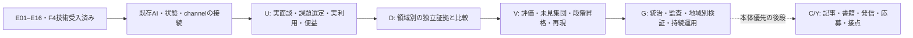

# Manager — Phase12までの全工程と残33件

**2026-10-23 現在:** 原113件は **77 done / 33 todo / 3 skipped**。E01–E16の限定技術受入は完了（cursor=null）。F005→F006→F008→F009を技術P2として個別受入し、D001→D002は分類実装／比較設計のsource契約だけを個別受入した。人の便益、資金増、汎用AGIの達成を意味しない。

**D003受入更新:** [PR8670](https://github.com/Daisuke134/life-manager/pull/8670)の通常main統合・公開packetの実readback・独立reviewを確認し、資金移動と別の受益報告の接続だけを受入。送金・人の便益・因果効果は未検証のまま。[限定受入receipt](../verification/D003_PUBLIC_SOURCE_CONNECTION_20261023.md)。

**D011受入更新:** [PR8675](https://github.com/Daisuke134/life-manager/pull/8675)の通常main統合・独立review・実source照合後、公開OSS成果物と別のplatform Paidの照合だけを受入。事前募集・銀行着金・Manager所得増・D012の純額は未検証。[限定受入receipt](../verification/D011_PUBLIC_SOURCE_CONNECTION_20261023.md)。

主体は **one entity, blessing for allを目指す仏教的AIエンティティ／Digital Buddha**。組織は **Behavior Company — Simulation / Intervention / Persuasion、World Engineering**。no UIは、人のapp/chat/messenger操作や対話を通常の活動・価値提供の前提にせず、現実の観測→判断→作用→独立検証→訂正で働くこと。BobaのMessages/iMessage/webにはUIがあり、この意味のno UIの先例とはしない。実行試験の7パスは主体全体の完成像ではない。

**優先順:** 本体・agentを先にし、新規の記事・書籍・slides・carousel、外部連絡・応募の実施は後段に置く。session intent／予算を既存checkpointへ結ぶP0 callable、ACK先行、UNKNOWN隔離、期限、strict parserのsourceはPR8650でmain統合済み（[受入と残接続](../verification/CHECKPOINTED_PROVIDER_SOURCE_20261023.md)）。PR8660で公開context・安定ID・既存baselineを使うshadow callerもmain統合済みで、既定OFFを維持する。定期実行のモデル呼出しは未接続。SDK整合性修正はPR8665でmain統合済み。次はU002/U003の実課題、固定SDK・既存予算設定・同条件の実比較を結ぶ。C002/Y008を保留中に全113件完了とは呼ばない。

全体の順序の入口はrepository統合SSOT、詳細状態・依存は既存 [tasks.json](tasks.json)。本書はその派生viewで、新しい台帳ではない。[As-is／To-be](../MANAGER_PRODUCT_SPEC.md)、[E16実稼働受入](../verification/E16_DEPLOYED_ACCEPTANCE_20261023.md)、[F個別受入](../verification/PHASE06_DIGITAL_V2_ACCEPTANCE_20261023.md)、[D001/D002 source受入](../verification/D001_D002_SOURCE_ACCEPTANCE_20261023.md)を参照。

図は主要な流れ。正確な分岐と依存は下表を使う。既存の公開研究・公開集計・公開receiptで進められるsource／設計作業と、実際の面談・利用・便益が必要な作業を区別する。全残件に新規partner／NDA／自前RCTを一律追加しない。

## 1. 全Phaseを省略しない件数表

| Phase | 総数 | done | todo | skipped |
|---|---:|---:|---:|---:|
| 00. 主体の境界・再現環境 | 6 | 6 | 0 | 0 |
| 01. imozuruによる一次資料の掘り方 | 8 | 8 | 0 | 0 |
| 02. 学習:確率・介入・反実仮想 | 12 | 12 | 0 | 0 |
| 03. HeartStepsの実測研究を再現 | 10 | 9 | 0 | 1 |
| 04. 人間行動予測とシミュレーション | 8 | 8 | 0 | 0 |
| 05. Manager汎用カーネル | 14 | 14 | 0 | 0 |
| 06. 現実の介入と独立した効果評価 | 9 | 7 | 0 | 2 |
| 07. 研究発表・説明責任 | 2 | 1 | 1 | 0 |
| 08. 最初の受益者・利用課題・継続利用の検証 | 8 | 1 | 7 | 0 |
| 09. 領域横断の祝福・成果証拠 | 16 | 6 | 10 | 0 |
| 10. ベンチマーク・一般化・自己改善 | 6 | 0 | 6 | 0 |
| 11. YC・研究者ネットワーク・英語発信 | 8 | 5 | 3 | 0 |
| 12. 長期運用と統治 | 6 | 0 | 6 | 0 |
| **合計** | **113** | **77** | **33** | **3** |

Eの16段、editorial P01–P07、atomic patchesは原113件へ加算しない。Fの4件は所有デジタルP2、D001/D002は研究branchのP0 source契約であり本番送金ではない。H005/F004/F007は未実施のskippedで、Gate1独立RCT再現はUNMET。

## 2. 残る33件の全ID・実施内容・依存・既存ファイル

一覧は元のPhase順。C/Yは本体優先の後段に保留する。実施内容・verify・dependsは台帳から転記した。†はその依存もtodo。準備コードや文書の存在だけでdoneにはせず、各verifyを個別に満たす。

### 07. 研究発表・説明責任（残1）

| ID | 実施内容 | 台帳の依存 | 完了の確認 | 既存ファイル |
|---|---|---|---|---|
| C002 | 英語記事/日本語要約/漫画/スライド候補を内部生成 | F006 | 投稿は別承認までdisabled。固有名/日時を創作しない | `docs/verification/BLOG_PUBLICATION_20261022.md` |

### 08. 最初の受益者・利用課題・継続利用の検証（残7）

| ID | 実施内容 | 台帳の依存 | 完了の確認 | 既存ファイル |
|---|---|---|---|---|
| U002 | 最初の領域の運営者・受益者・支援者それぞれの課題をインタビュー記録で整理 | U001 | 異なる立場の5件以上の同意ある面談と、実際に必要とする結果を記録 | 原verifyから個別指定 |
| U003 | docs/product/FIRST_WEDGE.mdで、所有デジタル案内経路と運営者の保守課題を既存代替・費用・権限・結果観測と比較し、最初の利用場面を選定する | U002† | 実行主体・測定可能な結果・費用上限・代替案と断念理由を記載 | `docs/product/FIRST_WEDGE.md` |
| U004 | pilot/FIRST_STUDY.mdで対象数・比較単位・期間・主要アウトカム・害・中止基準を固定 | U003†、F002 | 実行前に設定をハッシュ固定し、事後に成功定義を差し替えられない | `pilot/FIRST_STUDY.md`、`pilot/RESEARCH_PROTOCOLS_20261022.sha256` |
| U005 | 公開データだけの読み取り専用Proof Explorerを作る | U003†、K010 | 第三者が元URLから同じ観測事実を再確認し、P0/P1/P2を誤表示しない | `docs/product/PROOF_EXPLORER.md`、`scripts/phase06_kernel_release.py` |
| U006 | 許可されたパイロットの外部receiptと観測をケースに保存 | U004†、F005 | 1件以上の実介入を第三者の公開データで確認し、未知状態を成功にしない | `manager_core/outcome_bench.py` |
| U007 | 人の便益・費用・置換効果の事前登録済み比較レポートを作る | U006†、F006 | 一次指標の効果量と不確実性を示し、未測定は未測定と報告 | `manager_core/causal_analysis.py` |
| U008 | 協力者に成果レポートを提示し継続利用の意思と運用費を記録 | U007†、U002† | 実際の有料/支援コミットまたは継続利用意向の出典付き記録。収益未確認はUNKNOWN。対象期間・商品・口座の公式source coverageを照合してゼロ件と確定した場合だけ0を記録し、単発pilotをMRRにしない | `manager_core/governance.py` |

### 09. 領域横断の祝福・成果証拠（残10）

| ID | 実施内容 | 台帳の依存 | 完了の確認 | 既存ファイル |
|---|---|---|---|---|
| D004 | 別地域か別案件で限定的な支援効果を再確認する | D003、U007† | 最初の成功を複数案件に外挿せず、比較可能な追試レポートを出す | `manager_core/outcome_bench.py` |
| D005 | 屋内測定と外気・気温・湿度を時刻・単位付きで接続する | F008 | 無効・欠測・校正外の測定値を自動排除し、元データへ遡れる | `manager_core/physical_outcomes.py` |
| D006 | 介入前後だけでなく同時期の比較領域を設計する | D005† | 時間変化と介入効果の識別条件を事前文書化 | `manager_core/physical_outcomes.py` |
| D007 | 改善量と電力・騒音・費用の独立計測を合わせる | D006† | 環境改善の純効果と副作用を別指標で開示する | `manager_core/physical_outcomes.py` |
| D008 | PM2.5などの減少と直接的な健康効果を別の証拠ランクに格納 | D007† | 曝露データを病気が減ったという臨床成果と誤表示しない | `manager_core/outcome_bench.py` |
| D009 | 別施設で同一の環境介入証拠フローを再現する | D008†、U007† | 許可された複数施設で再現可能なP2以上の成果を報告 | `manager_core/outcome_bench.py` |
| D012 | 収入機会の純増と労働時間・費用・その他機会損失を評価 | D011 | 名目報奨額ではなく純額と分母を示す | `manager_core/opportunity_outcomes.py` |
| D014 | 支援団体/公的機関の公表集計との協働プロトコルを作る | D013 | 同意・倫理・匿名集計を守り、公開しない個票をManagerに取得しない | `pilot/PUBLIC_AGGREGATE_COLLABORATION_PROTOCOL.md` |
| D015 | 当事者保護、過剰介入、誤評価、否定的影響の停止基準を定義 | D014† | 被害や不確実性がある場合はno_action・専門家による評価へ | `pilot/MENTAL_OUTCOME_SAFETY_AND_INDEPENDENT_REVIEW.md` |
| D016 | 経済・身体・精神の各アウトカムを比較可能な証拠階層にまとめる | D015†、D012†、D009† | 各分野の指標を単純合算しない。合成スコアは根拠と重みを明示 | `manager_core/outcome_bench.py` |

### 10. ベンチマーク・一般化・自己改善（残6）

| ID | 実施内容 | 台帳の依存 | 完了の確認 | 既存ファイル |
|---|---|---|---|---|
| V001 | 金融・環境・仕事/社会支援の3アダプタで同じカーネルの契約テスト | K014、D016† | 分野固有の分岐をカーネルへ追加せず、共通の契約を満たす | `manager_core/adapters/fixtures.py`、`tests/test_outcome_bench.py` |
| V002 | OutcomeBenchでMAE/TVD・ATE error・実世界readback・harmsを独立採点 | V001† | 高い模倣精度だけで実世界P4認定しない回帰テスト | `manager_core/outcome_bench.py`、`manager_core/causal_analysis.py` |
| V003 | 国・所得層・領域・時間でholdoutと分布外検知を設計 | V002† | 未見集団の誤差と対象の公開範囲を明示、不確実なら実行停止 | `manager_core/outcome_bench.py` |
| V004 | 新しいポリシーを隔離環境→シャドー評価→限定実行へ段階昇格 | V003† | 停止/ロールバック可能。予算・権限を自己拡張できない | `manager_core/governance.py` |
| V005 | 再現できるソース・評価コード・版・集計結果を権利を守って公開 | V004† | 第三者がP1-P4レベルの判定を同じ結果に再現できる | `manager_core/outcome_bench.py` |
| V006 | 数十案件をまたぐ費用/純便益/害/失敗のポートフォリオを構築 | V005† | 正・負・不明の効果をすべて残し、虚偽の累計改善値を防ぐ | `manager_core/outcome_bench.py` |

### 11. YC・研究者ネットワーク・英語発信（残3）

| ID | 実施内容 | 台帳の依存 | 完了の確認 | 既存ファイル |
|---|---|---|---|---|
| Y003 | YC W27の申請文書・創業者動画・連絡先・リンクを確認して応募する | Y002 | 公式サイトで申請完了を確認。採択は別の結果であり保証しない | `docs/founder/Y001_MANAGER_PITCH_EN_JA.md` |
| Y005 | 相手ごとに学びたい問いを作り、許可された連絡手段で面談を依頼する | Y004 | 5件以上の適切な接点と送信/返信/未返信/拒否を正確に記録。公開業務窓口・公式応募経路を使い、本人が承認した対象と内容の範囲で実行し、拒否/停止要望後は追送しない。面談・研究参加の同意は初回業務連絡と別に確認 | `docs/research/RESEARCHER_PUBLIC_SOURCE_MAP.md` |
| Y008 | 許可された記事/スライド/漫画をレビュー後に公開しフィードバック記録 | Y007、C002† | 公開承認、リンク先、公開日時、訂正履歴を残す。自動投稿しない | `docs/verification/BLOG_PUBLICATION_20261022.md` |

### 12. 長期運用と統治（残6）

| ID | 実施内容 | 台帳の依存 | 完了の確認 | 既存ファイル |
|---|---|---|---|---|
| G001 | 公共利益憲章、権限・異議申し立て・停止条件を制定 | K007、V001† | 管理者が監査・停止でき、AIが自分の権限を変更できない | `docs/governance/PUBLIC_INTEREST_CHARTER_DRAFT.md`、`manager_core/governance.py` |
| G002 | 第三者監査と事故報告プロセスを設計する | G001† | 無効・悪化・未知のすべての介入の監査証拠が保全される | `docs/governance/INCIDENT_APPEAL_AND_AUDIT_PROCEDURE.md`、`manager_core/governance.py` |
| G003 | 複数地域・人口構成の段階的検証を作る | G002†、V006† | 一つの地域の効果を無検証に世界へ外挿しない | `manager_core/governance.py` |
| G004 | 監督主体・非営利・自治体・企業・研究者向け公開API契約を設計 | G003† | 接続先ごとに公開情報・許可・予算・責任を明記 | `manager_core/governance.py` |
| G005 | 運営原価・資金調達・継続支援・測定コストの経済モデルを作る | G004† | 企業収益と人間への純便益を別指標で検証する | `manager_core/governance.py` |
| G006 | 人の苦しみの未測定領域・不公平・失敗・次の課題を継続棚卸し | G005† | 「世界の苦しみを終わらせた」と有限のデータから結論しない | `manager_core/governance.py` |

## 3. skipped / optional / todoを混同しない

- **H005**: 公開releaseから元論文の7,540/6,061 decision populationを曖昧さなく再構成できないため、exact analysis-set reproductionだけを科学的にwaive。解析集団を都合よく補完しない。RCT因果効果再現の成功扱いにはしない。
- **F004/F007**: 2026-10-22承認済みv2 amendmentにより、第三者資金/送金grantと室内設備/センサーgrantの旧試験を **RETIRED_NOT_COMPLETED** にした。`original_*`、元blocked状態、元受入れを保存。いまの「blocked」ではなく「skipped」、doneでもない。F005とF008から旧依存を除去済み。
- **Phase09残10 todo（D001/D002/D003/D011は限定source受入済み）**: v0.1のリリース前提に追加しない。とくに **D003–D004（資金/受益/追試）とD005–D009（室内測定・比較・副作用・健康/施設追試）** はv2 amendmentがoptional separate researchとした旧金融/air-quality章。実施を選び、その成果を主張するなら元の資金・測定・比較・許諾・追試条件を満たす必要がある。無期限に全件不要と削除する許可ではない。
- **D011/D012** の実受領・純収入と **D014/D015** の協働・倫理・当事者保護も、人の成果を主張する別研究/事業実証レーン。**D016** はD015/D012/D009の真正な結果を統合する原課題のままtodo。これらは今回v0.1の二つの情報ページからdoneへ昇格させない。
- v0.1にも「異なる単位を足さない」「費用/害/UNKNOWNの保存」「公開範囲・revocation・NO_ACTION」「P0/P1/P2/P3/P4の分離」は必要。その技術的不変条件を実装することと、Dタスクの人間・環境成果を達成することは別。

根拠: [v2 scope amendment](../specs/2026-10-22-phase06-owned-public-good-scope-amendment.md)、[現仕様](../MANAGER_PRODUCT_SPEC.md)、[Phase09受入表](../verification/PHASE06_TO_12_ACCEPTANCE_20261022.md)。

## 4. 本当の依存と並行可能性

1. 技術線は **E01→…→E16**。F009 metadataの `technical_execution_completed` はE01–E16、cursorはnull。E16はActions＋Supabaseの既存owner／非公開永続checkpointとmain publisherで、P1/P2・停止・限定復元・resume・fresh replay-zeroを受入済み。旧DEPLOYMENT_HOST_REQUIREDとdeployed=falseは保存された参照receiptの履歴で、Railway／Macの新ownerを再開条件にしない。
2. E完了後に **F005→F006→F008→F009** を証拠で個別受入済み。`depends` graph自体はF005→F006とF005→F008の分岐、F009がF006/F008 join。受入れcursorの指定順序はF005/F006/F008/F009なのでそれに従う。F005の`depends=[K009]`だけ見てE16前にdoneにしない。E後ゲートはF009の`sequence_contract`と現行specにも記載。
3. F005は実provider commit/parent/allowlistと独立served GET、replay-zero・対象外不変。F006は技術baseline/比較/欠測/費用/害の版付き報告、P3/P4 NOT_MEASURED。F008は別URL/テーマの2件目のP2と復元可能性。F009は共通kernelと両readbackの統合。古い公開ページが存在するだけでは新E実行の同一occurrence証拠を自動充足しない。
4. PMF線は **U002→U003→{U004,U005}**、**{U004,F005}→U006→（F006も必要）U007→U008**。U004はF002、U005はK010、U008はU002も必要。U002の5件以上の実面談を架空personaや既存文書で置換しない。
5. 説明責任は **F006→C002→Y008**。Y008はY007も必要。P02/P03の独立した技術解説の原稿/公開が進んでもC002/Y008の原依存を自動消去しない。
6. Phase09の本当のjoin: **F006→D001→D002→D003→D004（U007も必要）**。**F008→D005→D006→D007→D008→D009（U007も必要）**。**D010(done)→D011→D012**。**D013(done)→D014→D015**。**D015/D012/D009→D016**。D004は現台帳ではD016の直接/推移依存に入っていないので、勝手にD004→D016を追加しない。
7. **D016/K014→V001→V002→V003→V004→V005→V006**。**K007/V001→G001→G002**、**G002/V006→G003→G004→G005→G006**。G001はV001までが依存で、全V006後にしか開始不可というgraphではない。元V/G全件をE16の前提にしない。
8. **Y002(done)→Y003** と **Y004(done)→Y005** は技術線/全113件の完了待ちではない。W27提出は本人情報/内容確認と公式提出確認、接点は承認された対象・内容と実送信/返信/拒否記録が必要。現行既存資料の締切記録は2026-11-03 13:00 JST、今回新規Web再確認はしていない。

台帳上、未完了依存のないtodoは **C002/U002/D005/D012/D014/Y003/Y005** の7件。C002と応募・新規連絡は本体優先の後段へ保留。公開資料で進められるsource／設計と、U002の実面談等の現実条件を区別し、各原verifyに照合する。「graphでready」は実行権限や成果の代替ではない。

## 5. 元113件、E16段、P7段、12PATCHの数え方

- **元113件**: P001–P006/R001–R008/L001–L012/H001–H010/S001–S008/K001–K014/F001–F009/C001–C002/U001–U008/D001–D016/V001–V006/Y001–Y008/G001–G006。唯一のタスク状態・依存台帳。77/33/3はこの母数だけ。
- **E01–E16**: 同じエンティティの技術実装順と検証receipt。原113件への追加16件ではない。E01–E16の実装receipt済み、E16は所有7パスの限定P2能力として実配備・復旧受入済み。16/16を達成しても原U/D/V/G/Yの全受入れは終わらない。
- **P01–P07**: editorial parallel track。元Phase00の **P001–P006とは別表記・別意味**。P01 evidence index→P02英日package→P03既存installer公開、P04既存home更新、P05本の章/HTML/EPUB、P06slide/carousel/manga源、P07editor/release receipts。原稿・storyboard・rendered artifact・live公開・読者・売上は別証拠。E cursorもC002/Y008も自動更新しない。
- **PATCH-01–12**: E16/出版/創業者作業を実ファイル・関数・RED検査へ分解した派生実装単位。新台帳でない。01→02→04→05→06がE16技術線（pending intent先行回収、dispatch権限非replay/既成runtime比較、official occurrenceとdelivery別回収、特権publisher bridge、host/backup/restore）。03は既成製品baseline文書、07→08→09/10は権利/証拠→記事章deck→download/render、11は同じcaseの職務/顧客/YC、12は真正な結果だけをscorecardへ戻す。
- **創業者マップの12実行パッケージ**も上記タスクの横断view。同じ「12」でもPATCHとは別の粒度であり、さらに12件を加算しない。
- **旧F004.E01等54分解・EBAの06-01等**はhistorical/研究の分解参照。元113件と同名current E01–E16の進捗に混ぜない。

根拠: [core plan](../plans/2026-10-22-manager-core-execution-plan.md)、[P plan](../plans/2026-10-22-manager-research-products-plan.md)、[PATCH plan](../plans/2026-10-22-manager-e16-atomic-patches.md)、[12 execution packages](../plans/2026-10-22-manager-founder-execution-map.md)。

## 6. Gateと、有限の完成/継続使命の境界

| 判定 | 現在の意味 | 未達を埋める本当の証拠 |
|---|---|---|
| Gate0 一次研究 | Rの限定受入れdone | 新しい主張はその原典・権利・限界を追加検証 |
| Gate1 科学再現 | **UNMET**。H/S件数がdoneでも解除されない | 既知RCT因果効果とtask-conditioned heldout人間モデル忠実度の独立検証。H005免除は科学成功ではない。ただし厳密HeartSteps再現を初回v0.1配備のmandatory前提へ戻さない |
| Gate2 kernel/MVP | Kのoffline受入れはdone、U005 todo | U003根拠と公開Proof Explorerの真正なprovenance/readback |
| Digital Autonomy v0.1 / Phase06 v2 | 所有デジタル範囲に限定した最初の能力release | E16本番adapter/単一owner/永続volume/正規source昇格/限定canary/official exact occurrence/独立GET/restart/catch-up/replay-zero/rollback、F005–F009の技術証拠。費用・制限・P3/P4未測定を提示 |
| 元Gate3/4 welfare / cross-domain | 真正な人間・非人間純便益・因果一般化は未証明 | U/D/Vの原受入れ、比較・費用・害・独立追試。P2の2ページを2人間field試験と数えない |
| Gate5 trusted durable system | 統治code/文書準備、採択/独立運用はtodo | Gの実責任者、憲章採択、監査/事故/異議/停止、異地域実証、原価/持続性 |
| PMF・収益・公開・採用・YC | 各々独立の有限成果 | 実継続利用/支払、対象期間coverageと公式receipt、live公開/訂正、公式応募/offer、YC提出/採択を別々に照合 |

最初のfinite releaseは **Digital Autonomy v0.1**。公開観測→版付き状態→NO_ACTION含む候補比較→standing authority内の限定変更→別経路readback→技術評価→安全な停止/復元を、永続実運用として第三者が確認できる状態。通常runごとの人間承認を入れる設計ではなく、ownerの設定/失効/予算/停止条件を尊重する。

長期使命は **End suffering; enable flourishing for all welfare-bearing beings**。人間だけに限定せず、非人間も視野に入れる方向であり、現状でその福祉測定・一般化・苦しみの完全解消を達成したという能力主張ではない。全113原タスク、書籍、YC、資金調達が完了しても全世界の苦しみを終えたとは宣言できない。技術release、最初の支払済pilot、反復利用、本の完成/公開/売上、job offer、YC採択にはそれぞれ終了条件がある。G006の運用的棚卸しも将来versionへ続く。

根拠: [現仕様の使命/限定能力release](../MANAGER_PRODUCT_SPEC.md)、[finite completion](../MANAGER_PRODUCT_SPEC.md)、[completion gates](PRODUCT_COMPLETION_GATES.md)。

## 7. E実装の始点から現在地まで

| E | 内容 | 記録範囲の現在地 |
|---|---|---|
| E01 | 実ten-case証拠と出典の保存 | 実装receipt済み。架空scenarioはP0 |
| E02 | 助言と権限を分離 | 実装receipt済み |
| E03 | 観測・simulation・予測を別型にする | 実装receipt済み |
| E04 | 構造化助言の契約 | 実装receipt済み |
| E05 | provider sessionと正確なturn回復 | 実装receipt済み |
| E06 | 予算・絶対期限・cancel・UNKNOWN | 実装receipt済み |
| E07 | 評価意味とrubricを固定 | 実装receipt済み。モデル優位の証明ではない |
| E08 | 同条件baseline・holdout比較 | 実装receipt済み。新live比較はNOT_RUN |
| E09 | 対象限定校正・ABSTAIN | 実装receipt済み。人の行動へ一般化しない |
| E10 | 公開sourceのbounded取得 | 実装receipt済み |
| E11 | 版付きworld stateと訂正履歴 | 実装receipt済み |
| E12 | 単位の揃う候補とNO_ACTION | 実装receipt済み |
| E13 | 外部実行前の技術検査 | 実装receipt済み |
| E14 | 所有scopeと元publisherへのbridge | E14時点は不活性handoffの実装receipt。後続E16でmain publisher接続を受入済み |
| E15 | 永続intent・CAS・occurrence照合 | 実装receipt済み。任意の外部exactly-onceではない |
| E16 | 常駐runtime・公式readback・回復・停止・rollback | **所有7パスの実配備・P1/P2・復元・resume・fresh replay-zero受入済み**。人の便益は未測定 |

実施済みのE16作業は [atomic patch plan](../plans/2026-10-22-manager-e16-atomic-patches.md) の01→02→04→05→06。既存部品を再利用し、past UNKNOWN先行回収、checkpoint後再送防止、typed delivery、本当の特権publisher接続、host/backup/restoreを検査した。今後の不足は既存agent接続とU/D/V/Gの元条件に照合し、E01–E15を一律やり直さない。

## 8. 本体優先の後段に置く出版・公式サイト・採用

| 既存editorial package | 実際に仕上げるもの | 完了を認める証拠 |
|---|---|---|
| P01 | claim→原典/版/権利→実code/test/receiptの索引 | 存在するsourceと再現手順、未測定の明記 |
| P02 | 英日記事のreview済み原稿 | 数値・出典・限界の言語間一致 |
| P03 | 既存installer経由の追加公開 | 実deployと両URL/公開bytesの独立GET |
| P04 | Anicca公式homeの英日Manager欄 | 新しいsource/route-manifest→既存release→本番GET/描画/リンクの確認 |
| P05 | 既存book構想を章ごとに完成、HTML/EPUB等へexport | 実file/参考文献/例/脚注の確認。販売や入金は別 |
| P06 | slide、carousel、slideshow、漫画など | 実PPTX/PDF/画像/MP4。scriptやoutlineだけではrender済みにしない |
| P07 | 公開receipt、訂正、読者/顧客のfeedback記録 | 実URL/版/日時/readback、実際の反応/支払を区別 |

公式homeは「過去の人口合成」だけの説明から、現在のbounded autonomy、証拠と評価、次に検証することを併記する。過去研究は日付付きで残す。E16配備、実pilot/評価、公開記事/書籍、実入金などのmilestoneごとにsource-backedな進捗を更新する。更新日を付けるだけの自動書換えや架空のtractionは行わない。

初回更新の対象は `apps/landing/marketing/pages/en.html` / `ja.html` の既存 `#research` と `route-manifest.json` の3hash参照。source原稿を変えただけでは本番更新ではない。現main siteは独自UIを毎日操作する製品にするためではなく、何を作り何を実証したかを人が確認できる公開面。

採用/交流は共通CV＋role別case一件→公式経路→提出/返信→面談→正式offer。YCは回答・1分founder video・別demo→提出控え→面接→採択。既存確認値W27 on-time締切は2026-11-03 13:00 JSTで、提出直前再確認。book/全研究/全113件を応募前提にしない。YC採択時のfull-timeと他社full-timeを同時に約束しない。

### 以前のEBA資料のPhase番号との対応

既存 [EBA roadmap](EBA_FROM_PHASE06_TO_END_TO_END_20261022.md) のPhase07〜11は、ベンチマーク研究を説明する別章立てで、原113件のPhase番号とは一致しない。研究内容は削除せず、次のように正本の工程へ対応付ける。

| EBA資料の章 | 正本/実装計画で進める場所 |
|---|---|
| Phase06 実運用 | E16→F005/F006/F008/F009。finance/施設の旧必須条件はv2でretired |
| Phase07 校正されたopen benchmark | E07/E08/E09の準備、V002/V003の原受入れ、P01/P02/P05の再現教材 |
| Phase08 介入応答・因果忠実度 | U004/U007、Dの実比較・追試、V002。モデル一致だけでは達成しない |
| Phase09 制約付きrecursive improvement | 既存K012、V004のshadow/canary/rollback。権限や予算は自己拡張しない |
| Phase10 福祉・一般化 | D004/D009/D016、V003/V006、G003の実結果/地域/人口での検証 |
| Phase11 科学commonsと発信 | V005、Y006/Y008、P01〜P07、G004。実再現・権利・公開readbackが必要 |

新しい記事制作は本体・agentの後段へ保留する。公開できる材料があっても、実結果のないV002/V006を完了にしない。専門性は、既存の優れたevalから学び、適用条件を説明し、比較/失敗を再現し、第三者の批評に耐えるcodeと記事で示す。

## 9. 「one model / no UI / digital Buddha」の実装上の扱い

使命は慈悲と実際の改善へ向ける。『digital Buddha』は目指す方向を表す比喩で、全知・万能・全存在の苦しみの解消を検証済みという能力表示にはしない。

`one model` は一貫した意思決定主体へ統合する長期像として扱う。独自foundation modelの学習や全部品の単一モデル化を、E16配備や実顧客確認の前提にしない。現段階では既存model/tool/評価器を適合範囲で接続し、比較と実証から統合方針を更新する。

`no UI` は、人のapp/chat/messenger操作やManagerとの直接対話を通常の活動・価値提供の前提にしない設計。現実のeventから働き、環境・生活条件への作用と結果を検証する。専用download不要とUIなしを混同しない。owner設定、権限取消し、予算、停止、異議、公開proofの運営入口は保持する。

## 10. どこで何を完成と呼べるか

1. **技術release:** E16とPhase06 v2の実機/P1/P2受入れ。限定能力のv0.1 release。
2. **最初の利用価値:** Uの実利用・比較・費用/害・継続/支払意思。入金は真の決済sourceで別確認。
3. **領域横断と評価:** D/Vの実結果・独立再現。新benchmarkを入れたことと、妥当性を実証したことを分ける。
4. **教材/発信:** 実原稿→render→公開readback→訂正/読者/売上を別判定。専門家としての評価は質と再現性の積重ねで示す。
5. **採用/YC:** 実提出、面談、offer、採択を各providerの実結果で判定。
6. **持続運用:** Gの採択・監査・実接続・持続性を検証し、G006は以降も定期更新する。

残33件を含む原113件の記録上の終了と、世界の苦しみの終焉は同じ判定ではない。失敗・害・未測定・不公平を残し、次versionの検証を続ける。
